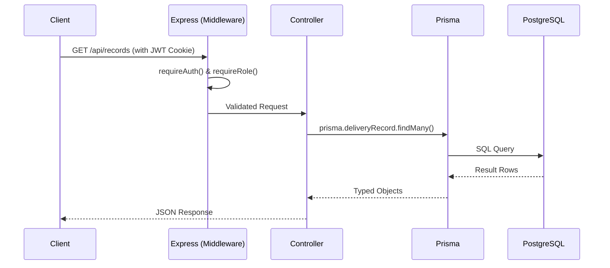
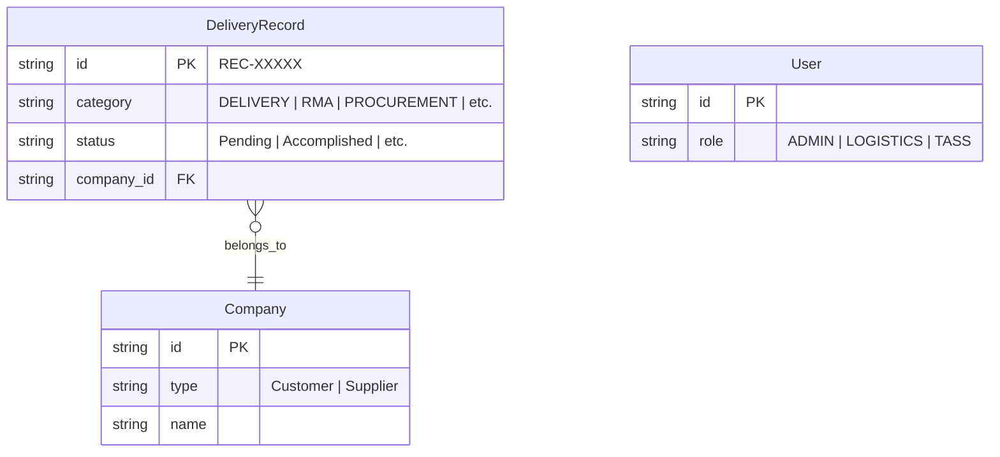

# System Architecture: Microgenesis Supply Chain Portal

This document outlines the high-level architecture of the Supply Chain Portal, a full-stack monorepo designed for logistics, sales, and administrative tracking.

## 1. High-Level System Overview (C4 Context)

The system is split into a **Client** (React SPA) and a **Server** (Express REST API) connected to a PostgreSQL database.

```mermaid
flowchart TD
    User([End User\nSales / Logistics / Admin])
    
    subgraph "Supply Chain Portal (Monorepo)"
        Client[React Frontend\nVite + Tailwind]
        Server[Express Backend\nNode.js + REST API]
        DB[(PostgreSQL\nvia Prisma ORM)]
    end
    
    Email[Terminal/SMTP\nEmail Service]

    User -->|Views / Interacts| Client
    Client -->|HTTP / JSON (JWT Auth)| Server
    Server -->|Read / Write| DB
    Server -->|Sends Notifications| Email
```

## 2. Frontend Architecture (`/client`)

The frontend is a strictly modular React Single Page Application (SPA). It uses role-based access control (RBAC) to render views dynamically based on the current user's role (`SALES_COORDINATOR`, `LOGISTICS`, `TASS`, `ADMIN`, `DRIVER`).

**Key Technologies:**
*   **Framework:** React 19 + TypeScript
*   **Build Tool:** Vite
*   **Styling:** Tailwind CSS + Lucide Icons
*   **Data Vis:** Recharts (for the Dashboard)

```mermaid
flowchart LR
    App[App.tsx\n(Core Router & Auth State)]
    
    subgraph Views
        Dashboard[DashboardView]
        Delivery[DeliveryRecordsView]
        Admin[AdminPanel]
        Others[...]
    end
    
    App -->|Role-Based Render| Views
    Views -->|Fetch Data| API[api.ts\n(API Client Wrapper)]
```

*Note on Permissions:* The frontend hides UI elements based on roles (`DEFAULT_ROLE_SCOPE`), but this is **only visual**. Real security is enforced on the backend.

## 3. Backend Architecture (`/server`)

The backend is a Node.js Express server that serves as the singular source of truth. It exposes a REST API secured by JWT tokens. 

**Key Technologies:**
*   **Framework:** Express + TypeScript
*   **Validation:** Zod (Strict schema validation)
*   **ORM:** Prisma (PostgreSQL)
*   **Auth:** JWT & Bcrypt
*   **Documentation:** Swagger / OpenAPI



## 4. Database Schema (Single Table Design)

A critical architectural decision in this system is the **Single Table Design** for all operational records. 

Instead of having separate tables for `Deliveries`, `RMA`, `Sales Orders`, `Procurement`, and `Accounting`, **they all live in a single `DeliveryRecord` table.** 



## 5. Deployment & Infrastructure

The application uses `render.yaml` for infrastructure-as-code deployment.

*   **Continuous Deployment:** Every push triggers a build.
*   **Migrations:** Prisma migrations (`prisma migrate deploy`) run automatically on every deploy.
*   **Seeding:** Currently, the `seed.ts` script runs on every deployment to ensure demo data is populated. *(Note: This must be removed before production use with real data).*
*   **Emails:** Email notifications (Output Actions) are currently mocked and printed to the terminal unless standard `SMTP_*` environment variables are provided.
