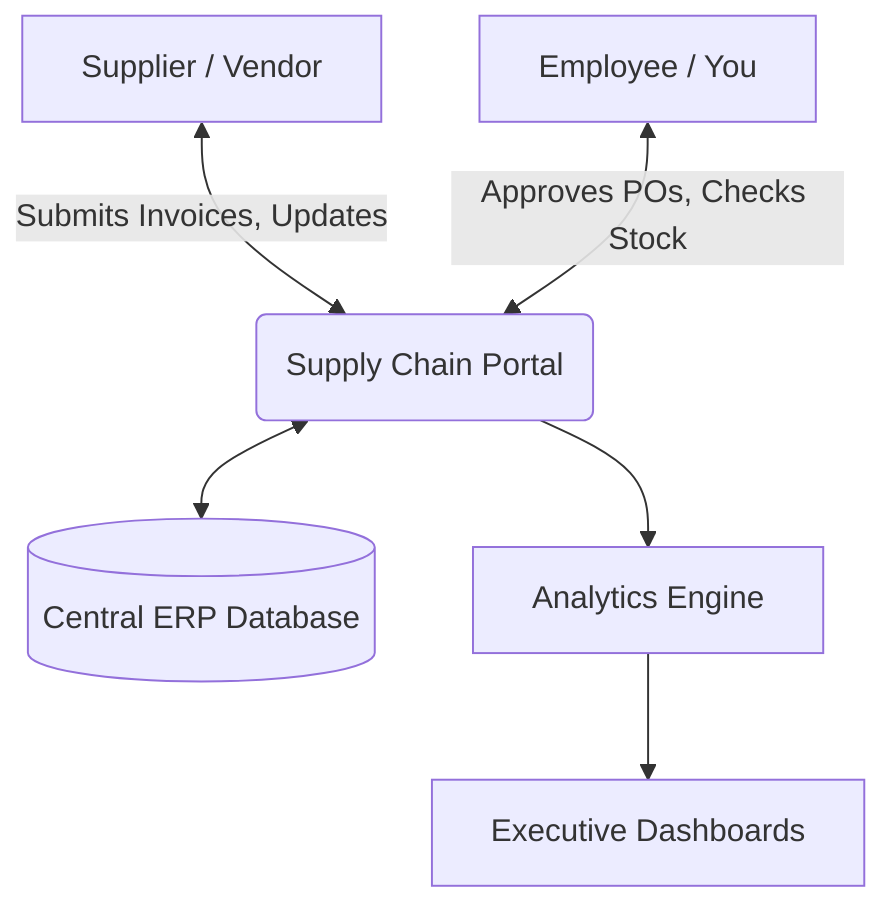
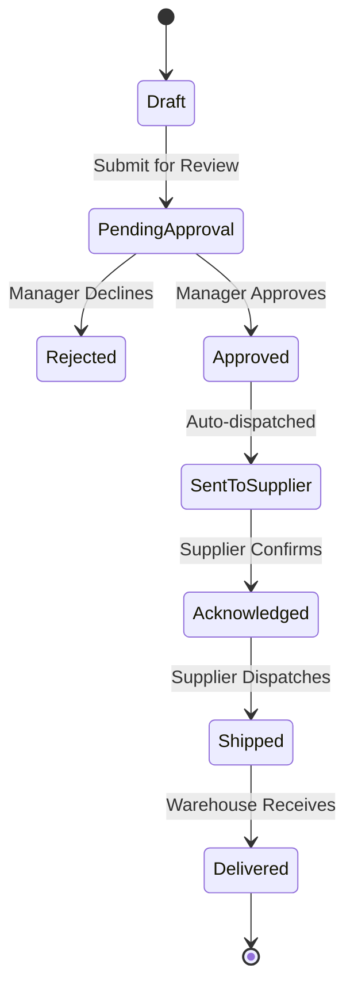

# Supply Chain Portal: Comprehensive Employee Manual

> [!IMPORTANT]
> This portal handles highly sensitive corporate and supplier data. Ensure your VPN is active, you are using a managed corporate device, and your 2FA token is ready before logging in. Never share your credentials.

## 1. Introduction: What is the Supply Chain Portal?

The Supply Chain Portal is our enterprise-grade, centralized platform designed to unify our entire procurement, logistics, and vendor management lifecycle. 

Instead of relying on fragmented spreadsheets and email threads, this portal provides a single source of truth. By using this system, you are helping the company reduce stockouts, improve supplier relationships, and accelerate order fulfillment.

### 1.1 System architecture overview

To understand how data flows through our system, review the high-level architecture below:

---

## 2. Getting started

### 2.1 First-time access and login

Before accessing the portal, ensure IT has provisioned your account with the correct Role-Based Access Control (RBAC) profile (e.g., Inventory Analyst, Procurement Manager).

1. Connect to the **Global Corporate VPN**.
2. Open Google Chrome or Microsoft Edge and navigate to `https://portal.supplychain.internal`.
3. You will be redirected to the corporate Single Sign-On (SSO) page.
4. Enter your corporate email and password.
5. Approve the login request via your mobile Authenticator app.

### 2.2 Navigating the dashboard

Upon logging in, you will land on the **Command Center Dashboard**. The layout is divided into three main areas:
*   **Left Sidebar:** Your main navigation menu containing modules like Inventory, Orders, Suppliers, and Reports.
*   **Top Bar:** Contains the global search bar, your notification bell (alerts for low stock or pending approvals), and your profile settings.
*   **Main Content Area:** Displays key metrics, widgets, and actionable tasks tailored to your role.

---

## 3. Module: Inventory management

The Inventory module is where you monitor stock levels across all global distribution centers.

### 3.1 Checking real-time stock levels

To locate specific items and view their current status:

1. Click on **Inventory** in the left sidebar, then select **Stock Directory**.
2. Use the **Global Search** at the top of the table. You can search by:
    *   SKU (e.g., `SKU-99823`)
    *   Product Name (e.g., `Industrial Bearings`)
    *   Category (e.g., `Raw Materials`)
3. Click on a product row to open the **Item Detail View**. This view shows:
    *   Current quantity on hand.
    *   Quantity currently in transit.
    *   Historical usage trends.

### 3.2 Configuring low-stock alerts

Setting up automated thresholds ensures we never run out of critical components.

1. Navigate to **Inventory > Threshold Settings**.
2. Search for the required SKU and click the **Edit** (pencil) icon.
3. Set the **Minimum Warning Level** (triggers a yellow alert).
4. Set the **Critical Reorder Level** (triggers a red alert and auto-generates a draft PO).
5. Click **Save Configuration**.

---

## 4. Module: Order processing (Procurement)

This module handles the lifecycle of Purchase Orders (POs) from draft to fulfillment.

### 4.1 The Purchase Order (PO) lifecycle

Understanding the lifecycle of a PO is critical for procurement staff.

### 4.2 Approving Purchase Orders

If you hold a Manager or Director role, you must approve POs before they are sent to vendors.

1. Go to **Orders > Pending Approvals**. (You will also see a badge on the notification bell).
2. Click on a PO Number (e.g., `PO-2026-8891`) to view the complete dossier.
3. **Verification Steps:**
    *   Verify the line items match the requested requisition.
    *   Check that the total cost aligns with the quarterly budget.
    *   Ensure the requested delivery date is feasible.
4. Add any internal notes in the **Comments** section.
5. Click the green **Approve** button to authorize, or the red **Reject** button (you must provide a rejection reason).

### 4.3 Tracking inbound shipments

1. Navigate to **Logistics > Inbound Tracker**.
2. Enter the PO number or the Carrier Tracking ID.
3. The interface will display a live map and a chronological timeline of scanning events (e.g., *Customs Cleared*, *Out for Delivery*).

---

## 5. Module: Supplier management

Maintaining clear communication and tracking supplier performance is vital.

### 5.1 Communicating with suppliers

> [!WARNING]
> Do not use external email to discuss active orders. All communication must happen within the portal to maintain a legally compliant audit trail.

1. Open the specific Purchase Order or Supplier Profile.
2. Navigate to the **Secure Messaging** tab.
3. Type your message. You can attach PDFs or Excel files up to 10MB.
4. Click **Send**. The portal routes this to the supplier's external portal interface, and their replies will appear seamlessly in this thread.

### 5.2 Viewing supplier performance scorecards

We evaluate vendors based on on-time delivery and defect rates.

1. Go to **Suppliers > Scorecards**.
2. Select a vendor from the dropdown list.
3. Review their quarterly grades (A through F) to make informed purchasing decisions.

---

## 6. Support, troubleshooting & FAQs

If you experience friction while using the portal, consult this guide before escalating.

### Common issues

*   **"Error 403: Access Denied" when clicking a link:** 
    *   *Cause:* Your RBAC profile does not have permissions for that module.
    *   *Solution:* Request a permission upgrade from your department head via the internal IT ticketing system.
*   **The portal is extremely slow or showing "Network Timeout":**
    *   *Cause:* Your VPN connection may have dropped or become unstable.
    *   *Solution:* Disconnect and reconnect your Global VPN client, then refresh the page (F5).
*   **A supplier claims they didn't receive a PO:**
    *   *Solution:* Check the PO status. If it says *Approved* but not *SentToSupplier*, there may be a system queue delay. If it says *SentToSupplier*, ask the vendor to check their spam filter or log into their side of the portal.

### Escalation path

If this manual does not resolve your issue:
1. Take a full-screen screenshot of the error.
2. Note the exact time the error occurred.
3. Open a High Priority ticket at `https://helpdesk.internal`.
4. Attach your screenshots and a description of the actions you were performing.
