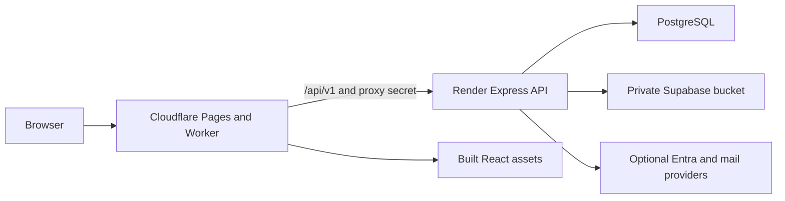

# Deployment runbook

Reviewed: **2026-11-04** against application revision **`1f46bfb`**.

This is the primary deployment guide for the Supply Chain portal. It brings together the frontend, API, database, attachment storage, authentication, release validation and rollback steps. Commands below describe operator actions; this documentation update did not deploy services, apply migrations, provision accounts or change hosted settings. Provider dashboards and the currently deployed release have not been inspected.

The current API prefix is **`/api/v1`**. Unversioned `/api` requests have no compatibility alias. Frontend pages retain URLs such as `/dashboard`, `/deliveries` and `/admin`.

## 1. Deployment layout



| Component | Repository configuration | Deployment target |
| --- | --- | --- |
| Frontend | `client/`, `client/vite.config.ts` | Cloudflare Pages Advanced Mode is the documented primary path |
| Pages request handler | `worker.js`, byte-identical `client/public/_worker.js` | Vite copies the mirror to `client/dist/_worker.js`; Pages supplies `ASSETS` |
| API | `server/`, `render.yaml` | Render Node web service |
| Database | `server/prisma/schema.prisma`, committed migrations | PostgreSQL dedicated to the intended environment |
| Attachments | `server/src/services/podStorage.ts` | Private Supabase Storage for hosted staging/production; approved persistent local disk is an alternative |
| Separate frontend option | Root and client `wrangler.json` | Worker with static assets; requires separate configuration review in section 6 |

The repository convention is `dev` for development, `staging` for reviewed UAT promotion and `main` for production/release. Verify each provider's connected repository and deployment branch; repository conventions do not prove those hosted settings. Use the same approved application commit for the API, frontend and Worker.

## 2. Release prerequisites

Use a clean checkout of the approved release and record its commit, environment, frontend/API origins, database identity, storage target and previous working release. Staging must have separate database/storage resources and secrets from production. A database name or environment label alone does not establish isolation.

Choose and pin a supported Node.js LTS version for the release's builds and API runtime, then validate the application on that version. The current CI workflow pins **Node 20**, which is EOL as of this review; it is an existing runtime-validation gap, not a supported deployment recommendation. Review the [official Node release table](https://nodejs.org/en/about/previous-releases). Updating runtime pins and CI is a separately tested change; this runbook does not claim that validation has happened.

Before changing a shared database, obtain a current backup and a reviewed restore procedure, inspect the pending migrations, and test them on an appropriate disposable target. Include attachment storage in the recovery plan. Do not use `prisma migrate reset`, `db:reset`, `db:clean`, `prisma db push` or demo seeds as a deployment step.

Arrange initial Admin/account provisioning through the release owner's reviewed process before first launch. The repository's local demo account/seed commands are not a production bootstrap procedure. Do not deploy known demo credentials or assume an empty migrated database contains an Admin.

For an existing environment, retain its verified `PERMISSION_MODE`. The default is `LEGACY`. Use `V1` only with initialized role policies, verified account conversion and the completed rollout checks in [GH-249](GH-249-permission-rollout.md). The `/api/v1` URL prefix does **not** activate V1 permissions. Local provisioning scripts are not a hosted rollout shortcut.

## 3. Configure each environment layer

Put secrets in the relevant provider's secret/environment settings, never in committed files or `VITE_*` variables. The root `.env` belongs to local Docker PostgreSQL. The API uses plain dotenv from its working directory, normally `server/`; it does not automatically load `.env.staging`. Vite reads build configuration from `client/`.

### API runtime on Render

Use [server/.env.staging.example](../server/.env.staging.example) as the hosted staging template and [server/.env.example](../server/.env.example) as the settings reference. Replace placeholders privately.

| Setting | Required deployment value or purpose |
| --- | --- |
| `NODE_ENV` | `production` for hosted staging and production; enables secure cookies and requires a signing secret |
| `APP_ENV` | `staging` on staging; keep consistent with the intended target and the guarded operational tools |
| `DATABASE_URL` | Exact reviewed PostgreSQL connection; include provider-required TLS options; keep credentials server-only |
| `JWT_SECRET` | Long random environment-specific secret; never use the template value; rotation invalidates existing sessions |
| `PORT` | Render service port; the blueprint sets `4000` |
| `CLIENT_ORIGIN` | Exact frontend HTTPS origin, for example `https://portal.example.com`, without `/api/v1` |
| `APP_URL` | Same clean frontend HTTPS origin for Microsoft redirects; no path/query/fragment |
| `TRUSTED_ORIGINS` | Additional explicitly approved frontend origins only; do not allow every preview origin |
| `POD_STORAGE_PROVIDER` | Explicit `supabase` for private hosted storage, or reviewed `local` with a persistent disk |
| `SUPABASE_URL`, `SUPABASE_SERVICE_ROLE_KEY`, `SUPABASE_STORAGE_BUCKET` | Storage project, server-only key and private bucket when using Supabase |
| `POD_UPLOAD_DIR` | Used for `local` storage; must point inside the mounted persistent disk |
| `PROXY_SHARED_SECRET` | Same private value on API and Cloudflare runtime |
| `REQUIRE_PROXY_SECRET` | Enable `true` after verifying the proxy, as described in section 7 |
| `TRUST_PROXY` | Verified proxy hop count only for another proxy path without the Worker secret; do not guess |
| `RENDER_EXTERNAL_URL` | API origin, without `/api/v1`, if using the existing self-ping |
| `PERMISSION_MODE` | Preserve the verified mode; do not switch as part of the URL migration |
| `LOCAL_DESTRUCTIVE_SEED` | Keep `false` on hosted environments |

`render.yaml` currently supplies only part of this configuration. In particular, it does **not** set `POD_STORAGE_PROVIDER`, `APP_URL`, Worker secrets or an HTTP `healthCheckPath`. Set and verify these in the appropriate hosted settings before treating the service as ready. An unset storage provider currently defaults to local disk with a production warning; it does not stop startup. Do not infer hosted values from the blueprint.

### Frontend build on Cloudflare

Use [client/.env.staging.example](../client/.env.staging.example) for staging builds. Set `VITE_SHOW_DEMO_ACCOUNTS=false`. Production and staging builds hide demo login controls and Data Sampler; backend flags cannot modify already-built frontend assets. Hiding demo controls does not deactivate demo accounts.

Keep browser API calls same-origin through the Worker. Do not set `VITE_API_BASE_URL` for this model. Never place database URLs, signing keys, Microsoft secrets or storage service keys in frontend variables.

### Cloudflare runtime

| Setting | Value |
| --- | --- |
| `API_BASE_URL` | Intended API origin, such as `https://supply-chain-api.example.com`; do not append `/api/v1` |
| `PROXY_SHARED_SECRET` | Same secret as the API runtime |
| `ASSETS` | Pages' asset binding; the separate Wrangler model declares it in configuration |

Set runtime settings separately for every deployed environment. A preview pointing at a production API shares its data and storage even if the frontend looks like staging.

## 4. Prepare PostgreSQL and attachment storage

Use the database provider's reviewed connection settings. Before deployment, verify reachability from the API host, the intended host/database/schema, existing migration history and the recovery plan. Apply only committed migrations to the authorized target. The Render start command in section 5 performs `prisma migrate deploy`; do not add a destructive reset when it fails.

For Supabase Storage, create or verify a **private** bucket and set the corresponding API runtime variables. Public buckets bypass the application's authenticated download boundary and are unsuitable for these attachments. Configure bucket size and MIME restrictions to support the application's accepted files. Supabase supports bucket-level [upload restrictions](https://supabase.com/docs/guides/storage/buckets/creating-buckets#restricting-uploads).

The current application accepts PDF, JPG/JPEG, PNG, DOCX and XLSX, up to **10 MiB per file**, with **10 attachments / 50 MiB per record**. Use the MIME list in [attachmentRules.ts](../server/src/services/attachmentRules.ts); legacy DOC is not an accepted new upload. The API validates content and serves files through `/api/v1/records/:id/attachments/...`; do not replace these with public bucket links.

If an operator chooses `POD_STORAGE_PROVIDER=local`, the blueprint mounts `/data` and sets `POD_UPLOAD_DIR=/data/uploads/pod`. Confirm the actual disk exists, survives redeploys and is writable. Merely setting the directory does not create persistent storage.

Attachment deletion jobs are bound to their storage target. Before changing provider, bucket or directory, follow [attachment deletion cleanup](STAGING_CONFIGURATION.md#attachment-deletion-cleanup) and drain the old target's pending jobs. Do not assume changing environment settings migrates files or redirects old cleanup jobs.

Seed preparation is a separate optional operation. For an explicitly approved staging dataset, follow [staging-seed.md](staging-seed.md); its preview/apply/reset safeguards remain applicable. Deployment must not run a seed automatically.

## 5. Build and deploy the Render API

Use the approved repository/release commit in a Render Node web service. The checked-in [render.yaml](../render.yaml) specifies:

| Setting | Repository value |
| --- | --- |
| Root directory | `server` |
| Build command | `npm install --include=dev && npx prisma generate && npm run build` |
| Start command | `npx prisma migrate deploy && npm run start` |
| API start script | `node dist/src/index.js` |
| Port | `4000` in the blueprint |
| Persistent disk | `/data`, if using the blueprint's disk configuration |

Keep build-time development dependencies available: TypeScript and the Prisma CLI are required. Confirm that the selected provider root, workspace installation and logs correspond to this repository. Render supports project-specific build/start commands; see [its Express deployment guide](https://render.com/docs/deploy-node-express-app).

Configure the service's **HTTP health-check path** to `/api/v1/health`. It checks database connectivity and required environment presence; it does not verify bucket persistence, active permission mode or mail delivery. The current blueprint has no `healthCheckPath`, so a dashboard/operator setting is needed unless a separately reviewed blueprint change adds it. Render documents the [HTTP health-check setting](https://render.com/docs/health-checks#setup).

Deploy through the approved release process. Check that Prisma reports the expected committed migrations and that startup succeeds. If a migration fails, stop release promotion, inspect the failure and use the reviewed migration recovery process. Do not remove `migrate deploy` from the start command to hide a missing-table error.

A missing `client/dist` warning is expected for an API-only Render deployment whose frontend is on Pages. The API must still start and answer health/API requests; do not interpret that warning as proof that the frontend was deployed.

## 6. Build and deploy the Cloudflare frontend

### Primary path: Pages Advanced Mode

Use these settings for the selected Pages project and verify its linked branch/release commit:

| Setting | Value |
| --- | --- |
| Project root | `client` |
| Production build command | `npm run build` |
| Staging build command | `npm run build -- --mode staging` |
| Output directory | `dist` |
| Advanced Mode handler | `_worker.js` in the output directory |

The canonical Worker is [worker.js](../worker.js), mirrored byte-for-byte at [client/public/_worker.js](../client/public/_worker.js). Vite places the mirror in `client/dist/_worker.js`; do not hand-edit build output. Pages Advanced Mode requires the handler in its output and provides `ASSETS` for serving static files. See [Cloudflare's Advanced Mode instructions](https://developers.cloudflare.com/pages/functions/advanced-mode/).

Verify the build artifact contains `index.html`, assets and `_worker.js`, and that the canonical/mirrored Worker files match. Configure the runtime target and secret from section 3, then deploy the matching frontend release. The Worker forwards `/api/v1` requests unchanged to the API origin. It returns JSON 404 for retired/unsupported API versions and 503 for v1 requests when the API origin is unset. Other asset requests and extensionless frontend routes are served through `ASSETS`/the React fallback.

For local artifact preparation from the repository root, after installing the approved runtime and dependencies:

```bash
npm ci
npm run prisma:generate --workspace=server
npm run lint --workspace=server
npm run lint --workspace=client
npm run build --workspace=server
npm run build --workspace=client
```

For a staging frontend artifact, use `npm run build --workspace=client -- --mode staging` in place of the last command. These build commands do not provision hosted settings or authorize database writes. Use the existing CI pipeline and relevant tests on isolated test targets before release; never point optional workflow/race tests at the business database. Skipped tests are not live validation.

### Alternative: Wrangler Worker with static assets

The root [wrangler.json](../wrangler.json) uses `worker.js`, `client/dist` and the `ASSETS` binding; [client/wrangler.json](../client/wrangler.json) expresses paths relative to `client/`. This is a different hosting model from Pages Advanced Mode. `npm run cf:preview --workspace=client` selects the root config for local preview and does not publish or validate a hosted Pages project.

Before choosing a standalone Worker deployment, review its asset routing and ensure the copied Pages `_worker.js` is excluded from public static assets (for example through the deployment artifact's `.assetsignore`) or moved out of that asset directory. Keep the tracked Pages mirror intact. Follow [Cloudflare's Pages-to-Workers migration guidance](https://developers.cloudflare.com/workers/static-assets/migration-guides/migrate-from-pages/#pages-functions-with-an-advanced-mode-_workerjs-file); do not blindly publish the Pages output as ordinary static assets. Configure the Worker name/environment, domains, target, secrets and bindings for that separate deployment.

## 7. Verify and enforce the proxy boundary

Configure matching `PROXY_SHARED_SECRET` values on the API and Worker before requiring the secret. The Worker removes caller-supplied proxy headers before adding its secret and Cloudflare's visitor address; the API uses a valid secret to trust that address for rate limits.

For a first-time setup, keep `REQUIRE_PROXY_SECRET=false` only during the approved configuration/verification window. For an existing protected deployment, retain protection and coordinate any secret changes on both sides; do not temporarily disable it as a routine redeploy step.

After sign-in as an existing Admin, request **`GET /api/v1/admin/deployment-status` through the frontend origin**. Review the actual database/storage identity, origin settings and warnings, and verify `proxy.request_carried_valid_secret` is true. Then enable `REQUIRE_PROXY_SECRET=true` for the API and repeat the check.

A direct request to a valid API endpoint on the API host without the Worker secret must return HTTP 403 once enforcement is on. Exact **`GET /api/v1/health`** remains the direct-host exception for health checks. Retired endpoints return 404. A non-Admin must not gain access to deployment diagnostics.

The diagnostics endpoint is read-only but exposes infrastructure identifiers and client-address information; restrict and redact retained evidence appropriately. A healthy API response alone does not establish environment isolation or the correct storage project.

## 8. Configure Microsoft sign-in and mail

### Microsoft Entra sign-in

SSO is optional. To enable it, set `AZURE_CLIENT_ID`, `AZURE_CLIENT_SECRET`, a specific corporate tenant GUID in `AZURE_TENANT_ID`, and the frontend HTTPS origin in `APP_URL`. Values such as `common`, `organizations` and `consumers` are not accepted tenant configuration.

Register this exact **Web** redirect URI in the environment's Entra app registration:

```text
https://YOUR_FRONTEND_ORIGIN/api/v1/auth/microsoft/callback
```

Use the actual frontend host, not the Render API host, when the Worker proxies sign-in. The API performs the confidential-server authorization-code exchange. The URI must match the emitted scheme, host and path; see [Microsoft's redirect URI rules](https://learn.microsoft.com/en-us/entra/identity-platform/reply-url). Keep the Front-channel logout URL blank because this application does not implement that endpoint.

Admin must prelink the intended existing portal account to its Microsoft Object ID in the configured tenant. Account-picker success alone does not authorize an unknown, inactive or unlinked account. Test the intended role; one Microsoft account does not verify all roles or native Teams SDK/embedded sign-in.

The new callback path also scopes the temporary SSO-state cookie. Restart sign-ins in progress during the `/api/v1` cutover. Production portal cookies are `httpOnly`, `Secure` and `SameSite=None`; serve HTTPS and retain both origin and CSRF checks.

### Email and billing recipients

The code chooses Microsoft Graph when all three Azure variables are set; otherwise it uses SMTP when `SMTP_HOST` is set, otherwise mock logging. There is no independent provider selector. Enabling SSO credentials can therefore change mail routing too.

For Graph, verify provider permissions/consent and the approved sender mailbox used by `SMTP_FROM`; this code passes that setting as the Graph user/mailbox identifier. For SMTP, configure `SMTP_HOST`, `SMTP_PORT`, credentials and sender for the approved provider. Test only approved recipients. A configured or provider-accepted send is not proof of inbox delivery.

If collection billing notifications are required, set `BILLING_NOTIFICATION_USER_EMAIL` to the exact existing active portal user's email and verify current Accounting Collection read authority. Missing/denied recipient mappings are skipped, not sent to a guessed mailbox. See [collection billing notifications](STAGING_CONFIGURATION.md#collection-billing-notifications).

The API also runs in-process scheduled notifications and attachment cleanup. Review uptime and duplicate-job handling before using multiple API instances; per-process timers and rate-limit counters are not a coordinated multi-instance scheduler. The self-ping is not evidence that all scheduled jobs will run or mail will arrive.

## 9. Coordinate the API v1 cutover

Use an approved release window that coordinates frontend, API and Worker promotion; independently configured auto-deploys can create an incompatible mixed-version interval. Prepare the new Entra callback and health monitor settings before promotion. Both sides must use the same release's URL contract.

The full switch removes `/api` without an alias or redirect. Update external integrations, saved requests and attachment bookmarks. Deploying the backend alone leaves old frontends calling retired URLs; deploying the frontend alone makes it call v1 routes an old backend may not serve. Refresh cached browser tabs after cutover. See [API_V1_MIGRATION.md](API_V1_MIGRATION.md) for the caller contract and historical documentation boundary.

## 10. Post-deployment checks and release evidence

Run these against the intended environment. Writes or provider messages require approved test accounts, fixtures and recipients; this guide does not authorize shared-data tests by itself.

| Check | Expected evidence |
| --- | --- |
| Release identity | API and frontend/Worker match the approved commit and intended environment; record provider deployment IDs |
| API readiness | Direct API and frontend-proxied `/api/v1/health` return HTTP 200 with `ok: true`; failures are investigated, not bypassed |
| API retirement | `/api/health` and unsupported `/api/v2/health` return JSON 404; there is no HTML SPA fallback or compatibility redirect |
| Frontend routing | `/login` loads and a direct refresh of an authorized `/dashboard` or `/admin` route works |
| Session security | Sign-in/session/logout work through the frontend origin; cookies are secure and invalid/cross-site writes are denied |
| Proxy identity | Admin diagnostics show the intended database/private storage, correct origins and valid/required Worker secret; direct non-health API access is rejected |
| Storage | Approved fixture upload, protected preview/download and persistence after the relevant restart/redeploy work; another unauthorized account cannot retrieve the file |
| Permissions | Verify current LEGACY/V1 mode and role/action denials; use the [accepted dashboard cases](../quality-assurance/06-reports/2026-11-04-v1-dashboard-access-acceptance.md) for V1 |
| SSO/mail, if enabled | Matching callback and intended linked user work; record actual configured/mocked/sent/skipped/failed provider outcomes |
| Operations | Review API errors, migrations, upload cleanup warnings, rate limits and scheduled-job outcomes |

Keep sanitized evidence and release-owner sign-off. Build success, a green unit suite, a read-only diagnostic or a health response does not establish full browser UAT, provider delivery, backup recovery or database race behavior.

## 11. Rollback

Record the previous API, frontend/Worker artifact IDs and relevant configuration before release. If the new release fails, contain writes and use the reviewed rollback/recovery procedure. Restore matching frontend, API, Worker, callback and monitor settings together; rolling back only one side of the URL migration leaves clients incompatible.

Check database migration compatibility before reverting binaries. Database and object-storage restoration, if necessary, require a reviewed coordinated recovery plan; do not run a reset or assume migrations can simply be undone. Preserve any intervening business writes according to that recovery plan.

Do not change `PERMISSION_MODE` from V1 to LEGACY as a rollback shortcut after action-specific policy edits. Follow the [permission rollout/rollback guidance](GH-249-permission-rollout.md) to preserve action-level denials. Verify health, identity, sessions and protected file access again after rollback.

## 12. Troubleshooting and detailed references

| Symptom | Check first |
| --- | --- |
| Frontend API calls return 404 | Matching v1 frontend/API/Worker release, the requested URL and intended Worker target |
| API proxy returns 503 | Cloudflare runtime `API_BASE_URL` is configured for that environment |
| Proxy returns 502 | Target URL, backend reachability, API startup and health |
| Valid v1 requests return direct-access 403 | Matching proxy secrets and diagnostics through the frontend; do not disable enforcement blindly |
| Login works but writes fail | Exact allowed frontend origin, HTTPS cookies and session CSRF header; do not bypass origin/CSRF checks |
| Entra reports a redirect mismatch | Exact Web redirect at the frontend origin with `/api/v1/auth/microsoft/callback` and clean `APP_URL` |
| API reports missing tables or migration errors | Intended database/schema and committed migration deployment; no reset |
| Attachments fail or disappear | Explicit provider, private bucket/key permissions, upload policy or persistent disk; inspect cleanup jobs before changing targets |
| Mail changes after enabling SSO | Graph-first provider selection, sender mailbox and recipient mappings |
| Data appears from the wrong environment | Stop writes; inspect Admin deployment identity and the actual Worker/API/database/storage target |

Detailed references: [local setup](GETTING_STARTED.md), [Cloudflare details](CLOUDFLARE_DEPLOYMENT.md), [staging settings](STAGING_CONFIGURATION.md), [API v1 migration](API_V1_MIGRATION.md), [staging data operations](staging-seed.md), [permission rollout](GH-249-permission-rollout.md), [deployment blueprint](../render.yaml).
