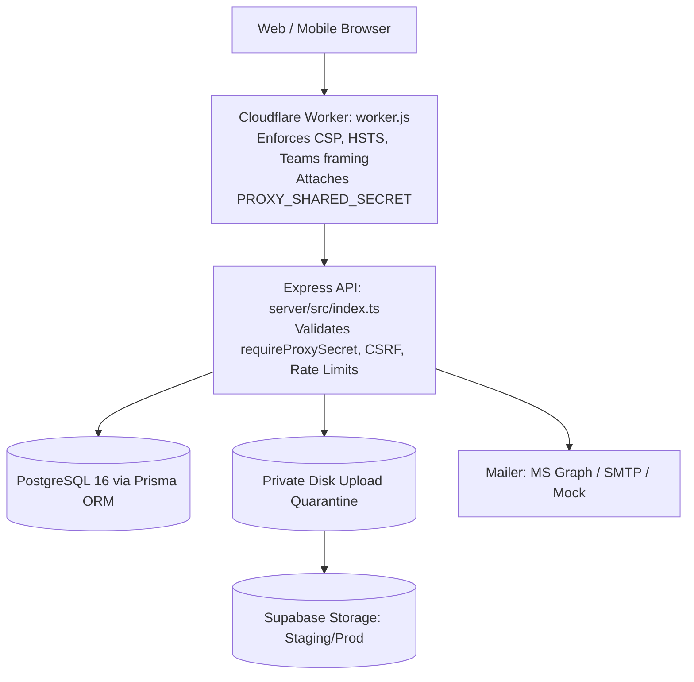

# Comprehensive Features & Capabilities Inventory — Microgenesis Supply Chain Portal

**Document Version:** 2.0  
**Last Updated:** November 11, 2026  
**Target Baseline:** `dev` (HEAD @ commit `1e2b900`)  
**Basis:** Source code implementation (`server/src/`, `client/src/`) and test suites (`server/tests/`, `client/tests/`, `e2e/tests/`).

---

## 1. System Architecture Overview

The system is a modular monolith npm monorepo with strict separation of concerns between client, API server, edge worker, and database storage:

---

## 2. Operational Modules (The 5 Record Categories)

All five categories share the unified [`DeliveryRecord`](../server/prisma/schema.prisma#L270) table, distinguished by the `category` attribute and scoped via [`recordAccess.ts`](../server/src/services/recordAccess.ts).

### 2.1 Deliveries Module
* **Frontend Screen:** [`DeliveriesPage.tsx`](../client/src/pages/DeliveriesPage.tsx) (`/deliveries`)
* **Workspace Component:** [`DeliveryRecordsView.tsx`](../client/src/features/deliveries/DeliveryRecordsView.tsx) & [`DeliveryRecordWorkspace.tsx`](../client/src/features/deliveries/DeliveryRecordWorkspace.tsx)
* **API Endpoints:**
  * `GET /api/v1/records?category=DELIVERY&paged=true`
  * `POST /api/v1/records` (Create Draft or Scheduled)
  * `PUT /api/v1/records/:id` (Field edits, version locked)
  * `PATCH /api/v1/records/:id/status` (State transitions)
  * `POST /api/v1/records/:id/time-in` (Clock-in arrival)
* **Key Capabilities:**
  * Auto-fill from demo locations in training environments.
  * Overdue counter calculation against Asia/Manila midnight.
  * Priority lock upon reaching `Delivered` status.
  * Multi-item line rows capture (`{ sku, quantity }`).
  * Return-to-Draft dialog (permitted only before Time In).

---

### 2.2 Sales Orders Module
* **Frontend Screen:** Deep-linkable operational view (`/sales_orders?item=<id>`)
* **Authorized Roles:** `SALES_COORDINATOR`, `ADMIN`
* **API Endpoints:** `GET /api/v1/records?category=SALES_ORDERS`
* **Key Capabilities:**
  * Captures client order line items without requiring immediate SAP reference numbers.
  * Allows Sales Coordinators to build order manifests before delivery dispatch.
  * Explicit boundary: Does not perform automatic ERP inventory reservation or price/tax calculations.

---

### 2.3 Procurement Pick-Up Module
* **Frontend Screen:** [`DeliveryRecordsView.tsx`](../client/src/features/deliveries/DeliveryRecordsView.tsx) (`/procurement_pickup`)
* **Authorized Roles:** `SALES_COORDINATOR`, `LOGISTICS`, `ADMIN`
* **API Endpoints:** `GET /api/v1/records?category=PROCUREMENT_PICKUP`
* **Key Capabilities:**
  * Tracks inbound vendor collection runs.
  * Links to the **Suppliers** directory for vendor contact information.
  * Shares standard driver dispatch and ePOD proof-of-pickup workflows.

---

### 2.4 Return Merchandise Authorization (RMA / TASS)
* **Frontend Screen:** [`RmaWorkflowPanel.tsx`](../client/src/features/deliveries/RmaWorkflowPanel.tsx) (`/rma`)
* **Authorized Roles:** `TASS` (Sole completion owner), `SALES_COORDINATOR`, `ADMIN`
* **API Routes:** [`server/src/routes/rmaDispatch.ts`](../server/src/routes/rmaDispatch.ts)
  * `POST /api/v1/records/:id/rma-transport-start`
  * `POST /api/v1/records/:id/rma-transport-complete`
  * `POST /api/v1/records/:id/rma-receive` (Lab physical receipt)
  * `POST /api/v1/records/:id/rma-complete` (Final repair completion)
* **Key Capabilities:**
  * Supports 3 movement scopes: `DRIVER_DISPATCH`, `SUPPLIER_DROP`, and `INTERNAL`.
  * Enforces the two-step separation between driver warehouse drop-off and TASS lab unboxing.
  * Admin and Logistics are strictly forbidden from finalizing RMA completion (`RMA_COMPLETION_ROLE_ERROR`).

---

### 2.5 Accounting Collection Module
* **Frontend Screen:** [`AccountingCollectionPage.tsx`](../client/src/pages/AccountingCollectionPage.tsx) (`/accounting_collection`)
* **Authorized Roles:** `TASS` (Verification owner), `SALES_COORDINATOR`, `ADMIN`
* **API Endpoints:**
  * `GET /api/v1/records?category=ACCOUNTING_COLLECTION`
  * `POST /api/v1/records/:id/verify-collection`
* **Key Capabilities:**
  * Links collected payments to parent delivery shipments via `linkedCollectionId`.
  * Driver captures photo of cheque or payment receipt.
  * TASS performs one-click verification, permanently stamping `collectionVerified = true` and `collectionVerifiedBy`.

---

## 3. Driver & Logistics Execution Suite

### 3.1 Field Mobile Driver Dashboard
* **Frontend Component:** [`DriverDashboard.tsx`](../client/src/features/drivers/DriverDashboard.tsx) (`/driver_dashboard`)
* **Target Device:** Mobile browsers (touch-first, no sidebar rail).
* **Key Capabilities:**
  * Filters runs by Asia/Manila current day.
  * Groups active runs by geographical Area.
  * Enforces 3-step ePOD flow:
    1. Tap **Record Time In** (locks run to driver).
    2. Tap **Upload Photo** (verified via `sharp` and magic bytes).
    3. Enter **Received By** + remarks, then tap **Accomplish**.
  * Supports field delay reporting (**Pending**) and customer postponement (**Reschedule**).

---

### 3.2 Driver Board & Dispatch Board
* **Frontend Screens:** [`DriverBoardPage.tsx`](../client/src/pages/DriverBoardPage.tsx) & [`DispatchBoardSelector.tsx`](../client/src/features/deliveries/DispatchBoardSelector.tsx)
* **Authorized Roles:** `LOGISTICS`, `ADMIN`
* **Key Capabilities:**
  * Visual Kanban columns displaying each driver's daily run load.
  * Unassigned deliveries column with fast drag-and-drop or select-to-assign actions.
  * Real-time driver status indicators (active vs accomplished counts).

---

### 3.3 Delivery Calendar
* **Frontend Screen:** [`CalendarPage.tsx`](../client/src/pages/CalendarPage.tsx) & [`DeliveryCalendar.tsx`](../client/src/features/deliveries/DeliveryCalendar.tsx)
* **Key Capabilities:**
  * Interactive Month, Week, and Day calendar views.
  * Visual markers highlighting daily delivery density and overdue shipments.
  * Date click directly filters deliveries for that specific fulfillment day.

---

### 3.4 Driver Manager Directory
* **Frontend Screen:** [`DriverManagerPage.tsx`](../client/src/pages/DriverManagerPage.tsx) (`/driver_manager`)
* **API Routes:** [`server/src/routes/drivers.ts`](../server/src/routes/drivers.ts)
* **Key Capabilities:**
  * Roster management for Drivers and Assistant Drivers.
  * Coverage area and subregion assignment.
  * Admin-only linking of portal login accounts to Driver profiles ([`driverLogin.ts`](../server/src/services/driverLogin.ts)).

---

## 4. Master Data & Directory Registry

### 4.1 Account Manager Directory
* **Location:** [`AccountManagerDirectory.tsx`](../client/src/features/admin/AccountManagerDirectory.tsx) & [`server/src/routes/accountManagers.ts`](../server/src/routes/accountManagers.ts)
* **Key Capabilities:**
  * Unique `normalizedName` constraint preventing duplicate entries (ignoring case and extra spaces).
  * Optional linking of Account Manager entries to actual portal User logins.
  * Optimistic version locking (`expected_version`) to prevent concurrent overwrite collisions.

---

### 4.2 Company Directory
* **Location:** [`CompanyHistoryPanel.tsx`](../client/src/components/CompanyHistoryPanel.tsx) & [`server/src/routes/companies.ts`](../server/src/routes/companies.ts)
* **Key Capabilities:**
  * Admin-controlled company master data with unique SAP numbers.
  * Default Account Manager assignment (automatically pre-selects AM on new delivery forms).
  * Historical delivery tracking panel accessible across all record workspaces.

---

### 4.3 Customer & Supplier Registries
* **Location:** [`CustomersPage.tsx`](../client/src/pages/CustomersPage.tsx) & [`SuppliersPage.tsx`](../client/src/pages/SuppliersPage.tsx)
* **Key Capabilities:**
  * Merchant Customer Registry with full contact info and address records.
  * Supplier Registry with multi-category catalog assignment (`SupplierCategoryAssignment`).
  * Full audit trail for customer/supplier edits including mandatory "Reason for Change".

---

### 4.4 SKU Master & Inventory Ledger
* **Location:** [`InventoryPage.tsx`](../client/src/pages/InventoryPage.tsx) & [`SkuWorkspace.tsx`](../client/src/features/inventory/SkuWorkspace.tsx)
* **Key Capabilities:**
  * Product definitions (SKU Code, Category A/B/C, Unit Cost, Unit Price, Reorder Point).
  * Warehouse stock adjustments with atomic audit logging.
  * Prevents negative on-hand balances.

---

## 5. Security, Administration & System Auditing

### 5.1 Admin Panel & Policy Engine
* **Location:** [`AdminPanel.tsx`](../client/src/features/admin/AdminPanel.tsx) & [`PolicyEditor.tsx`](../client/src/features/admin/PolicyEditor.tsx)
* **Key Capabilities:**
  * User provisioning with role assignment (`ADMIN`, `LOGISTICS`, `SALES_COORDINATOR`, `TASS`, `DRIVER`).
  * V1 Policy Matrix editor supporting granular screen, resource, and action-level overrides (`ALLOW` vs `DENY`).
  * 30-second automated client session refresh syncing permission changes in real-time.

---

### 5.2 System Audit Log & Forensics
* **Location:** [`BusinessAuditDiff.tsx`](../client/src/features/admin/BusinessAuditDiff.tsx) & [`server/src/routes/admin.ts`](../server/src/routes/admin.ts)
* **Key Capabilities:**
  * Full system audit trail tracking `CREATE`, `UPDATE`, and `DELETE` actions.
  * Visual side-by-side JSON diff viewer showing before and after states.
  * Audit entries are permanently linked to the actor's user ID and timestamp.

---

### 5.3 Health, Diagnostics & Edge Protection
* **Location:** [`server/src/routes/health.ts`](../server/src/routes/health.ts) & [`worker.js`](../worker.js)
* **Key Capabilities:**
  * Edge Content Security Policy (CSP), HSTS, and frame-ancestors allowlisting Microsoft Teams.
  * Shared secret verification (`x-mg-proxy-secret`) blocking raw traffic that bypasses Cloudflare.
  * Fail-closed public readiness check returning 200 or 503 with zero information disclosure.
  * HMAC-signed `X-CSRF-Token` verifying cross-site POST/PUT/DELETE requests.

---

## 6. Document & Proof of Delivery (ePOD) Engine

* **File Storage:** Local disk quarantine during development; Supabase Storage in production.
* **Format Allowlist:** `.jpg`, `.jpeg`, `.png`, `.pdf`, `.docx`, `.xlsx` (strictly verified by magic byte inspection, not file extensions).
* **Quotas & Limits:**
  * Maximum 10 MiB per single file.
  * Maximum 10 attachments per record.
  * Maximum 50 MiB cumulative storage per record.
* **Pre-Storage Quarantine:** Uploads are streamed to private temporary disk space and scanned before database references are created. Failed or oversized uploads are purged immediately.
* **Durable Compensating Deletion:** Outbox retry table [`PodStorageDeletion`](../server/prisma/schema.prisma#L362) ensures abandoned files on disk or object storage are retried and deleted even if a server crashes.
