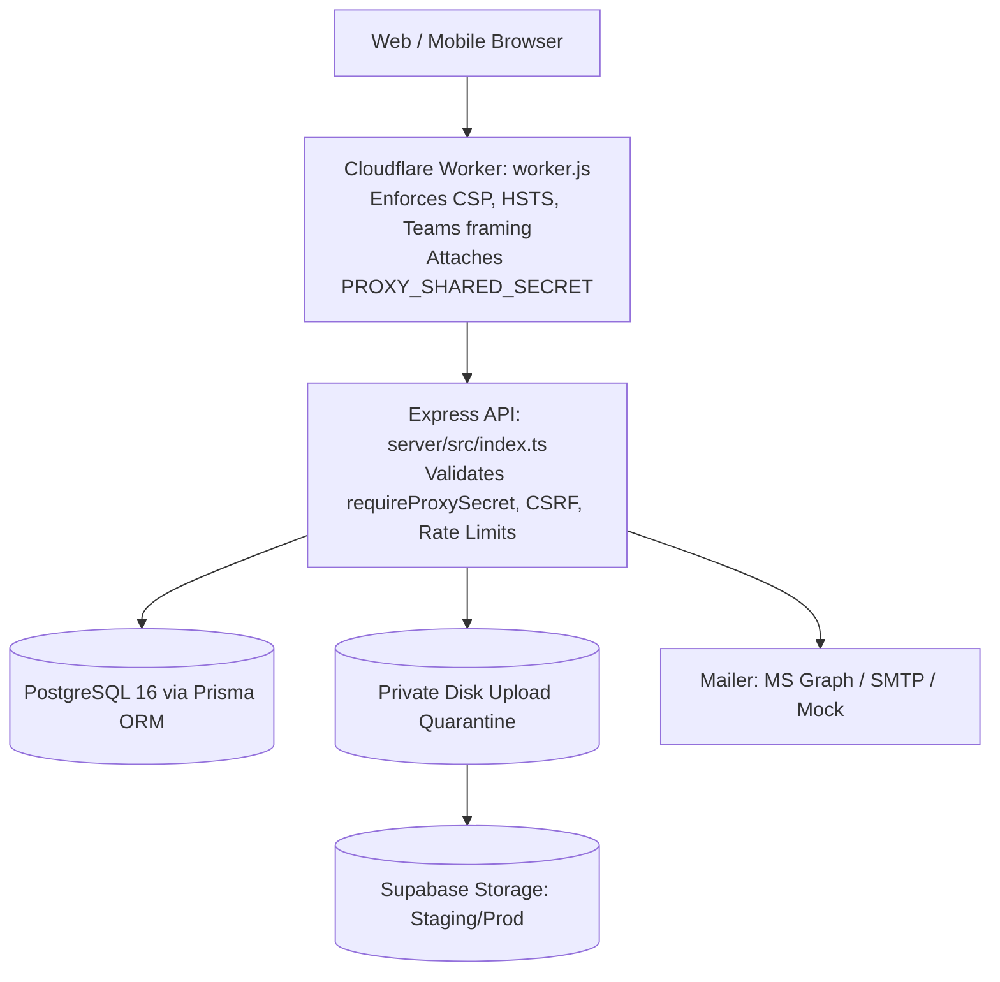

# Comprehensive Features & Capabilities Inventory — Microgenesis Supply Chain Portal

**Document Version:** 2.1
**Last Updated:** November 12, 2026 (targeted corrections)
**Original Baseline:** `dev` at `1e2b900`
**Correction Baseline:** `81214c5` on `fix/fullstack-role-review-remediations`.
**Basis:** Original source inventory with targeted rechecks of role boundaries, Driver cards, RMA endpoints and audit presentation. Unchanged sections have not received a new full-document audit. Source/test-file presence does not establish browser or deployed behavior.

See the [readiness follow-up](COMMIT_READINESS_REVIEW_2026-11-12.md) for revision-specific checks and remaining defects. Role descriptions below remain subject to current account permissions, ownership and lifecycle rules.

---

## 1. System Architecture Overview

The system is a modular monolith npm monorepo with strict separation of concerns between client, API server, edge worker, and database storage:

---

## 2. Operational Modules (The 5 Record Categories)

All five categories share the unified [`DeliveryRecord`](../server/prisma/schema.prisma#L270) table, distinguished by the `category` attribute and scoped via [`recordAccess.ts`](../server/src/services/recordAccess.ts).

### 2.1 Deliveries Module
* **Frontend Screen:** [`DeliveriesPage.tsx`](../client/src/pages/DeliveriesPage.tsx) (`/deliveries`)
* **Workspace Component:** [`DeliveryRecordsView.tsx`](../client/src/features/deliveries/DeliveryRecordsView.tsx) & [`DeliveryRecordWorkspace.tsx`](../client/src/features/deliveries/DeliveryRecordWorkspace.tsx)
* **API Endpoints:**
  * `GET /api/v1/records?category=DELIVERY&paged=true`
  * `POST /api/v1/records` (Create Draft or Scheduled)
  * `PUT /api/v1/records/:id` (Field edits, version locked)
  * `PATCH /api/v1/records/:id/status` (State transitions)
  * `POST /api/v1/records/:id/time-in` (Clock-in arrival)
* **Key Capabilities:**
  * Auto-fill from demo locations in training environments.
  * Overdue counter calculation against Asia/Manila midnight.
  * Priority lock upon reaching `Delivered` status.
  * Multi-item line rows capture (`{ sku, quantity }`).
  * Return-to-Draft dialog (permitted only before Time In).

---

### 2.2 Sales Orders Module
* **Frontend Screen:** Deep-linkable operational view (`/sales_orders?item=<id>`)
* **Role Boundaries:** Sales Coordinator creates/prepares; Logistics dispatches/manages saved runs; Admin views only; assigned Drivers execute runs.
* **API Endpoints:** `GET /api/v1/records?category=SALES_ORDERS`
* **Key Capabilities:**
  * Drafts may omit references; non-draft submission requires the reference under the shared submission rules.
  * Allows Sales Coordinators to build order manifests before delivery dispatch.
  * Explicit boundary: Does not perform automatic ERP inventory reservation or price/tax calculations.

---

### 2.3 Procurement Pick-Up Module
* **Frontend Screen:** [`DeliveryRecordsView.tsx`](../client/src/features/deliveries/DeliveryRecordsView.tsx) (`/procurement_pickup`)
* **Authorized Roles:** `SALES_COORDINATOR`, `LOGISTICS`, `ADMIN`
* **API Endpoints:** `GET /api/v1/records?category=PROCUREMENT_PICKUP`
* **Key Capabilities:**
  * Tracks inbound vendor collection runs.
  * Links to the **Suppliers** directory for vendor contact information.
  * Shares standard driver dispatch and ePOD proof-of-pickup workflows.

---

### 2.4 Return Merchandise Authorization (RMA / TASS)
* **Frontend Screen:** [`RmaWorkflowPanel.tsx`](../client/src/features/deliveries/RmaWorkflowPanel.tsx) (`/rma`)
* **Role Boundaries:** TASS creates, records physical receipt and finalizes; Logistics assigns eligible transport; linked assigned Drivers execute transport; Admin views only. Sales Coordinator has no RMA access.
* **API Routes:** [`server/src/routes/rmaDispatch.ts`](../server/src/routes/rmaDispatch.ts)
  * `GET /api/v1/records/:id/rma-capabilities`
  * `PATCH /api/v1/records/:id/rma-assignment` (Logistics assignment)
  * `PATCH /api/v1/records/:id/rma-transport` (`IN_TRANSIT` or `COMPLETED`; assigned Driver)
  * `POST /api/v1/records/:id/rma-receipt` (TASS physical receipt)
  * `PATCH /api/v1/records/:id/status` (Final `Delivered` transition; TASS, after receipt and any required transport)
* **Key Capabilities:**
  * Supports `LOGISTICS_TRANSPORT` (Logistics transport), `SUPPLIER_COLLECTION` (Supplier collection), and `INTERNAL_NO_DRIVER` (Internal / no driver).
  * Enforces the two-step separation between driver warehouse drop-off and TASS lab unboxing.
  * Admin and Logistics are strictly forbidden from finalizing RMA completion (`RMA_COMPLETION_ROLE_ERROR`).

---

### 2.5 Accounting Collection Module
* **Frontend Screen:** [`AccountingCollectionPage.tsx`](../client/src/pages/AccountingCollectionPage.tsx) (`/accounting_collection`)
* **Authorized Roles:** `TASS` (Verification owner), `SALES_COORDINATOR`, `ADMIN`
* **API Endpoints:**
  * `GET /api/v1/records?category=ACCOUNTING_COLLECTION`
  * `PATCH /api/v1/records/:id/verify-collection`
* **Key Capabilities:**
  * Links collected payments to parent delivery shipments via `linkedCollectionId`.
  * Driver captures photo of cheque or payment receipt.
  * TASS verifies an accomplished, unverified collection, saving the acting account and verification timestamp. The UI action does not request separate verification remarks; Admin cannot perform this TASS-only action.

---

## 3. Driver & Logistics Execution Suite

### 3.1 Field Mobile Driver Dashboard
* **Frontend Component:** [`DriverDashboard.tsx`](../client/src/features/dashboard/DriverDashboard.tsx) (`/driver_dashboard`)
* **Target Device:** Mobile browsers (touch-first, no sidebar rail).
* **Key Capabilities:**
  * Uses uniform job cards for Delivery, RMA, Procurement Pick-up, Sales Order and Accounting Collection, subject to assignment and lifecycle eligibility.
  * Retains actionable overdue/started runs; future unstarted runs are read-only. Cards display company, area, reference, due date and expandable item text.
  * Offers two actions: **Start transport** and **Complete delivery**, both with required remarks. After starting, select photo/documents and enter **Received by** before completion.
  * Requires a verified persisted JPG/PNG photo; PDF/DOCX/XLSX are supporting documents. For ordinary runs completion stamps Time Out; for RMA it completes transport only, leaving physical receipt and final completion to TASS.
  * Drivers contact Logistics for Pending/Rescheduled exceptions. The separate staff Drivers View has a known non-Delivery reschedule payload defect documented in the readiness review.

---

### 3.2 Driver Board & Dispatch Board
* **Frontend Screens:** [`DriverBoardPage.tsx`](../client/src/pages/DriverBoardPage.tsx) & [`DispatchBoardSelector.tsx`](../client/src/features/deliveries/DispatchBoardSelector.tsx)
* **Role Boundaries:** Logistics dispatches under granted actions; Admin remains view-only for the four restricted operational categories.
* **Key Capabilities:**
  * Visual columns displaying each driver's daily run load.
  * Unassigned-run visibility for dispatch coordination; saved assignment actions remain permission/lifecycle guarded.
  * Real-time driver status indicators (active vs accomplished counts).

---

### 3.3 Delivery Calendar
* **Frontend Screen:** [`CalendarPage.tsx`](../client/src/pages/CalendarPage.tsx) & [`DeliveryCalendar.tsx`](../client/src/features/deliveries/DeliveryCalendar.tsx)
* **Key Capabilities:**
  * Monthly calendar grid with previous/next navigation and daily status/record counts. Separate Week/Day view modes are not implemented.
  * Clicking a populated day opens a paged list; selecting a record navigates to its category workspace.

---

### 3.4 Driver Manager Directory
* **Frontend Screen:** [`DriverManagerPage.tsx`](../client/src/pages/DriverManagerPage.tsx) (`/driver_manager`)
* **API Routes:** [`server/src/routes/drivers.ts`](../server/src/routes/drivers.ts)
* **Key Capabilities:**
  * Roster management for Drivers and Assistant Drivers.
  * Coverage area and subregion assignment.
  * Admin-only linking of portal login accounts to Driver profiles ([`driverLogin.ts`](../server/src/services/driverLogin.ts)).

---

## 4. Master Data & Directory Registry

### 4.1 Account Manager Directory
* **Location:** [`AccountManagerDirectory.tsx`](../client/src/features/admin/AccountManagerDirectory.tsx) & [`server/src/routes/accountManagers.ts`](../server/src/routes/accountManagers.ts)
* **Key Capabilities:**
  * Unique `normalizedName` constraint preventing duplicate entries (ignoring case and extra spaces).
  * Optional linking of Account Manager entries to actual portal User logins.
  * Optimistic version locking (`expected_version`) to prevent concurrent overwrite collisions.

---

### 4.2 Company Directory
* **Location:** [`CompanyHistoryPanel.tsx`](../client/src/components/CompanyHistoryPanel.tsx) & [`server/src/routes/companies.ts`](../server/src/routes/companies.ts)
* **Key Capabilities:**
  * Admin-controlled company master data with unique SAP numbers.
  * Default Account Manager assignment (automatically pre-selects AM on new delivery forms).
  * Historical delivery tracking panel accessible across all record workspaces.

---

### 4.3 Customer & Supplier Registries
* **Location:** [`CustomersPage.tsx`](../client/src/pages/CustomersPage.tsx) & [`SuppliersPage.tsx`](../client/src/pages/SuppliersPage.tsx)
* **Key Capabilities:**
  * Merchant Customer Registry with full contact info and address records.
  * Supplier Registry with multi-category catalog assignment (`SupplierCategoryAssignment`).
  * Customer edits require change reasons and produce audit history. Supplier creation and Admin category-assignment changes are audited; general supplier contact editing and retirement remain unavailable.

---

### 4.4 SKU Master & Inventory Ledger
* **Location:** [`InventoryPage.tsx`](../client/src/pages/InventoryPage.tsx) & [`SkuWorkspace.tsx`](../client/src/features/inventory/SkuWorkspace.tsx)
* **Key Capabilities:**
  * Product definitions (SKU Code, Category A/B/C, Unit Cost, Unit Price, Reorder Point).
  * Warehouse stock adjustments with atomic audit logging.
  * Prevents negative on-hand balances.
  * Several SKU workspace tabs remain scaffolds. Operational deliveries do not automatically reserve, issue or reconcile inventory or financial balances.

---

## 5. Security, Administration & System Auditing

### 5.1 Admin Panel & Policy Engine
* **Location:** [`AdminPanel.tsx`](../client/src/features/admin/AdminPanel.tsx) & [`PolicyEditor.tsx`](../client/src/features/admin/PolicyEditor.tsx)
* **Key Capabilities:**
  * User provisioning with role assignment (`ADMIN`, `LOGISTICS`, `SALES_COORDINATOR`, `TASS`, `DRIVER`).
  * V1 Policy Matrix editor supporting granular screen, resource, and action-level overrides (`ALLOW` vs `DENY`).
  * Client permission refresh every 30 seconds and on focus; the server checks current account authority on requests. V1 availability depends on initialized policies, verified conversion and activation.

---

### 5.2 System Audit Log & Forensics
* **Location:** [`BusinessAuditDiff.tsx`](../client/src/features/admin/BusinessAuditDiff.tsx) & [`server/src/routes/admin.ts`](../server/src/routes/admin.ts)
* **Key Capabilities:**
  * Full system audit trail tracking `CREATE`, `UPDATE`, and `DELETE` actions.
  * Action and From/To date filters. Supported entries expand **Record changes (n)** or **Permission changes (n)** showing before/after values; category/actor filters and a general side-by-side JSON viewer are not present.
  * Audit entries are permanently linked to the actor's user ID and timestamp.

---

### 5.3 Health, Diagnostics & Edge Protection
* **Location:** [`server/src/routes/health.ts`](../server/src/routes/health.ts) & [`worker.js`](../worker.js)
* **Key Capabilities:**
  * Edge Content Security Policy (CSP), HSTS, and frame-ancestors allowlisting Microsoft Teams.
  * Shared secret verification (`x-mg-proxy-secret`) blocking raw traffic that bypasses Cloudflare.
  * Public readiness check returns an uncached minimal boolean with HTTP 200/503; detailed diagnostics require Admin access.
  * HMAC-signed `X-CSRF-Token` verifying cross-site POST/PUT/DELETE requests.

---

## 6. Document & Proof of Delivery (ePOD) Engine

* **File Storage:** Private local disk quarantine before validation for either storage backend; persisted storage uses the configured local or Supabase adapter. Verify hosted configuration separately.
* **Format Allowlist:** `.jpg`, `.jpeg`, `.png`, `.pdf`, `.docx`, `.xlsx` (strictly verified by magic byte inspection, not file extensions).
* **Quotas & Limits:**
  * Maximum 10 MiB per single file.
  * Maximum 10 attachments per record.
  * Maximum 50 MiB cumulative storage per record.
* **Pre-Storage Quarantine:** Uploads are streamed to private temporary disk space and scanned before database references are created. Failed or oversized uploads are purged immediately.
* **Durable Compensating Deletion:** Outbox retry table [`PodStorageDeletion`](../server/prisma/schema.prisma#L362) ensures abandoned files on disk or object storage are retried and deleted even if a server crashes.
