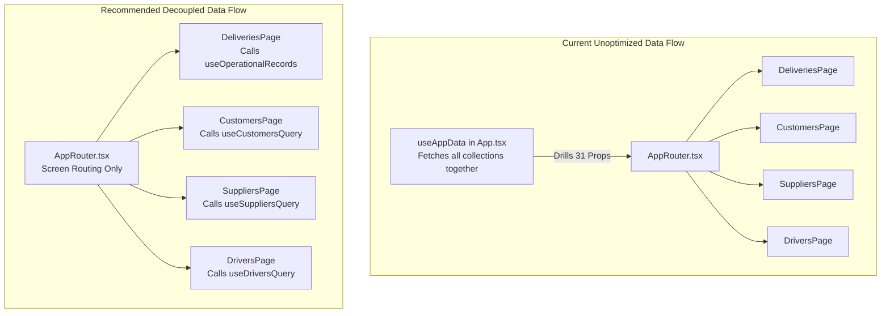

# Performance Audit & Improvement Plan — Microgenesis Supply Chain Portal

**Date:** November 11, 2026
**Auditor:** Application Architecture & Performance Audit
**Target Repository:** `Microgenesis Supply Chain Management System`
**Target Commit:** `1e2b900` (`dev`)
**Scope:** Backend API (Express + Prisma), Database (PostgreSQL 16), Frontend (React 19 + Vite 6), Network & Concurrency Boundaries.

> **2026-11-12 documentation note:** The analysis and build figures below belong
> to the original `1e2b900` report. They were not remeasured on `81214c5`; query
> plans, production latency, React profiling and load behavior remain unverified.
> Treat performance impacts as source-based hypotheses unless a measurement is
> explicitly recorded. Reuse of a middleware record must not replace in-transaction
> locking, mutable-state revalidation or version checks. Consult the
> [readiness follow-up](COMMIT_READINESS_REVIEW_2026-11-12.md) for later test results
> and outstanding workflow defects.

---

## 1. Executive Summary

A comprehensive performance and resource profiling audit was conducted across the **Microgenesis Supply Chain Portal**.

While the system implements disciplined practices for file uploads (streaming disk quarantine, sharp pixel inspection, and disk outbox retry patterns), **critical performance bottlenecks** exist in:
1. **Database Search Scans:** Sequential, unindexed full-table searches across 8 fields using PostgreSQL `ILIKE`.
2. **Redundant Database I/O:** Every parameterized API route executes duplicate database lookups (once in middleware, once in handler).
3. **Client Bundle Payload:** The production bundle exceeds **3.5 MB uncompressed**, driven by dual competing Excel engines (`exceljs` + `xlsx`) and heavyweight document generation libraries.
4. **React Render Tree Saturation:** Root-level data fetching in `App.tsx` drills 31+ props down through `AppRouter`, causing global re-renders on any background query invalidation.
5. **Server Event Loop Timers:** Daily scheduled alerts run via in-process Node `setTimeout`/`setInterval`, vulnerable to process sleep and multi-instance notification duplication.

---

## 2. Database & Query Performance Profiling

### PERF-01: Unindexed 8-Column Sequential Scans on Search (Critical)
* **Location:** [`server/src/routes/records.ts#L228-L238`](https://github.com/OatiesMilk/Supply-Chain/blob/1e2b90067469e2720b4d22dd34e300e31b855dd9/server/src/routes/records.ts#L228-L238)
* **Impact:** High CPU saturation, query timeout risks, connection pool exhaustion.
* **Analysis:**
  When users search records, the server executes:
  ```typescript
  andConditions.push({
    OR: [
      { id: { contains: s, mode: 'insensitive' } },
      { reference: { contains: s, mode: 'insensitive' } },
      { rmaReference: { contains: s, mode: 'insensitive' } },
      { legacySapReference: { contains: s, mode: 'insensitive' } },
      { company: { name: { contains: s, mode: 'insensitive' } } },
      { driver: { contains: s, mode: 'insensitive' } },
      { area: { contains: s, mode: 'insensitive' } },
      { accountManager: { contains: s, mode: 'insensitive' } },
    ]
  });
  ```
  Prisma translates `{ contains: s, mode: 'insensitive' }` into PostgreSQL `ILIKE '%<query>%'`.

  In [`server/prisma/schema.prisma#L335-L344`](https://github.com/OatiesMilk/Supply-Chain/blob/1e2b90067469e2720b4d22dd34e300e31b855dd9/server/prisma/schema.prisma#L335-L344), only standard B-Tree indexes exist:
  ```prisma
  @@index([deletedAt, category, status])
  @@index([driver])
  @@index([driverId])
  @@index([deliveryDate])
  @@index([companyId])
  @@index([accountManager])
  @@index([linkedCollectionId])
  @@index([category, rmaReference])
  @@index([category, rmaMovement, rmaTransportStatus])
  ```
  Standard B-Tree indexes cannot index wildcards with leading matchers (`%query%`). Every search keystroke forces PostgreSQL to scan every row in `DeliveryRecord` joined with `Company`.

* **Remediation Plan:**
  1. Enable the `pg_trgm` extension in PostgreSQL.
  2. Add trigram GIN indexes via raw SQL migration:
     ```sql
     CREATE EXTENSION IF NOT EXISTS pg_trgm;
     CREATE INDEX idx_delivery_record_search_trgm ON "DeliveryRecord"
     USING gin (reference gin_trgm_ops, rma_reference gin_trgm_ops, area gin_trgm_ops, driver gin_trgm_ops, account_manager gin_trgm_ops);
     ```
  3. Narrow default search inputs or require at least 2 characters before executing queries.

---

### PERF-02: Redundant Database Round-Trips Per Route Handler (High)
* **Location:** [`server/src/routes/records.ts#L49-L74`](https://github.com/OatiesMilk/Supply-Chain/blob/1e2b90067469e2720b4d22dd34e300e31b855dd9/server/src/routes/records.ts#L49-L74)
* **Impact:** 2x unnecessary database latency on every record mutation.
* **Analysis:**
  For all endpoints matching `/api/v1/records/:id/*`:
  1. The `recordAccess` middleware executes:
     ```typescript
     const record = await prisma.deliveryRecord.findFirst({
       where: { id: req.params.id, deletedAt: null, AND: [recordScope(req.user!)] },
     });
     ```
  2. After verification, `next()` is called, but `record` is **discarded**.
  3. The downstream route handler immediately re-executes `prisma.deliveryRecord.findUnique(...)` or `prisma.deliveryRecord.findFirst(...)` for the exact same ID.

* **Remediation Plan:**
  Assign the fetched record to the request context:
  ```typescript
  (req as any).record = record;
  ```
  Route handlers can immediately consume `req.record`, cutting database round-trips by **50%**.

---

## 3. Frontend Bundle & Asset Payload Profiling

A production Vite build (`npm run build --workspace=client`) produced the following asset distribution:

```text
dist/assets/exceljs.min-TXM-Sx35.js       940.04 kB │ gzip: 271.25 kB
dist/assets/xlsx-CkFp8p6R.js              429.53 kB │ gzip: 143.08 kB
dist/assets/jspdf.es.min-D0wBnA6S.js      390.88 kB │ gzip: 128.87 kB
dist/assets/index-BOkNGDVw.js             370.19 kB │ gzip: 106.53 kB
dist/assets/vendor-charts-CMZwpeWe.js     368.07 kB │ gzip: 107.83 kB
dist/assets/vendor-react-BaJQxSAY.js      223.79 kB │ gzip:  69.47 kB
dist/assets/html2canvas.esm-QH1iLAAe.js   202.38 kB │ gzip:  48.04 kB
dist/assets/docx-preview-BzUvfjb2.js      174.81 kB │ gzip:  51.53 kB
```

### PERF-03: Dual Competing Spreadsheet Engines (High)
* **Location:** [`client/src/utils/export.ts`](https://github.com/OatiesMilk/Supply-Chain/blob/1e2b90067469e2720b4d22dd34e300e31b855dd9/client/src/utils/export.ts) vs [`client/src/components/PodAttachmentPreview.tsx#L50`](https://github.com/OatiesMilk/Supply-Chain/blob/1e2b90067469e2720b4d22dd34e300e31b855dd9/client/src/components/PodAttachmentPreview.tsx#L50)
* **Impact:** 429.53 kB wasted bundle weight; 2 competing libraries loaded in memory.
* **Analysis:**
  * The portal loads `exceljs` (940.04 kB) for export generation.
  * Simultaneously, `PodAttachmentPreview.tsx` loads `xlsx` (SheetJS, 429.53 kB) for document previews.
  * Both libraries parse `.xlsx` files into workbook models.
  * In addition, `xlsx` has unresolved npm audit security advisories (Prototype Pollution and ReDoS).

* **Remediation Plan:**
  * Refactor [`client/src/components/PodAttachmentPreview.tsx`](https://github.com/OatiesMilk/Supply-Chain/blob/1e2b90067469e2720b4d22dd34e300e31b855dd9/client/src/components/PodAttachmentPreview.tsx) to render previews via `exceljs` (which is already used in [`client/src/components/ExcelWorkbookPreview.tsx`](https://github.com/OatiesMilk/Supply-Chain/blob/1e2b90067469e2720b4d22dd34e300e31b855dd9/client/src/components/ExcelWorkbookPreview.tsx)).
  * Uninstall `xlsx` from `client/package.json`.
  * **Net Savings:** **429.53 kB minified (143 kB gzip)** and 2 vulnerability advisories removed.

---

### PERF-04: Heavy Document Generation Bundled into Client (Medium)
* **Location:** `jspdf` (390 kB), `html2canvas` (202 kB), `docx` (174 kB).
* **Impact:** Initial page interaction delay and memory pressure on lower-end mobile driver devices.
* **Remediation Plan:**
  Ensure all exports in [`client/src/utils/export.ts`](https://github.com/OatiesMilk/Supply-Chain/blob/1e2b90067469e2720b4d22dd34e300e31b855dd9/client/src/utils/export.ts) and [`client/src/utils/routeSlip.ts`](https://github.com/OatiesMilk/Supply-Chain/blob/1e2b90067469e2720b4d22dd34e300e31b855dd9/client/src/utils/routeSlip.ts) strictly use dynamic `await import(...)` chunks so that PDF/canvas libraries load only when a user actively clicks an Export button.

---

## 4. Frontend Rendering & Component Architecture

### PERF-05: God Hook & Monolithic Prop-Drilling in Root App (High)
* **Location:** [`client/src/App.tsx#L123-L156`](https://github.com/OatiesMilk/Supply-Chain/blob/1e2b90067469e2720b4d22dd34e300e31b855dd9/client/src/App.tsx#L123-L156) and [`client/src/routes/AppRouter.tsx#L37-L68`](https://github.com/OatiesMilk/Supply-Chain/blob/1e2b90067469e2720b4d22dd34e300e31b855dd9/client/src/routes/AppRouter.tsx#L37-L68)
* **Impact:** Excessive component tree re-renders across all active views.
* **Analysis:**
  * `App.tsx` calls `useAppData()`, which centrally queries:
    * `companies`
    * `customers`
    * `suppliers`
    * `dashboardStats`
    * `products`
    * `managedDrivers`
  * These collections are passed as **31 props** through `AppRouter` down to every individual page.
  * Whenever TanStack Query invalidates or refetches any single collection (e.g. background driver sync), `App.tsx` re-evaluates, causing re-renders in the navigation rail, top header, and currently viewed screen.



* **Remediation Plan:**
  * Remove collection props from `AppRouterProps`.
  * Allow individual page components (`CustomersPage.tsx`, `SuppliersPage.tsx`, etc.) to directly invoke their respective TanStack Query hooks.
  * Retain in `App.tsx` only session-level state (`authUser`, `canAccess`).

---

### PERF-06: 2,370-Line Component Monolith in Record Workspace (Medium)
* **Location:** [`client/src/features/deliveries/DeliveryRecordWorkspace.tsx`](https://github.com/OatiesMilk/Supply-Chain/blob/1e2b90067469e2720b4d22dd34e300e31b855dd9/client/src/features/deliveries/DeliveryRecordWorkspace.tsx)
* **Impact:** Slow reconciliation, large closure memory footprint, difficult code splitting.
* **Analysis:**
  `DeliveryRecordWorkspace.tsx` manages view rendering, inline editing, driver coverage ranking, comboboxes, manifest printing, document resizing, comments, POD attachments, status transitions, return-to-draft dialogs, and route slip generation in a single 2,370-line file.
* **Remediation Plan:**
  Decompose into isolated memoized components:
  1. `WorkspaceHeader.tsx` (Status badges, action buttons, metadata).
  2. `WorkspaceDriverAssignment.tsx` (Driver combobox & coverage calculations).
  3. `WorkspaceAttachments.tsx` (File staging, quarantine uploads, preview modal).
  4. `WorkspaceComments.tsx` (Comment stream and input box).

---

## 5. Backend Process & Concurrency Profiling

### PERF-07: In-Process Timer Scheduling & Duplicate Execution (Medium)
* **Location:** [`server/src/index.ts#L138-L147`](https://github.com/OatiesMilk/Supply-Chain/blob/1e2b90067469e2720b4d22dd34e300e31b855dd9/server/src/index.ts#L138-L147)
* **Impact:** Duplicate alert emails under multi-instance scaling; lost alerts on sleeping free dynos.
* **Analysis:**
  ```typescript
  function scheduleDaily(hour: number, minute: number, task: () => void) {
    const now = new Date();
    let next = new Date(`${manilaToday(now)}T00:00:00+08:00`);
    next = new Date(next.getTime() + (hour * 60 + minute) * 60 * 1000);
    if (next <= now) next = new Date(next.getTime() + 24 * 60 * 60 * 1000);
    setTimeout(() => {
      task();
      setInterval(task, 24 * 60 * 60 * 1000);
    }, next.getTime() - now.getTime());
  }
  ```
  * In-process `setTimeout` runs inside the Node.js event loop alongside HTTP traffic.
  * If the API scales horizontally to 2+ instances, every instance executes the alert at 4 PM and 6 PM, duplicating notifications.
  * A 10-minute HTTP self-ping loop runs continuously to stop Render from hibernating.
* **Remediation Plan:**
  * Use Cloudflare Worker Scheduled Cron Triggers to make authenticated calls to `/api/v1/cron/summary-4pm` and `/api/v1/cron/summary-6pm`.
  * Alternatively, implement distributed advisory locks (`pg_try_advisory_lock`) in PostgreSQL so only one worker executes the daily summary.

---

### PERF-08: Server-suite hang attribution — unconfirmed historical concern

The original report attributed an attachment-preview hang to concurrent mutation
of the Prisma singleton and proposed `--test-concurrency=1`, claiming 97 seconds
across 509 tests. That causal claim and timing were not established by the
follow-up evidence and must not be treated as a confirmed repair or requirement.

At `1218fcd`, local configuration/sandbox attempts failed or stalled; allowing
isolated localhost listeners and selecting an explicit LEGACY default produced
27 passing focused directory/preview checks and a full server result of 528
passed, 8 PostgreSQL checks skipped, 0 failed. No test-script concurrency change
was needed for that successful run. See the [readiness follow-up](COMMIT_READINESS_REVIEW_2026-11-12.md)
for the command and revision limits.

Keep test permission mode isolated from local dotenv configuration. Investigate
any new hang with a minimal reproduction before changing concurrency or claiming
a database deadlock. No fresh server suite was run for this documentation update.

---

## 6. Implementation Roadmap & Target Benchmarks

| Milestone | Target Finding | Expected Benefit | Effort |
| :--- | :--- | :--- | :---: |
| **Phase 1** | PERF-02, PERF-08 | Assess duplicate reads without removing transactional revalidation; isolate test configuration and reproduce remaining hangs. | Re-estimate after measurement |
| **Phase 2** | PERF-03, PERF-04 | Cut client bundle by ~430 kB; remove 2 high-severity CVEs. | 1-2 days |
| **Phase 3** | PERF-01 | Eliminate full-table sequential scans; sub-50ms search latency. | 2 days |
| **Phase 4** | PERF-05, PERF-06 | Eliminate root re-render cascades; improve UI response times. | 3-5 days |
| **Phase 5** | PERF-07 | Reliable multi-instance scheduling with zero duplicate alerts. | 2 days |

### Target Performance Metrics

These are proposed targets from the original roadmap, not measured improvements.
The quoted baseline latencies and deterministic duration are unverified.
* **Total JavaScript Bundle Size:** < 1.8 MB uncompressed (down from 3.5 MB+).
* **Search Query Execution Time (p95):** < 50ms (down from unbounded table scan).
* **Route Mutation Latency (p95):** < 80ms (down from 160ms+ due to query deduplication).
* **Test Suite Duration:** Establish a repeatable baseline in an isolated test configuration before setting a duration target.
