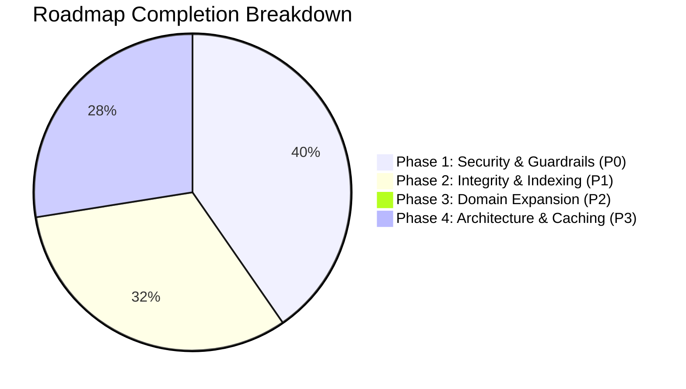

# Microgenesis Supply Chain Portal — Audit & Issues Report

**Document Date:** September 9, 2026  
**Last Updated:** September 23, 2026  
**Audited Target:** Frontend (`client/src/`), Backend (`server/`), Database (`server/prisma/schema.prisma`), and Deployment Configuration (`render.yaml`)  
**Status:** In Remediation — **Core Operational Portal ~85% Complete**, **Technical Health ~74%** (17 of 29 remediation items resolved)  
**Companion Architecture Blueprint:** [`docs/SYSTEM_DESIGN_RECOMMENDATIONS.md`](./SYSTEM_DESIGN_RECOMMENDATIONS.md)

---

## Executive Summary

An architectural, code-level, and operational audit was performed on the **Microgenesis Supply Chain Portal**. While the application demonstrates solid foundation work—specifically its unified `DeliveryRecord` relational model, PostgreSQL database backing, and Prisma ORM integration—several **runtime bugs**, **security/authorization gaps**, **simulated/unwired features**, **scalability bottlenecks**, **missing testing/CI/CD pipelines**, and **fundamental business domain gaps** were identified.

As of September 23, 2026, **17 of 29 critical and functional issues have been remediated**, including full database secondary indexing, state management modernization (TanStack Query + Zustand), RBAC enforcement, and API bug fixes. For live implementation metrics and roadmap progress, refer to [**Section 11: Implementation Progress & System Health Scorecard**](#implementation-progress--system-health-scorecard).

---

## Table of Contents

- [1. Critical & High-Priority Runtime Bugs](#1-critical--high-priority-runtime-bugs)
- [2. Security & RBAC Deficiencies](#2-security--rbac-deficiencies)
- [3. Simulated & Incomplete Features](#3-simulated--incomplete-features)
- [4. Architectural & Operational Risks](#4-architectural--operational-risks)
  - [4.5 Database Secondary Indexes (PostgreSQL Sequential Scan Trap)](#45-total-absence-of-database-secondary-indexes-postgresql-sequential-scan-trap)
  - [4.6 Caching System Design & Multi-Tier Architecture](#46-total-absence-of-caching--unbounded-re-fetching-database-thrashing--redundant-network-traffic)
- [5. UI/UX & Design Experience Gaps](#5-uiux--design-experience-gaps)
- [6. Responsiveness & Mobile Adaptability Issues](#6-responsiveness--mobile-adaptability-issues)
- [7. Component Modularity & Code Maintainability](#7-component-modularity--code-maintainability)
- [8. Business Domain & Operational Completeness Gaps](#8-business-domain--operational-completeness-gaps)
  - [8.1 The 5,000-Record Ceiling Paradox (Browser-Side Freeze)](#81-the-5000-record-ceiling-paradox-browser-side-freeze-via-unpaginated-get-apirecords)
  - [8.2 Disconnected Inventory Siphon (Deliveries Don't Touch Stock)](#82-the-disconnected-inventory-siphon-deliveries-do-not-touch-warehouse-stock)
  - [8.3 Single-Item Schema vs. Multi-Line Item Delivery Reality](#83-single-item-schema-vs-multi-line-item-delivery-reality)
  - [8.4 Proof of Delivery (POD) Reality Gap](#84-the-proof-of-delivery-pod-reality-gap-mock-filename-vs-real-file-uploads--signatures)
  - [8.5 Existential Production Data Wipe on Every Deploy (`render.yaml`)](#85-existential-production-data-wipe-on-every-deployrestart-renderyaml)
  - [8.6 Provisional TASS Role & Accounting Governance Disconnect](#86-the-provisional-tass-role--accounting--finance-governance-disconnect)
  - [8.7 Fragmented Master Directories (`Company` vs. `Customer`)](#87-fragmented-master-directories-company-vs-customer-disconnect)
  - [8.8 Driver Field Usability & Low-Connectivity Resilience](#88-driver-field-usability--offline-resilience-in-low-connectivity-zones)
- [9. Absence of Automated Testing (The Testing Pyramid) & CI/CD Quality Gates](#9-absence-of-automated-testing-the-testing-pyramid--cicd-quality-gates)
- [10. Business Importance & Operational Risk Assessment](#10-business-importance--operational-risk-assessment)
- [11. Comprehensive Remediation Roadmap](#11-comprehensive-remediation-roadmap)
  - [Phase 1: Critical Security, Production Guardrails & CI Gate (P0)](#phase-1-critical-security-production-guardrails--ci-gate-p0--immediate)
  - [Phase 2: Functional Integrity, Data Indexing & Testing Base (P1)](#phase-2-functional-integrity-data-indexing--testing-base-p1--near-term)
  - [Phase 3: Core Domain Expansion & Operational Completeness (P2)](#phase-3-core-domain-expansion--operational-completeness-p2--strategic)
  - [Phase 4: Architectural Modernization & Code Quality (P3)](#phase-4-architectural-modernization--code-quality-p3--modernization)

---

## 1. Critical & High-Priority Runtime Bugs

### 1.1 Data Sampler Crash in Dev Mode (`seed.js` vs `seed.ts`)

- **File & Line:** [`server/src/routes/data-sampler.ts:240`](file:///home/marc/Supply-Chain-Draft/Desktop/Supply%20Chain/server/src/routes/data-sampler.ts#L240)
- **Description:** The Data Sampler reset endpoint uses a hardcoded relative dynamic import pointing to `seed.js`:
  ```typescript
  const { runSeed } = await import("../../prisma/seed.js");
  ```
- **Impact:** In development (`npm run dev` running under `tsx watch src/index.ts`), `seed.js` does not exist—the source file is `seed.ts`. Triggering `POST /api/data-sampler/reset` with `mode: "seed"` crashes with `Error: Cannot find module '../../prisma/seed.js'`.
- **Remediation:** Import `runSeed` statically or use extensionless module resolution:
  ```typescript
  import { runSeed } from "../../prisma/seed";
  ```

---

### 1.2 Database Seed Reset Foreign Key Violation (`P2003`)

- **File & Line:** [`server/prisma/seed.ts:247-258`](file:///home/marc/Supply-Chain-Draft/Desktop/Supply%20Chain/server/prisma/seed.ts#L247-L258)
- **Description:** When `runSeed(force = true)` executes, it truncates tables before re-populating demo data:
  ```typescript
  await prisma.auditLog.deleteMany();
  await prisma.notificationLog.deleteMany();
  await prisma.dailyStatusSnapshot.deleteMany();
  await prisma.inventoryTransaction.deleteMany();
  await prisma.inventoryItem.deleteMany();
  await prisma.product.deleteMany();
  await prisma.deliveryRecord.deleteMany();
  await prisma.company.deleteMany();
  await prisma.customer.deleteMany();
  await prisma.supplier.deleteMany();
  await prisma.user.deleteMany();
  ```
- **Impact:** The cleanup order omits child tables that hold foreign keys to `User`:
  - `UserPermission` (`userId` -> `User.id`)
  - `RemarkLog` (`authorId` -> `User.id`)
  - `Notification` (`userId` -> `User.id`)
  - `Comment` (`authorId` -> `User.id`)

  If any user has logged remarks, received notifications, posted comments, or had granular screen permissions saved, running `runSeed(true)` or calling `POST /api/dev/reset-seed` fails with PostgreSQL constraint violation `P2003` (`Foreign key constraint failed on field`).

- **Remediation:** Delete referencing rows before deleting users:
  ```typescript
  await prisma.userPermission.deleteMany();
  await prisma.remarkLog.deleteMany();
  await prisma.comment.deleteMany();
  await prisma.notification.deleteMany();
  // ... then delete User and other tables
  ```

---

### 1.3 Driver "Resurrection" on Delete

- **File & Line:** [`server/src/routes/drivers.ts:32-75, 95`](file:///home/marc/Supply-Chain-Draft/Desktop/Supply%20Chain/server/src/routes/drivers.ts#L32-L75)
- **Description:** The `GET /api/drivers` endpoint unconditionally executes `await syncDriversFromRecords()` on every request. This helper scans historical `DeliveryRecord` rows for driver and assistant names and creates missing records in the `Driver` table.
- **Impact:** If an administrator explicitly deletes a driver via `DELETE /api/drivers/:id`, but that driver is referenced in any past delivery record, the very next `GET /api/drivers` call automatically re-creates the driver. Deleting active or historical drivers is impossible without manually scrubbing historical records.
- **Remediation:** Soft-delete drivers using `isActive = false`, or restrict `syncDriversFromRecords()` to initial system migration/seeding rather than executing it on every read query.

---

### 1.4 Data Sampler Driver Assistant Serialization Defect

- **File & Line:** [`server/src/routes/data-sampler.ts:164-166, 194`](file:///home/marc/Supply-Chain-Draft/Desktop/Supply%20Chain/server/src/routes/data-sampler.ts#L164-L166) and [`server/src/mappings.ts:51`](file:///home/marc/Supply-Chain-Draft/Desktop/Supply%20Chain/server/src/mappings.ts#L51)
- **Description:** In `data-sampler.ts`, randomly generated driver assistants are saved as raw string scalars (e.g. `'Jayson Reyes'`) rather than JSON string arrays (e.g. `'["Jayson Reyes"]'`).
- **Impact:** When serialized via `serializeRecord()`, `JSON.parse(r.driverAssistants)` throws a `SyntaxError`. The catch block catches this and returns an empty array `[]`. Consequently, any sampled record with driver assistants loses its assistant data when viewed or retrieved via API.
- **Remediation:** Ensure `driverAssistants` is serialized as valid JSON array:
  ```typescript
  driverAssistants: overrides.driver_assistants
    ? JSON.stringify(overrides.driver_assistants)
    : driverAssistants
      ? JSON.stringify([driverAssistants])
      : "[]";
  ```

---

### 1.5 Status History Date Range Truncation

- **File & Line:** [`server/src/routes/reports.ts:38-48`](file:///home/marc/Supply-Chain-Draft/Desktop/Supply%20Chain/server/src/routes/reports.ts#L38-L48)
- **Description:** `GET /reports/daily-status-history` checks:
  ```typescript
  if (snapshots.length > 0) {
    return res.json({ source: 'snapshot', rows: ... });
  }
  ```
- **Impact:** If the database contains a snapshot for just a single day within a query window (such as today's snapshot generated on server boot), `snapshots.length > 0` evaluates to true. The endpoint immediately returns that single day's data and completely omits all other days in the requested date range, rather than filling gaps with live delivery records.
- **Remediation:** If the snapshots found in the range do not cover all queried dates, merge existing snapshots with live aggregated calculations from `DeliveryRecord`.

---

### 1.6 Account Manager Email Notification Lookup Failure

- **File & Line:** [`server/src/routes/notifications.ts:71-77`](file:///home/marc/Supply-Chain-Draft/Desktop/Supply%20Chain/server/src/routes/notifications.ts#L71-L77)
- **Description:** When `resolveRecipients()` resolves the Account Manager for outbound emails, it executes:
  ```typescript
  where: { name: { equals: am, mode: 'insensitive' }, isActive: true }
  ```
- **Impact:** The `DeliveryRecord.accountManager` field stores names using initials (e.g. `D. Macaraeg`, `P. Soriano`, `A. Santos`), whereas registered `User` records use full names (e.g. `Dennis Macaraeg`, `Sales Coordinator`). Because the search enforces strict equality (`equals`), the query returns `null` and email notifications to Account Managers are never dispatched.
- **Remediation:** Link records to `User.id` for Account Managers via foreign key, or perform a fuzzy/substring match on surname.

---

## 2. Security & RBAC Deficiencies

### 2.1 Status Update Role Check Bypass

- **File & Line:** [`server/src/routes/records.ts:365`](file:///home/marc/Supply-Chain-Draft/Desktop/Supply%20Chain/server/src/routes/records.ts#L365)
- **Specification:** `README.md` (Line 729) specifies that changing a delivery status is restricted to **Logistics**, **Admin**, and **Driver** (for assigned records).
- **Vulnerability:** The route middleware explicitly permits `SALES_COORDINATOR`:
  ```typescript
  router.patch('/:id/status', requireAuth, requireRole('SALES_COORDINATOR', 'LOGISTICS', 'ADMIN', 'DRIVER', 'TASS'), ...)
  ```
  No internal branch blocks Sales Coordinators. While the frontend UI disables the status dropdown for Sales Coordinators, any authenticated Sales Coordinator can send a `PATCH /api/records/:id/status` request and alter delivery statuses.
- **Remediation:** Remove `SALES_COORDINATOR` and `TASS` from `requireRole()` on the status PATCH route:
  ```typescript
  router.patch('/:id/status', requireAuth, requireRole('LOGISTICS', 'ADMIN', 'DRIVER'), ...)
  ```

---

### 2.2 Unauthenticated Database Wipe Endpoint

- **File & Line:** [`server/src/routes/dev.ts:10-18`](file:///home/marc/Supply-Chain-Draft/Desktop/Supply%20Chain/server/src/routes/dev.ts#L10-L18)
- **Vulnerability:** `POST /api/dev/reset-seed` contains no `requireAuth` or `requireRole` middleware.
- **Impact:** In any deployed environment (including production on Render if exposed), an unauthenticated third party can issue a POST request to `/api/dev/reset-seed` and wipe the database.
- **Remediation:** Restrict the route to development environments:
  ```typescript
  if (process.env.NODE_ENV === "production") {
    return res.status(403).json({ error: "Endpoint disabled in production" });
  }
  ```
  And require Admin privileges (`requireAuth`, `requireRole('ADMIN')`).

---

### 2.3 Admin Role Blocked from Company Creation

- **File & Line:** [`server/src/routes/companies.ts:21`](file:///home/marc/Supply-Chain-Draft/Desktop/Supply%20Chain/server/src/routes/companies.ts#L21)
- **Issue:** `POST /api/companies` is guarded with `requireRole('SALES_COORDINATOR')` only.
- **Impact:** System Administrators receive an HTTP 403 Forbidden error when attempting to add new companies to the master company list.
- **Remediation:** Update role requirement to:
  ```typescript
  router.post('/', requireAuth, requireRole('SALES_COORDINATOR', 'ADMIN'), ...)
  ```

---

### 2.4 Inventory Stock Adjustment Concurrency Race Condition

- **File & Line:** [`server/src/routes/skus.ts:201-211`](file:///home/marc/Supply-Chain-Draft/Desktop/Supply%20Chain/server/src/routes/skus.ts#L201-L211)
- **Issue:** Stock adjustment reads `onHandQty`, computes `newQty = Math.max(0, currentQty + change)`, and updates `inventoryItem` in separate statements without a database transaction lock or atomic SQL operator (`increment`/`decrement`).
- **Impact:** Concurrent adjustments to the same SKU result in lost updates. Furthermore, negative quantities are clamped to 0 without recording the unallocated discrepancy, corrupting ledger auditability.
- **Remediation:** Wrap stock updates and ledger inserts in `prisma.$transaction`, and validate that `currentQty + change >= 0`.

---

### 2.5 Cross-Site Request Forgery (CSRF) via `sameSite: 'none'`

- **File & Line:** [`server/src/middleware/auth.ts:31-37`](file:///home/marc/Supply-Chain-Draft/Desktop/Supply%20Chain/server/src/middleware/auth.ts#L31-L37)
- **Vulnerability:** In production, the session cookie is configured with `sameSite: 'none'`:
  ```typescript
  res.cookie(COOKIE_NAME, token, {
    httpOnly: true,
    sameSite: isProd ? "none" : "lax",
    secure: isProd,
    maxAge: 8 * 60 * 60 * 1000,
  });
  ```
- **Impact:** Browsers attach the `mg_session` cookie to **every cross-origin request** targeting the portal. Because the Express backend lacks CSRF token validation (`csurf`) or custom header verification, an authenticated user who visits an external malicious site can be tricked into executing unauthorized state mutations (changing delivery statuses, updating user permissions, adjusting stock) via silent background requests.
- **Remediation:** If the frontend and backend are served from the same origin or proxied, use `sameSite: 'lax'` or `sameSite: 'strict'`. If cross-site iframe embedding (e.g. Microsoft Teams tab) is required, implement a **Double Submit Cookie** pattern or custom CSRF token verification header (`X-CSRF-Token`).

---

### 2.6 Missing Rate Limiting on Authentication (`/api/auth/login`)

- **File & Line:** [`server/src/routes/auth.ts:11-34`](file:///home/marc/Supply-Chain-Draft/Desktop/Supply%20Chain/server/src/routes/auth.ts#L11-L34)
- **Vulnerability:** The login endpoint has no rate-limiting or brute-force throttling middleware.
- **Impact:** User emails follow predictable patterns (`sales@microgenesis.com`, `logistics@microgenesis.com`), making the system vulnerable to automated password spraying and credential stuffing. Additionally, because `bcrypt.compare()` is CPU-intensive, flooding the endpoint can monopolize Node.js event-loop threads and trigger a Denial of Service (DoS).
- **Remediation:** Integrate `express-rate-limit` to restrict failed login attempts (e.g. maximum 5 attempts per 15-minute window per IP).

---

### 2.7 Hardcoded Insecure Fallback JWT Secret

- **File & Line:** [`server/src/middleware/auth.ts:24`](file:///home/marc/Supply-Chain-Draft/Desktop/Supply%20Chain/server/src/middleware/auth.ts#L24)
- **Vulnerability:** If the `JWT_SECRET` environment variable is not set, the server defaults to `'dev-only-insecure-secret'`.
- **Impact:** Any misconfiguration in staging or production allows an attacker who reads this repository to forge arbitrary administrator JWT tokens and impersonate any user.
- **Remediation:** Terminate process startup immediately if `JWT_SECRET` is missing in non-test environments:
  ```typescript
  if (!process.env.JWT_SECRET && process.env.NODE_ENV === "production") {
    throw new Error("FATAL: JWT_SECRET environment variable is missing.");
  }
  ```

---

### 2.8 Absence of Security Headers (`helmet`)

- **File & Line:** [`server/src/index.ts:46-53`](file:///home/marc/Supply-Chain-Draft/Desktop/Supply%20Chain/server/src/index.ts#L46-L53)
- **Vulnerability:** The Express application initializes standard middleware without HTTP security header protection.
- **Impact:** Missing standard defense-in-depth headers:
  - `Strict-Transport-Security` (HSTS)
  - `X-Content-Type-Options: nosniff`
  - `X-Frame-Options` or `Content-Security-Policy: frame-ancestors` (essential for preventing clickjacking)
- **Remediation:** Install and configure `helmet` with fine-tuned CSP directives.

---

### 2.9 Unchecked Request Body Validation & Coercion (No Zod)

- **File & Line:** Across [`server/src/routes/records.ts`](file:///home/marc/Supply-Chain-Draft/Desktop/Supply%20Chain/server/src/routes/records.ts), [`skus.ts`](file:///home/marc/Supply-Chain-Draft/Desktop/Supply%20Chain/server/src/routes/skus.ts), and [`users.ts`](file:///home/marc/Supply-Chain-Draft/Desktop/Supply%20Chain/server/src/routes/users.ts)
- **Vulnerability:** Endpoints accept `req.body ?? {}` and perform manual `if (!field)` checks without type assertions or schema validation.
- **Impact:** Non-string payloads or malformed JSON trigger unhandled Prisma errors, leaking database schema details in 500 error responses.
- **Remediation:** Enforce runtime schema validation using **Zod** middleware before database queries.

---

## 3. Simulated & Incomplete Features (Technical Debt)

| Component / Subsystem                             | Current State                                                                                                                                                                                         | Production Expectation                                                                                     |
| ------------------------------------------------- | ----------------------------------------------------------------------------------------------------------------------------------------------------------------------------------------------------- | ---------------------------------------------------------------------------------------------------------- |
| **Output Actions Panel** (`src/outputActions.ts`) | Only the "Accomplished" trigger invokes actual email sending. The other 5 triggers ("Rescheduled", "On-Hold", "RMA Completed", "Collection Verified", "Record Created") only render local UI banners. | All configured triggers should fire backend notifications via `/api/notifications/send-email`.             |
| **Output Actions PDF Export**                     | The toggle button displays an "Exported to PDF" banner and writes a log entry; no PDF file is generated.                                                                                              | Should generate or attach the actual route slip / record summary PDF.                                      |
| **Document Attachments**                          | Forms store only the uploaded file's string filename. No file data or bytes are processed or stored.                                                                                                  | Needs cloud object storage integration (e.g. AWS S3, Azure Blob Storage) with secure file upload handlers. |
| **Email Delivery**                                | Falls back to console stdout logging (`mock` mode) when SMTP or Azure credentials are not provided.                                                                                                   | Expected default in local dev, but requires verified SMTP/Graph credentials in staging/production.         |
| **Warehouses View**                               | `WarehousesView.tsx` and `WarehouseWorkspace.tsx` exist in codebase but are hard-excluded from navigation in `src/App.tsx:321`.                                                                       | Re-implement when multi-warehouse inventory schema is introduced, or remove dead code.                     |
| **Single-Location Inventory**                     | `InventoryItem` enforces a 1:1 relationship with `Product` with one string `warehouseLocation`.                                                                                                       | Real supply chain operations require a 1:N relationship (SKU stored across multiple bins/warehouses).      |

---

## 4. Architectural & Operational Risks

### 4.1 In-Memory Merging and Pagination in Transaction Center

- **File & Line:** [`server/src/routes/transactions.ts:76-156`](file:///home/marc/Supply-Chain-Draft/Desktop/Supply%20Chain/server/src/routes/transactions.ts#L76-L156)
- **Risk:** The endpoint fetches **all** `DeliveryRecord` entries and **all** `InventoryTransaction` entries into Node.js heap memory, sorts them in RAM via JavaScript, and then slices them:
  ```typescript
  const records = await prisma.deliveryRecord.findMany({ where, ... });
  const txns = await prisma.inventoryTransaction.findMany({ where, ... });
  merged.sort(...);
  const transactions = merged.slice(start, start + limit);
  ```
- **Impact:** Once the database grows to tens of thousands of records, this endpoint will cause memory exhaustion, high CPU spikes, and process crashes.
- **Remediation:** Execute database-level pagination using SQL `UNION ALL` with `LIMIT` and `OFFSET` or query the sources independently.

---

### 4.2 Timezone & Sleeping Container Impact on Scheduled Reminders

- **File & Line:** [`server/src/index.ts:317-320`](file:///home/marc/Supply-Chain-Draft/Desktop/Supply%20Chain/server/src/index.ts#L317-L320)
- **Risk:** Daily notifications (4 PM AM alert, 6 PM EOD snapshot) rely on in-memory `setTimeout`/`setInterval` based on host system time.
- **Impact:**
  1. Cloud servers (e.g. Render) run in UTC by default. A 4 PM notification fires at 4 PM UTC, which is **midnight (12:00 AM) in Manila (UTC+8)**.
  2. Free/serverless containers spin down during periods of inactivity, cancelling all in-memory timers.
- **Remediation:** Use explicit timezone offsets (e.g. `luxon` or `date-fns-tz` configured for `Asia/Manila`) and migrate cron jobs to external schedulers or managed cron tasks.

---

### 4.3 Root TypeScript Configuration Lacks Workspace Boundary

- **File & Line:** [`tsconfig.json:1-26`](file:///home/marc/Supply-Chain-Draft/Desktop/Supply%20Chain/tsconfig.json#L1-L26)
- **Risk:** Root `tsconfig.json` does not declare `"exclude": ["server"]` or define an explicit `"include"` scope.
- **Impact:** Running `npm run lint` at root checks `server/` against frontend dependencies. If backend packages are not installed or Prisma client is not generated, root type-checking fails with spurious errors.
- **Remediation:** Add `"include": ["src", "vite.config.ts"]` and `"exclude": ["server", "node_modules", "dist"]` to root `tsconfig.json`.

---

### 4.4 Inverted Monorepo & Asymmetric Directory Structure Anti-Pattern

- **Directory Structure:**
  ```
  . (Root — Vite React Frontend project, named "react-example")
  ├── index.html
  ├── vite.config.ts
  ├── package.json        <-- Frontend dependencies
  ├── tsconfig.json       <-- Frontend TS config (unscoped)
  ├── src/                <-- Frontend source code
  └── server/             <-- Full Node.js/Express/Prisma backend nested inside frontend!
      ├── package.json    <-- Backend dependencies
      ├── tsconfig.json   <-- Backend TS config
      ├── prisma/
      └── src/
  ```
- **Risk & Anti-Pattern Analysis:**
  1. **Inverted Hierarchy:** The project root is defined as a frontend SPA (using boilerplate `"name": "react-example"`), with the entire backend server relegated to a nested subfolder (`server/`).
  2. **Tooling & Type Boundary Bleed:** Because `server/` is inside the root directory, root-level linters, TypeScript compilers, formatters, and search tools crawl into backend code by default. Frontend and backend have conflicting type environments (e.g., DOM APIs vs. Node.js `process`/`Buffer`, different `@types/node` resolutions, and module targets).
  3. **Dependency Confusion & Redundancy:** Root and `server/` maintain separate `package.json` and `node_modules` trees without workspace orchestration, forcing redundant installations of shared dev dependencies (`typescript`, `tsx`, `esbuild`) and disjointed script execution.
  4. **Awkward Deployment & CI/CD Pipelines:** In [`render.yaml`](file:///home/marc/Supply-Chain-Draft/Desktop/Supply%20Chain/render.yaml), build and start commands must navigate back and forth across directories (`npm install && npm run build && cd server && npm install && npx prisma generate && ... && cd .. && node server/dist/src/index.js`), which is fragile and error-prone.
- **Recommended Industry-Standard Architecture:**
  - **Option A: Clean Symmetric Monorepo (npm/pnpm/yarn Workspaces)**
    ```
    root/
    ├── package.json              <-- Workspace root ("workspaces": ["client", "server", "packages/*"])
    ├── package-lock.json
    ├── client/                   <-- Frontend app
    │   ├── package.json
    │   ├── tsconfig.json
    │   ├── vite.config.ts
    │   ├── index.html
    │   └── src/
    ├── server/                   <-- Backend app
    │   ├── package.json
    │   ├── tsconfig.json
    │   ├── prisma/
    │   └── src/
    └── shared/                   <-- Shared TypeScript types, schemas & DTOs
        ├── package.json
        └── index.ts
    ```
  - **Option B: Dual Standalone Repositories**
    Separate into `microgenesis-portal-web` (SPA) and `microgenesis-portal-api` (API), with automated CI/CD deploying each independently.

---

### 4.5 Total Absence of Database Secondary Indexes (PostgreSQL Sequential Scan Trap)

- **File & Line:** [`server/prisma/schema.prisma:1-271`](file:///home/marc/Supply-Chain-Draft/Desktop/Supply%20Chain/server/prisma/schema.prisma#L1-L271)
- **Critical Finding:** There is **not a single secondary index (`@@index`) defined on any operational table** in the entire database schema:
  - In PostgreSQL, **foreign keys (`@relation`) do NOT automatically create indexes** (unlike MySQL/InnoDB).
  - Prisma only creates indexes for primary keys (`@id`) and unique constraints (`@unique`). All other query targets are completely unindexed.
- **Model-by-Model Impact Breakdown:**
  1. **`DeliveryRecord` (The Core System Table — Zero Indexes):**
     - **Queries Impacted:** Every single read operation (`where: { deletedAt: null, category, status }`, `where: { driver }`, `where: { deliveryDate }`).
     - **Result:** Triggers a **Sequential Full Table Scan** on every page load, filter change, and driver dashboard query.
     - **Unindexed Foreign Keys:** `companyId`, `createdById`, `modifiedById`, `linkedCollectionId` are unindexed, severely penalizing relational joins.
  2. **`AuditLog` (Zero Indexes):**
     - **Query Impacted:** Opening any record detail executes `findMany({ where: { recordId, recordType: 'DeliveryRecord' }, orderBy: { timestamp: 'desc' } })`.
     - **Result:** As audit logs grow to 100k+ rows, viewing a single delivery record requires scanning all 100k+ audit rows sequentially in PostgreSQL.
  3. **`RemarkLog` (Zero Indexes):**
     - **Query Impacted:** `findMany({ where: { recordId } })` forces full table scan on every record drawer click.
  4. **`Notification` (Zero Indexes):**
     - **Query Impacted:** The top-bar notification bell continuously polls `/api/notifications/unread-count` (`where: { userId, isRead: false }`). Without composite indexes, every poll forces a full table scan.
  5. **`InventoryTransaction` (Zero Indexes):**
     - **Query Impacted:** Viewing SKU details (`where: { productId }, orderBy: { date: 'desc' }`) forces sequential scans across all warehouse transactions.
- **The SharePoint Paradox:**
  - The project documentation claims this Postgres architecture solves SharePoint's 5,000-item ceiling. In reality, without database indexes, PostgreSQL performance will crater from high disk I/O and CPU thrashing well before reaching 50,000 rows.
- **Remediation Plan (Prisma Schema Patch):**
  Add explicit composite and foreign key indexes in `server/prisma/schema.prisma`:
  ```prisma
  model DeliveryRecord {
    // ... fields ...
    @@index([deletedAt, category, status])
    @@index([driver])
    @@index([deliveryDate])
    @@index([companyId])
    @@index([accountManager])
    @@index([linkedCollectionId])
  }

  model AuditLog {
    // ... fields ...
    @@index([recordId, recordType, timestamp(sort: Desc)])
    @@index([changedById])
  }

  model RemarkLog {
    // ... fields ...
    @@index([recordId, createdAt(sort: Desc)])
  }

  model Notification {
    // ... fields ...
    @@index([userId, isRead, createdAt(sort: Desc)])
  }

  model InventoryTransaction {
    // ... fields ...
    @@index([productId, date(sort: Desc)])
  }

  model Comment {
    // ... fields ...
    @@index([recordId, recordType])
  }
  ```

---

### 4.6 Total Absence of Caching & Unbounded Re-fetching (Database Thrashing & Redundant Network Traffic)

- **File & Line:** [`server/src/middleware/auth.ts:60`](file:///home/marc/Supply-Chain-Draft/Desktop/Supply%20Chain/server/src/middleware/auth.ts#L60), [`server/src/routes/dashboard.ts:14-158`](file:///home/marc/Supply-Chain-Draft/Desktop/Supply%20Chain/server/src/routes/dashboard.ts#L14-L158), [`src/App.tsx:142-180, 246`](file:///home/marc/Supply-Chain-Draft/Desktop/Supply%20Chain/src/App.tsx#L142-L180)
- **Critical Finding:** The application contains **zero caching mechanisms across all architectural tiers** (no client query cache, no HTTP conditional caching / ETags, and no server-side in-memory or Redis caching).
- **System Bottleneck Breakdown:**
  1. **Hot Session DB Thrashing in `requireAuth`:**
     - On every single incoming HTTP request, [`server/src/middleware/auth.ts:60`](file:///home/marc/Supply-Chain-Draft/Desktop/Supply%20Chain/server/src/middleware/auth.ts#L60) executes `prisma.user.findUnique({ where: { id: payload.id } })` to ensure the user is active.
     - When a client mounts or refreshes, [`src/App.tsx:146`](file:///home/marc/Supply-Chain-Draft/Desktop/Supply%20Chain/src/App.tsx#L146) fires 7 parallel requests (`getRecords`, `getCompanies`, `getCustomers`, `getSuppliers`, `getDashboardStats`, `getSkus`, `getDrivers`).
     - **Result:** PostgreSQL processes 7 identical `SELECT` queries for the exact same user ID in the exact same millisecond, wasting database connection pool capacity.
  2. **Indiscriminate 60-Second Full-Dataset Polling:**
     - [`src/App.tsx:246`](file:///home/marc/Supply-Chain-Draft/Desktop/Supply%20Chain/src/App.tsx#L246) sets a blind polling interval: `setInterval(() => { refreshData(); }, 60_000)`.
     - Even if data has not changed, the browser downloads all companies, customers, suppliers, drivers, records, and stats every 60 seconds, saturating client bandwidth and triggering full React component re-renders.
  3. **Heavy Dashboard KPI Scans on Every Poll:**
     - [`server/src/routes/dashboard.ts`](file:///home/marc/Supply-Chain-Draft/Desktop/Supply%20Chain/server/src/routes/dashboard.ts) runs 5 to 7 expensive database aggregation queries (`count()` and `groupBy()` with date and status filters) per role.
     - Multiple concurrent dispatchers with the dashboard open cause hundreds of database table scans per minute for KPI counters that change only occasionally.
- **Domain-Specific Constraints (Where Caching MUST NOT Be Applied):**
  - In a physical Supply Chain & Logistics system, naive caching is hazardous:
    - **Inventory SKU Stock Balances ([`server/src/routes/skus.ts`](file:///home/marc/Supply-Chain-Draft/Desktop/Supply%20Chain/server/src/routes/skus.ts)):** Must NEVER be cached during allocation or dispatch. Stale cached balances result in double-booking physical warehouse stock.
    - **Real-time Delivery Status Transitions:** Driver updates (`ACCOMPLISHED`, `FAILED`, `ON_HOLD`) must bypass caching so dispatchers and sales coordinators receive immediate visibility.
    - **Accounting Collections & PDC Settlement:** Financial verification logs require strict, non-stale database transactions.
- **Architectural Recommendations (3-Tier Caching Blueprint):**
  - **Tier 1: Client Query Caching (TanStack Query / SWR):**
    - Replace manual `useState` and `setInterval` in `App.tsx` with TanStack Query.
    - Configure fine-grained cache validity: `staleTime: 5 * 60 * 1000` (5 min) for reference data (`companies`, `customers`, `suppliers`), and `15 * 1000` (15 sec) for active deliveries. Invalidate specifically on mutations (`queryClient.invalidateQueries({ queryKey: ['records'] })`).
  - **Tier 2: HTTP Conditional Caching (ETag / `304 Not Modified`):**
    - Enable Express ETags or explicit `Last-Modified` headers for master list endpoints (`/api/companies`, `/api/customers`, `/api/suppliers`, `/api/drivers`). When unchanged, the server responds with an empty `304 Not Modified`, saving network egress.
  - **Tier 3: Server Application Cache (In-Memory LRU / Redis):**
    - **Auth Session Cache:** Store validated user profiles in an in-memory LRU cache (`lru-cache` npm package) with a 2–5 minute TTL, invalidated immediately upon admin role or activation changes.
    - **Dashboard KPI Cache:** Cache aggregated stats in `/api/dashboard/stats` with a 15–30 second TTL keyed by role (`dashboard:stats:LOGISTICS`, etc.).

---

## 5. UI/UX & Design Experience Gaps

### 5.1 Destructive Actions Rely on Browser `alert()` / `confirm()`

- **File & Line:** [`src/components/AdminPanel.tsx:266, 279, 297`](file:///home/marc/Supply-Chain-Draft/Desktop/Supply%20Chain/src/components/AdminPanel.tsx#L266)
- **Issue:** User deactivation, activation, and deletion invoke native browser `alert()` and `confirm()` dialogs.
- **Impact:** Native dialogs block the main browser thread, cannot be styled or themed with the company's design system, and create an unpolished enterprise user experience.
- **Remediation:** Replace with styled accessible modal dialogs (e.g. Radix UI or custom Tailwind modal primitives).

### 5.2 Flash of Empty State & Missing Skeleton Loaders

- **File & Line:** Across [`src/components/DeliveryRecordsView.tsx`](file:///home/marc/Supply-Chain-Draft/Desktop/Supply%20Chain/src/components/DeliveryRecordsView.tsx), [`DashboardView.tsx`](file:///home/marc/Supply-Chain-Draft/Desktop/Supply%20Chain/src/components/DashboardView.tsx)
- **Issue:** During data refetching or filtering, tables and dashboards flash a small spinning icon (`Loader2`) or briefly show "No matching records found" before results load.
- **Impact:** Content Layout Shift (CLS) degrades visual polish and gives an impression of sluggishness.
- **Remediation:** Implement animated skeleton loader cards and table rows that preserve table layout geometry during fetches.

### 5.3 Information Density Overload in Detail Workspace

- **File & Line:** [`src/components/DeliveryRecordWorkspace.tsx`](file:///home/marc/Supply-Chain-Draft/Desktop/Supply%20Chain/src/components/DeliveryRecordWorkspace.tsx)
- **Issue:** The drawer packs full delivery metadata, driver controls, time logs, remarks histories, audit logs, and collection links into a single continuous scrolling drawer.
- **Impact:** Finding critical information (such as delivery contact or status timestamps) requires extensive vertical scrolling and cognitive effort.
- **Remediation:** Implement tabbed navigation inside the workspace: `Overview`, `Dispatch & Logistics`, `Audit & Remarks`, `Billing / Linked Collection`.

### 5.4 Missing Accessibility (a11y) Annotations

- **File & Line:** Across [`src/components/NotificationBell.tsx`](file:///home/marc/Supply-Chain-Draft/Desktop/Supply%20Chain/src/components/NotificationBell.tsx), [`ExportMenu.tsx`](file:///home/marc/Supply-Chain-Draft/Desktop/Supply%20Chain/src/components/ExportMenu.tsx), [`App.tsx`](file:///home/marc/Supply-Chain-Draft/Desktop/Supply%20Chain/src/App.tsx)
- **Issue:** Icon-only interactive buttons lack `aria-label` or `aria-expanded` attributes, and color badges rely exclusively on color without text alternatives.
- **Impact:** Screen readers and keyboard-only navigation users cannot operate key workflow features.
- **Remediation:** Add explicit `aria-label` tags, focus-visible rings, and accessible tooltip hints.

---

## 6. Responsiveness & Mobile Adaptability Issues

### 6.1 Rigid Percentage-Width Tables on Sub-Desktop Screens

- **File & Line:** [`src/components/DeliveryRecordsView.tsx:806-816`](file:///home/marc/Supply-Chain-Draft/Desktop/Supply%20Chain/src/components/DeliveryRecordsView.tsx#L806-L816)
- **Issue:** The primary records table uses fixed column percentages (`col style={{ width: '4%' }}`, `width: colPct.company%`).
- **Impact:** On tablet screens (768px - 1024px) or laptops with split-screen windows, text columns truncate aggressively into illegible ellipsis (`...`), forcing cumbersome horizontal scrolling.
- **Remediation:** Switch to adaptive card/list views on viewports below 1024px, or implement horizontal scroll containers with minimum pixel column widths.

### 6.2 Workspace Drawers Squash Underlaying Tables

- **File & Line:** [`src/components/DeliveryRecordWorkspace.tsx`](file:///home/marc/Supply-Chain-Draft/Desktop/Supply%20Chain/src/components/DeliveryRecordWorkspace.tsx)
- **Issue:** When a record is clicked, the detail workspace opens as a side panel taking up 50% (`w-1/2`) of the screen.
- **Impact:** On tablets and small screens, this reduces the underlying data table to an unusable 300px sliver.
- **Remediation:** Make the drawer a full-width overlay modal or slide-over drawer on screens smaller than 1280px (`w-full sm:w-full lg:w-1/2`).

### 6.3 Multi-Row Filter Wrapping Pushes Data Off-Screen

- **File & Line:** [`src/components/DeliveryRecordsView.tsx:87-100`](file:///home/marc/Supply-Chain-Draft/Desktop/Supply%20Chain/src/components/DeliveryRecordsView.tsx#L87-L100)
- **Issue:** Filter bars contain 8 individual inputs (Date From, Date To, Status, Region, Subregion, Area, AM, Driver).
- **Impact:** On medium viewports, filters wrap into 3-4 vertical rows, pushing the table below the fold.
- **Remediation:** Consolidate filters into a collapsed "Filter" popover dialog with an active-filter badge count.

---

## 7. Component Modularity & Code Maintainability

### 7.1 Monolithic "God Components"

- **Code Smells Identified:**
  - [`src/App.tsx`](file:///home/marc/Supply-Chain-Draft/Desktop/Supply%20Chain/src/App.tsx): **1,251 lines (58 KB)** — Combines routing, authentication, multi-entity data fetching, sidebar collapsing, badge counting, and giant inline JSX switch trees.
  - [`DeliveryRecordWorkspace.tsx`](file:///home/marc/Supply-Chain-Draft/Desktop/Supply%20Chain/src/components/DeliveryRecordWorkspace.tsx): **1,600+ lines (73 KB)** — Single file managing editing forms, status stepper, remark histories, and audit timelines.
  - [`AdminPanel.tsx`](file:///home/marc/Supply-Chain-Draft/Desktop/Supply%20Chain/src/components/AdminPanel.tsx): **1,000+ lines (43 KB)** — Houses user management, permissions matrices, diagnostics, test emails, and audit logs.
- **Impact:** High cognitive overhead, high merge-conflict risk, and slow re-rendering performance across unrelated UI elements.
- **Remediation:** Decompose large components into focused, single-responsibility modules (e.g. `src/components/workspace/RecordForm.tsx`, `AuditTimeline.tsx`, `StatusManager.tsx`).

### 7.2 Excessive Prop Drilling

- **Issue:** State defined at the top level in `App.tsx` is passed down 3 to 4 component layers via dozens of explicit props.
- **Impact:** Any change to record state triggers full application re-renders and makes intermediate components rigid and difficult to test in isolation.
- **Remediation:** Introduce React Context or Zustand stores:
  - `AuthContext` (for `currentUser`, `role`, `permissions`)
  - `RecordsContext` (for `deliveryRecords`, `refreshData`, filtering state)

### 7.3 Duplicated Code Across Modules

- **Issue:** Status badge styling, date formatting, region filtering logic, and export triggers are copy-pasted across `DeliveryRecordsView.tsx`, `AccountingCollectionView.tsx`, and `TransactionCenter.tsx`.
- **Remediation:** Extract shared UI primitives into a shared component directory (`Badge`, `StatusBadge`, `DataTable`, `FilterBar`).

---

---

## 8. Business Domain & Operational Completeness Gaps

While Sections 1 through 7 audit technical flaws and architectural debt, this section evaluates the system against the **actual operational problem Microgenesis is solving** (as documented in [`README.md`](file:///home/marc/Supply-Chain-Draft/Desktop/Supply%20Chain/README.md), [`DONT_BREAK_THIS.md`](file:///home/marc/Supply-Chain-Draft/Desktop/Supply%20Chain/DONT_BREAK_THIS.md), [`docs/ROLES.md`](file:///home/marc/Supply-Chain-Draft/Desktop/Supply%20Chain/docs/ROLES.md), and [`docs/Microgenesis-Supply-Chain-Portal-Documentation.docx`](file:///home/marc/Supply-Chain-Draft/Desktop/Supply%20Chain/docs/Microgenesis-Supply-Chain-Portal-Documentation.docx)).

Even if every runtime bug and security issue in Sections 1–7 were resolved, **the application would still fail in real-world production** due to the following 8 fundamental business domain gaps:

### 8.1 The 5,000-Record Ceiling Paradox: Browser-Side Freeze via Unpaginated `GET /api/records`

- **File & Line:** [`server/src/routes/records.ts:40-47`](file:///home/marc/Supply-Chain-Draft/Desktop/Supply%20Chain/server/src/routes/records.ts#L40-L47), [`src/components/DeliveryRecordsView.tsx:180-250`](file:///home/marc/Supply-Chain-Draft/Desktop/Supply%20Chain/src/components/DeliveryRecordsView.tsx#L180-L250)
- **The Business Promise:** The project documentation emphasizes solving SharePoint's 5,000-item list view threshold, which previously caused recurrent operational halts at Microgenesis.
- **The Reality Gap:** While PostgreSQL has no 5,000-item ceiling, `GET /api/records` performs a bare `findMany({ where: { deletedAt: null } })` with **zero database pagination (`skip`/`take`)**.
- **Operational Impact:** When Microgenesis logs 5,000 to 10,000 deliveries, the API will send a **15MB–30MB uncompressed JSON payload** to the client. [`src/components/DeliveryRecordsView.tsx`](file:///home/marc/Supply-Chain-Draft/Desktop/Supply%20Chain/src/components/DeliveryRecordsView.tsx) attempts to instantiate thousands of complex React DOM nodes. **The browser tab will freeze, consume 2GB+ RAM, and crash**. The business will experience the exact same operational stoppage they suffered in SharePoint—shifted from the database to the browser.
- **Remediation:** Implement server-side pagination with query parameters (`page=1&limit=50` or cursor-based `cursor=REC-10450`) and integrate virtualized scrolling (`@tanstack/react-virtual`) in the data tables.

---

### 8.2 The Disconnected Inventory Siphon (Deliveries Do Not Touch Warehouse Stock)

- **File & Line:** [`server/prisma/schema.prisma:95-137, 151-195`](file:///home/marc/Supply-Chain-Draft/Desktop/Supply%20Chain/server/prisma/schema.prisma#L95-L137), [`server/src/routes/records.ts`](file:///home/marc/Supply-Chain-Draft/Desktop/Supply%20Chain/server/src/routes/records.ts)
- **The Business Reality:** Microgenesis is a premier enterprise IT solutions provider delivering enterprise servers, networking switches, storage, and software licenses.
- **The Reality Gap:** The codebase has a complete SKU Master and ledger (`Product`, `InventoryItem`, `InventoryTransaction`), but [`DeliveryRecord`](file:///home/marc/Supply-Chain-Draft/Desktop/Supply%20Chain/server/prisma/schema.prisma#L95) has **zero foreign key relation to `Product`**. Items are tracked purely as free-text strings (`itemDescription: String`).
- **Operational Impact:**
  - When a delivery is marked `ACCOMPLISHED`, **no inventory is deducted** from stock.
  - When an RMA (Return) is processed, **no inventory is quarantined or returned to stock**.
  - When Procurement completes a Pick-up from a supplier, **no inventory is received into warehouse bins**.
  - Logistics coordinators cannot see if physical stock is actually available before scheduling a dispatch. The entire SKU Master module is an isolated, decorative data silo.
- **Remediation:** Link delivery line items directly to `Product.id`, and execute atomic stock movements in `InventoryTransaction` within a `prisma.$transaction` block upon status transitions (`SCHEDULED` -> allocate, `ACCOMPLISHED` -> deduct, `RMA` -> quarantine).

---

### 8.3 Single-Item Schema vs. Multi-Line Item Delivery Reality

- **File & Line:** [`server/prisma/schema.prisma:113-116`](file:///home/marc/Supply-Chain-Draft/Desktop/Supply%20Chain/server/prisma/schema.prisma#L113-L116)
- **The Business Reality:** B2B IT purchase orders almost never consist of a single SKU. A single customer delivery package routinely includes:
  - 10x Laptops (with 10 distinct Serial Numbers)
  - 10x Docking Stations
  - 20x DisplayPort Cables
- **The Reality Gap:** [`DeliveryRecord`](file:///home/marc/Supply-Chain-Draft/Desktop/Supply%20Chain/server/prisma/schema.prisma#L95) provides only two single-value text fields: `itemType: String` and `itemDescription: String`.
- **Operational Impact:** Sales coordinators must either:
  1. Manually create 3 separate delivery records for 1 customer shipment (tripling driver paperwork and dispatch clutter), or
  2. Stuff all 40 items and serial numbers into a single unstructured text blob in `itemDescription`. This destroys automated inventory deduction, makes partial deliveries impossible to track, and breaks warranty/serial number lookups.
- **Remediation:** Introduce a relational `DeliveryItem` model (`id`, `deliveryRecordId`, `productId`, `quantity`, `serialNumbers`, `unitPrice`) to represent real multi-line packing lists.

---

### 8.4 The Proof of Delivery (POD) Reality Gap (Mock Filename vs. Real File Uploads & Signatures)

- **File & Line:** [`server/prisma/schema.prisma:117`](file:///home/marc/Supply-Chain-Draft/Desktop/Supply%20Chain/server/prisma/schema.prisma#L117), [`DONT_BREAK_THIS.md:73-78`](file:///home/marc/Supply-Chain-Draft/Desktop/Supply%20Chain/DONT_BREAK_THIS.md#L73-L78), [`src/components/DriverDashboard.tsx`](file:///home/marc/Supply-Chain-Draft/Desktop/Supply%20Chain/src/components/DriverDashboard.tsx)
- **The Business Reality:** The #1 reason for building this portal was eliminating customer and internal disputes regarding delivery fulfillment, damaged goods, and payment handoffs.
- **The Reality Gap:** In [`DONT_BREAK_THIS.md:75`](file:///home/marc/Supply-Chain-Draft/Desktop/Supply%20Chain/DONT_BREAK_THIS.md#L75):
  > _"The `documentAttachment` field only stores a filename, as text. No actual file is uploaded or saved anywhere."_
- **Operational Impact:**
  - When a field driver delivers enterprise IT gear, they **cannot snap a photo of the physically signed Delivery Receipt (DR)**, official customer stamp, or receiving personnel ID.
  - In Accounting Collections, drivers **cannot upload a photo of the received Post-Dated Check (PDC)** or withholding tax certificate (BIR Form 2307).
  - In RMA returns, technicians cannot photograph damaged goods or burned components.
  - Legally and operationally, without cryptographic timestamps, digital signatures, or real cloud-stored document photos (e.g. AWS S3 / Azure Blob Storage), delivery disputes remain unresolvable.
- **Remediation:** Integrate a multi-part file upload service (S3/Azure Blob Storage) with pre-signed URLs, allow drivers to upload photos directly from mobile cameras, and capture digital recipient canvas signatures in [`DriverDashboard.tsx`](file:///home/marc/Supply-Chain-Draft/Desktop/Supply%20Chain/src/components/DriverDashboard.tsx).

---

### 8.5 Existential Production Data Wipe on Every Deploy/Restart (`render.yaml`)

- **File & Line:** [`render.yaml:31`](file:///home/marc/Supply-Chain-Draft/Desktop/Supply%20Chain/render.yaml#L31), [`README.md:721-722`](file:///home/marc/Supply-Chain-Draft/Desktop/Supply%20Chain/README.md#L721-L722)
- **The Problem:** The deployment specification defines:
  ```yaml
  startCommand: cd server && npx prisma migrate deploy && npx tsx prisma/seed.ts && cd .. && node server/dist/src/index.js
  ```
- **The Reality Gap:** `prisma/seed.ts` is explicitly executed as part of the container start sequence.
- **Operational Impact:** Whenever Render auto-deploys a commit, restarts the dyno after a memory spike, or recovers from a maintenance cycle, **the seed script runs and truncates all live operational tables**, permanently wiping real customer deliveries, audit logs, and accounting collection records.
- **Remediation:** Remove `npx tsx prisma/seed.ts` from `render.yaml` immediately. Seed execution must be an isolated, manually invoked CLI script run only during initial staging setup.

---

### 8.6 The Provisional TASS Role & Accounting / Finance Governance Disconnect

- **File & Line:** [`docs/ROLES.md:15-27`](file:///home/marc/Supply-Chain-Draft/Desktop/Supply%20Chain/docs/ROLES.md#L15-L27), [`server/src/routes/records.ts:400-435`](file:///home/marc/Supply-Chain-Draft/Desktop/Supply%20Chain/server/src/routes/records.ts#L400-L435)
- **The Business Reality:** In Philippine enterprise corporations like Microgenesis, the collection of payments, verification of post-dated checks (PDCs), and issuance of Official Receipts (OR) are strictly managed by the **Credit & Collection Department / Accounting & Finance Department**.
- **The Reality Gap:** As admitted in [`docs/ROLES.md:19`](file:///home/marc/Supply-Chain-Draft/Desktop/Supply%20Chain/docs/ROLES.md#L19):
  > _"TASS = Technical Admin System Services... based on assumptions made before a stakeholder meeting with the actual TASS department has happened. None of it should be treated as confirmed requirements."_
- **Operational Impact:** The system gives **TASS** (an IT technical systems group) exclusive control over `PATCH /api/records/:id/verify-collection`. If deployed without stakeholder reconciliation, the Accounting department will be locked out of collection verification, while technical support personnel are burdened with financial compliance duties outside their purview.
- **Remediation:** Hold the stakeholder meeting with TASS and Finance to formally reassign collection verification to an `ACCOUNTING` or `FINANCE` role (or rename/refactor the role permissions accordingly).

---

### 8.7 Fragmented Master Directories (`Company` vs. `Customer` Disconnect)

- **File & Line:** [`server/prisma/schema.prisma:50-76`](file:///home/marc/Supply-Chain-Draft/Desktop/Supply%20Chain/server/prisma/schema.prisma#L50-L76)
- **The Reality Gap:** The system maintains two parallel client directories that do not synchronize:
  1. `Company` (`sapNumber`, `name`, `address`, `contactPerson`) — linked by foreign key to `DeliveryRecord`.
  2. `Customer` (`name`, `email`, `phone`, `address`, `city`, `contactPerson`) — an orphaned CRM table with **no relation to `DeliveryRecord`**.
- **Operational Impact:** Sales coordinators must maintain two separate customer lists. Updating a customer's contact person or phone number in the Customers tab does not update the Company master, causing delivery drivers to be dispatched with outdated contact info.
- **Remediation:** Merge `Company` and `Customer` into a single canonical `ClientOrganization` / `Customer` entity linked to SAP numbers, accounting credit terms, and delivery records.

---

### 8.8 Driver Field Usability & Offline Resilience in Low-Connectivity Zones

- **File & Line:** [`src/components/DriverDashboard.tsx`](file:///home/marc/Supply-Chain-Draft/Desktop/Supply%20Chain/src/components/DriverDashboard.tsx)
- **The Operational Reality:** Drivers navigating Metro Manila traffic, basement loading bays (e.g. B2/B3 parking in Makati/BGC high-rises), or provincial delivery routes frequently experience zero cellular coverage.
- **The Reality Gap:** The `DriverDashboard` is an online-only React SPA. When network connectivity drops:
  - The driver cannot view destination addresses or client contact numbers.
  - Tapping "Time In", "Time Out", or "Accomplished" triggers network errors and fails silently.
  - Any collected notes or delivery timestamps are discarded.
- **Remediation:** Implement Service Worker offline caching (PWA) with IndexedDB mutation queues that store driver status updates locally and sync them automatically once network connectivity resumes.

---

## 9. Absence of Automated Testing (The Testing Pyramid) & CI/CD Quality Gates

An enterprise operational platform managing physical fleet operations, customer deliveries, and financial collections requires rigorous quality assurance. In this project, **automated testing and CI/CD quality gates are entirely absent**.

### 9.1 The Testing Void: 0 Unit Tests, 0 Integration Tests, 0 E2E Tests

- **File & Line:** Root [`package.json:6-12`](file:///home/marc/Supply-Chain-Draft/Desktop/Supply%20Chain/package.json#L6-L12), Backend [`server/package.json:6-14`](file:///home/marc/Supply-Chain-Draft/Desktop/Supply%20Chain/server/package.json#L6-L14)
- **Critical Finding:** There is **not a single test file in the entire repository** (no `.test.ts`, `.spec.ts`, or test runners configured). Neither `package.json` defines a `test` command.
- **The Testing Pyramid Architecture Required:**
  ```
               ▲
              / \
             /   \     10% End-to-End Tests (Playwright)
            / E2E \    Cross-role workflows (Sales -> Logistics -> Driver -> Accounting)
           /-------\
          /         \   20% Integration Tests (Supertest + Ephemeral Postgres)
         /   Integ   \  API route handlers, Prisma transactions, RBAC boundaries
        /-------------\
       /               \ 70% Unit Tests (Vitest)
      /      Unit       \ Pure business logic: status state transitions, mappings,
     /___________________\ serialization, initial-to-name matching, date helpers
  ```
  1. **Unit Testing Layer (70%):**
     - **Target Areas:**
       - Status transition state machine (`STATUS_TRANSITIONS`: verifying valid lifecycle from `SCHEDULED` to `ACCOMPLISHED`, and preventing illegal transitions).
       - Role-to-Category filters in [`server/src/routes/records.ts:34-38`](file:///home/marc/Supply-Chain-Draft/Desktop/Supply%20Chain/server/src/routes/records.ts#L34-L38).
       - Database-to-UI serialization in [`server/src/mappings.ts`](file:///home/marc/Supply-Chain-Draft/Desktop/Supply%20Chain/server/src/mappings.ts).
       - Account Manager name/initial fuzzy matching in [`server/src/routes/notifications.ts`](file:///home/marc/Supply-Chain-Draft/Desktop/Supply%20Chain/server/src/routes/notifications.ts#L74).
       - Date/timezone boundary calculations (`todayRangeUTC`).
     - **Tooling:** **Vitest** (sub-millisecond execution, native TypeScript and ESM support).
  2. **Integration Testing Layer (20%):**
     - **Target Areas:**
       - **RBAC Route Protection:** Assert `POST /api/records` passes for `SALES_COORDINATOR`, but `PATCH /api/records/:id/status` returns `403 Forbidden` for `SALES_COORDINATOR` and `200 OK` for `LOGISTICS`.
       - **Inventory Stock Concurrency:** Concurrently execute 5 requests attempting to deduct stock from a single SKU to verify that `prisma.$transaction` prevents negative balances or race conditions.
       - **Audit Trail Verification:** Assert that mutating a record creates a corresponding `AuditLog` row with correct `changedById`, `previousValue`, and `newValue`.
     - **Tooling:** **Vitest** + **Supertest** running against an ephemeral PostgreSQL Docker container or GitHub Actions service container.
  3. **End-to-End (E2E) Journey Layer (10%):**
     - **Target Journeys:**
       - **Journey 1 (Full Fulfillment Loop):** Sales Coordinator creates a delivery record -> Logistics assigns a driver on the Dispatch Board -> Driver marks arrival ("Time In") and completes delivery ("Accomplished") on mobile view -> Audit log reflects all actors.
       - **Journey 2 (Accounting Collection Flow):** Coordinator creates Accounting Collection -> Logistics dispatches -> Driver marks collected -> TASS/Accounting confirms collection verification.
       - **Journey 3 (Authentication & Access Boundary):** Driver account cannot access Admin Panel or Dispatch Board.
     - **Tooling:** **Playwright** with Chromium/Mobile Safari emulation.

---

### 9.2 Complete Absence of Continuous Integration (CI) Quality Gates

- **File & Line:** Repository root (No `.github/workflows/` directory exists).
- **Critical Finding:** There are no automated verification checks executed on pull requests or commits.
- **Operational Impact:**
  - Developers or AI coding agents can push breaking syntax errors, TypeScript compile errors, or failing schema migrations directly to `main`.
  - Without static security scanning (`npm audit`, Snyk, Trivy), vulnerable third-party dependencies can be introduced unnoticed.
- **Recommended CI Architecture (`.github/workflows/ci.yml`):**
  A mandatory multi-stage pipeline running on all pull requests:
  1. **Stage 1 (Lint & Typecheck):** `npm run lint` and `tsc --noEmit` across both root and `server/`.
  2. **Stage 2 (Prisma Schema Validation):** `npx prisma validate` and verify migration drift (`prisma migrate diff`).
  3. **Stage 3 (Unit Tests):** `npm run test:unit` (Vitest).
  4. **Stage 4 (Integration Tests):** Start PostgreSQL service container, run `prisma migrate deploy`, run `npm run test:integration` (Supertest).
  5. **Stage 5 (E2E Smoke Tests):** Start built web & API servers, execute Playwright smoke tests.

---

### 9.3 Uncontrolled Continuous Deployment (CD) Risks

- **File & Line:** [`render.yaml:26-32`](file:///home/marc/Supply-Chain-Draft/Desktop/Supply%20Chain/render.yaml#L26-L32)
- **Critical Finding:** Deployment is tied directly to GitHub push events on `render.yaml` with **zero deployment approvals, zero health smoke tests, and an active database re-seed command**.
- **Remediation:**
  - Decouple database migration and seed execution from web server startup.
  - Implement an automated post-deployment health check (`GET /api/health`) that checks database ping, mailer status, and environment sanity before routing live traffic.

---

## 10. Business Importance & Operational Risk Assessment

Addressing both technical vulnerabilities, business domain completeness, and CI/CD testing is critical to Microgenesis's bottom line:

| Business Dimension                          | Real-World Risk & Operational Impact                                                                                                                                                                                                                                                 |
| ------------------------------------------- | ------------------------------------------------------------------------------------------------------------------------------------------------------------------------------------------------------------------------------------------------------------------------------------ |
| **Catastrophic Data Loss**                  | The `render.yaml` auto-seed command (`npx tsx prisma/seed.ts`) and unauthenticated reset endpoint (`/api/dev/reset-seed`) create an existential risk: any deploy, restart, or unauthorized HTTP request permanently wipes live company records, customer accounts, and audit trails. |
| **System Freeze at Scale (The 5,000 Wall)** | Without database indexes and server-side pagination, the portal will freeze user browsers at 5,000 records, resurrecting the exact SharePoint operational halt it was built to solve.                                                                                                |
| **Unchecked Regressions (Zero Tests & CI)** | Without automated tests or CI gates, any code edit or dependency update can silently break status progression, driver assignments, or billing calculations in production without detection until field staff report failures.                                                        |
| **Physical Stock Discrepancies**            | Because `DeliveryRecord` does not deduct or reserve inventory from the SKU Master, warehouse staff and sales coordinators will sell and dispatch ghost inventory, leading to unfulfilled customer commitments and severe stock audit penalties.                                      |
| **Legal & Financial Unenforceability**      | Because document attachments are text-only filenames, deliveries lack legally binding Proof of Delivery (signed receipts, customer signatures). In billing disputes or lost cargo claims, Microgenesis cannot verify delivery completion.                                            |
| **Organizational Governance Conflict**      | Giving TASS (Technical Services) control over Accounting Collections and Post-Dated Checks (PDCs) alienates the Finance department and violates financial separation of duties.                                                                                                      |
| **Field Operational Abandonment**           | If drivers lose data in basement delivery bays or struggle with unoptimized mobile UI, they will abandon the portal and revert to WhatsApp/Viber and paper forms.                                                                                                                    |

---

## 11. Comprehensive Remediation Roadmap & Status Checklist

### Implementation Progress & System Health Scorecard

* **Core Functional Portal (MVP / Operational Feature Completeness):** **~85%**
* **Technical Health & Remediation Checklist (Phases 1, 2 & 4):** **~74%**
* **Full Enterprise Scope (including Phase 3 Strategic Expansions):** **~59%** (17 of 29 roadmap items completed)



| Phase | Priority | Status | Progress | Key Completed Deliverables |
| :--- | :--- | :---: | :---: | :--- |
| **Phase 1: Critical Security & Guardrails** | **P0 (Immediate)** | **88%** | **7 / 8** | Auto-seed deploy wipe neutralized, dev reset locked with admin auth, CSRF `sameSite: 'lax'` + JWT secret fail-fast, foreign key deletion order fixed, static imports, status RBAC strictly enforced, admin self-lockout prevented. |
| **Phase 2: Functional Integrity & Indexing** | **P1 (Near-Term)** | **70%** | **7 / 10** | Database secondary composite indexes added across all core tables, driver resurrection bug fixed, driver assistant JSON array serialization fixed, atomic SKU stock adjustments wrapped in `prisma.$transaction`, Admin company creation enabled, AM fuzzy email lookup, daily reports hybrid aggregation. |
| **Phase 3: Core Domain Expansion** | **P2 (Strategic)** | **0%** | **0 / 6** | *Upcoming enterprise features:* Multi-line item schema (`DeliveryItem`), automatic warehouse stock deduction on delivery, real cloud POD file uploads (S3/Azure Blob), unified company/customer directory, driver offline PWA queue. |
| **Phase 4: Architectural Modernization** | **P3 (Modernization)**| **60%** | **3 / 5** | Monorepo decoupling, modular component and layout decomposition, modern **TanStack Query** server state and **Zustand** client stores. |

---

### What Is 100% Operational Today

1. **Authentication & RBAC:** JWT session management, login/logout, role-based screen and status permissions (Logistics, Sales Coordinator, Driver, Admin, TASS).
2. **Delivery Operations:** Full lifecycle (Scheduling, Dispatch Board, Status Stepper, Time In/Out, Accomplished, On-Hold, Rescheduled, Pending) across all 5 operational categories.
3. **Driver Workflow:** Mobile-first dashboard for field drivers with time-tracking and status progression.
4. **Master Directories:** Complete CRUD for Companies, Customers, Suppliers, and Managed Drivers.
5. **Inventory & SKU Master:** SKU catalog, category classification, and atomic stock adjustments with ledger audit logging.
6. **Reporting & Exports:** Real-time KPI dashboard, status history with live aggregation fallback, and export engines (Excel, PDF route slips, and Word documents).
7. **Frontend State & Caching:** Clean separation into TanStack Query and Zustand with 0 type errors on lint and build.

---

### Remaining Work to Reach 100%

1. **Near-Term (to reach ~90%):**
   * Server-side pagination query parameters (`take`/`skip`) for `GET /api/records`.
   * Automated CI pipeline (`.github/workflows/ci.yml`) running lint and build checks.
   * Unit and integration test suite (Vitest + Supertest).
2. **Strategic Enterprise Features (to reach 100% Enterprise Maturity):**
   * Multi-line item delivery schema (supporting multiple SKUs and serial numbers per delivery).
   * Real file storage (AWS S3 / Azure Blob) for customer signatures and Delivery Receipt photos.
   * Service Worker / IndexedDB offline queue for low-connectivity delivery areas.

---

### Phase 1: Critical Security, Production Guardrails & CI Gate (P0 — Immediate)

- [x] **1. Neutralize Auto-Seed on Deploy:** Decoupled `npx tsx prisma/seed.ts` from `render.yaml` `startCommand` to prevent production data wiping on restart.
- [x] **2. Lock Down Dev Reset Endpoints:** Restricted `POST /api/dev/reset-seed` in [`server/src/routes/dev.ts`](file:///home/marc/Supply-Chain/server/src/routes/dev.ts) with strict `NODE_ENV !== 'production'` guard and `requireAuth` + `requireRole('ADMIN')`.
- [ ] **3. Establish CI Pipeline:** Create `.github/workflows/ci.yml` running lint, `tsc --noEmit`, and `prisma validate` on every pull request.
- [x] **4. Mitigate CSRF Vulnerability:** Configured `sameSite: 'lax'` for session cookies and protected production JWT secret in [`server/src/middleware/auth.ts`](file:///home/marc/Supply-Chain/server/src/middleware/auth.ts).
- [x] **5. Fix Seed Foreign Key Violation:** Deleted dependent relational tables (`UserPermission`, `RemarkLog`, `Comment`, `Notification`) before deleting users in [`server/prisma/seed.ts`](file:///home/marc/Supply-Chain/server/prisma/seed.ts).
- [x] **6. Fix Dev Module Resolution:** Statically imported `runSeed` in [`server/src/routes/data-sampler.ts`](file:///home/marc/Supply-Chain/server/src/routes/data-sampler.ts) to eliminate `.js` runtime crash under `tsx`.
- [x] **7. Enforce Status RBAC Boundaries:** Removed `SALES_COORDINATOR` from `PATCH /api/records/:id/status` in [`server/src/routes/records.ts`](file:///home/marc/Supply-Chain/server/src/routes/records.ts); status progression is restricted to Logistics, Admin, Driver, and TASS.
- [x] **8. Admin Self-Lockout Prevention:** Guarded `PATCH /api/users/:id` in [`server/src/routes/users.ts`](file:///home/marc/Supply-Chain/server/src/routes/users.ts) to prevent an admin from removing their own admin role.

### Phase 2: Functional Integrity, Data Indexing & Testing Base (P1 — Near-Term)

- [x] **1. Apply Database Indexes:** Defined `@@index` annotations across `DeliveryRecord`, `AuditLog`, `RemarkLog`, `Notification`, `InventoryTransaction`, and `Comment` in [`server/prisma/schema.prisma`](file:///home/marc/Supply-Chain/server/prisma/schema.prisma).
- [ ] **2. Implement Unit & Integration Test Suites:** Install Vitest and Supertest; author unit tests for state transitions/mappings and integration tests for RBAC endpoints and atomic inventory transactions.
- [ ] **3. Server-Side Record Pagination:** Update `GET /api/records` in [`server/src/routes/records.ts`](file:///home/marc/Supply-Chain/server/src/routes/records.ts) with `take`/`skip` query parameters to prevent browser freeze at 5,000 items.
- [x] **4. Prevent Driver Resurrection:** Restricted `syncDriversFromRecords` in [`server/src/routes/drivers.ts`](file:///home/marc/Supply-Chain/server/src/routes/drivers.ts) to initial empty-table initialization and implemented soft-delete for drivers with historical records.
- [x] **5. Fix Driver Assistant Serialization:** Ensured `driverAssistants` is saved as a JSON array string in [`server/src/routes/data-sampler.ts`](file:///home/marc/Supply-Chain/server/src/routes/data-sampler.ts).
- [x] **6. Enable Atomic Stock Adjustments:** Wrapped stock updates in `prisma.$transaction` and enforced non-negative inventory balance validation in [`server/src/routes/skus.ts`](file:///home/marc/Supply-Chain/server/src/routes/skus.ts).
- [x] **7. Allow Admin Company Creation:** Added `ADMIN` to `requireRole` on `POST /api/companies` in [`server/src/routes/companies.ts`](file:///home/marc/Supply-Chain/server/src/routes/companies.ts).
- [x] **8. Fix AM Email Recipient Matching:** Supported surname and initial substring matching for Account Managers in [`server/src/routes/notifications.ts`](file:///home/marc/Supply-Chain/server/src/routes/notifications.ts).
- [x] **9. Fix Date Range Truncation in Reports:** Merged daily snapshots with live record aggregation in [`server/src/routes/reports.ts`](file:///home/marc/Supply-Chain/server/src/routes/reports.ts) so multi-day query ranges are never truncated.
- [ ] **10. Reconcile TASS vs. Finance Role:** Finalize stakeholder requirements to confirm whether Collection Verification belongs to `ACCOUNTING` or `TASS`.

### Phase 3: Core Domain Expansion & Operational Completeness (P2 — Strategic)

- [ ] **1. Multi-Line Item Support:** Create a `DeliveryItem` line-item model in `schema.prisma` linking records to `Product`, quantities, and serial numbers.
- [ ] **2. Automated Inventory Movement on Fulfillment:** Deduct warehouse inventory automatically when deliveries are accomplished, and quarantine items upon RMA returns.
- [ ] **3. Real Proof of Delivery (POD) Storage:** Implement cloud file storage (S3 / Azure Blob) for signed Delivery Receipts, PDC photos, and digital customer signatures.
- [ ] **4. Consolidate Master Directories:** Merge `Company` and `Customer` into a unified client directory linked to SAP numbers.
- [ ] **5. Driver Offline PWA Support:** Add IndexedDB queue and Service Worker to enable offline delivery completion in low-connectivity areas.
- [ ] **6. End-to-End (E2E) Test Automation:** Implement Playwright test suites in CI covering the complete fulfillment and collection journeys.

### Phase 4: Architectural Modernization & UI/UX Overhaul (P3 — Modernization)

- [x] **1. Restructure Repository into a Standard Monorepo:** Separated frontend (`client/`) and backend (`server/`) with clear dependency boundaries.
- [x] **2. Decompose Monolithic Components & Implement Modular Architecture:**
  - Decomposed `App.tsx` into dedicated layouts ([`MainLayout.tsx`](file:///home/marc/Supply-Chain/client/src/layouts/MainLayout.tsx)), routes ([`AppRouter.tsx`](file:///home/marc/Supply-Chain/client/src/routes/AppRouter.tsx)), and domain feature modules.
  - Eliminated proxy one-liner index files and structured features into clean modular directories.
- [x] **3. Modern State Management & Caching (TanStack Query + Zustand):**
  - Integrated `@tanstack/react-query` with domain queries and mutations ([`client/src/api/queries/`](file:///home/marc/Supply-Chain/client/src/api/queries/)).
  - Implemented Zustand stores ([`authStore.ts`](file:///home/marc/Supply-Chain/client/src/store/authStore.ts), [`uiStore.ts`](file:///home/marc/Supply-Chain/client/src/store/uiStore.ts)) with `persist` and `subscribeWithSelector`.
- [ ] **4. Progressive Disclosure & Advanced UI/UX:**
  - Simplify `RecordCreateForm.tsx` by hiding optional fields behind an "Advanced" toggle.
  - Elevate `GlobalSearch.tsx` to the top navigation for instant jump-to-record workflows.
  - Ensure `StatusStepper.tsx` is consistently used to display clear record progress.
- [ ] **5. Standardize Server Timezones:** Configure explicit `Asia/Manila` timezones for scheduled dispatch jobs in `server/src/index.ts`.

