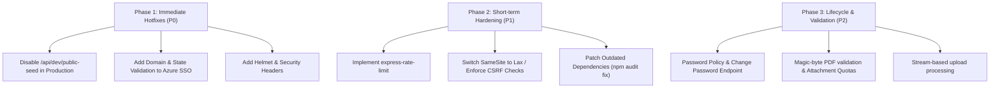

# Security Audit Report — Microgenesis Supply Chain Portal

**Date:** October 9, 2026  
**Auditor:** Application Security Team / Antigravity Security Audit  
**Target Repository:** `Microgenesis Supply Chain Management System`  
**Target Branches:** `dev`, `main`  
**Assessment Scope:** Backend (`Express` + `Prisma`), Frontend (`React 19` + `Vite`), Deployment Configs (`Render`, `Cloudflare Worker`, `Docker`), and Dependency Supply Chain.

---

## 1. Executive Summary

A comprehensive application security audit and code-level vulnerability assessment was performed across the **Microgenesis Supply Chain Portal**. 

The application implements several commendable architectural patterns, notably:
- Strict database abstraction via Prisma ORM using parameterized queries (preventing SQL injection).
- Separation of duties (SoD) across roles (`SALES_COORDINATOR`, `LOGISTICS`, `TASS`, `ADMIN`, `DRIVER`).
- Strict server-side record scoping (`recordScope`) preventing drivers and coordinators from reading unauthorized records.
- Storing JWT authentication tokens exclusively in `httpOnly` cookies rather than local storage.
- Multi-step validation on delivery photos (magic-byte check and pixel analysis via `sharp`).

However, **critical security vulnerabilities and architectural gaps** were identified that expose the application to severe risks, including unauthenticated total data loss, account takeover, cross-site request forgery, denial of service, and supply chain exposure.

---

## 2. Risk Matrix & Vulnerability Summary

| Vulnerability ID | Severity | Category | Vulnerability Summary | CVSS v3.1 |
| :--- | :--- | :--- | :--- | :--- |
| **SEC-01** | **CRITICAL** | Broken Access Control | Unauthenticated database wipe & reseeding route (`POST /api/dev/public-seed`) | **10.0** |
| **SEC-02** | **HIGH** | Authentication & SSO | Azure AD OAuth2 login CSRF (missing `state`) & open tenant auto-provisioning | **8.6** |
| **SEC-03** | **HIGH** | Session Security / CSRF | `SameSite: 'none'` session cookies without anti-CSRF protection | **8.1** |
| **SEC-04** | **HIGH** | Rate Limiting & DoS | Total absence of rate limiting across login, email dispatch, and uploads | **7.5** |
| **SEC-05** | **HIGH** | Security Misconfiguration | Absence of HTTP security headers (No Helmet, No CSP, Clickjacking risk) | **7.4** |
| **SEC-06** | **HIGH** | Supply Chain / Dependencies | Vulnerable dependencies (`shell-quote`, `nodemailer`, `xlsx`, `dompurify`) | **7.8** |
| **SEC-07** | **MEDIUM** | Resource Exhaustion (DoS) | Unbounded memory buffering (`multer.memoryStorage`) & no upload quotas | **6.5** |
| **SEC-08** | **MEDIUM** | Input Validation | Missing magic-byte/content verification for non-photo uploads (`.pdf`, `.doc`) | **5.3** |
| **SEC-09** | **MEDIUM** | Credential Management | Lack of password policy, password change endpoint, or JWT revocation | **5.8** |
| **SEC-10** | **LOW** | Information Disclosure | Unauthenticated health check environment disclosure & hardcoded URLs | **4.3** |

---

## 3. Detailed Technical Findings

### SEC-01: Public Unauthenticated Database Wipe Route (CRITICAL)
- **Affected File:** `server/src/routes/dev.ts` (lines 24–34) and `server/src/index.ts` (line 100)
- **Vulnerability Type:** CWE-306 (Missing Authentication for Critical Function) / CWE-284 (Improper Access Control)
- **CVSS Vector:** `CVSS:3.1/AV:N/AC:L/PR:N/UI:N/S:C/C:H/I:H/A:H` (**10.0**)
- **Description:**  
  While `/api/dev/reset-seed` correctly verifies `requireAuth`, `requireResource('admin')`, `requireRole('ADMIN')`, and `NODE_ENV !== 'production'`, the `/api/dev/public-seed` endpoint is completely unauthenticated and lacks the production environment check:
  ```typescript
  // Public endpoint for demo seeding directly from the login page.
  // Be careful: this allows unauthenticated database resets!
  router.post('/public-seed', async (_req, res) => {
    try {
      await runSeed(true);
      res.json({ ok: true });
    } catch (err) {
      console.error('Public seed failed:', err);
      res.status(500).json({ error: 'Failed to reset seed data' });
    }
  });
  ```
  `runSeed(true)` executes `deleteMany()` across 15 database tables (`DeliveryRecord`, `User`, `AuditLog`, `Customer`, `Supplier`, `Product`, `InventoryItem`, etc.) and resets default credentials to `admin@microgenesis.com / admin123`.
- **Impact:** Any anonymous user on the public internet can wipe all production data, delete audit records, and achieve total account takeover.
- **Remediation:**
  1. Add a hard fail-closed check on `process.env.NODE_ENV === 'production'`:
     ```typescript
     if (process.env.NODE_ENV === 'production') {
       return res.status(403).json({ error: 'Endpoint disabled in production environment' });
     }
     ```
  2. Guard or completely remove `/public-seed` outside of sandboxed local automated tests.
  3. Ensure `server/src/index.ts` does not mount `devRoutes` in production deployments.

---

### SEC-02: Azure AD SSO Login CSRF & Open Tenant Auto-Provisioning (HIGH)
- **Affected File:** `server/src/routes/auth.ts` (lines 62–180)
- **Vulnerability Type:** CWE-352 (Cross-Site Request Forgery) / CWE-287 (Improper Authentication)
- **CVSS Vector:** `CVSS:3.1/AV:N/AC:L/PR:N/UI:R/S:U/C:H/I:H/A:N` (**8.6**)
- **Description:**  
  1. **Missing OAuth `state` parameter:** `msalApp.getAuthCodeUrl` initiates the authorization code flow without generating, storing, and validating a cryptographically secure random `state` token. This exposes users to OAuth Login CSRF where an attacker can trick a victim into authenticating into the attacker's account or binding an attacker's identity.
  2. **Unrestricted Tenant Scope:** `process.env.AZURE_TENANT_ID` defaults to `'common'`. Any personal Microsoft account (`@outlook.com`, `@live.com`, or external corporate tenant) can authenticate.
  3. **Automatic Privilege Provisioning:** Any newly authenticated Microsoft user is automatically created with `role: 'SALES_COORDINATOR'` (`auth.ts:156`) without validating the email domain (e.g. `@microgenesis.com`).
  4. **Account Pre-Hijacking:** The callback matches accounts by email string without checking if the user was explicitly provisioned or verifying email authenticity.
- **Impact:** External unauthorized individuals can authenticate with personal Microsoft accounts and immediately obtain internal sales and delivery access.
- **Remediation:**
  1. Generate a cryptographic `state` token before calling `getAuthCodeUrl`, store it in an `httpOnly`, `sameSite: 'lax'` signed cookie, and verify it in `/api/auth/microsoft/callback`.
  2. Enforce a single corporate tenant ID (`AZURE_TENANT_ID` must not be `'common'` in production).
  3. Enforce email domain validation: reject any email not ending in `@microgenesis.com`.
  4. Only allow SSO login for pre-existing active users created by an administrator.

---

### SEC-03: `SameSite: 'none'` Session Cookies Without CSRF Protection (HIGH)
- **Affected File:** `server/src/middleware/auth.ts` (lines 43–51) and `server/src/index.ts`
- **Vulnerability Type:** CWE-352 (Cross-Site Request Forgery)
- **CVSS Vector:** `CVSS:3.1/AV:N/AC:L/PR:N/UI:R/S:U/C:H/I:H/A:N` (**8.1**)
- **Description:**  
  In production, `setSessionCookie` sets:
  ```typescript
  res.cookie(COOKIE_NAME, token, {
    httpOnly: true,
    sameSite: isProd ? 'none' : 'lax',
    secure: isProd,
    maxAge: 8 * 60 * 60 * 1000
  });
  ```
  `SameSite: 'none'` causes the browser to send `mg_session` with **every cross-origin request**. The backend implements no anti-CSRF token verification (such as `csrf-csrf`), no double-submit cookies, and no `Origin` or `Sec-Fetch-Site` header checks on mutating HTTP methods (`POST`, `PUT`, `PATCH`, `DELETE`).
- **Impact:** An attacker's website can execute cross-origin authenticated requests on behalf of a logged-in user (e.g., updating delivery statuses, uploading attachments, or triggering logouts).
- **Remediation:**
  1. Route all frontend requests through the reverse proxy (`Cloudflare Worker` or custom domain) so that frontend and backend share the same site, allowing `sameSite: 'lax'` or `'strict'`.
  2. If cross-site requests are mandatory, implement anti-CSRF tokens for all state-changing endpoints and validate `req.headers['sec-fetch-site'] !== 'cross-site'`.

---

### SEC-04: Complete Absence of Rate Limiting (HIGH)
- **Affected File:** `server/src/index.ts`, `server/src/routes/auth.ts`, `server/src/routes/notifications.ts`, `server/src/routes/admin.ts`
- **Vulnerability Type:** CWE-307 (Improper Restriction of Excessive Authentication Attempts) / CWE-770 (Allocation of Resources Without Limits)
- **CVSS Vector:** `CVSS:3.1/AV:N/AC:L/PR:N/UI:N/S:U/C:L/I:N/A:H` (**7.5**)
- **Description:**  
  The application does not use `express-rate-limit` or any token-bucket throttling.
  - `/api/auth/login`: Vulnerable to brute-force credential stuffing and dictionary attacks.
  - `/api/notifications/send-email`: Can be called repeatedly by any user with `records` permission to spam staff or exhaust mail server quotas.
  - `/api/admin/test-email`: Can be spammed by an administrative account to trigger external mail flooding.
  - `/api/records/:id/attachments`: Can be spammed to exhaust disk space or bandwidth.
- **Impact:** Account compromise via password brute-forcing; denial of service via mail server quota exhaustion or storage saturation.
- **Remediation:**
  Install `express-rate-limit` and configure dedicated limiters:
  - **Auth Limiter:** Max 5 failed attempts per IP per 15 minutes.
  - **Email Limiter:** Max 10 email dispatches per user per hour.
  - **Global API Limiter:** Max 300 requests per IP per minute.

---

### SEC-05: Missing Standard HTTP Security Headers (HIGH)
- **Affected File:** `server/src/index.ts`
- **Vulnerability Type:** CWE-693 (Protection Mechanism Failure) / CWE-1021 (Improper Restriction of Rendered UI Layers or Frames)
- **CVSS Vector:** `CVSS:3.1/AV:N/AC:L/PR:N/UI:R/S:C/C:L/I:L/A:N` (**7.4**)
- **Description:**  
  Express is mounted without `helmet` or explicit security headers:
  - Missing `X-Frame-Options` and `Content-Security-Policy: frame-ancestors 'none'` permits external websites to embed the supply chain portal in an `<iframe>`, enabling Clickjacking.
  - Missing `X-Content-Type-Options: nosniff` enables browser MIME sniffing vulnerabilities.
  - Missing `Strict-Transport-Security` (HSTS) allows SSL stripping.
- **Remediation:**
  Install and configure `helmet` in `server/src/index.ts`:
  ```typescript
  import helmet from 'helmet';
  app.use(helmet({
    contentSecurityPolicy: {
      directives: {
        defaultSrc: ["'self'"],
        scriptSrc: ["'self'"],
        styleSrc: ["'self'", "'unsafe-inline'"],
        imgSrc: ["'self'", 'data:', 'blob:'],
        connectSrc: ["'self'", CLIENT_ORIGIN],
        frameAncestors: ["'none'"]
      }
    },
    hsts: { maxAge: 31536000, includeSubDomains: true }
  }));
  ```

---

### SEC-06: Known Vulnerabilities in Dependencies (HIGH)
- **Source:** `npm audit`
- **Vulnerability Type:** CWE-1395 (Dependency on Vulnerable Third-Party Component)
- **Summary:**  
  14 vulnerabilities detected (2 Critical, 7 High, 4 Moderate, 1 Low):
  - **`shell-quote` (Critical - GHSA-pqg4-j6r4-53mv):** Command injection via line terminators in token after `{ comment }` (used by `concurrently`).
  - **`nodemailer` (High - GHSA-268h-hp4c-crq3, GHSA-p6gq-j5cr-w38f):** CRLF header injection, SSRF, and DoS via address parsing.
  - **`xlsx` (High - GHSA-4r6h-8v6p-xvw6):** Prototype pollution in SheetJS.
  - **`dompurify` (Moderate/High - GHSA-p98j-92pf-mc4p):** DOM XSS bypass in older versions.
  - **`mysql2` (High - GHSA-3f6p-5ww8-9rcr):** Auth plugin downgrade credential disclosure (Prisma dependency).
- **Remediation:**
  - Update `nodemailer` to `>= 6.10.0` or `10.x`.
  - Replace `xlsx` with `exceljs` (which is already present in `client/package.json`).
  - Update root dev dependencies (`concurrently`) to patch `shell-quote`.

---

### SEC-07: Unbounded Memory Buffering & Missing Attachment Quotas (MEDIUM)
- **Affected File:** `server/src/services/podStorage.ts` (lines 92–94) and `server/src/routes/records.ts` (lines 221–292)
- **Vulnerability Type:** CWE-400 (Uncontrolled Resource Consumption)
- **CVSS Vector:** `CVSS:3.1/AV:N/AC:L/PR:L/UI:N/S:U/C:N/I:N/A:H` (**6.5**)
- **Description:**  
  1. `multer.memoryStorage()` buffers incoming files up to 10MB completely in Node.js process RAM. A burst of concurrent uploads can trigger an Out-Of-Memory (OOM) crash.
  2. There is no quota on the maximum number of attachments per `DeliveryRecord`.
- **Remediation:**
  1. Stream uploads to temporary storage or cloud storage instead of buffering raw buffers in heap memory.
  2. Enforce an attachment limit (e.g. maximum 10 attachments per record).

---

### SEC-08: Incomplete Magic-Byte Verification for Document Uploads (MEDIUM)
- **Affected File:** `server/src/routes/records.ts` (lines 230–233) & `server/src/services/podStorage.ts`
- **Vulnerability Type:** CWE-434 (Unrestricted Upload of File with Dangerous Type)
- **CVSS Vector:** `CVSS:3.1/AV:N/AC:L/PR:L/UI:N/S:U/C:L/I:L/A:N` (**5.3**)
- **Description:**  
  While `.jpg` and `.png` files are checked for magic bytes and pixel stats, `.pdf` and `.doc` files only rely on client-supplied extensions and MIME headers. An attacker can upload arbitrary files by spoofing the file extension and MIME header.
- **Remediation:**
  Enforce magic-byte validation for PDF files (`%PDF-` header: `Buffer.from([0x25, 0x50, 0x44, 0x46])`).

---

### SEC-09: Password Management & JWT Revocation Gaps (MEDIUM)
- **Affected File:** `server/src/routes/users.ts` & `server/src/routes/auth.ts`
- **Vulnerability Type:** CWE-521 (Weak Password Requirements) / CWE-613 (Insufficient Session Expiration)
- **CVSS Vector:** `CVSS:3.1/AV:N/AC:L/PR:L/UI:N/S:U/C:H/I:N/A:N` (**5.8**)
- **Description:**  
  - No password complexity or length policy is enforced when creating users.
  - No user self-service password change or admin reset endpoint exists.
  - Logout only deletes the client cookie. Issued JWTs remain valid until their 8-hour expiration.
- **Remediation:**
  - Enforce minimum 12-character passwords with complexity requirements.
  - Add `POST /api/auth/change-password` with current password verification.
  - Maintain a `tokenVersion` or `passwordChangedAt` in the `User` table to immediately invalidate JWTs upon password change or logout.

---

### SEC-10: Information Disclosure via Health Checks & Hardcoded URLs (LOW)
- **Affected File:** `server/src/index.ts` (lines 60–85) and `worker.js` (line 6)
- **Vulnerability Type:** CWE-200 (Exposure of Sensitive Information)
- **CVSS Vector:** `CVSS:3.1/AV:N/AC:L/PR:N/UI:N/S:U/C:L/I:N/A:N` (**4.3**)
- **Description:**  
  - `/api/health` exposes missing environment variable names and mailer implementation details to unauthenticated visitors.
  - Fallback backend URL `https://supply-chain-9fnl.onrender.com` is hardcoded in public worker scripts.
- **Remediation:**
  - Keep public `/api/health` minimal (`{ ok: true }`). Move diagnostic health checks behind admin authentication.
  - Ensure workers fail closed if `API_BASE_URL` is omitted rather than falling back to hardcoded URLs.

---

## 4. Defense-in-Depth Strengths Observed

The codebase demonstrates several strong security controls:
1. **Parameterized Queries:** Prisma ORM is consistently used; raw SQL queries use parameterized template tags (`$queryRaw` / `$executeRaw`), eliminating SQL injection risks.
2. **Access Control & Row Scoping:** `recordScope` enforces role-specific visibility; Driver profiles strictly isolate run assignments.
3. **Cookie Security:** The JWT is transmitted in an `httpOnly` cookie rather than localStorage, preventing credential theft via XSS.
4. **Image Validation:** Deep raster verification with `sharp` prevents pixel-flood and malformed image exploits.

---

## 5. Phased Remediation Roadmap



### Action Checklist
- [ ] **P0:** Guard `/api/dev/public-seed` against execution in production.
- [ ] **P0:** Add OAuth `state` parameter and `@microgenesis.com` domain validation to Microsoft SSO.
- [ ] **P1:** Add `helmet` in `server/src/index.ts` with Clickjacking and CSP defenses.
- [ ] **P1:** Add `express-rate-limit` for authentication and email routes.
- [ ] **P1:** Resolve dependency CVEs via `npm update` / `npm audit fix`.
- [ ] **P2:** Enforce PDF magic-byte checks and upload limits per delivery record.
- [ ] **P2:** Implement user password change and complexity validation.
