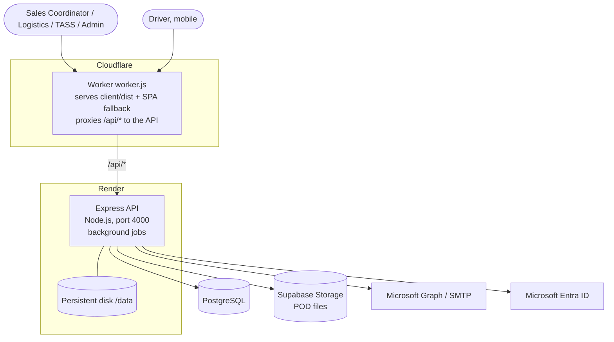
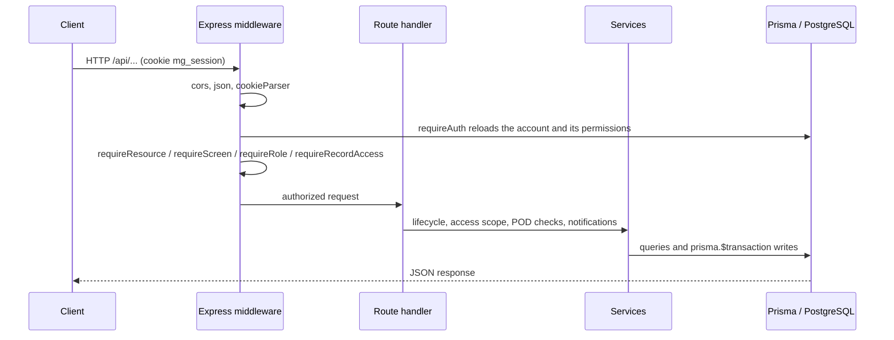
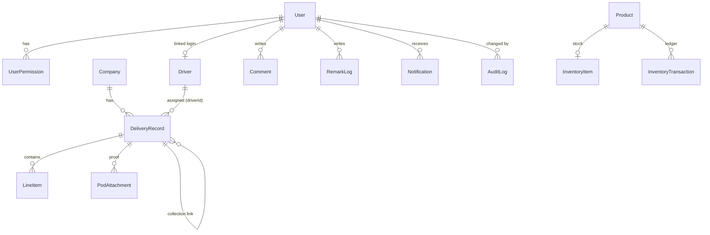

# System Architecture: Microgenesis Supply Chain Portal

> Last verified: 2026-10-09 against commit `ccbf192` (`dev`).
> The code is the source of truth. Companion documents: [business requirements](./BUSINESS_REQUIREMENTS.md), [API contract](./API_CONTRACT.md), [module access](./MODULE_ACCESS.md), [`DONT_BREAK_THIS.md`](../DONT_BREAK_THIS.md), [project issues](./PROJECT_ISSUES_REPORT.md).

## 1. System overview

**System:** Microgenesis Supply Chain Portal, an internal portal that replaces legacy SharePoint trackers.
**Purpose:** one source of truth for deliveries, RMA/TASS, procurement pick-ups, accounting collections, sales orders, driver operations, directories and SKU master data.
**Roles:** `SALES_COORDINATOR`, `LOGISTICS`, `TASS`, `ADMIN`, `DRIVER`.
**Style:** modular monolith in an npm-workspaces monorepo (`client/`, `server/`), one PostgreSQL database.

## 2. Technology stack

| Layer | Technology |
| :--- | :--- |
| Frontend | React 19, TypeScript, Vite 6, Tailwind CSS v4, TanStack Query 5, Zustand 5, Recharts, Lucide, Sonner (toasts), Motion; exports with `exceljs`, `xlsx`, `jspdf`/`jspdf-autotable`, `docx` |
| Backend | Node.js, Express 4, TypeScript (run with `tsx`), multer (uploads), sharp (image verification), nodemailer, MSAL/Microsoft Graph. Request bodies are validated by hand in the routes; `zod` and the `swagger-*` packages are installed but not used |
| Database | PostgreSQL 16, Prisma 7 (`@prisma/adapter-pg`) |
| Auth | bcrypt-hashed passwords, JWT (8 h) in the `httpOnly` cookie `mg_session`, optional Microsoft Entra ID (Azure AD) SSO |
| File storage | Local disk (`server/uploads/pod`) in development, Supabase Storage in staging/production (`POD_STORAGE_PROVIDER`) |
| Email | Microsoft Graph if `AZURE_*` is set, else SMTP if `SMTP_HOST` is set, else a `mock` mailer that logs to the terminal |
| Tests | Node's built-in `node:test` through `tsx` (server and client unit/HTTP-level tests), Playwright end-to-end suite in `e2e/` |
| CI | GitHub Actions (`.github/workflows/ci.yml`): Prisma validate/generate, type checks and builds for both workspaces. Tests are not run in CI |
| Hosting | API on Render (`render.yaml`), frontend on Cloudflare Workers (`wrangler.json`, `worker.js`), Docker Compose for local PostgreSQL |
| Not present | Caching layer, rate limiting, security headers (`helmet`), job queue |

## 3. Context and deployment



In local development the Vite dev server (port 3000) proxies `/api/*` to Express
(port 4000), so the session cookie is same-origin. In production the API can
also serve the built frontend (`FRONTEND_DIST`, `NODE_ENV=production`), but the
live setup serves the frontend from Cloudflare. See
[Cloudflare deployment](./CLOUDFLARE_DEPLOYMENT.md).

Deployment flow: pushes to GitHub trigger Render (`buildCommand`: install,
`prisma generate`, `npm run build`; `startCommand`: `npx prisma migrate deploy && npm run start`).
The seed is **not** run on deploy. Cloudflare Workers Builds track the `staging` branch.
`render.yaml` configures `healthCheckPath: /api/v1/health`. The public
[readiness route](../server/src/routes/health.ts) checks database connectivity
and required production configuration, returning only `{ ok: true }` (200) or
`{ ok: false }` (503), with `Cache-Control: no-store`. Detailed deployment
and integration diagnostics require Admin access. `RENDER_EXTERNAL_URL` enables
a 10-minute self-ping. Repository configuration does not establish that a hosted
service has applied the setting; verify the effective deployed health path.

## 4. Frontend (`client/src`)

```text
client/src
├── App.tsx            Session bootstrap, server-availability gate, 30 s permission refresh, Sonner <Toaster> (bottom-right)
├── routes/            AppRouter.tsx (screen → page switch), screenRouting.ts (category ↔ screen keys, URL sync)
├── layouts/           MainLayout, Navbar, Sidebar (collapsible rail)
├── pages/             Thin page components (one per screen)
├── features/          accounting, admin, auth, customers, dashboard, deliveries, drivers, inventory, suppliers, transactions
├── api/               fetch wrapper (index.ts), queryClient, availability check, queries/ (TanStack Query hooks)
├── store/             authStore.ts, uiStore.ts (Zustand)
├── hooks/, utils/, types/, components/
```

- **Navigation:** URL path is the screen key (`/deliveries`, `/driver_board`, …). `AppRouter.tsx` renders the page for the active screen; `syncAuthenticatedRoute` falls back to an allowed screen. Accounts with no modules reach `/no-access`.
- **Permissions:** the client never invents role defaults. It uses the `effectiveScreens` snapshot returned by `POST /api/auth/login` and `GET /api/auth/me`, and `canAccess(screen)` to gate the sidebar, routes and queries. The snapshot is refreshed every 30 s, on focus/reconnect, and after a 401/403. A changed `permissionVersion` rebuilds the query cache.
- **Drivers:** the `DRIVER` role gets a standalone mobile dashboard (`driver_dashboard`) with no sidebar.
- **Screens (sidebar):** Main, Dashboard, Deliveries, RMA, Accounting Collection, Procurement Pick-up, Sales Orders, Customers, Suppliers, Drivers (tabs: View `driver`, Board `driver_board`, Manager `driver_manager`), Admin Panel, Delivery Calendar, Reports (`statistical_reports`), AM Directory, Transaction Center, SKU Master (`inventory`), Data Sampler (Admin only).
- **Retired screens:** Status History was removed (TSK-103; the Audit Trail remains). The Warehouses view files remain in `features/inventory` but are not routed.

## 5. Backend (`server/src`)

```text
server/src
├── index.ts           Express app, route mounting, /api/v1/health, background jobs
├── db.ts              Prisma client singleton
├── mappings.ts        UI ↔ DB category/status mappings, record serializer
├── areaHierarchy.ts   Area hierarchy used for driver coverage matching
├── middleware/        auth.ts (requireAuth, requireRole, requireResource, requireScreen), asyncRoute, uploadErrors
├── routes/            auth, records, companies, customers, suppliers, users, drivers, dashboard, admin,
│                      skus, transactions, notifications, reports, data-sampler, dev
└── services/          permissions (canonical RBAC policy), recordAccess, transactionAccess, deliveryLifecycle,
                       driverIdentity/driverDirectory/driverCoverage/driverLogin/historicalDrivers,
                       podPhotos/podStorage, audit, inAppNotify, notify, mailer, customerValidation, dailyStatusSnapshot
```

### Request flow



## 6. Authentication and authorization

1. `POST /api/auth/login` verifies the bcrypt hash, signs an 8-hour JWT and sets the `mg_session` cookie (`httpOnly`; `sameSite=lax` in development, `sameSite=none` + `secure` in production). Normal browser API calls remain relative and pass through the Cloudflare Worker proxy. The server refuses to start in production without `JWT_SECRET`.
2. Optional SSO (planned for company rollout once the system is complete; local email/password login is used until then): `POST /api/auth/microsoft` (returns 501 when not configured), `GET /api/auth/microsoft/callback`, `GET /api/auth/microsoft/status`. The callback matches `User.microsoftOid`, then email; an unknown Microsoft user is auto-created as an active `SALES_COORDINATOR` (see issue 13.4 in the project issues report).
3. **Every protected request reloads the user and permissions**, so revoking access takes effect on the next call even with an old cookie.
4. Authorization is layered:
   - `requireResource(...)`: coarse shared-resource access derived from the account's effective screens (`RESOURCE_SCREENS` in `services/permissions.ts`).
   - `requireScreen(...)`: a specific module grant.
   - `requireRole(...)`: privileged actions (every write route also has `requireAuth`).
   - `requireRecordAccess` and `recordScope`: category limits (TASS reads only RMA and Accounting Collection) and Driver ownership via the Admin-linked `Driver` profile (`driverId`), plus explicit per-category denials.
   - Field/lifecycle rules in `services/deliveryLifecycle.ts` (status transitions, Time In, Draft return, future-dated Driver read-only).
5. Role defaults live only in `server/src/services/permissions.ts` (`ROLE_DEFAULTS`); Admin can grant or deny individual modules per user (`UserPermission`). Admin Panel is Admin-only. See [Module access](./MODULE_ACCESS.md).

## 7. Data model

All operational records live in one `DeliveryRecord` table (single-table design, `category` = `DELIVERY | RMA | ACCOUNTING_COLLECTION | PROCUREMENT_PICKUP | SALES_ORDERS`). Enums are plain strings constrained in the application layer (`mappings.ts`, `deliveryLifecycle.ts`).



| Model | Notes |
| :--- | :--- |
| `User`, `UserPermission` | Accounts and per-user module overrides (`microsoftOid` for SSO) |
| `Driver` | Directory of drivers and assistants (`type`), JSON `coverageAreas`, optional `userId` login link |
| `Company`, `Customer`, `Supplier` | Company is the validated lookup used on records; Customer and Supplier are separate relationship directories with no foreign key to records |
| `DeliveryRecord` | Soft-delete (`deletedAt`), `draft`, `driverId` ownership, `timeIn`/`timeOut`, `completedLate`/`daysLate`, collection verification fields, `linkedCollectionId`; string `deliveryDate` (`YYYY-MM-DD`, Asia/Manila semantics) |
| `LineItem` | Per-record SKU and quantity (text `sku`, not a foreign key to `Product`) |
| `PodAttachment` | Proof-of-delivery file metadata (`storageKey`, MIME, size, uploader) |
| `AuditLog`, `RemarkLog`, `Comment` | Audit trail, append-only remark history, record comments |
| `Notification`, `NotificationLog` | In-app bell entries; email log (`SENT | FAILED | MOCKED`) |
| `Product`, `InventoryItem`, `InventoryTransaction` | SKU Master, one stock row per product, stock ledger |
| `DailyStatusSnapshot` | Per-day record counts by category and status |

Migrations are in `server/prisma/migrations` (latest: `20261008093000_add_delivery_lateness`). Indexes on `DeliveryRecord`: `[deletedAt, category, status]`, `[driver]`, `[driverId]`, `[deliveryDate]`, `[companyId]`, `[accountManager]`, `[linkedCollectionId]`.

## 8. Delivery lifecycle

States: `Draft → Scheduled → In Transit → Delivered`, with `Pending`, `On-Hold` and `Rescheduled` branches (`RUN_TRANSITIONS` in `services/deliveryLifecycle.ts`).

- **In Transit** is entered only through the dedicated Time In action (assigned driver required).
- **Delivered** requires a recorded Time In, recipient, remarks and at least one verified JPG/PNG proof photo; the server stamps Time Out.
- **Draft** return is limited to Sales Coordinator/Admin and only before Time In.
- Drivers can act on today's and overdue Deliveries; future-dated unstarted runs are read-only. Eligibility uses Asia/Manila time.
- Late completion is persisted (`completedLate`, `daysLate`).

## 9. Integrations and background jobs

- **Mailer** (`services/mailer.ts`): Graph → SMTP → mock fallback.
- **Notifications:** in-app bell entries (`inAppNotify`) on record events (a submitted non-draft record notifies Logistics, driver assignment notifies the creator, completion of an Accounting Collection notifies TASS, collection verification notifies the record creator); a real email plus `NotificationLog` row on **Accomplished** (`services/notify.ts`). Other Output Actions in the UI are simulated (see `DONT_BREAK_THIS.md`).
- **Jobs** (`server/src/index.ts`, in-process timers, Asia/Manila clock): daily 4 PM reminders (unassigned scheduled records to Logistics, unfinished records to Account Managers), 6 PM end-of-day snapshot/alerts, Monday 8 AM weekly report, and a snapshot written at boot. They run in the API process, so they are not safe for multiple instances and are lost while the host sleeps.
- **Microsoft Teams:** `teams/` holds a tab-app manifest and packaging script.

## 10. Testing

- Server: `server/tests/*.test.ts` (permissions, records integration, driver identity/coverage/directory, dashboard and reports lifecycle, POD requirements, transaction access, upload errors, customers, regression tests).
- Client: `client/tests/*.test.ts` and co-located `__tests__/` / `tests/` folders (permissions, pagination, session navigation, workspace tabs, lifecycle mutations, date range, POD preview, driver coverage, company history, customer validation, comment composer).
- E2E: `e2e/tests` (Playwright; Sales Coordinator, Logistics, Driver and integration specs).
- Commands: see [Getting started](./GETTING_STARTED.md#7-checks-and-tests).

## 11. Security posture

In place: `httpOnly` session cookie, per-request account reload, layered RBAC with deny-by-default for unknown roles in transaction access, audited admin actions, server-side POD byte verification and 10 MB upload limit, production `JWT_SECRET` fail-fast, and destructive reset routes restricted to an authenticated Admin on an explicitly opted-in local disposable database.

The anonymous destructive seed routes are removed, and staging/production resets are denied before Prisma access. Open gaps (details and evidence in [project issues](./PROJECT_ISSUES_REPORT.md)): no login rate limiting, no `helmet` headers, production cookie is `sameSite=none` with no CSRF token, in-process scheduled jobs, and string-typed dates. The local database check cannot detect a loopback port that a developer has manually tunneled to a remote database, so setup also requires human verification that no tunnel is active.

## 12. Known documentation limits

> ⚠️ UNVERIFIED: Microsoft SSO callback behavior was read, not exercised, because no tenant credentials were available.
> ⚠️ UNVERIFIED: Production hosting details (Render plan, Supabase bucket settings) are inferred from `render.yaml`, `.env.example` and the Cloudflare guide, not from the live environments.
