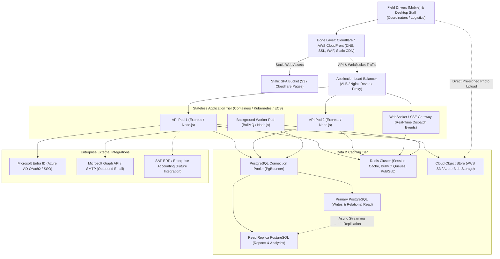
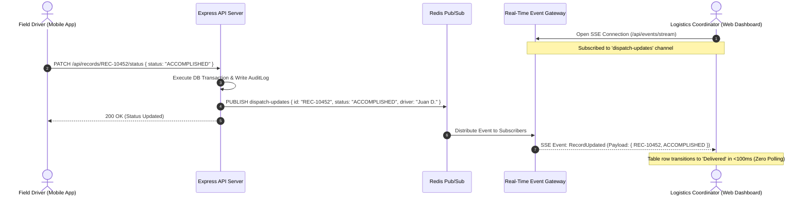
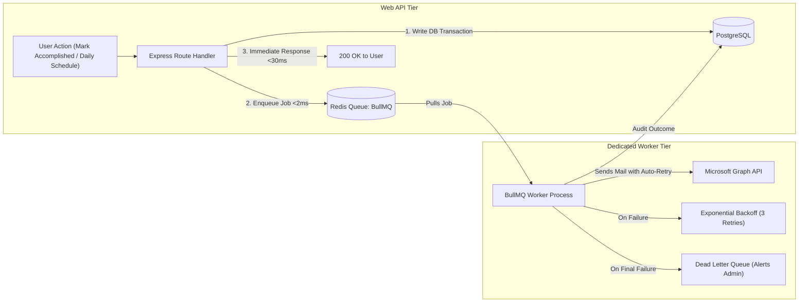
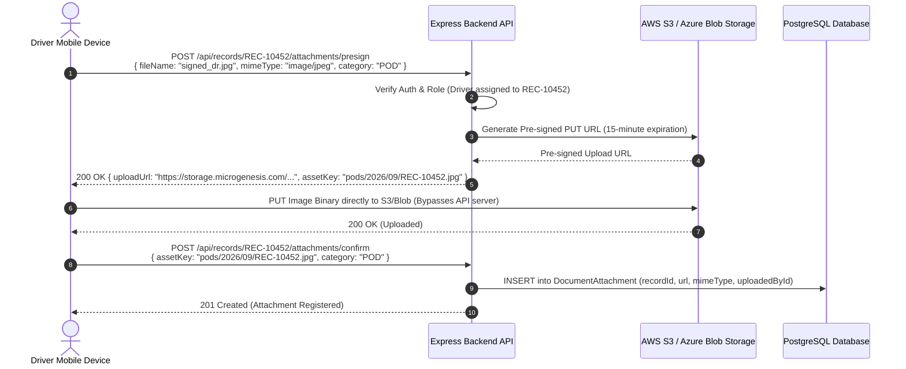
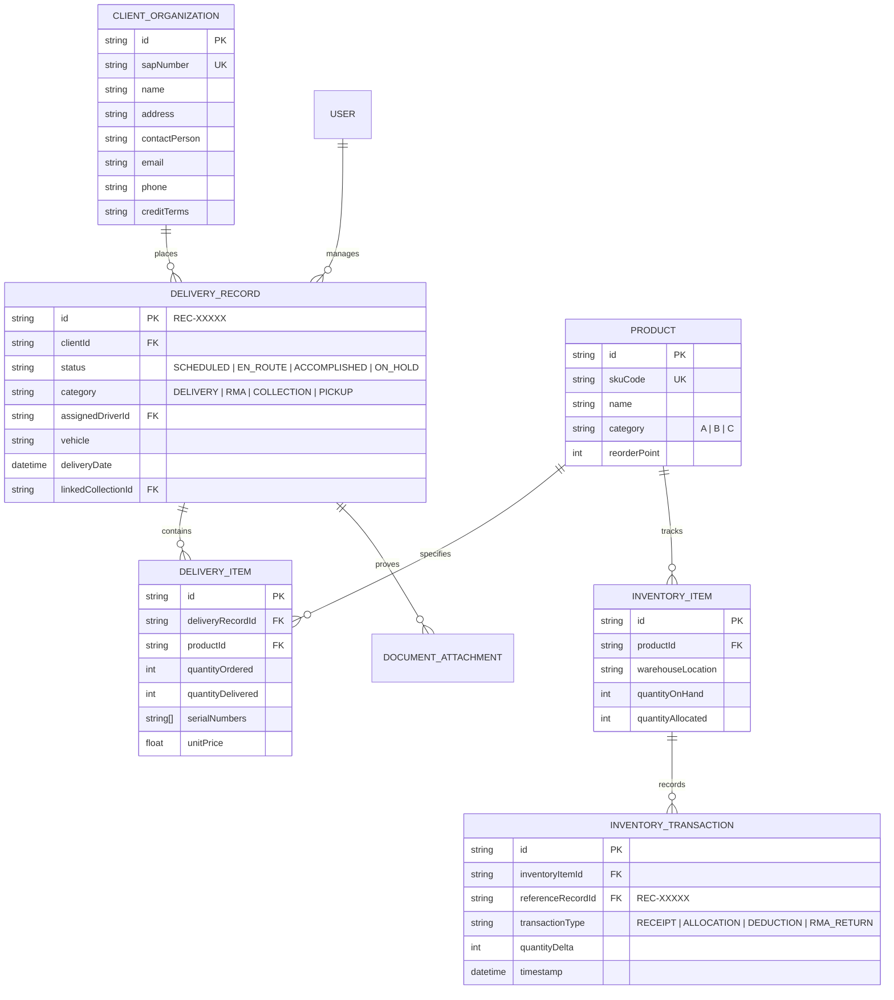
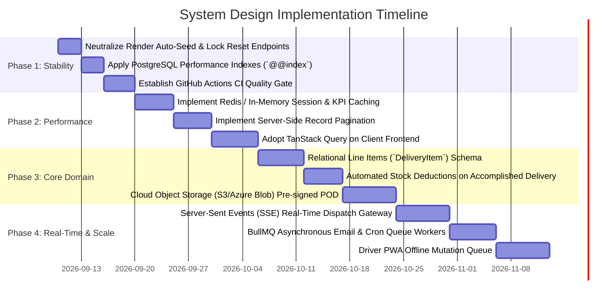

# Microgenesis Supply Chain Portal — System Design & Architecture Recommendations

**Document Date:** September 9, 2026  
**Document Version:** 1.0 (Target-State Architecture Recommendations)  
**Target Systems:** Frontend Client (`src/`), API Backend (`server/`), Database (`PostgreSQL`), and Cloud Infrastructure  
**Companion Document:** [`docs/PROJECT_ISSUES_REPORT.md`](./PROJECT_ISSUES_REPORT.md)

---

## Executive Summary

The **Microgenesis Supply Chain Portal** is currently constructed as a **single-process, coupled web monolith** running an Express API, a React Single-Page Application (SPA), in-memory cron jobs, and synchronous email dispatch on a single container. While this architecture functions as an initial demonstration, it suffers from severe throughput ceilings, synchronous request blocking, blind polling inefficiencies, and lack of real-world operational persistence (such as Proof of Delivery media and inventory synchronization).

This document outlines the **Target System Design Recommendations** required to scale the portal into an enterprise-grade, high-availability, real-time logistics and dispatch platform capable of handling Microgenesis's physical fleet operations, customer deliveries, and financial collections with zero data loss.

---

## Table of Contents

1. [Architectural Evolution Strategy: From Lean Monolith to Selective Microservices](#1-architectural-evolution-strategy-from-lean-monolith-to-selective-microservices)
2. [High-Level Architecture Topology](#2-high-level-architecture-topology)
3. [Real-Time Communication Architecture (Event-Driven vs. Polling)](#3-real-time-communication-architecture-event-driven-vs-polling)
4. [Asynchronous Background Job & Queue Architecture](#4-asynchronous-background-job--queue-architecture)
5. [Cloud Object Storage & Proof of Delivery (POD) Pipeline](#5-cloud-object-storage--proof-of-delivery-pod-pipeline)
6. [Domain-Driven Data Model & Inventory Ledger Architecture](#6-domain-driven-data-model--inventory-ledger-architecture)
7. [Multi-Tier Caching & Consistency Strategy](#7-multi-tier-caching--consistency-strategy)
8. [Enterprise Security & Zero-Trust Governance](#8-enterprise-security--zero-trust-governance)
9. [Incremental Migration & Implementation Roadmap](#9-incremental-migration--implementation-roadmap)

---

## 1. Architectural Evolution Strategy: From Lean Monolith to Selective Microservices

A foundational principle of enterprise software engineering is **avoiding premature distributed systems complexity**. Jumping immediately into microservices for a 20–50 person company introduces immense engineering friction: distributed transaction failures, network latency between microservices, dual-write consistency hazards, complex multi-repo CI/CD, and inflated cloud bills.

Instead, the recommended strategy follows a proven **3-Stage Evolutionary Path** (the model successfully used by Shopify, Basecamp, and GitHub):

```
┌─────────────────────────────────────────────────────────────────────────────┐
│                       THE 3-STAGE EVOLUTIONARY JOURNEY                      │
└─────────────────────────────────────────────────────────────────────────────┘

 [ STAGE 1: LEAN MONOLITH ] ─────────► [ STAGE 2: MODULAR MONOLITH ] ─────────► [ STAGE 3: SELECTIVE MICROSERVICES ]
 • Focus: Day 1 Immediate Soln        • Focus: Medium Growth & Reliability    • Focus: Enterprise Hyper-Scale
 • Single Node.js + Postgres + S3     • API Pod + BullMQ Worker + Redis       • Extract Hot Services (GPS, OCR)
 • Handles: 50-100 users, 50k recs    • Handles: 500 users, 500k recs         • Handles: 1,000+ trucks, multi-squads
 • Cost: ~$25 - $35 / mo              • Cost: ~$80 - $150 / mo                • Cost: Enterprise Cloud Tier
 • Team: 1-3 Developers               • Team: 3-8 Developers                  • Team: 15+ Engineers in Squads
```

---

### Stage 1: The Lean Monolith (Day 1 — Immediate Production Readiness)
* **Goal:** Solve 100% of Microgenesis's immediate pain points (SharePoint 5,000-record limit, missing audit trail, dirty data, fake Proof of Delivery, and database auto-wipe) with the smallest possible operational footprint.
* **Architecture:**
  * Single Express + TypeScript Node.js backend.
  * Single React + Vite Single-Page Application (SPA).
  * Single managed PostgreSQL database instance (with proper `@@index` annotations and server-side pagination).
  * Cloud Object Storage bucket (AWS S3 or Azure Blob) for signed receipt photos.
* **Operational Profile:**
  * **Capacity:** Up to 100 concurrent coordinators, logistics staff, and drivers; 50,000+ delivery records.
  * **Estimated Cloud Cost:** **~$25–$35 / month** (e.g. Render Standard Web Service + Managed Postgres Starter + S3 standard).
  * **Engineering Complexity:** Low. Zero distributed system failure modes; one unified codebase to build, test, and deploy.

---

### Stage 2: The Modular Monolith with Decoupled Workers (Growth Stage)
* **Trigger to Transition:**
  * Microgenesis expands its active fleet to **50+ drivers** and **5,000+ monthly deliveries**.
  * Outbound email volume or scheduled cron jobs begin to impact web request responsiveness.
  * The business deploys multiple API containers behind a load balancer for high availability.
* **Architecture:**
  * Keep the **same unified codebase and single PostgreSQL database**, but decouple runtime execution:
    * **Stateless Web API Pods:** Handle user logins, queries, and record updates.
    * **Dedicated Worker Pods:** Run BullMQ background workers consuming from a managed Redis instance. Workers process outbound emails, generate large PDF/Excel reports, and execute the 4:00 PM daily dispatch alert.
    * **Redis Caching:** In-memory caching for session validation and dashboard KPI aggregations.
* **Operational Profile:**
  * **Capacity:** 500+ concurrent staff, 500,000+ records, multi-region branch offices (e.g. Cebu/Davao branches).
  * **Estimated Cloud Cost:** **~$80–$150 / month**.
  * **Engineering Complexity:** Moderate. Requires managing Redis for job queuing and pub/sub.

---

### Stage 3: Selective Microservices (Enterprise Hyper-Scale)
* **Crucial Rule:** **Do NOT decompose into microservices based on arbitrary traffic volume.** Decompose only when specific operational or organizational triggers are met.

#### The 3 Concrete Triggers That Justify Extracting a Microservice:

| Trigger Condition | Why a Monolith Bottlenecks | Microservice Extraction Solution |
|---|---|---|
| **1. Team Scaling (Squad Ownership)** | When Microgenesis grows to 15–20+ software engineers split into distinct departments (*Fleet Squad*, *Warehouse Squad*, *Finance/SAP Squad*), developers step on each other's toes in a single codebase with merge conflicts and deploy freezes. | Break into bounded services by domain: `Fleet-Service`, `Inventory-Service`, `Billing-Service`. Each team deploys their service independently. |
| **2. Extreme Write Telemetry (Live GPS Tracking)** | If 500 delivery trucks stream real-time GPS coordinates every 3 seconds, that generates **166 write requests per second**. Flooding the primary business relational database with ephemeral GPS coordinates degrades core order processing. | Extract a lightweight **GPS & Telemetry Ingestion Service** (Node.js/Go) writing to a dedicated time-series store (TimescaleDB or DynamoDB), completely isolated from the order database. |
| **3. Heavy Compute Isolation (AI / OCR / Routing)** | Generating AI-driven optimal multi-stop driver route slips or running OCR on scanned physical Delivery Receipts consumes 100% CPU and 4GB+ RAM. If run inside the main API, it can crash the server and drop active driver mobile sessions. | Extract an **Optimization & Document OCR Service** onto auto-scaling GPU/CPU compute nodes that scale to zero when idle. |

---

## 2. High-Level Architecture Topology

The recommended target production architecture decouples presentation, computation, asynchronous workers, caching, and persistent storage into horizontally scalable tiers.



---

## 3. Real-Time Communication Architecture (Event-Driven vs. Polling)

### The Problem in Current Architecture
Currently, [`src/App.tsx:246`](../src/App.tsx#L246) invokes `refreshData()` on a blind 60-second timer (`setInterval`), and the notification bell periodically polls `/api/notifications/unread-count`. This causes:
* **Operational Latency:** A dispatcher waiting for a driver to accomplish a critical VIP delivery may wait up to 60 seconds after physical completion before the dashboard updates.
* **Database Thrashing:** 50 concurrent staff members generate thousands of repetitive SQL aggregation queries per minute when 95% of requests return identical data.

### Recommended System Design: Server-Sent Events (SSE) & WebSocket Pub/Sub



#### Architectural Decisions:
1. **Protocol Selection:** Use **Server-Sent Events (SSE)** for web dispatchers. SSE operates over standard HTTP/2, automatically reconnects, bypasses restrictive corporate firewalls, and requires no complex bidirectional WebSocket handshake since dispatchers only need inbound updates.
2. **Multi-Node Synchronization:** Back the event stream with **Redis Pub/Sub** (`redis.publish('dispatch-updates', data)`). When API Pod 1 receives a status update from a mobile driver, all connected SSE clients on Pod 1, Pod 2, or Pod $N$ receive the update instantly.

---

## 4. Asynchronous Background Job & Queue Architecture

### The Problem in Current Architecture
Currently, outbound emails (Accomplished notifications, the daily 4 PM logistics alert, weekly summaries) execute synchronously inside the Express request-response loop ([`server/src/services/mailer.ts`](../server/src/services/mailer.ts)). If Microsoft Graph or the SMTP server experiences a 5–10 second network freeze, the user's browser hangs. Furthermore, scheduled jobs run in Node's single-process memory; running multiple container replicas causes **duplicate scheduled emails**.

### Recommended System Design: BullMQ + Redis Queue Workers



#### Architectural Decisions:
1. **Isolated Responsibilities:** Decouple web request handlers from long-running tasks. Outbound emails, daily notification rollup aggregations, and PDF/Excel batch exports must run on a dedicated worker queue.
2. **Distributed Cron Execution:** Use BullMQ's repeatable jobs. Even if 4 API pods are running, Redis acts as the distributed lock coordinator, ensuring the **4:00 PM Logistics daily alert runs exactly once**.
3. **Fault Tolerance & Dead Letter Queue (DLQ):** Network errors communicating with Microsoft Graph or SMTP automatically trigger exponential backoff retries ($10\text{s} \rightarrow 30\text{s} \rightarrow 2\text{m}$). Failed jobs land in a Dead Letter Queue visible in the Admin Panel.

---

## 5. Cloud Object Storage & Proof of Delivery (POD) Pipeline

### The Problem in Current Architecture
[`DONT_BREAK_THIS.md:75`](../DONT_BREAK_THIS.md#L75) confirms that document attachments currently store only a filename string in the database (`documentAttachment: String?`). In physical logistics, an unverified delivery is legally unenforceable. Drivers have no way to attach signed Delivery Receipts (DR), recipient signatures, or photos of customer checks.

### Recommended System Design: Direct-to-Storage Pre-Signed URL Pipeline

To prevent large multi-megabyte image and PDF uploads from choking Node.js CPU and memory, mobile clients and browsers must upload directly to **Cloud Object Storage (AWS S3 / Azure Blob Storage)** via time-limited pre-signed URLs.



#### Storage Schema Recommendation:
```prisma
model DocumentAttachment {
  id            String         @id @default(cuid())
  recordId      String
  record        DeliveryRecord @relation(fields: [recordId], references: [id], onDelete: Cascade)
  category      String         // PROOF_OF_DELIVERY | PDC_CHECK | BIR_FORM_2307 | RMA_DEFECT_PHOTO | WAYBILL
  storageUrl    String
  fileName      String
  mimeType      String
  fileSizeBytes Int
  uploadedById  String
  uploadedBy    User           @relation(fields: [uploadedById], references: [id])
  createdAt     DateTime       @default(now())

  @@index([recordId])
}
```

---

## 6. Domain-Driven Data Model & Inventory Ledger Architecture

### The Problem in Current Architecture
1. **Disconnected Inventory:** `DeliveryRecord` has no foreign key to `Product`. Delivering goods does not draw down stock.
2. **Single-Item Constraint:** Orders with multiple SKUs and distinct serial numbers are forced into a single free-text description string.
3. **Duplicate Client Directories:** `Company` (linked to records) and `Customer` (CRM directory) exist as disconnected duplicate tables.

### Recommended System Design: Relational Line Items & Transactional Ledger



#### Transactional Stock Movement Logic:
When status changes in [`server/src/routes/records.ts`](../server/src/routes/records.ts), execute atomic inventory transitions inside `prisma.$transaction`:
* **`SCHEDULED`**: Increment `quantityAllocated` for each line item's SKU.
* **`ACCOMPLISHED`**: Decrement `quantityOnHand` and `quantityAllocated`, and create an `INVENTORY_TRANSACTION` row with `referenceRecordId: record.id`.
* **`RMA (Return)`**: Increment `quantityOnHand` or credit quarantined return location upon physical item inspection.

---

## 7. Multi-Tier Caching & Consistency Strategy

### Architectural Cache Tiers

```
[ Client Browser / PWA ] ────► 1. TanStack Query Cache (5 min for master data, 15s for records)
            │
            ▼
[ Edge / Reverse Proxy ] ────► 2. HTTP ETag / 304 Not Modified (Zero-payload conditional responses)
            │
            ▼
[ Application Server ]   ────► 3. Redis In-Memory Cache (User sessions, role scopes, dashboard KPIs)
            │
            ▼
[ PostgreSQL Primary ]   ────► 4. Source of Truth (Database writes, transactional stock deductions)
```

### Supply Chain Consistency Matrix

| Domain / Query | Recommended Cache Policy | Invalidation Mechanism | Reason |
|---|---|---|---|
| **User Authentication / Active Check** | Redis Cache (TTL: 3 minutes) | Purge on user deactivation / permission edit | Eliminates 70% of database reads on `requireAuth` |
| **Master Directories** (Companies, Customers, Drivers) | HTTP ETag + TanStack Query (TTL: 10 mins) | Purge on `POST`/`PUT`/`DELETE` mutations | Master records change rarely; saves client bandwidth |
| **Dashboard KPI Counters** | Redis Key per Role (TTL: 20 seconds) | Automatic TTL expiration | Aggregated queries are computationally heavy |
| **Active Delivery Record Details** | Short Cache / TanStack Query (TTL: 15 seconds) | Invalidated immediately on driver status patch | Coordinators must see field progress quickly |
| **Inventory Quantity on Hand** | **NEVER CACHE (Direct DB Transaction)** | N/A | **Zero Tolerance for Phantom Stock.** Allocations require `SELECT FOR UPDATE` |
| **PDC Collection Settlements** | **NEVER CACHE (Direct DB Transaction)** | N/A | Strict general ledger financial reconciliation |

---

## 8. Enterprise Security & Zero-Trust Governance

### Recommended Security Enhancements

1. **Strict Session & Cookie Governance:**
   * Transition from static fallback JWT secrets to cryptographically secure rotated secrets managed via AWS Secrets Manager or Azure Key Vault.
   * Separate browser session cookies (`sameSite: 'lax'`) from cross-origin Microsoft Teams embedded tabs (which require verified origin headers and token exchange rather than wildcard `sameSite: 'none'`).
2. **Automated Request Body Validation (Zod Contracts):**
   * Introduce shared Zod schemas across client and server. Route handlers must reject unvalidated payloads with `400 Bad Request` prior to database execution.
3. **Rate Limiting & Abuse Defense:**
   * Enforce `express-rate-limit` with Redis storage:
     * `/api/auth/login`: Maximum 5 attempts per 15 minutes per IP.
     * `/api/*` (Authenticated endpoints): 300 requests per minute per authenticated user.
4. **Automated Audit Event Invariance:**
   * Guarantee that every state-modifying database mutation (`create`, `update`, `delete`, `status_change`) writes an immutable `AuditLog` row inside the same atomic database transaction.

---

## 9. Incremental Migration & Implementation Roadmap

To minimize operational disruption, the transition from the existing architecture to the target architecture should proceed in 4 phased increments:



### Immediate Next Steps
1. **Review and approve this target architecture** with engineering and operations leadership.
2. Begin execution of **Phase 1** items (neutralizing auto-seed data loss risks and applying database indexes) as prioritized in [`docs/PROJECT_ISSUES_REPORT.md`](./PROJECT_ISSUES_REPORT.md).
