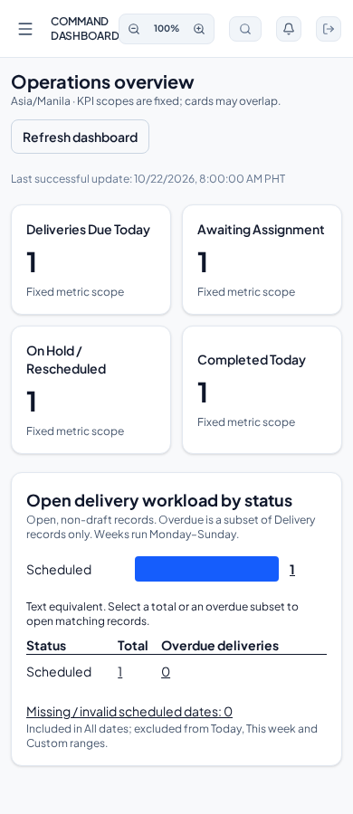
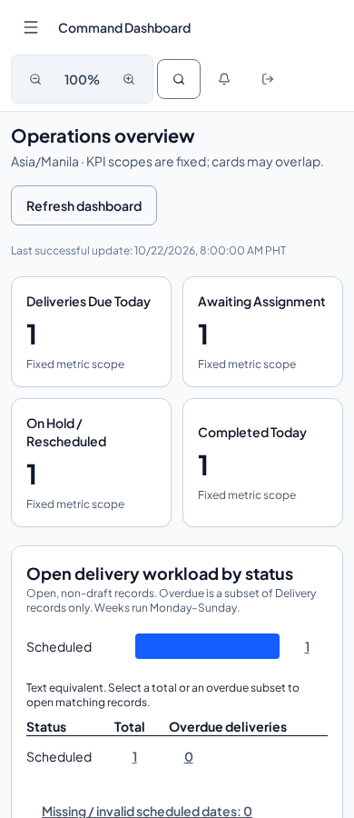
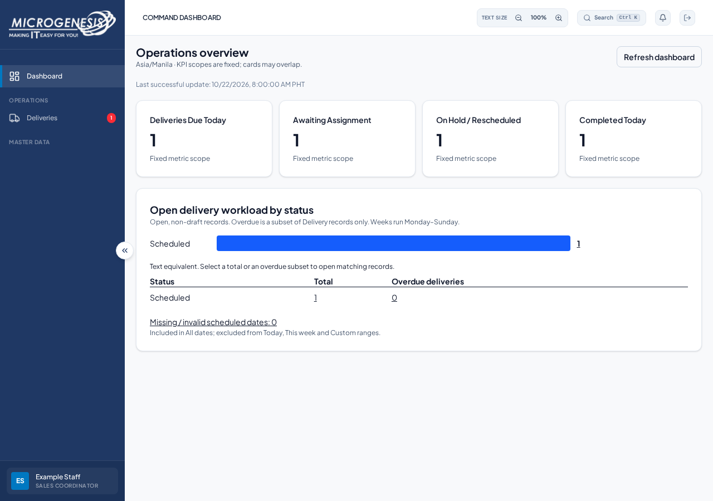
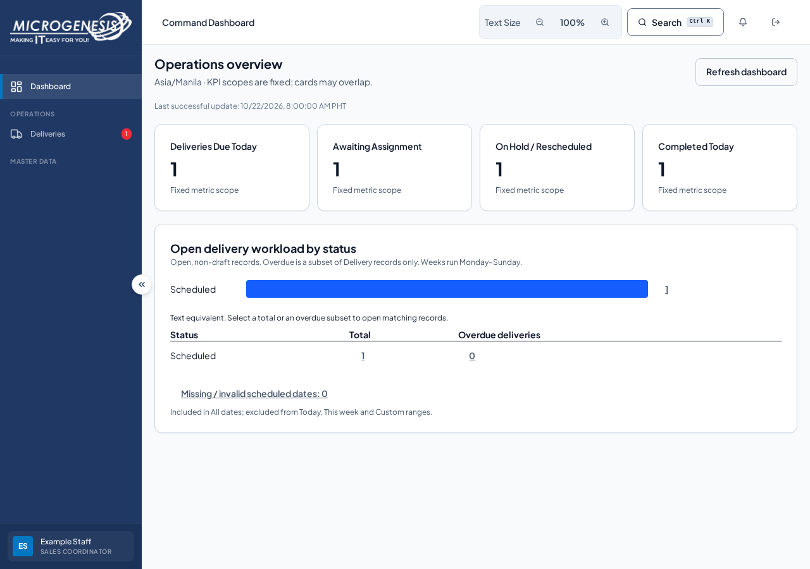
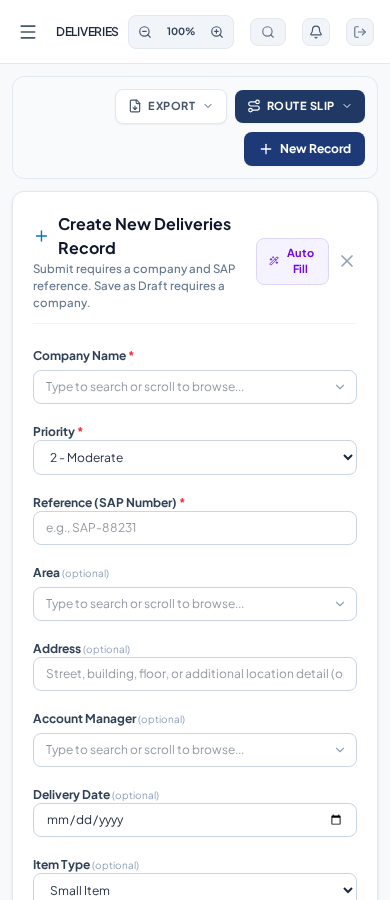
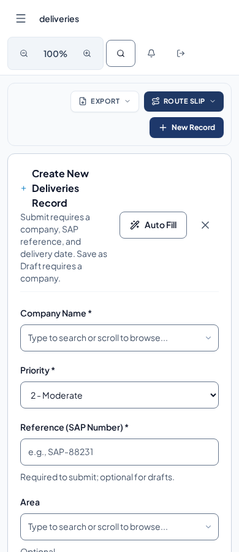
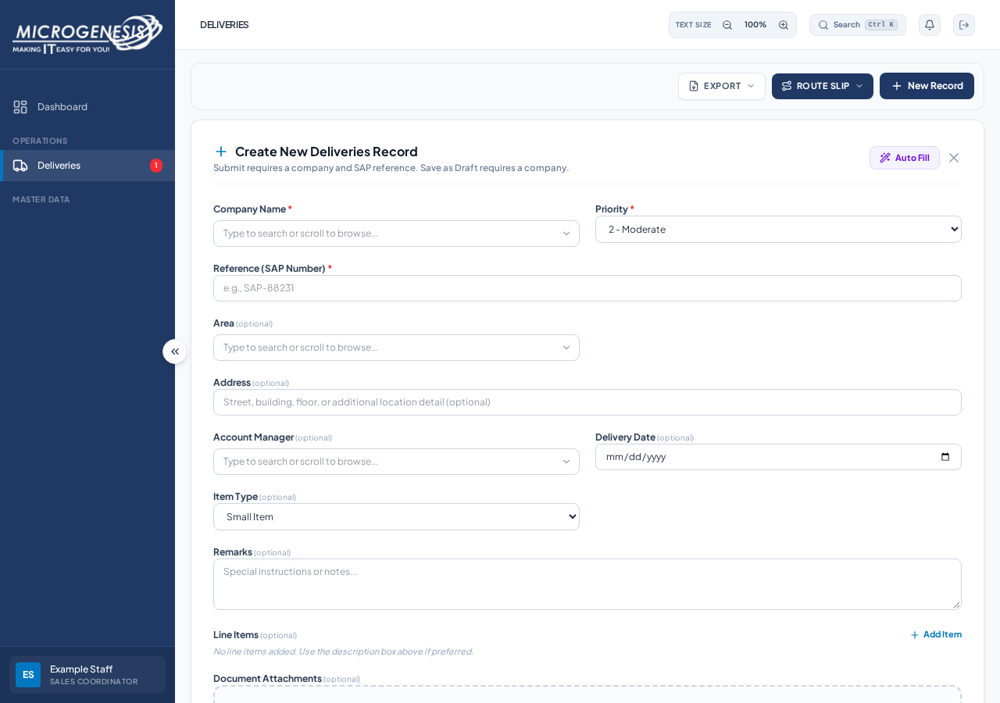
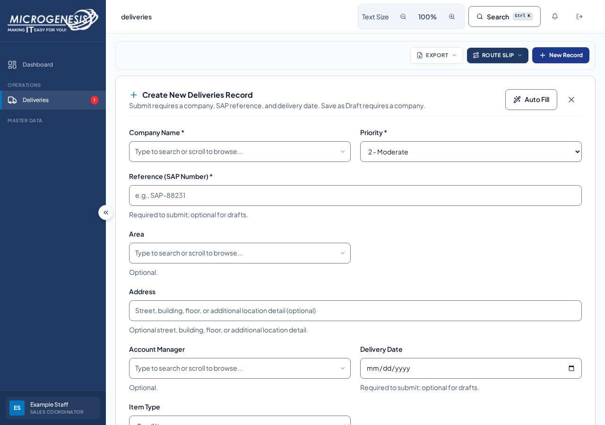

# UI-005 implementation evidence

Refs [#213](https://github.com/MarcZxc1/Supply-Chain/issues/213). Before captures and measurements use latest `dev` at `7e37bc1`; after captures use this task's implementation. All screenshots contain synthetic accounts, companies and records.

## Scope and behavior

The [component guide](design-system.md) inventories the existing patterns, documents native APIs and the state matrix, and explains the gradual adoption strategy. The first migration covers Navbar/MainLayout, RecordCreateForm/ComboboxField, OperationalDashboard, ActionDialog, Pagination, and the notification trigger. Other feature modules keep their current styling.

The behavioral regressions exercise draft and submitted record callbacks, native form submitter values, connected labels/errors, pending buttons, status words beyond color, proportional chart bars and fixed KPI query scope. The existing role dashboard browser suite remains the reference for all five roles and chart drill-downs.

## Visual review

The same synthetic fixture, 900px viewport height and existing local frontend were used for both captures. Browser screenshots are review evidence; these are not cross-platform pixel-perfect golden files. Automated checks separately assert control size, keyboard focus, overflow and behavior, avoiding fragile font-rendering comparisons between local Linux and GitHub's runners.

| Surface | Before | After |
| --- | --- | --- |
| Dashboard and shell, 390px |  |  |
| Dashboard and shell, 1280px |  |  |
| Record form, 390px |  |  |
| Record form, 1280px |  |  |

Review found the larger form actions were squeezing the phone heading. The final layout gives heading/help text a full-width row and places the actions below it on small screens.

## Reproduce

Use the already-running frontend on port 3000. Tests do not start additional dev servers.

```bash
npm run lint --workspace=client
npm run test:client
npm run build --workspace=client
npm run test:design-system --prefix e2e
npm run test:dashboard --prefix e2e
```

The new design-system browser suite intercepts every `/api/` request. Fixture writes fail locally; the destructive-dialog regression holds and then rejects an intercepted reset request and never forwards it to the backend. It verifies pending cancellation protection, error recovery, Escape and focus return without resetting a database.

Actual Chromium execution covers 320/390/1280px, visible focus and 44px targets, record errors, dashboard navigation/pagination, enlarged text at 200% in a 640px CSS viewport, and reduced-motion behavior. Enlarged portal text is not a claim of manual browser-zoom/device testing. CI runs this suite after the existing role and dashboard suites; `playwright-artifacts` retains screenshots and the HTML report for seven days on success and failure.

## Duplication and bundle measurements

The comparison includes these eight migrated files: Navbar, MainLayout, RecordCreateForm, OperationalDashboard, ActionDialog, Pagination, ComboboxField, and NotificationBell.

| Source measure | Before | After |
| --- | ---: | ---: |
| Literal `#1F3864` / `#0078C1` occurrences | 26 | 9 |
| Inline focus outline/ring/border utility prefixes | 35 | 6 |
| Characters in literal `className="..."` attributes | 15,138 | 9,452 |

These are simple source-text counts, excluding template-expression class names and the new shared definitions. They show where per-screen duplication moved into the common foundation, not a claim that all styling repetition has been removed.

Bundle measurements sum every emitted JavaScript/CSS file, including lazy chunks, and gzip each file independently with Python's `gzip.compress`. This compares built assets, not startup timing or a network trace. No dependency or UI framework was added.

| Build asset measurement (`client/dist/assets`) | Measured size |
| --- | ---: |
| Total raw emitted assets (JS + CSS) | 3,318,427 bytes (3,240.65 KB) |
| Total independently gzipped assets | 961,780 bytes (939.24 KB) |

## UI-001 integration on the rebased UI-005 branch

UI-001 ([#215](https://github.com/MarcZxc1/Supply-Chain/pull/215)) has merged into `dev`. UI-005 has been replayed onto the resulting `dev` tip; the new tree retains the UI-001 accessibility workflows alongside UI-005 tokens/components. Manual reconciliation preserved native keyboard-operable attachment inputs, combobox/listbox ARIA links and Enter-key behavior, notifications' keyboard focus/escape and nonmodal semantics, the search dialog trigger, skip-to-main link, and both Playwright suites in CI.

The before/after screenshots above compare the original standalone UI-005 prototype against its historical baseline; they are not recaptured images of the integrated code. Post-rebase CI (client/server checks, accessibility E2E and design-system E2E) and manual screen-reader/device verification are required before final acceptance. Do not replace the merged accessibility behavior with the earlier standalone UI-005 components.

Palette tests check the specified shared text pairs against 4.5:1 and control/focus boundaries against 3:1. They do not establish WCAG conformance for the entire application. Screen-reader, actual zoom/device and nondeveloper usability acceptance remain human checks under the UI refinement program.
