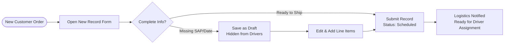
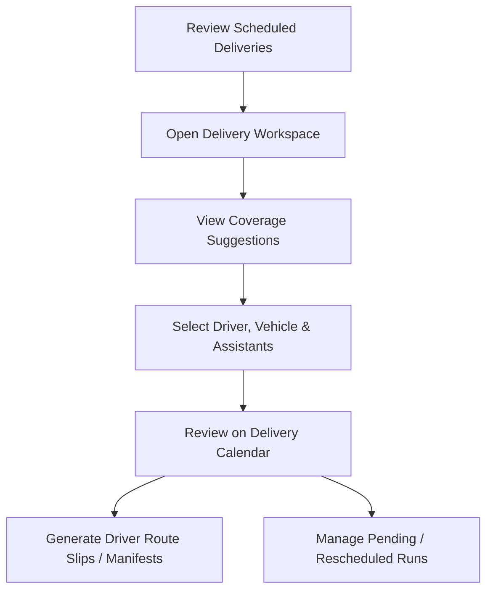
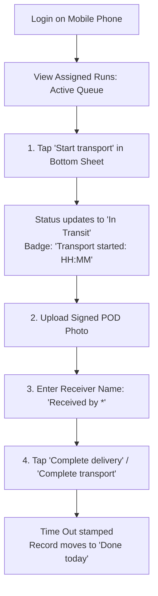
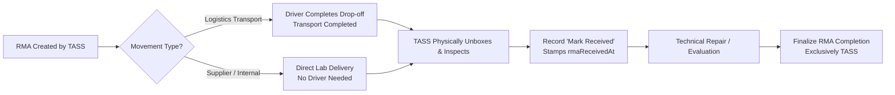

# User Operating Manuals — Microgenesis Supply Chain Portal

**Document Version:** 2.1  
**Last Updated:** November 11, 2026  
**Target Baseline:** `dev` (HEAD @ commit `d2cb412`)  
**Basis:** Codebase source inspection, uniform driver job cards (`PR #309`), operational module rules (`server/src/services/moduleAccessRules.ts`), and verified E2E Playwright test flows ([`e2e/tests/`](../e2e/tests/)).

---

## Table of Contents

1. [General System Operations & Navigation](#1-general-system-operations--navigation)
   * 1.1 [Sign-In & Session Security](#11-sign-in--session-security)
   * 1.2 [Layout & Navigation (Staff Roles)](#12-layout--navigation-staff-roles)
   * 1.3 [Operational Access Boundaries & Module Matrix](#13-operational-access-boundaries--module-matrix)
2. [Sales Coordinator User Manual](#2-sales-coordinator-user-manual)
   * 2.1 [Dashboard & KPI Card Filtering](#21-dashboard--kpi-card-filtering)
   * 2.2 [Creating a Delivery, Sales Order, or Procurement Pick-up Record](#22-creating-a-delivery-sales-order-or-procurement-pick-up-record)
   * 2.3 [Managing Existing Records & Drafts](#23-managing-existing-records--drafts)
3. [Logistics Officer User Manual](#3-logistics-officer-user-manual)
   * 3.1 [Driver Assignment & Coverage Matching](#31-driver-assignment--coverage-matching)
   * 3.2 [Using the Delivery Calendar & Driver Board](#32-using-the-delivery-calendar--driver-board)
   * 3.3 [Generating Route Slips & Manifests](#33-generating-route-slips--manifests)
   * 3.4 [Managing Field Exceptions & Status Transitions](#34-managing-field-exceptions--status-transitions)
   * 3.5 [Managing the Driver Roster & Assistants](#35-managing-the-driver-roster--assistants)
4. [Field Driver User Manual (Mobile)](#4-field-driver-user-manual-mobile)
   * 4.1 [Daily Run Queue & Interface](#41-daily-run-queue--interface)
   * 4.2 [Step-by-Step Delivery Execution (ePOD)](#42-step-by-step-delivery-execution-epod)
   * 4.3 [Field Exception Handling & Dispatch Coordination](#43-field-exception-handling--dispatch-coordination)
5. [TASS Specialist User Manual (RMA & Collections)](#5-tass-specialist-user-manual-rma--collections)
   * 5.1 [RMA Processing & Two-Step Receiving](#51-rma-processing--two-step-receiving)
   * 5.2 [Verifying Accounting Collections](#52-verifying-accounting-collections)
6. [System Administrator User Manual](#6-system-administrator-user-manual)
   * 6.1 [Operational View-Only Guardrails](#61-operational-view-only-guardrails)
   * 6.2 [Managing User Accounts & Driver Logins](#62-managing-user-accounts--driver-logins)
   * 6.3 [Managing Master Data (Account Managers & Companies)](#63-managing-master-data-account-managers--companies)
   * 6.4 [Policy Editor & Access Control](#64-policy-editor--access-control)
   * 6.5 [System Audit Log & Forensics](#65-system-audit-log--forensics)
7. [Error Handling & Conflict Resolution Guide](#7-error-handling--conflict-resolution-guide)

---

## 1. General System Operations & Navigation

### 1.1 Sign-In & Session Security
* **Accessing the Portal:** Open the web portal (desktop browser for staff roles, mobile browser for Drivers).
* **Authentication Options:**
  1. **Email / Password:** Enter your Microgenesis email and credentials, then click **Sign In**.
  2. **Microsoft 365 / Entra ID:** Click **Sign in with Microsoft** for corporate SSO (when enabled for your tenant).
* **Session Lifecycle:**
  * Sessions are maintained via secure `httpOnly` cookies (`mg_session`) valid for 8 hours.
  * Your active permission snapshot refreshes automatically every 30 seconds or whenever your browser regains focus.
  * If an Administrator changes your role or module access while you are working, changes apply immediately without requiring you to log out.
* **Timezone Standard:** All operational dates, dispatch schedules, calendar filters, and overdue counters strictly operate on **Asia/Manila (UTC+8)** time.

### 1.2 Layout & Navigation (Staff Roles)
* **Collapsible Rail / Sidebar:**
  * Click the menu icon (top-left) to expand or collapse the sidebar.
  * Screens visible to your account depend strictly on your granted permissions.
  * If you attempt to access an unauthorized screen via direct URL, the application displays a friendly `"Access Denied"` screen with a **"Request Temporary Access"** button.
* **Global Search (Ctrl+K):** Use the search bar in the top navigation bar to quickly jump to any record by reference, company, or driver name.
* **Toasts & Feedback:** Operational confirmations and warnings appear as clean notifications in the bottom corner.

### 1.3 Operational Access Boundaries & Module Matrix
To enforce strict audit trails and separation of duties, the system enforces the **Operational Module Access Rules** ([`server/src/services/moduleAccessRules.ts`](../server/src/services/moduleAccessRules.ts) & [`docs/MODULE_ACCESS.md`](./MODULE_ACCESS.md)):

| Module | Sales Coordinator | Logistics | TASS | Admin | Driver |
| :--- | :--- | :--- | :--- | :--- | :--- |
| **Deliveries** | Create, edit, submit | Assign driver, schedule, Pending/Reschedule | No access | View only | Assigned runs: Start transport, Complete delivery |
| **RMA** | No access | View, assign driver (Logistics transport only) | Create, edit, receipt, final completion | View only | Assigned Logistics-transport RMAs: Start transport, Complete transport |
| **Procurement Pick-up** | Create, edit, submit | Assign driver, schedule, Pending/Reschedule | No access (screen decommissioned) | View only | Assigned runs: Start transport, Complete delivery |
| **Sales Orders** | Create, edit, submit | Assign driver, schedule, Pending/Reschedule | No access | View only | Assigned runs: Start transport, Complete delivery |
| **Accounting Collection** | Create, edit | Assign driver, schedule | Verify collection, receipt review | Full manage | Assigned collections: Start transport, Complete delivery |

> [!IMPORTANT]
> **Admin View-Only Guardrail:** System Administrators have view-only access to operational runs (Deliveries, RMA, Procurement Pick-up, and Sales Orders). Creating records, driver assignments, starting transport, completing deliveries, and modifying run lifecycle statuses must be conducted by the respective operational roles.

---

## 2. Sales Coordinator User Manual

**Primary Purpose:** Order entry, customer relationship tracking, delivery preparation, and draft management.  
**Access:** Dashboard, Deliveries, Procurement Pick-up, Sales Orders, Customers, AM Directory, Transaction Center.  
**Verified E2E Flow:** [`e2e/tests/sales_coordinator.spec.ts`](../e2e/tests/sales_coordinator.spec.ts)

### 2.1 Dashboard & KPI Card Filtering
1. Log in to land on the **Dashboard** ([`client/src/pages/DashboardPage.tsx`](../client/src/pages/DashboardPage.tsx)).
2. Click any KPI card (e.g. **Needs Attention**, **Overdue**, or **On-Hold Items**).
3. The system navigates directly to the **Deliveries** view with a highlighted filter chip:
   * *Example:* `"Showing: On-Hold Items (from Dashboard)"`.
4. Click the **"Clear Filter"** (✕) button on the chip to restore your standard list view.

### 2.2 Creating a Delivery, Sales Order, or Procurement Pick-up Record
1. Navigate to **Deliveries**, **Procurement Pick-up**, or **Sales Orders** on the sidebar.
2. Click the **"+ New Record"** button at the top-right.
3. **Fill in Mandatory Information:**
   * **Company Name:** Begin typing in the combobox. You **must select a valid company from the list** (free text is rejected).
   * Selecting a company automatically populates its default **Account Manager** and address.
   * **Reference / SAP #:** Enter the sales order or invoice tracking number (required for non-drafts).
   * **Area & Address:** Type the destination area (e.g., `Makati`, `BGC`, `Ortigas`) and detailed street address. *(Tip: Click "Auto Fill" in demo/training environments to populate valid coordinate pairs).*
   * **Delivery Date:** Select the scheduled fulfillment date.
   * **Priority:** Select `1 - Low`, `2 - Moderate`, or `3 - High`.
4. **Add Line Items:**
   * In the items section, enter the **SKU Code** and **Quantity**.
   * Click **"+ Add Item"** to attach additional products.
5. **Save Options:**
   * **Save as Draft:** Use when details are incomplete. The record is saved with status `Draft` and remains hidden from Drivers.
   * **Submit:** Validates all required fields, assigns status `Scheduled`, and triggers an automated notification to **Logistics** that a driver must be assigned.

### 2.3 Managing Existing Records & Drafts
* **Returning a Record to Draft:**
  * Open a `Scheduled` record before driver departure.
  * In the top-right action bar, click **"Return to Draft"**.
  * Enter a mandatory remark explaining why the shipment was paused.
  * *Note:* Once a driver records **Start transport**, the shipment is actively in transit and can no longer be returned to Draft.
* **Company History Lookup:**
  * While inspecting any record, click the **"Company History"** button beside the client name.
  * A slide-over panel displays all historical deliveries and account managers for that customer.

---

## 3. Logistics Officer User Manual

**Primary Purpose:** Driver dispatch, vehicle allocation, route slips, delivery calendar, field exception handling, and status tracking.  
**Access:** Dashboard, Deliveries, Delivery Calendar, Driver Board, Driver Manager, Statistical Reports.  
**Verified E2E Flow:** [`e2e/tests/logistics.spec.ts`](../e2e/tests/logistics.spec.ts)

### 3.1 Driver Assignment & Coverage Matching
1. Open **Deliveries** and filter by status **`Scheduled`**.
2. Click any unassigned record to open the **Delivery Record Workspace** ([`client/src/features/deliveries/DeliveryRecordWorkspace.tsx`](../client/src/features/deliveries/DeliveryRecordWorkspace.tsx)).
3. In the **Driver Assignment** section:
   * Click the **Driver** dropdown. The system automatically calculates and sorts drivers using the **Coverage Ranking Algorithm** ([`client/src/utils/driverCoverage.ts`](../client/src/utils/driverCoverage.ts)):
     1. Drivers assigned directly to that exact **Area**.
     2. Drivers covering the surrounding **Subregion**.
     3. Other available roster drivers.
   * Select the designated driver.
   * Select the **Vehicle** (e.g. `Van`, `Motorcycle`, `Truck`) and optional **Driver Assistants**.
4. Click **Save Assignment**. The record updates and is pushed immediately to that driver's mobile queue.

### 3.2 Using the Delivery Calendar & Driver Board
* **Delivery Calendar:**
  * Navigate to **Delivery Calendar** on the sidebar.
  * Toggle between **Month**, **Week**, and **Day** views.
  * Days highlight workload volume; clicking any date filters scheduled deliveries for that calendar day.
* **Driver Board:**
  * Open **Driver Board** to view a Kanban-style board grouped by assigned driver columns.
  * Unassigned deliveries appear in the leftmost column for fast dispatch.

### 3.3 Generating Route Slips & Manifests
1. On the **Deliveries** list view, click the **"Route Slips"** menu button.
2. Select your scope:
   * **Single Driver:** Export route slips for a specific driver for today or a chosen date range.
   * **All Drivers (Consolidated):** Generates a multi-page PDF or Excel manifest grouping deliveries by driver route.
3. Click **Download PDF**, **Export Excel**, or **Export Word**. The document downloads with complete SAP references, delivery addresses, line items, and recipient sign-off blocks.

### 3.4 Managing Field Exceptions & Status Transitions
Because mobile driver cards are strictly limited to starting transport and completing runs, **Logistics Officers manage all operational status exceptions**:
* **Marking a Record Pending:**
  * When a driver reports that a client site is temporarily inaccessible or waiting for security clearance, open the record workspace.
  * Select status **`Pending`** and provide the mandatory reason in the remarks field.
* **Rescheduling a Run:**
  * If a delivery cannot be fulfilled on the current date, open the record workspace.
  * Select status **`Rescheduled`**.
  * Enter the **New Delivery Date** and mandatory remarks explaining the reschedule.
  * The record moves to the newly selected date cohort on the Delivery Calendar and Driver Board.

### 3.5 Managing the Driver Roster & Assistants
* Open **Driver Manager** (`/driver_manager`).
* **Create Driver Assistant:** Click **"+ New Assistant"**, enter full name, and assign active status.
* **Update Coverage Areas:** Click on any driver row to adjust their primary and subregional delivery zones. *(Note: Linking or creating login user accounts for drivers is performed in Admin Panel → User Management).*

---

## 4. Field Driver User Manual (Mobile)

**Primary Purpose:** Mobile run execution, starting transport, Proof of Delivery (POD) photo capture, and completion.  
**Access:** Dedicated Mobile Dashboard ([`client/src/features/dashboard/DriverDashboard.tsx`](../client/src/features/dashboard/DriverDashboard.tsx)). Clean mobile-optimized interface with no distracting sidebar menus.  
**Verified E2E Flow:** [`e2e/tests/driver.spec.ts`](../e2e/tests/driver.spec.ts), [`e2e/driver-mobile.spec.ts`](../e2e/driver-mobile.spec.ts)

### 4.1 Daily Run Queue & Interface
1. **Login:** Log in on your mobile smartphone browser using your Driver credentials.
2. **Dashboard Overview:**
   * **Header:** Displays current Manila time and a manual **Refresh** button.
   * **Counter Strip:** Quickly shows remaining active runs vs. completed runs for today.
   * **Queue Switch:** Toggle between **`Active`** (today's runs & any overdue runs) and **`Done today`** (accomplished runs).
3. **Uniform Job Cards:**
   * Every assigned task—whether **Delivery**, **RMA**, **Procurement Pick-up**, **Sales Order**, or **Accounting Collection**—uses the standardized **Driver Job Card** ([`client/src/features/dashboard/DriverJobCard.tsx`](../client/src/features/dashboard/DriverJobCard.tsx)).
   * **Category Badge:** Indicates the job type at a glance.
   * **Customer & Destination:** Displays company name, delivery area, and street address.
   * **Copyable Reference:** Tap the **Ref** button to immediately copy the SAP number or tracking code to your phone's clipboard.
   * **Item Summary:** Clamped to two lines with a **"Show more"** toggle for detailed item lists.
   * **Lateness Indicator:** Overdue runs clearly display a red badge (e.g. `Due Nov 10 · 1 day late`).
   * *(Future scheduled runs appear under "Upcoming / Other Dates" in read-only mode until their scheduled delivery date).*

### 4.2 Step-by-Step Delivery Execution (ePOD)
1. **Step 1: Start Transport**
   * When departing for or arriving at the customer site, tap the blue **"Start transport"** button.
   * An accessible bottom sheet dialog opens. Enter any optional departure notes and tap **Confirm**.
   * Status updates to **`In Transit`**, and a blue indicator appears on the card: `Transport started: HH:MM`.
2. **Step 2: Upload Proof of Delivery (POD) Photo**
   * After handing over goods and obtaining the client's signature on the physical delivery slip, the **POD Uploader** on your job card unlocks.
   * Tap **"Upload Photo"** to take a photo using your phone camera or select an image from your gallery.
   * **Supported Formats:** JPG, JPEG, PNG, PDF, DOCX, XLSX (max 10 MB per file, up to 10 files / 50 MB total per record).
3. **Step 3: Enter Receiver Name**
   * In the **"Received by *"** field, type the full name of the representative who accepted the goods (mandatory, 1 to 120 characters).
   * For RMA runs, this records the transport handover recipient (`rmaTransportReceivedBy`).
4. **Step 4: Complete Delivery**
   * Tap **"Complete delivery"** (or **"Complete transport"** for RMA runs).
   * Confirm the completion in the bottom sheet.
   * The server validates that the photo is safely stored on disk, records your **Time Out** timestamp, marks the run **`Delivered`** / **`Accomplished`**, and moves the card to your **`Done today`** queue.

### 4.3 Field Exception Handling & Dispatch Coordination
* **Driver Action Boundaries:**
  * Driver job cards contain **only two action triggers: Start transport and Complete delivery**.
  * `Pending` and `Reschedule` buttons have been removed from mobile driver cards.
* **Handling Road Delays or Closed Clients:**
  * If a client site is closed, payment is unavailable, or a delivery cannot be fulfilled, **contact your Logistics Officer (Dispatcher)**.
  * The Logistics Officer will mark the run `Pending` or `Rescheduled` in the master dispatch workspace.

---

## 5. TASS Specialist User Manual (RMA & Collections)

**Primary Purpose:** Technical returns management, lab unboxing/receipt, warranty evaluation, and collection verification.  
**Access:** Dashboard, RMA, Accounting Collection, Suppliers, AM Directory, Transaction Center.  
**Verified E2E Flow:** [`e2e/tests/rma-dispatch.spec.ts`](../e2e/tests/rma-dispatch.spec.ts)

### 5.1 RMA Processing & Two-Step Receiving
1. **RMA Ownership:**
   * TASS exclusively creates and manages RMA tickets ([`client/src/features/deliveries/RmaWorkflowPanel.tsx`](../client/src/features/deliveries/RmaWorkflowPanel.tsx)).
   * In **RMA Movement Type**, choose between `Logistics Transport`, `Internal (No Driver)`, or `Supplier Collection`.
2. **Two-Step Receiving Workflow:**
   * **Step 1: Transport Arrival (Logistics Runs):** When a driver delivers returned equipment to the office, the driver marks transport complete (`rmaTransportReceivedBy` is recorded). *This records delivery arrival, NOT lab receipt.*
   * **Step 2: Lab Physical Unboxing & Inspection:**
     * The TASS technician inspects the physical package in the lab.
     * Click **"Mark Received"**.
     * Enter inspection remarks and condition notes.
     * The server stamps `rmaReceivedAt` and `rmaReceivedBy`.
3. **Final Technical Completion:**
   * Once diagnostic repairs, supplier replacements, or customer returns are finished, open the RMA ticket.
   * Enter the resolution details and recipient name.
   * Click **"Complete RMA"**.
   * *(Security Rule: Admins and Logistics cannot complete RMAs; this final step is reserved exclusively for TASS).*

### 5.2 Verifying Accounting Collections
1. Open **Accounting Collection** on the sidebar.
2. Select a collection record where the driver collected payment, a cheque, or an official receipt.
3. Inspect the attached payment receipt or cheque image in the previewer.
4. Click **"Verify Collection"**.
5. Enter verification remarks. The record permanently saves `collectionVerified = true`, your user ID, and an immutable timestamp.

---

## 6. System Administrator User Manual

**Primary Purpose:** User provisioning, role and policy management, directory maintenance, and audit inspections.  
**Access:** Full system access + Admin Panel (`/admin`), SKU Master, and System Diagnostics.

### 6.1 Operational View-Only Guardrails
* To preserve audit accountability and prevent accidental interference with active delivery queues, Administrators operate in **view-only mode** for:
  * **Deliveries**
  * **RMA**
  * **Procurement Pick-up**
  * **Sales Orders**
* Admins can inspect all records, run reports, download manifests, and view audit trails, but cannot submit new operational orders, assign drivers, or execute run transitions.

### 6.2 Managing User Accounts & Driver Logins
1. Open **Admin Panel** → **User Management** tab.
2. **Create New User:**
   * Click **"+ New User"**.
   * Enter Name, Corporate Email, Role (`SALES_COORDINATOR`, `LOGISTICS`, `TASS`, `ADMIN`, `DRIVER`), and initial password.
   * **For DRIVER Accounts:** You **must link the user to a Driver profile** in the dropdown. If no profile exists, create one in Driver Manager first.
3. **Deactivate / Activate:** Toggle the status switch to revoke system access immediately.
4. **Delete User:** Users with active linked delivery records cannot be deleted (returns 409 Conflict) to preserve audit integrity.

### 6.3 Managing Master Data (Account Managers & Companies)
1. Open **Admin Panel** → **Account Managers** tab:
   * Click **"+ New Account Manager"**.
   * Enter full name (trimmed and case-normalized automatically) and optional email.
   * Optionally link to an active portal login account.
2. Open **Admin Panel** → **Companies** tab:
   * Click **"+ New Company"**.
   * Enter the **Company Name**, **SAP Number** (required and unique), Address, Contact Person, and select a **Default Account Manager**.
   * All delivery forms immediately access this directory.

### 6.4 Policy Editor & Access Control
1. Open **Admin Panel** → **Roles & Permissions** tab.
2. View role default permissions or configure per-account permission overrides.
3. System supports both **LEGACY** and **V1** granular policy evaluation with immutable server ceilings and conflict detection.

### 6.5 System Audit Log & Forensics
1. Open **Admin Panel** → **System Audit Log** tab.
2. Filter by date range, record category, or actor ID.
3. Click **"View Diff"** on any entry to inspect a side-by-side JSON comparison of what changed, who changed it, and why.

---

## 7. Error Handling & Conflict Resolution Guide

| Error Message / Toast | Cause | How to Resolve |
| :--- | :--- | :--- |
| **`409 Conflict: Record was modified by another user`** | Another user saved edits or updated status while your screen was open. | The screen automatically refreshes with latest data. Re-apply your changes and click Save. |
| **`Admin has view-only access to [Category] records`** | Administrator attempted to create, edit, assign, or complete an operational record. | Operational records must be prepared by Sales/TASS and dispatched by Logistics. |
| **`Driver can only start transport or complete run`** | Driver attempted an unauthorized status change (e.g. attempting to mark pending or reschedule). | Drivers may only start transport or complete runs. Contact Logistics to handle field postponements. |
| **`Only Sales Coordinator can create [Category] records`** | A non-SC user attempted to create a Delivery, Procurement Pick-up, or Sales Order. | These records must be initiated by an authorized Sales Coordinator. |
| **`Only TASS can complete RMA records`** | Admin or Logistics attempted to trigger final RMA technical completion. | Hand off the ticket to the TASS laboratory specialist for final completion. |
| **`Select a company from the list`** | Typed free-text in the company combobox without picking a suggestion. | Click the dropdown and select an existing verified company row. |
| **`Priority can't be changed after a record is Delivered`** | Attempting to edit Priority on an accomplished record. | Priority is permanently locked once delivered (`BR-LIFE-03`). Changes are forbidden. |
| **`POD photo required for delivery completion`** | Driver clicked Complete delivery without uploading a valid proof photo. | Tap "Upload Photo", take a photo of the signed receipt, then tap Complete delivery. |
| **`Received by is required for delivery completion`** | Receiver's name was left blank or exceeds 120 characters. | Type the full name of the representative who accepted the goods. |
| **`Module access denied`** | Current role does not have authorization for this action or screen. | Contact your Administrator to check your role policy in the Admin Panel. |
