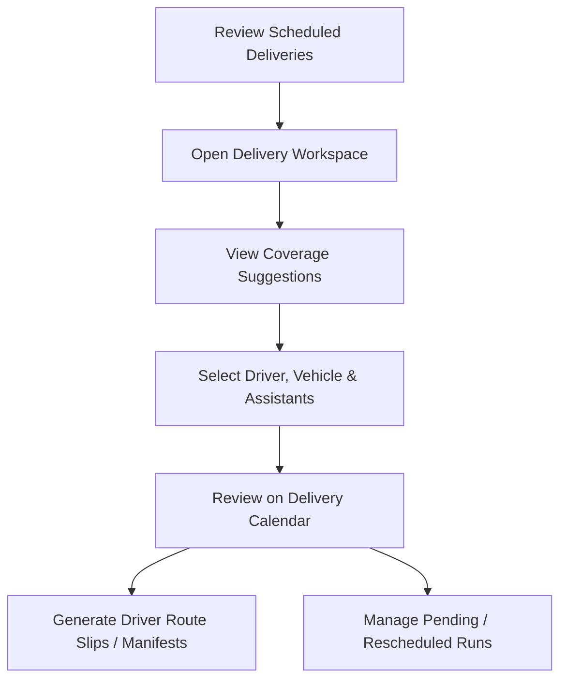
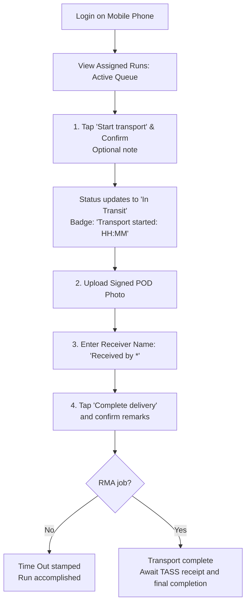
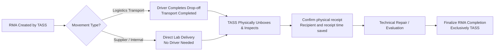

# Staff Operating Manual — Microgenesis Business Systems

**Document Version:** 2.6
**Last Updated:** November 13, 2026 (synced with `origin/dev` PRs #314, #316, #317, #318)
**Audience:** Microgenesis Business Systems Sales Coordinators, TASS specialists, Logistics staff, Drivers and Administrators.
**Baseline:** `origin/dev` at `027be8d` (including PRs #314, #316, #317, and #318)
**Basis:** Source inspection of short record numbers, role dashboard panels and Logistics **Completed today** dialog, Driver Start transport confirmation, record preparation/dispatch, calendar, exports, account provisioning, RMA receipt/completion, collection verification, Admin audit controls, operational access rules, and access request UI. Linked E2E suites describe available tests; they were not executed during this documentation update. Unchanged sections have not received a new full-document verification.

Download the [staff Word manual](USER_MANUALS.docx).

**Word edition:** Arial typography, black text and grayscale tables. Rebuild from the repository root with `node scripts/export-user-manual.cjs`; this uses the project's `docx` package and Python's `markdown-it-py` parser. The Word copy omits developer source links/test-file references from staff instructions while retaining known limitations and verification notes.

These instructions describe repository behavior at baseline `027be8d` and do not establish deployment or browser UAT completion.

---

## Table of Contents

1. [General System Operations & Navigation](#1-general-system-operations--navigation)
   * 1.1 [Sign-In & Session Security](#11-sign-in--session-security)
   * 1.2 [Layout & Navigation (Staff Roles)](#12-layout--navigation-staff-roles)
   * 1.3 [Operational Access Boundaries & Module Matrix](#13-operational-access-boundaries--module-matrix)
2. [Sales Coordinator User Manual](#2-sales-coordinator-user-manual)
   * 2.1 [Dashboard & KPI Card Filtering](#21-dashboard--kpi-card-filtering)
   * 2.2 [Creating a Delivery, Sales Order, or Procurement Pick-up Record](#22-creating-a-delivery-sales-order-or-procurement-pick-up-record)
   * 2.3 [Managing Existing Records & Drafts](#23-managing-existing-records--drafts)
3. [Logistics Officer User Manual](#3-logistics-officer-user-manual)
   * 3.1 [Driver Assignment & Coverage Matching](#31-driver-assignment--coverage-matching)
   * 3.2 [Using the Delivery Calendar & Driver Board](#32-using-the-delivery-calendar--driver-board)
   * 3.3 [Generating Route Slips & Manifests](#33-generating-route-slips--manifests)
   * 3.4 [Managing Field Exceptions & Status Transitions](#34-managing-field-exceptions--status-transitions)
   * 3.5 [Managing the Driver Roster & Assistants](#35-managing-the-driver-roster--assistants)
4. [Field Driver User Manual (Mobile)](#4-field-driver-user-manual-mobile)
   * 4.1 [Daily Run Queue & Interface](#41-daily-run-queue--interface)
   * 4.2 [Step-by-Step Delivery Execution (ePOD)](#42-step-by-step-delivery-execution-epod)
   * 4.3 [Field Exception Handling & Dispatch Coordination](#43-field-exception-handling--dispatch-coordination)
5. [TASS Specialist User Manual (RMA & Collections)](#5-tass-specialist-user-manual-rma--collections)
   * 5.1 [RMA Processing & Two-Step Receiving](#51-rma-processing--two-step-receiving)
   * 5.2 [Verifying Accounting Collections](#52-verifying-accounting-collections)
6. [System Administrator User Manual](#6-system-administrator-user-manual)
   * 6.1 [Operational View-Only Guardrails](#61-operational-view-only-guardrails)
   * 6.2 [Managing User Accounts & Driver Logins](#62-managing-user-accounts--driver-logins)
   * 6.3 [Managing Master Data (Account Managers & Companies)](#63-managing-master-data-account-managers--companies)
   * 6.4 [Policy Editor & Access Control](#64-policy-editor--access-control)
   * 6.5 [System Audit Log & Forensics](#65-system-audit-log--forensics)
7. [Error Handling & Conflict Resolution Guide](#7-error-handling--conflict-resolution-guide)
8. [Known Limitations & Verification Status](#8-known-limitations--verification-status)

---

## 1. General System Operations & Navigation

### 1.1 Sign-In & Session Security
* **Accessing the Portal:** Open the web portal (desktop browser for staff roles, mobile browser for Drivers).
* **Authentication Options:**
  1. **Email / Password:** Enter your Microgenesis email and credentials, then click **Sign In**.
  2. **Microsoft 365 / Entra ID:** Click **Sign in with Microsoft** for corporate SSO (when enabled for your tenant).
* **Session Lifecycle:**
  * Sessions are maintained via secure `httpOnly` cookies (`mg_session`) valid for 8 hours.
  * Your active permission snapshot refreshes automatically every 30 seconds or whenever your browser regains focus.
  * The server checks current account permissions on requests. The interface picks up access changes on its permission refresh; it can take until the next refresh to reflect them without logging out.
* **Timezone Standard:** All operational dates, dispatch schedules, calendar filters, and overdue counters strictly operate on **Asia/Manila (UTC+8)** time.

### 1.2 Layout & Navigation (Staff Roles)
* **Collapsible Rail / Sidebar:**
  * Use the collapse control (top-left) or press `Ctrl+B` on desktop to expand or collapse the sidebar.
  * Screens visible to your account depend strictly on your granted permissions (`Operations` and `Master Data` groups).
  * Unavailable screens may be hidden or navigation may return you to an allowed screen. If the **Request Temporary Access** modal opens (or you request access from the sidebar), enter **Module / Screen Needed** and **Reason for Request**, then click **Submit Request**. *Note:* Clicking **Submit Request** shows an in-app `"Request Sent"` confirmation only and does not dispatch a backend notification or email to administrators — contact your Administrator directly when access needs to be updated.
* **Global Search (`Ctrl+K`):** Click **`Global search (Ctrl+K)`** in the top navigation bar or press `Ctrl+K` / `Cmd+K` to jump to records by **Record No.** (e.g., `DEL-26-00042`), reference/SAP #, company, or driver name, as well as accessible screens, SKUs, customers, suppliers, and drivers.
* **Short Record Numbers (`Record No.`):** Every record receives a permanent, human-readable **Record No.** when created (including Drafts) in `{PREFIX}-{YY}-{NNNNN}` format (Asia/Manila year, per-type counter): **`DEL`** (Deliveries), **`RMA`** (RMA), **`PUP`** (Procurement Pick-up), **`SO`** (Sales Orders), and **`COL`** (Accounting Collection). Record tables, workspaces, search, exports, and audit logs display this number, and linking an Accounting Collection accepts `COL-YY-NNNNN` or an internal ID.
* **Toasts & Feedback:** Operational confirmations and warnings appear as notifications in the bottom-right corner.

### 1.3 Operational Access Boundaries & Module Matrix
To enforce strict audit trails and separation of duties, the system enforces the **Operational Module Access Rules** ([`server/src/services/moduleAccessRules.ts`](../server/src/services/moduleAccessRules.ts) & [`docs/MODULE_ACCESS.md`](./MODULE_ACCESS.md)):

| Module | Sales Coordinator | Logistics | TASS | Admin | Driver |
| :--- | :--- | :--- | :--- | :--- | :--- |
| **Deliveries** | Create, edit, submit | Assign driver, schedule, Pending/Reschedule | No access | View only | Assigned runs: Start transport, Complete delivery |
| **RMA** | No access | View, assign driver (Logistics transport only) | Create, edit, receipt, final completion | View only | Assigned Logistics-transport RMAs: Start transport, Complete transport |
| **Procurement Pick-up** | Create, edit, submit | Assign driver, schedule, Pending/Reschedule | No access (screen decommissioned) | View only | Assigned runs: Start transport, Complete delivery |
| **Sales Orders** | Create, edit, submit | Assign driver, schedule, Pending/Reschedule | No access | View only | Assigned runs: Start transport, Complete delivery |
| **Accounting Collection** | Create, edit | Assign driver, schedule | Verify collection, receipt review | Manage under granted actions; verification remains TASS-only | Assigned collections: Start transport, Complete delivery |

> [!IMPORTANT]
> Role capabilities also depend on the current account's permissions and record state. A visible module does not grant every action.
>
> **Admin View-Only Guardrail:** System Administrators have view-only access to operational runs (Deliveries, RMA, Procurement Pick-up, and Sales Orders), and only TASS may verify Accounting Collections or confirm/complete RMAs. Creating operational orders, assigning drivers, starting transport, completing deliveries, and modifying operational run lifecycle statuses must be conducted by the respective operational roles.

---

## 2. Sales Coordinator User Manual

**Primary Purpose:** Order entry, customer relationship tracking, delivery preparation, and draft management.
**Access:** Default screens include Dashboard, Deliveries, Procurement Pick-up, Sales Orders, Accounting Collection, Delivery Calendar, Customers, AM Directory, and Transaction Center (subject to assigned account permissions).
**Related E2E suites:** [`e2e/tests/sales_coordinator.spec.ts`](../e2e/tests/sales_coordinator.spec.ts)

### 2.1 Dashboard & KPI Card Filtering
1. Log in to land on the **Sales dashboard** ([`client/src/pages/DashboardPage.tsx`](../client/src/pages/DashboardPage.tsx)).
2. Click an available KPI filter tile: **Scheduled today**, **Pending driver assignment**, **On hold**, **Rescheduled**, or **Completed today**. The **Needs attention** panel also offers compact action tiles and **View all N items needing action**.
3. Clicking a KPI filter navigates directly to **Deliveries** with an active dashboard filter chip (available tiles and target scopes depend on your granted permissions).
4. Use the filter chip's clear control to restore the standard list view.
5. Scroll below the **Delivery record status** chart to review the full-width **In transit** panel, which lists your active **Deliveries**, **Procurement Pick-up**, and **Sales Orders** runs that a driver has already started. Use its footer links (**View Deliveries in transit**, **View Procurement Pickups in transit**, **View Sales Orders in transit**) or click a row to open the filtered list or record workspace.

### 2.2 Creating a Delivery, Sales Order, or Procurement Pick-up Record
1. Navigate to **Deliveries**, **Procurement Pick-up**, or **Sales Orders** on the sidebar (or start from **All Operations**).
2. Click the **+ New Record** button at the top-right.
3. **Fill in Mandatory Information:**
   * **Company Name \*:** Begin typing in the combobox and **select an existing company from the list** (free text is rejected). Selecting a company automatically fills its default **Account Manager** unless you have already picked a different one; enter and verify the destination **Area** and **Address** separately.
   * **Priority \*:** Select `1 - Low`, `2 - Moderate`, or `3 - High`.
   * **Reference (SAP Number) \*:** Enter the sales order or invoice tracking number (mandatory for non-draft submissions).
   * **Area & Address:** Type the destination area (e.g., `Makati`, `BGC`, `Ortigas`) and detailed street address. *(Where **Auto Fill** is shown, it populates sample test/training values that must be reviewed before saving.)*
   * **Delivery Date:** Select the scheduled fulfillment date (mandatory for non-draft submissions).
   * **Item Type & Remarks:** Optional header classification and initial notes.
4. **Add Line Items:**
   * In the **Line Items** section, enter **`SKU or Description`** and **Quantity**.
   * Click **+ Add Item** to attach additional product rows.
   * Optional **Document Attachments** can be staged alongside form entry or added later in the workspace.
5. **Save Options:**
   * **Save as Draft:** Use when details are incomplete. The record is saved with status `Draft`, receives its permanent **Record No.** (e.g., `DEL-26-00042`, `PUP-26-00001`, or `SO-26-00001`), and remains hidden from Drivers.
   * **Submit:** Validates required fields, sets status to `Scheduled` with a permanent **Record No.**, and sends an automated in-app notification to **Logistics** that the record is ready for review or driver assignment.

### 2.3 Managing Existing Records & Drafts
* **Returning a Record to Draft:**
  * Open a `Scheduled` record before a driver records Time In / transport start.
  * In the workspace action bar, click **Return to Draft**.
  * Enter a mandatory remark explaining why the shipment was paused.
  * *Note:* Once a driver records **Start transport** (Time In), the run is actively in transit and can no longer be returned to Draft.
* **Company History Lookup:**
  * While inspecting any record in **Delivery Record Workspace**, click the clickable **Company Name** in the record summary header (with the history icon and tooltip **View company history**).
  * A slide-over panel displays historical records and account managers for that company.

---

## 3. Logistics Officer User Manual

**Primary Purpose:** Driver dispatch, vehicle allocation, route slips, delivery calendar, field exception handling, and status tracking.
**Access:** Default screens include Dashboard, Deliveries, Delivery Calendar, Driver Board, Driver Manager, and Statistical Reports (with view/dispatch access as permitted across categories).
**Related E2E suites:** [`e2e/tests/logistics.spec.ts`](../e2e/tests/logistics.spec.ts)

### 3.1 Driver Assignment & Coverage Matching
1. On the **Logistics dashboard**, review the four KPI tiles (**Assigned to drivers today**, **No driver assigned**, **Completed today**, **On hold or rescheduled**) and the **Transport requests** panel:
   * **Completed today** counts completed runs across all visible record categories and opens the paginated **Records completed today** dialog (`Record`, `Type`, `Company`, `Completed (Manila time)`, 25 rows per page) so you can open completed Deliveries, Pick-ups, Sales Orders, Collections, or RMAs directly.
   * **Transport requests** (also linked from **No driver assigned**) lists unassigned, non-draft, non-accomplished driver jobs across **Deliveries**, **RMA** (Logistics transport only), **Procurement Pick-up**, and **Sales Orders** (Accounting Collection is excluded). Use the per-type footer links (**View N Deliveries / RMA / Procurement Pickups / Sales Orders**) or click any row to open the record.
   * The **Drivers out for delivery** panel tracks active runs currently in progress across those four job types, and **Needs attention** surfaces counts for **Unassigned records**, **On hold**, and **Rescheduled**.
2. Click any unassigned record to open the **Delivery Record Workspace** ([`client/src/features/deliveries/DeliveryRecordWorkspace.tsx`](../client/src/features/deliveries/DeliveryRecordWorkspace.tsx)).
3. In **Driver & delivery details**:
   * Click the **Driver** dropdown. Drivers are sorted using the **Coverage Ranking Algorithm** ([`client/src/utils/driverCoverage.ts`](../client/src/utils/driverCoverage.ts)):
     1. Drivers assigned directly to that exact **Area**.
     2. Drivers covering the surrounding **Subregion**.
     3. Other available roster drivers.
   * Select the designated **Driver**, **Vehicle**, and optional **Driver Assistants**.
4. Enter the required reason in the save/remarks area, then click **Save Changes**. The saved assignment becomes available to the linked Driver on the next refresh. *(For Logistics-transport RMA records, use **Save assignment** in the dedicated RMA workflow panel.)*

### 3.2 Using the Delivery Calendar & Driver Board
* **Delivery Calendar:**
  * Navigate to **Delivery Calendar** on the sidebar.
  * Use the previous/next arrows to navigate the **monthly** grid. Separate Week and Day view switches are not currently available.
  * Dates show record counts; click a populated date to open its popup record list (paginated at 25 per page), then click a row to open its workspace.
* **Driver Board:**
  * Open **Driver Board** (or switch tabs within **Drivers**) to view columns grouped by assigned driver.
  * Selecting a new driver through a card's **Reassign** selector saves immediately; check the card feedback before navigating away.

### 3.3 Generating Route Slips & Manifests
1. On the record list, set the **Driver** filter if you want a single driver's slip; leave it unfiltered to include assigned drivers in scope.
2. Open **Route Slip**, choose the **Export period** (`Single day`, `From date onward`, or `From–To range`) and **Document size** (`A4`, `Letter`, or `Legal`).
3. Under **Current Status** or **Status Trail**, select **Excel**, **PDF**, or **Word**. The selected scope produces slips for assigned drivers using the table's active dates/filters (undated records are excluded); **Status Trail** includes record history.
4. Review the generated preview and use its download control after verifying dates and driver scope.

### 3.4 Managing Field Exceptions & Status Transitions
Because mobile driver job cards are limited to starting transport and completing runs, **Logistics Officers manage all operational status exceptions** (and note that unlike Drivers on mobile cards, Logistics or Admin recording Time In on a driver's behalf in the workspace must enter required remarks):
* **Marking a Record Pending:**
  * When a driver reports that a client site is temporarily inaccessible or awaiting clearance, open the record workspace.
  * After a valid Time In / transport start has been recorded, select **`Pending`**, enter the required reason remarks, and save. (`Pending` is unavailable before a run has started.)
* **Rescheduling a Run:**
  * Open the record in **Delivery Record Workspace** (**Status & Actions** tab).
  * Select status **`Rescheduled`**.
  * For a **Deliveries** record (when rescheduled by Logistics or Admin), enter **New delivery date \*** and required remarks, then save; date-based views update to the newly saved date. *(Note: On `origin/dev`, **Drivers → View** does not display a `New Delivery Date *` input inside its confirmation modal, so **Deliveries** records must be rescheduled from the record workspace.)*
  * Other categories (**Procurement Pick-up**, **Sales Orders**, **Accounting Collection**) reschedule with required remarks only; update their planned delivery date separately in **Overview** if needed.

### 3.5 Managing the Driver Roster & Assistants
* Open **Driver Manager** (under **Master Data → Drivers**, or the **Manager** tab inside Drivers).
* **Create Driver Assistant / Driver:** Select **Assistants** and click **Add Assistant** (or click **Add Driver** on the Drivers tab when permitted as Admin), fill in the name and coverage areas/subregions, then save.
* **Update Coverage Areas:** Use each row's edit control to update assigned areas/subregions or manage active/inactive status. *(Note: Creating or linking `DRIVER` login accounts is done in **Admin Panel → User Management**.)*

---

## 4. Field Driver User Manual (Mobile)

**Primary Purpose:** Mobile run execution, starting transport, Proof of Delivery (POD) photo capture, and completion.
**Access:** Dedicated Mobile Dashboard ([`client/src/features/dashboard/DriverDashboard.tsx`](../client/src/features/dashboard/DriverDashboard.tsx)) (`Microgenesis Field Mobile`), displaying assigned runs without the desktop sidebar.
**Related E2E suites:** [`e2e/tests/driver.spec.ts`](../e2e/tests/driver.spec.ts), [`e2e/driver-mobile.spec.ts`](../e2e/driver-mobile.spec.ts)

### 4.1 Daily Run Queue & Interface
1. **Login:** Log in on your mobile smartphone browser using your Driver credentials.
2. **Dashboard Overview:**
   * **Header:** Displays **`Microgenesis Field Mobile`**, today's Manila date, and a manual **Refresh** button.
   * **Counter Strip:** Shows counts for today's runs, accomplished runs, and remaining active runs.
   * **Queue Switch:** Toggle between **`Active`** (today's runs and any overdue runs) and **`Done today`** (accomplished runs plus RMA jobs whose transport is complete and waiting for TASS receipt).
3. **Uniform Job Cards:**
   * Assigned tasks across **Deliveries**, **RMA**, **Procurement Pick-up**, **Sales Orders**, and **Accounting Collection** use the standardized **Driver Job Card** ([`client/src/features/dashboard/DriverJobCard.tsx`](../client/src/features/dashboard/DriverJobCard.tsx)).
   * **Category Badge:** Identifies the job type at a glance.
   * **Customer & Destination:** Displays company name and delivery area. Coordinate with Logistics if you need a full street address or special delivery instructions beyond what is shown on the card.
   * **Copyable Reference:** Tap the **Ref** control to copy the SAP/reference number to your clipboard.
   * **Item Summary:** Clamped summary with a toggle (**Show more**) for full item lists.
   * **Lateness Indicator:** Overdue runs display a red badge (e.g., `Due Nov 10 · 1 day late`).
   * **Future Scheduled Runs:** Listed separately under **Upcoming and other dates** in read-only mode until their scheduled delivery date.

### 4.2 Step-by-Step Delivery Execution (ePOD)
1. **Step 1: Start Transport**
   * Tap the blue **Start transport** button.
   * A confirmation sheet opens (`Your start time is recorded when you confirm.`). Tap **Confirm** immediately, or add an optional message under **Note (optional)** (`Add a note…`). Leaving the note blank automatically stores **`Transport started`** in the record history.
   * Status updates to **`In Transit`** with a **`Transport started: HH:MM`** indicator.
2. **Step 2: Upload Proof of Delivery (POD) Photo**
   * After obtaining the customer's signature or delivery proof, the card's **POD Uploader** is available for evidence capture.
   * Tap to choose files from your device camera/gallery.
   * **Required Proof:** At least one valid **JPG/JPEG or PNG** delivery photo is required (`PDF`, `DOCX`, and `XLSX` are accepted only as optional supporting documents and cannot replace the photo). Per server rules, limits are **10 MB per file**, **10 files per record**, and **50 MB total per record**. Selected files must upload and persist cleanly; a filename alone is not accepted proof.
3. **Step 3: Enter Receiver Name**
   * In **`Received by *`**, type the full name of the representative who received the goods/payment (mandatory, 1 to 120 characters).
   * For RMA jobs, this stores the transport handover recipient (`rmaTransportReceivedBy`).
4. **Step 4: Complete Delivery**
   * Tap **Complete delivery** on the job card (or **Complete transport** when viewing an RMA in the dedicated workflow panel).
   * Enter the **required completion remarks** in the confirmation sheet and tap **Confirm** (requires both a receiver name and verified photo proof).
   * For ordinary runs, the server verifies stored image bytes, stamps **Time Out**, marks the run **`Delivered`** (`Accomplished`), and updates the queue.
   * For an **RMA**, this marks **transport complete only** and shows **`Transport complete. Waiting for TASS receipt.`** It does not finalize the RMA or record TASS physical receipt; TASS completes those two steps separately.

### 4.3 Field Exception Handling & Dispatch Coordination
* **Driver Action Boundaries:**
  * Mobile Driver job cards expose only **Start transport** and **Complete delivery**; `Pending` and `Reschedule` are disabled/omitted from driver run execution.
* **Handling Road Delays or Closed Clients:**
  * If a site is closed, payment cannot be collected, or a run cannot be completed, **contact your Logistics Officer (Dispatcher)** so they can mark the record **`Pending`** or **`Rescheduled`** in the workspace.

---

## 5. TASS Specialist User Manual (RMA & Collections)

**Primary Purpose:** Technical returns management, lab unboxing/receipt, warranty evaluation, and collection verification.
**Access:** Default screens include Dashboard (`Command dashboard`), RMA, Accounting Collection, Suppliers, AM Directory, and Transaction Center (subject to granted permissions; Procurement Pick-up is restricted for TASS).
**Related E2E suites:** [`e2e/tests/rma-dispatch.spec.ts`](../e2e/tests/rma-dispatch.spec.ts)

### 5.1 RMA Processing & Two-Step Receiving
1. **RMA Ownership & Dashboard Tracking:**
   * TASS exclusively creates and manages RMA tickets ([`client/src/features/deliveries/RmaWorkflowPanel.tsx`](../client/src/features/deliveries/RmaWorkflowPanel.tsx)). (TASS may also return an unstarted RMA to Draft when corrections are needed.)
   * In **RMA Movement Type**, choose **`Logistics Transport`**, **`Internal (No Driver)`**, or **`Supplier Collection`**.
   * On the TASS **Command dashboard**, KPI tiles show **Open RMA**, **On hold**, **Pick-ups pending**, and **Collections to verify**. Below **Open RMA needing attention**, the **RMA in transit** panel lists Logistics-transport RMAs whose driver transport has started, with a **View all N in transit** link.
2. **Two-Step Receiving Workflow:**
   * **Step 1: Transport Arrival (Logistics Runs):** When a driver returns equipment via Logistics Transport, the driver completes transport (`rmaTransportReceivedBy` is recorded). *This records transport arrival, NOT lab physical receipt.*
   * **Step 2: Lab Physical Unboxing & Inspection:**
     * Physically inspect the item in the lab.
     * Enter the **Recipient** who physically received the equipment and the required **Remarks** documenting receipt/inspection.
     * Click **Confirm physical receipt** (available at the permitted workflow stage with TASS receipt permission). The server saves receipt recipient, timestamp, and acting TASS user independently from Driver transport arrival.
3. **Final Technical Completion:**
   * Once repair, replacement, or evaluation is finished, open the RMA record.
   * Review the confirmed physical receipt (Logistics transport, if applicable, must already be complete) and enter required completion **Remarks**.
   * Click **Complete RMA**. Final completion uses the confirmed physical receipt recipient and sets the completed timestamp.
   * *(Security Rule: Only TASS may confirm receipt or complete an RMA; Admin and Logistics are blocked from completing RMAs.)*

### 5.2 Verifying Accounting Collections
1. Open **Accounting Collection** on the sidebar (or click **Collections to verify** on the Command dashboard).
2. Select an accomplished, unverified collection record where the driver collected payment, a cheque, or an official receipt.
3. Inspect the attached payment receipt or cheque photo in the attachment previewer.
4. Open the **Verification** tab and click **`Verify Collection of ₱…`** (when an amount is recorded) or **`Mark as Collection Verified`**.
5. This saves verified state, verifying TASS user, and timestamp without prompting for separate verification remarks. Repeated or concurrent verification requests are rejected with `409 Conflict`.

---

## 6. System Administrator User Manual

**Primary Purpose:** User provisioning, role and policy management, directory maintenance, and audit inspections.
**Access:** Admin Panel (`/admin`), Admin dashboard, SKU Master, System Diagnostics / Data Sampler (when enabled), plus granted view-only operational screens.

### 6.1 Operational View-Only Guardrails
* To preserve audit separation, Administrators operate in **view-only mode** for:
  * **Deliveries**
  * **RMA**
  * **Procurement Pick-up**
  * **Sales Orders**
* Admins can inspect accessible records, generate exports/manifests, and inspect audit trails, but cannot create operational records, assign drivers, start transport, complete runs, or verify Accounting Collections (TASS-only).

### 6.2 Managing User Accounts & Driver Logins
1. Open **Admin Panel** → **User Management** tab.
2. **Create New User:**
   * Click **Create User**.
   * Enter **Full Name**, **Email**, initial **Password**, **Role** (`SALES_COORDINATOR`, `LOGISTICS`, `TASS`, `ADMIN`, `DRIVER`), and optional **Microsoft user Object ID**.
   * **For `DRIVER` Accounts:** Link an eligible existing **Driver profile**, or keep the default **Create a new profile named after this login** option. A Driver login can see and act only on runs assigned to its linked Driver profile; matching display names alone do not grant ownership.
3. **Deactivate / Activate:** Toggle account status via the row action dialog to revoke or restore portal sign-in.
4. **Delete User:** Users linked to historical business records cannot be deleted (`409 Conflict`); deactivate them instead to preserve audit history. You cannot delete or deactivate your own Admin account.

### 6.3 Managing Master Data (Account Managers & Companies)
1. Open **Admin Panel** → **Account Managers** tab:
   * Click **Add Account Manager**, enter name and optional email (normalized duplicate check prevents colliding names), and optionally link an active user account.
2. Open **Admin Panel** → **Companies** tab:
   * Click **Add Company**, enter **Company Name**, unique **SAP Number**, optional address/contact details, and **Default Account Manager**.
   * Saved companies appear immediately in record-creation comboboxes; use row actions to edit details or deactivate/reactivate entries.

### 6.4 Policy Editor & Access Control
1. Open **Admin Panel** → **Roles & Permissions** tab.
2. Search built-in roles (**Search by role name**), filter by **Account assignments** (`All roles`, `With assigned accounts`, `Without assigned accounts`), or open **View** / **Edit** per role. *(In `LEGACY` permission mode, role policy editing is disabled in read-only candidate view until `V1` policy mode is activated.)*
3. Under **Individual account exceptions**, choose a user to inspect or adjust module/permission access:
   * In `LEGACY` mode, the individual account view shows **Default for role** and **Not in role** screen toggles with **Save Changes** and **Reset to Role Default** (role-locked modules cannot be toggled).
   * In `V1` mode, the **Policy Editor** displays role policies and explicit Allow/Deny overrides with optimistic version conflict checking.

### 6.5 System Audit Log & Forensics
1. Open **Admin Panel** → **System Audit Log** tab.
2. Filter by **Action** (`All Actions`, `CREATE`, `UPDATE`, or `DELETE`) and optional **From** / **To** dates, then click **Apply Filters**. *(Category and actor-ID filters are not provided in this UI.)*
3. Inspect **Timestamp**, **User**, **Action**, **Record** (showing short **Record No.** when present), and **Record Type**. When projected field or permission diffs exist, expand **`Record changes (n)`** or **`Permission changes (n)`** in the **Record Type** cell to inspect before/after values.

---

## 7. Error Handling & Conflict Resolution Guide

| Error Message / Toast | Cause | How to Resolve |
| :--- | :--- | :--- |
| **`This record changed in another session. Your draft was not saved. Review the latest record before retrying.`** *(409 Conflict)* | Another user or tab updated the record after you opened it (or collection/version state changed concurrently). | Reload/review the latest record state before re-applying changes. |
| **`Logistics has view-only access to RMA records`** / Admin operational write restriction | Logistics attempted to create/modify an RMA outside allowed dispatch actions, or an Admin attempted a write in a view-only category (`Deliveries`, `RMA`, `Procurement Pick-up`, `Sales Orders`). | Let TASS manage RMA creation/completion, and let Sales Coordinators / Logistics handle ordinary record writes. |
| **`Drivers can only start transport or complete a run. Ask Logistics to mark it Pending or Rescheduled.`** | A `DRIVER` account attempted an unauthorized status change (e.g., `Pending`, `On-Hold`, `Rescheduled`). | Drivers only execute **Start transport** and **Complete delivery**. Contact Logistics to record postponements. |
| **`Sales Coordinator cannot assign drivers — use the Logistics role`** | A Sales Coordinator attempted to submit a record with a driver or driver assistants attached. | Clear driver fields on creation; Logistics assigns drivers after submission. |
| **`Only TASS may confirm receipt or complete an RMA.`** | A non-TASS user attempted to confirm physical receipt or complete an RMA. | Hand off the RMA ticket to a TASS specialist for physical receipt confirmation and final completion. |
| **`Select a company from the list`** | Free text was entered in `Company Name *` without choosing an existing verified company suggestion. | Open the Company dropdown and click a verified company entry. |
| **`Priority can't be changed after a record is Delivered.`** | Attempted to change **Priority** after the run is already `Delivered`. | Priority is locked once a record reaches `Delivered`. |
| **`Upload at least one JPG or PNG delivery photo before completing this delivery. Documents alone do not count.`** | Driver attempted completion without a verified JPG/JPEG or PNG photo uploaded to the record. | Upload at least one valid JPG or PNG photo of the signed POD (within 10 MB/file, 10 files, 50 MB total limits), then retry completion. |
| **`Received By is required before completing this run.`** *(or RMA recipient equivalent)* | Receiver field (`Received by *`) was left blank (or exceeds 120 chars). | Enter the representative's full name before confirming completion. |
| **`This delivery is scheduled for a future date and is read-only until that date.`** | A Driver attempted to act on a `Deliveries` run scheduled for a future Manila date. | Wait until the scheduled delivery date, or ask Logistics to reschedule the delivery date if dispatching early. |
| **`Module access denied`** | Your account lacks permission for the requested module or record operation. | Review your role defaults and ask an Administrator to inspect **Roles & Permissions** in the Admin Panel. |

---

## 8. Known Limitations & Verification Status

This manual reflects `origin/dev` at baseline `027be8d` (including PRs #314, #316, #317, and #318). It documents implemented source behavior and does not establish live browser UAT, live PostgreSQL concurrency verification, or production deployment.

| Area | Current limitation on `origin/dev` | User action |
| :--- | :--- | :--- |
| Directory search | Selecting Customer, Supplier, or Driver items from `Ctrl+K` Global Search opens the target screen without auto-selecting that item. | Search or locate the intended item inside the destination directory. |
| Access request modal | Clicking **Submit Request** in **Request Temporary Access** shows an in-app confirmation only and does not notify Admins over the backend or email. | Contact your System Administrator directly to request role or permission updates. |
| Rescheduling `Deliveries` (`Drivers → View`) | The `Confirm status` dialog in **Drivers → View** lacks a `New Delivery Date *` input, while Logistics/Admin rescheduling a `Deliveries` record requires `delivery_date`. | Reschedule **Deliveries** records from the **Delivery Record Workspace** (**Status & Actions** tab). |
| Email delivery logs | `SENT` in notification logs records mail-transport acceptance (and `MOCKED` indicates console-only test logging when no mail provider is active), not guaranteed inbox delivery. | Confirm directly with the recipient or mail provider when delivery confirmation is critical. |

**Documentation verification:** Verified against repository source files at `origin/dev` (`027be8d`), regenerated `docs/USER_MANUALS.docx` via `node scripts/export-user-manual.cjs`, inspected extracted `.docx` contents, verified internal markdown links and file references, and ran formatting checks. Application unit tests and Playwright E2E suites were not executed as part of this documentation-only update.
