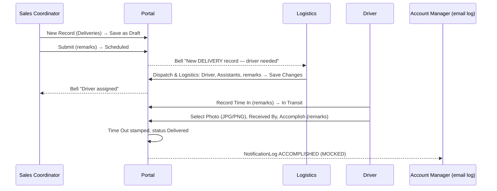

# System Overview (Discovery)

| Document control | |
|---|---|
| Title | System Overview, Microgenesis Supply Chain Portal |
| Document ID | QA-DISC-001 |
| Version | 1.0 |
| Date | 2026-10-14 |
| Author agent | Claude Code |
| Status | Final for UAT cycle 1 |
| Baseline | Branch `dev`, commit `2172fc8` |

Every statement below is backed by a code reference (`path:line` at commit `2172fc8`). Where the code and the project's own docs disagree, the code is treated as the description of current behaviour and the disagreement is listed in `open-questions.md`.

---

## 1. Technology and how to run it

| Item | Value | Evidence |
|---|---|---|
| Frontend | React 19 + TypeScript, Vite, TanStack Query, Zustand, Tailwind; served on port 3000; `/api` proxied to 4000 | `CLAUDE.md`; `client/` |
| Backend | Node.js, Express 4, TypeScript, port 4000 | `server/package.json:40`; `server/src/index.ts:34` |
| Database | PostgreSQL via Prisma 7 (Docker, host port 5433) | `server/prisma/schema.prisma:5-7`; `docs/GETTING_STARTED.md` §3 |
| Package manager | npm workspaces (`client`, `server`) | `package.json:8-33` |
| Start | `npm run dev` from the repo root (both servers) | `package.json:11` |
| Health check | `GET http://localhost:4000/api/health` | `server/src/index.ts:67` |
| Env files | `.env` (Docker PostgreSQL), `server/.env` (API: `DATABASE_URL`, `JWT_SECRET`, …). Copy from the `.example` files | `docs/GETTING_STARTED.md` §2 |
| UAT seed | `npm run seed:uat`: wipes and reseeds a **disposable** local DB (guarded by `assertDisposableSeedTarget`) | `server/prisma/seed-uat.ts:86-121` |
| Seeded accounts | 5 accounts, one per role (emails below; passwords in `docs/GETTING_STARTED.md` §6, supplied at run time) | `server/prisma/seeds/users.ts:6-10` |
| Seeded master data | 15 companies (`seeds/accounts.ts:5-19`), customers, suppliers; drivers Lando Navarro, Manny Santos, Ronald de la Cruz; assistants Jayson Reyes, Bong Alvarez, Ricky Mendoza (`seeds/drivers.ts:6-33`) | |
| Seeded runs | Driver login "John Doe" linked to a Driver profile; one Scheduled run per category assigned to John Doe dated the seed day, area "Quezon City - Diliman", references `SAP-DEMO-<hash>[-<CATEGORY>]`; one Delivered delivery `REC-UAT-DELIVERED-<YYYYMMDD>` with a stored PNG photo | `server/prisma/seed-driver-demo.ts`; `server/prisma/seed-uat.ts:13-82` |
| Mail | No SMTP/Azure config → mock mailer; outcomes logged in `NotificationLog` with status `MOCKED` | `server/src/services/notify.ts:24-35` |
| Time zone | All date logic uses Asia/Manila; dates are `YYYY-MM-DD` strings | `server/src/services/deliveryLifecycle.ts:96-98` |

### 1.1 Seeded accounts

| Role (code) | UI role label | Email | Name |
|---|---|---|---|
| `SALES_COORDINATOR` | Sales Coordinator | `sales@microgenesis.com` | Maria Reyes |
| `LOGISTICS` | Logistics | `logistics@microgenesis.com` | Juan Santos |
| `TASS` | TASS | `tass@microgenesis.com` | Ana Cruz |
| `ADMIN` | Admin | `admin@microgenesis.com` | System Admin |
| `DRIVER` | Driver | `driver@microgenesis.com` | John Doe |

## 2. Authentication and session

| Rule | Evidence |
|---|---|
| Sign-in page is `/login`. The email form is hidden behind the link "Sign in with email instead"; fields "Email", "Password", button "Sign In". The "Sign in with Microsoft" button is **out of scope**. | `client/src/features/auth/LoginView.tsx:221`, `:225-276`; `client/src/routes/screenRouting.ts:59-64` |
| `POST /api/auth/login`: missing fields → 400 "Email and password are required"; unknown email or wrong password → 401 "Invalid email or password"; deactivated account (correct password) → 401 "Account is deactivated". Email is lower-cased. | `server/src/routes/auth.ts:16-40` |
| Session = JWT in `httpOnly` cookie `mg_session`, 8-hour lifetime. Every request reloads the user; a deleted or deactivated user gets 401 "Session no longer valid — please log in again". | `server/src/middleware/auth.ts:33`, `:40-42`, `:85-114` |
| Writes require the `X-CSRF-Token` header (returned on every authenticated response) → otherwise 403 "Security token missing or expired. Refresh the page and try again." Cross-site origins → 403 "Cross-site request blocked". | `server/src/middleware/csrf.ts:46-77` |
| Rate limits: 5 failed logins per account and 20 per IP per 15 minutes; 600 API requests/min per user; 30 uploads per 10 min. Message "Too many requests. Please wait and try again." | `server/src/middleware/rateLimits.ts:16-21`, `:85`, `:92-101`; `server/src/middleware/security.ts` `applySecurity` |
| Logout: icon button `title="Log out"` (`id="logout-button"`) in the Navbar; Driver app button "Log Out". | `client/src/layouts/Navbar.tsx:170-177`; `client/src/features/dashboard/DriverDashboard.tsx:155` |

## 3. Roles and permissions

### 3.1 Roles

`SALES_COORDINATOR | LOGISTICS | TASS | ADMIN | DRIVER` (`server/src/middleware/auth.ts:8`). Each request passes up to four checks: `requireAuth`, `requireResource` (derived from screens), `requireScreen`, `requireRole`, plus record-level scope.

### 3.2 Default screens per role (module access)

Source: `server/src/services/permissions.ts:18-24`. Admin can grant or deny individual screens per user (`permissions.ts:27-45`); Admin Panel and Driver Dashboard can never be granted by override, Data Sampler only to Admin.

| Screen key | Sidebar label | SC | LOG | TASS | ADMIN | DRIVER |
|---|---|:-:|:-:|:-:|:-:|:-:|
| `main` | Main | ✓ | ✓ | ✓ | ✓ | |
| `dashboard` | Dashboard | ✓ | ✓ | ✓ | ✓ | |
| `deliveries` | Deliveries | ✓ | ✓ | | ✓ | |
| `rma` | RMA | ✓ | ✓ (view only) | ✓ | ✓ | |
| `accounting_collection` | Accounting Collection | ✓ | ✓ | ✓ | ✓ | |
| `procurement_pickup` | Procurement Pick-up | ✓ | ✓ | ✓ (sees no records, SI-01) | ✓ | |
| `sales_orders` | Sales Orders | ✓ | ✓ | | ✓ | |
| `customers` | Customers | ✓ | ✓ | | ✓ | |
| `suppliers` | Suppliers | ✓ | ✓ | ✓ | ✓ | |
| `driver` / `driver_board` / `driver_manager` | Drivers (tabs View / Board / Manager) | | ✓ | | ✓ | |
| `calendar` | Delivery Calendar | | ✓ | | ✓ | |
| `statistical_reports` | Reports | | ✓ | | ✓ | |
| `am_directory` | AM Directory | ✓ | | | ✓ | |
| `transactions` | Transaction Center | ✓ | ✓ | ✓ | ✓ | |
| `inventory` | SKU Master | | | | ✓ | |
| `data_sampler` | Data Sampler | | | | ✓ | |
| `admin` | Admin Panel | | | | ✓ | |
| `driver_dashboard` | (Driver app) | | | | | ✓ |

Sidebar labels: `client/src/layouts/Sidebar.tsx:328-361`. A screen the user lacks shows "This page is not available for your account." when opened by URL (`client/src/routes/AppRouter.tsx:102-103`); from inside the app a "Request Temporary Access" modal appears (`client/src/App.tsx:177-178`).

### 3.3 Record categories readable per role

`readableCategories` (`server/src/services/recordAccess.ts:12-21`): a category is readable if the user has its screen or any aggregate screen (main, dashboard, calendar, driver, driver_board, driver_dashboard, statistical_reports), unless explicitly denied; **TASS is restricted to RMA and Accounting Collection**. Drivers additionally see only non-draft records assigned to their linked Driver profile (`recordAccess.ts:26-33`); an unlinked Driver sees nothing.

### 3.4 Role-permission matrix (actions)

| Action | API (evidence) | SC | LOG | TASS | ADMIN | DRIVER |
|---|---|:-:|:-:|:-:|:-:|:-:|
| Create record (Draft or Scheduled) | `POST /api/records` (`records.ts:793`) | ✓ | ✓ except RMA (`:806`) | ✗ | ✓ | ✗ |
| Create record from UI list "New Record" | `DeliveryRecordsView.tsx:260-262` | ✓ | ✓ except RMA | ✗ | ✗ (uses Main "New Delivery") | ✗ |
| Edit metadata (company, reference, date, item, line items, amount) with remarks | `PUT /api/records/:id` (`records.ts:881`, `:974-999`) | ✓ | ✗ | ✗ | ✓ | ✗ |
| Edit area/address/priority with remarks | `records.ts:913-958` | ✓ | ✓ (not RMA) | RMA only | ✓ | ✗ |
| Change Delivery Date (Delivery) | `records.ts:918`, `:935-938`, `:1001` | ✓ | ✓ | ✗ | ✓ | ✗ |
| Assign driver / assistants / vehicle | `records.ts:934-952` | ✗ (403 on create `:811-816`; field ignored on edit) | ✓ (not RMA) | RMA (SI-14) | ✓ | ✗ |
| Link to an Accounting Collection | `records.ts:960-973` | ✗ | ✓ | RMA (SI-14) | ✓ | ✗ |
| Submit Draft / Return to Draft | `records.ts:902`, `:1024-1030`, `:1125` | ✓ | ✗ edit route; ✓ status route (SI-03) | RMA via status route (SI-03) | ✓ | ✗ |
| Record Time In | `POST /api/records/:id/time-in` (`records.ts:1080`) | ✗ | ✓ (not RMA) | ✗ | ✓ | own runs |
| Change status (non-draft transitions) | `PATCH /api/records/:id/status` (`records.ts:1106-1194`) | ✗ (`:1125`) | ✓ (not RMA) | RMA only (`:1124`) | ✓ | own runs |
| Correct Time In / Time Out | `records.ts:897-900` | ✗ | ✓ | ✗ | ✓ | ✗ |
| Upload attachment | `POST /api/records/:id/attachments` (`records.ts:642-727`) | ✓ | ✓ (not RMA) | ✗ | ✓ | own runs |
| Remove attachment | `DELETE /api/records/:id/attachments/:aid` (`records.ts:747`) | ✓ | ✓ (not RMA) | ✗ | ✓ | ✗ |
| Comment | `POST /api/records/:id/comments` (`records.ts:1288`) | ✓ | ✓ (not RMA, `:30-35`) | ✓ (readable) | ✓ | own runs |
| Verify collection | `PATCH /api/records/:id/verify-collection` (`records.ts:1197`) | ✗ | ✗ | ✓ | ✗ (API); UI says "TASS or Admin" | ✗ |
| Soft delete record | `DELETE /api/records/:id` (`records.ts:1248`); **no UI** | ✓ | ✗ | ✗ | ✗ | ✗ |
| Create company | `POST /api/companies` (`companies.ts:21`) | ✓ | ✗ | ✗ | ✓ | ✗ |
| Create customer | `POST /api/customers` (`customers.ts:32`) | ✓ | ✓ | ✗ | ✓ | ✗ (no screen, OQ-05) |
| Edit customer (reason required) | `PUT /api/customers/:id` (`customers.ts:95`) | ✓ | ✓ | ✗ | ✓ | ✗ |
| Create supplier | `POST /api/suppliers` (`suppliers.ts:30`) | ✓ | ✓ | ✗ (role) | ✓ | ✗ |
| Add Driver profile | `POST /api/drivers` (`drivers.ts:52-66`) | ✗ | ✗ | ✗ | ✓ | ✗ |
| Add Assistant; edit coverage/status; deactivate | `drivers.ts:52-90` | ✗ | ✓ | ✗ | ✓ | ✗ |
| Rename Driver / change type | `services/driverDirectory.ts:76-84` | ✗ | ✗ | ✗ | ✓ | ✗ |
| Create / edit SKU | `POST/PUT /api/skus` (`skus.ts:95`, `:132`); **no UI** | ✗ | ✗ | ✗ | ✓ | ✗ |
| Stock adjustment | `POST /api/skus/:id/adjust` (`skus.ts:185`) | ✗ | only with SKU Master granted | ✗ | ✓ | ✗ |
| Transaction Center | `GET /api/transactions` (`transactions.ts:26`) | DELIVERY, PROCUREMENT_PICKUP, SALES_ORDERS + inventory | DELIVERY, RMA, PROCUREMENT_PICKUP + inventory | ACCOUNTING_COLLECTION only | all + inventory | API only, own runs |
| Users, module access, audit log, integrations, test email | `/api/users/*`, `/api/admin/*` | ✗ | ✗ | ✗ | ✓ | ✗ |
| Data Sampler generate | `POST /api/data-sampler/generate` | ✗ | ✗ | ✗ | ✓ | ✗ |

## 4. Modules

| Module | Screens / UI | Server | Notes |
|---|---|---|---|
| Records (5 categories) | Deliveries, RMA, Procurement Pick-up, Sales Orders → `DeliveryRecordsView` + `DeliveryRecordWorkspace`; Accounting Collection → `AccountingCollectionView` + `AccountingCollectionWorkspace` (`client/src/routes/AppRouter.tsx:108-146`) | `server/src/routes/records.ts` | One table `DeliveryRecord` (`schema.prisma:114-169`) |
| Driver app | `DriverDashboard` for role DRIVER (`client/src/App.tsx:243`) | records routes scoped to own runs | |
| Drivers | Driver Manager, Board, View; Delivery Calendar; Monthly Driver Report | `server/src/routes/drivers.ts`, `/records/calendar-summary` | |
| Master data | Companies (combobox on records), Customers ("Merchant Customer Registry"), Suppliers ("Supplier Registry") | `companies.ts`, `customers.ts`, `suppliers.ts` | Customer edits audited with reason and optimistic concurrency |
| SKU Master | `InventoryView` + `SkuWorkspace`; only **Stock Adjustment** is writable in the UI | `skus.ts` | Create/edit SKU API-only |
| Transaction Center | `TransactionCenter` + `TransactionDetail` | `transactions.ts` | Merges records and stock movements |
| Dashboards & reports | Role dashboards, Statistical Reports, AM Directory | `dashboard.ts`, `reports.ts`, `/records/am-summary` | |
| Notifications | Bell (`NotificationBell.tsx`), completion email log | `notifications.ts`, `services/inAppNotify.ts`, `services/notify.ts` | |
| Administration | Admin Panel tabs: User Management, System Audit Log, Integrations; Module Access panel | `users.ts`, `admin.ts` | |
| Data Sampler | `DataSamplerView` | `data-sampler.ts` | Reset is destructive (out of scope) |

## 5. Record lifecycle (state machine)

States: Draft, Scheduled, In Transit, Pending, On-Hold, Rescheduled, Delivered (UI "Accomplish"/"Collected" for completion). Stored statuses: `SCHEDULED | IN_TRANSIT | ACCOMPLISHED | ON_HOLD | RESCHEDULED | PENDING` with a `draft` flag (`server/src/mappings.ts:26-44`; `deliveryLifecycle.ts:59-69`).

Allowed transitions (`server/src/services/deliveryLifecycle.ts:49-57`, filtered by `:70-76`):

```mermaid
stateDiagram-v2
    [*] --> Draft: Save as Draft (SC/LOG/ADMIN)
    [*] --> Scheduled: Submit (SC/LOG/ADMIN)\nnotifies Logistics
    Draft --> Scheduled: Submit (SC/ADMIN; also LOG via status route, SI-03)\nreference required
    Scheduled --> Draft: Return to Draft (SC/ADMIN), no Time In
    Scheduled --> InTransit: Record Time In (DRIVER own/LOG/ADMIN)\ndriver assigned
    Rescheduled --> InTransit: Record Time In
    Scheduled --> OnHold
    Scheduled --> Rescheduled
    InTransit --> Delivered: Time In + Received By + JPG/PNG photo\nserver stamps Time Out
    InTransit --> Pending
    InTransit --> OnHold
    InTransit --> Rescheduled: clears Time In/Out/Received By
    Pending --> Delivered
    Pending --> OnHold
    Pending --> Rescheduled
    OnHold --> Scheduled: only without Time In
    OnHold --> Delivered: only with Time In
    OnHold --> Pending: only with Time In
    OnHold --> Rescheduled
    OnHold --> Draft: SC/ADMIN, no Time In
    Rescheduled --> Scheduled: no Time In
    Rescheduled --> OnHold
    Rescheduled --> Draft: SC/ADMIN
    Delivered --> [*]: terminal; priority locked
    state "In Transit" as InTransit
    state "On-Hold" as OnHold
```

Transition rules (all server-enforced, `server/src/routes/records.ts:1106-1194`, `:1080-1103`):

| Rule | Message | Evidence |
|---|---|---|
| Remarks required on every status change and Time In | "Remarks are required when changing status." / "Remarks are required when recording Time In." | `records.ts:1109`, `:1082` |
| In Transit only via Time In | "Use Record Time In to start this run." | `deliveryLifecycle.ts:78` |
| Time In needs non-draft, driver assigned, no prior Time In, state Scheduled/Rescheduled | "Submit the draft before recording Time In." / "Assign a driver before recording Time In." / "Time In has already been recorded for this attempt." / "Only a Scheduled or Rescheduled run can start." | `deliveryLifecycle.ts:84-90` |
| Delivered / Pending need a Time In | "Record a valid Time In before completing or marking this run Pending." | `records.ts:1142` |
| Delivered needs Received By | "Received By is required before completing this run." | `records.ts:1153` |
| Delivered needs a stored, verified JPG/PNG photo | "Upload at least one JPG or PNG delivery photo before marking this delivery Accomplished." | `records.ts:1154`; `services/podPhotos.ts:7` |
| Delivered stamps Time Out (server clock) and, for Deliveries, `completedLate`/`daysLate` | | `records.ts:1151-1163` |
| Delivered for a Delivery needs a valid Delivery Date | "A valid Delivery Date is required before completing this delivery." | `records.ts:1139-1141` |
| Rescheduled (Delivery, by LOG/ADMIN) needs a new date, not past, different from current | "A new delivery date is required to reschedule a delivery." / "The new delivery date cannot be in the past." / "The new delivery date must be different from the current delivery date." | `records.ts:1131-1137` |
| Rescheduled clears Time In, Time Out, Received By | | `records.ts:1164` |
| Same status and no priority change rejected | "Choose a different status or priority before saving." | `records.ts:1129` |
| Draft target only for SC/Admin and only before Time In | "Only Sales Coordinator or Admin may return a record to Draft." / "A started run cannot be returned to Draft." | `deliveryLifecycle.ts:79-80` |
| SC status changes limited to draft flow | "Sales Coordinator may only submit or return drafts." (403) | `records.ts:1125` |
| TASS status changes limited to RMA | "TASS status updates are limited to RMA records" (403) | `records.ts:1124` |
| Priority locked once Delivered | "Priority can't be changed after a record is Delivered." | `records.ts:22`, `:1023`, `:1128` |
| Driver: future-dated unstarted **Delivery** read-only; invalid date blocks | "This delivery is scheduled for a future date and is read-only until that date." | `deliveryLifecycle.ts:40-46` |
| Submit draft needs reference | "Reference is required to submit the draft." | `records.ts:1146`, `:1028` |
| New drafts cannot get new assignments | "New assignments to drafts are not allowed." | `records.ts:1037` |

## 6. End-to-end business workflows

### WF-1 Delivery (main chain)


Evidence: create `records.ts:793-877`; notify Logistics `:868-874`, `:1176-1184`; driver assigned notify `:1061-1074`; Time In `:1080-1103`; completion `:1151-1163`, `:1185-1192`.

Alternate paths: On-Hold, Pending, Rescheduled (new date, clears Time In), Return to Draft (before Time In), Logistics completing on behalf of the Driver (Logistics/Admin may Record Time In and change status), bulk status/priority from the list (Logistics; priority also SC) (`DeliveryRecordsView.tsx:909-962`).

### WF-2 Accounting Collection

SC/LOG/ADMIN create (UI requires Company, Reference, Amount to Collect, Area, Account Manager, Delivery Date; `AccountingCollectionView.tsx:280-283`) → Logistics assigns driver → Time In → "Collected" (= Delivered) with photo and Received By → TASS bell "Collection ready for verification" (`records.ts:1191`) and NotificationLog to "Billing Department" (`records.ts:1189`) → TASS opens tab "Verification" → "Verify Collection of ₱{amount}" (`AccountingCollectionWorkspace.tsx:451-453`) → creator gets bell "Collection verified" (`records.ts:1236-1242`). Verification only once, only when Delivered (`records.ts:1204-1214`). A Delivery can be linked to a collection by Logistics/Admin (card "Linked Collection", `DeliveryRecordWorkspace.tsx:669`).

### WF-3 RMA

SC/ADMIN create (Logistics blocked, `records.ts:806`); Logistics view-only (`records.ts:30-35`); TASS may edit and change status of RMA via API (`records.ts:889-892`, `:1124`), but the record workspace shows **no tabs** for TASS (`DeliveryRecordWorkspace.tsx:93-100`), so TASS has no UI to do it (SI-17). Time In for RMA only by Admin or assigned Driver (OQ-01).

### WF-4 Procurement Pick-up and WF-5 Sales Orders

Same lifecycle as Deliveries; created by SC/LOG/ADMIN; Sales Orders appear under the sidebar "Sales Orders" item (`Sidebar.tsx:343`). TASS has the Procurement screen but no records (SI-01). Suppliers workspace lists linked pick-ups ("Procurement Pick-ups (N)").

### WF-6 Driver execution

Driver signs in → "Microgenesis Field Mobile" dashboard with today's runs → "Record Time In" (Confirm Status modal with remarks) → "Select Photo / Document" → "Received By *" → "Accomplish" / "Pending" / "Reschedule" → Confirm (remarks) → "Accomplished (N)" list; future runs listed under "Upcoming / Other Dates" read-only (`DriverDashboard.tsx:144-553`). There is no On-Hold button for Drivers.

### WF-7 Administration

Admin creates a user ("Create User" → "New User Account") → for Driver role links or creates a Driver profile (`users.ts:31-92`; `services/driverLogin.ts`) → sets per-user module access ("Access" → "Module Access — {name}", version-checked, `permissions.ts:99-117`) → deactivates/activates/deletes (`users.ts:190-300`; delete refused if the user has linked records, 409).

### WF-8 Master data and stock

Companies (SC/Admin), Customers (create SC/LOG/ADMIN; edit with "Reason for change", 409 on concurrent edit), Suppliers (create), Driver directory (Admin adds Drivers, Logistics adds Assistants, coverage areas from `server/src/areaHierarchy.ts:8-55`), SKU stock adjustment (Admin; Logistics only if granted SKU Master) with non-negative balance (`skus.ts:205-211`).

## 7. Business rules and validations (catalogue)

IDs here are used by the traceability matrix.

| ID | Rule | Evidence |
|---|---|---|
| BR-01 | Non-draft create requires company, reference, category, delivery date | `records.ts:796-819` |
| BR-02 | Draft create requires only company and category | `records.ts:796-798` |
| BR-03 | New records can only be Draft or Scheduled | `records.ts:820` |
| BR-04 | Drivers cannot be assigned on create (403 for SC, 400 otherwise) | `records.ts:810-821` |
| BR-05 | Every substantive edit requires remarks | `records.ts:921-923` |
| BR-06 | Status changes go through the status action only | `records.ts:895` |
| BR-07 | Priority values limited to 1 - Low, 2 - Moderate, 3 - High; locked when Delivered | `records.ts:904-911`, `:1023` |
| BR-08 | Delivery Date must be valid YYYY-MM-DD on edit | `records.ts:936`, `:1001-1003` |
| BR-09 | Timestamp corrections: Logistics/Admin, existing stamp, ISO with zone, Time Out ≥ Time In | `records.ts:896-900`, `:1038-1043` |
| BR-10 | Received By cannot be cleared on completed runs | `records.ts:1044`, `:1149` |
| BR-11 | Driver may only act on own assigned non-draft runs | `recordAccess.ts:26-37`; `records.ts:928-931` |
| BR-12 | Driver future-dated Delivery read-only | `deliveryLifecycle.ts:40-46` |
| BR-13 | Driver assignment must be an active DRIVER profile; assistants must be active ASSISTANT entries | `services/driverDirectory.ts:118-165` |
| BR-14 | Linked collection must be an existing Accounting Collection | `records.ts:965-971` |
| BR-15 | Attachment types: PDF, JPG/JPEG, PNG, DOC, DOCX, content-verified | `services/attachmentRules.ts:15-23`; `services/podPhotos.ts:74-89` |
| BR-16 | 10 MB per file → 413 "File is too large. The maximum upload size is 10 MB." | `middleware/uploadErrors.ts:27-28` |
| BR-17 | Max 10 attachments and 50 MB per record → 409 | `attachmentRules.ts:6-10`, `:32-40` |
| BR-18 | Cannot remove the last delivery photo of a Delivered record (409) | `records.ts:755-758` |
| BR-19 | Collection verification: TASS, Accounting Collection, Delivered, once | `records.ts:1197-1214` |
| BR-20 | Soft delete only; SC only | `records.ts:1248-1268` |
| BR-21 | Customer edit: name required ≤120, email format, phone chars, reason required, optimistic concurrency, "No changes to save." | `services/customerValidation.ts:4-54`; `customers.ts:95-127` |
| BR-22 | Supplier create requires name and category | `suppliers.ts:33` |
| BR-23 | Company create requires name | `companies.ts:23` |
| BR-24 | Driver directory: name required, no duplicate name+type, coverage from the area list, Logistics adds Assistants only, Driver rename/type change Admin only, Driver with login/runs cannot change type | `services/driverDirectory.ts:28-96`; `drivers.ts:52-90` |
| BR-25 | Stock adjustment: type, non-zero qty, reference required; balance cannot go negative | `skus.ts:192-211` |
| BR-26 | SKU create requires sku_code, name, category, unit_cost, unit_price, reorder_point | `skus.ts:134-138` |
| BR-27 | User create requires name, email, password, valid role; email unique (409) | `users.ts:33-39`, `:81-89` |
| BR-28 | Admin cannot change own role away from Admin, deactivate or delete self | `users.ts:160-162`, `:194-196`, `:249-251` |
| BR-29 | User delete refused when the user has linked business records (409) | `users.ts:256-292` |
| BR-30 | Module access save: known screens, booleans, no duplicates, version match (409), role-locked screens refused | `permissions.ts:82-117` |
| BR-31 | Driver login linking: only DRIVER logins; profile not linked elsewhere; same-name profile must be chosen explicitly | `services/driverLogin.ts:31-60` |
| BR-32 | Notifications are per user; mark read only own | `notifications.ts:10-56` |
| BR-33 | Record list filters validated (status, dates from ≤ to, search ≤ 100 chars, limit 1-100) | `records.ts:175-289` |
| BR-34 | Reports date range must be valid and from ≤ to | `services/dateSemantics.ts:37-46`; `reports.ts:13-40` |
| BR-35 | Comment body required | `records.ts:1290-1292` |

## 8. Notifications, emails and audit

| Event | In-app (bell) | Email log | Audit |
|---|---|---|---|
| Record submitted (create non-draft or Draft→Scheduled for DELIVERY without driver) | All active LOGISTICS: "New {CATEGORY} record — driver needed" | | CREATE / UPDATE |
| Logistics assigns first driver | Record creator: "Driver assigned" | | UPDATE |
| Record Delivered | Accounting Collection → all TASS: "Collection ready for verification" | `NotificationLog` ACCOMPLISHED to Account Manager (or "Billing Department") | UPDATE |
| Collection verified | Creator: "Collection verified" | | UPDATE |
| Attachment upload (DELIVERY) / removal | | | UPDATE |
| Customer create / edit | | | CREATE / UPDATE with reason |
| Driver directory create/update/link | | | CREATE / UPDATE / LINK_LOGIN / UNLINK_LOGIN |
| Module access change | | | UPDATE (`UserPermission`) |

Evidence: `records.ts:860-874`, `:1061-1074`, `:1185-1192`, `:1236-1242`; `services/notify.ts`; `customers.ts:52-56`, `:115-119`; `services/driverDirectory.ts`; `permissions.ts:111-114`. Remark history contexts: CREATION, GENERAL_EDIT, TIMESTAMP_CORRECTION, TIME_IN, STATUS_CHANGE (`records.ts:864`, `:1054`, `:1098`, `:1171`).

## 9. Routes and pages

### 9.1 Pages (URL = `/<screen-key>`, record deep link `?item=<id>`)

`client/src/routes/screenRouting.ts:46-57`. Login `/login`. Example: `http://localhost:3000/deliveries?item=REC-12345`.

### 9.2 API endpoints (all under `/api`)

| Method + path | Guards (beyond requireAuth) | Evidence |
|---|---|---|
| POST /auth/login, POST /auth/logout, GET /auth/me | none / none / auth | `auth.ts:16`, `:42`, `:47` |
| GET /records (filters, paging), /active-counts, /am-summary, /calendar-summary, /status-history-counts | resource `records` + scope | `records.ts:291-591` |
| GET /records/:id, /:id/audit, /:id/attachments, /:id/remarks, /:id/comments | resource `records` + scope | `records.ts:593-790`, `:1271` |
| POST /records | SC, LOG, ADMIN | `records.ts:793` |
| PUT /records/:id | SC, LOG, ADMIN, DRIVER, TASS (+ field rules) | `records.ts:881` |
| POST /records/:id/time-in | DRIVER, LOG, ADMIN | `records.ts:1080` |
| PATCH /records/:id/status | SC, LOG, ADMIN, DRIVER, TASS (+ rules) | `records.ts:1106` |
| PATCH /records/:id/verify-collection | TASS | `records.ts:1197` |
| DELETE /records/:id | SC | `records.ts:1248` |
| POST /records/:id/attachments; DELETE …/:aid; GET …/:aid/download | SC, LOG, ADMIN, DRIVER / SC, LOG, ADMIN / read | `records.ts:642`, `:747`, `:729` |
| POST /records/:id/comments | all roles (scope) | `records.ts:1288` |
| GET/POST /companies | POST: SC, ADMIN | `companies.ts:7`, `:21` |
| GET/POST /customers, PUT /customers/:id, GET /customers/:id/audit | POST: SC, LOG, ADMIN, DRIVER; PUT/audit: SC, LOG, ADMIN | `customers.ts:9-130` |
| GET/POST /suppliers | POST: screen suppliers + SC, LOG, ADMIN, DRIVER | `suppliers.ts:7`, `:30` |
| GET/POST/PUT/DELETE /drivers | writes: screen driver_manager + LOG, ADMIN | `drivers.ts:46-90` |
| GET /skus, /skus/:id; GET /skus/:id/audit, POST/PUT /skus | reads: resource skus; writes/audit: ADMIN | `skus.ts:50-181` |
| POST /skus/:id/adjust | screen inventory + ADMIN, LOG | `skus.ts:185` |
| GET /transactions, /transactions/:source/:id | role category limits | `transactions.ts:26`, `:148` |
| GET /dashboard/stats | resource dashboard | `dashboard.ts:8` |
| GET /reports/summary | screen statistical_reports | `reports.ts:13` |
| GET /notifications, /unread-count; PATCH /read-all, /:id/read; POST /send-email | auth only (send-email: resource records) | `notifications.ts:10-150` |
| /users (GET, POST, PATCH /:id, PATCH /:id/deactivate, /:id/activate, DELETE /:id, GET/PUT /:id/permissions, PUT /:id/driver-profile) | ADMIN | `users.ts:14-320` |
| /admin/audit-log, /integration-status, /deployment-status, POST /test-email | ADMIN | `admin.ts:11-120` |
| /data-sampler/counts, /generate, /reset | ADMIN (reset also local-only) | `data-sampler.ts:19`, `:131`, `:288` |
| /auth/microsoft* , PUT /users/:id/microsoft-identity | **out of scope** | `auth.ts:53-175`; `users.ts:117` |

## 10. UI elements per role that differ from the API

| Observation | Evidence |
|---|---|
| Record workspace tabs are shown only to SC, Logistics, Admin; **TASS sees no tabs** on RMA/Procurement records | `client/src/features/deliveries/DeliveryRecordWorkspace.tsx:93-100` |
| "Dispatch & Logistics" tab (driver, assistants, status, Time In, POD) only Logistics/Admin; hidden for Logistics on RMA | same, `:94-99` |
| Status is changed with buttons in the "Status Update" card, not a dialog; Draft rendered as "Return to Draft" | `DeliveryRecordWorkspace.tsx:1019-1068`; `client/src/utils/recordLifecycle.ts:16-20` |
| Vehicle is edited in Overview ("Vehicle" select, SC/Admin) and in Drivers → View detail pane | `DeliveryRecordWorkspace.tsx:429`; `client/src/features/drivers/DriverView.tsx` |
| Main → "New Delivery" opens a create modal with "Order Type *" for every role whose screens include record categories (TASS included) | `client/src/pages/MainView.tsx:114-121`, `:195-209` |
| Record soft delete has **no UI**; SKU create/edit have **no UI** | `client/src/api/index.ts:542`, `:606` |
| "Request Temporary Access" modal shows "Request Sent / Your admin has been notified." but sends nothing | `client/src/components/AccessRequestModal.tsx:25-34` |
| Accounting Collection "Documents" tab is a placeholder ("This section is under development…") | `client/src/features/accounting/AccountingCollectionWorkspace.tsx:151-160`, `:758` |
| Create form labels Delivery Date "(optional)" though Submit requires it | `client/src/features/deliveries/RecordCreateForm.tsx:496`; `client/src/utils/recordLifecycle.ts:8` |
| Verification tab text says "Verification requires TASS or Admin role." but the API allows TASS only | `AccountingCollectionWorkspace.tsx:370`; `records.ts:1197` |
