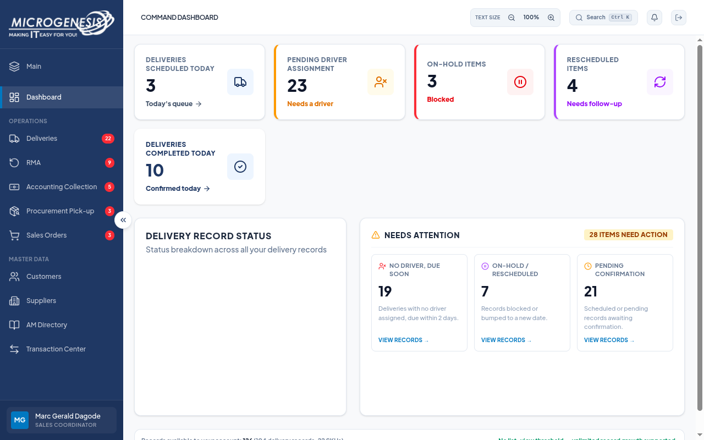
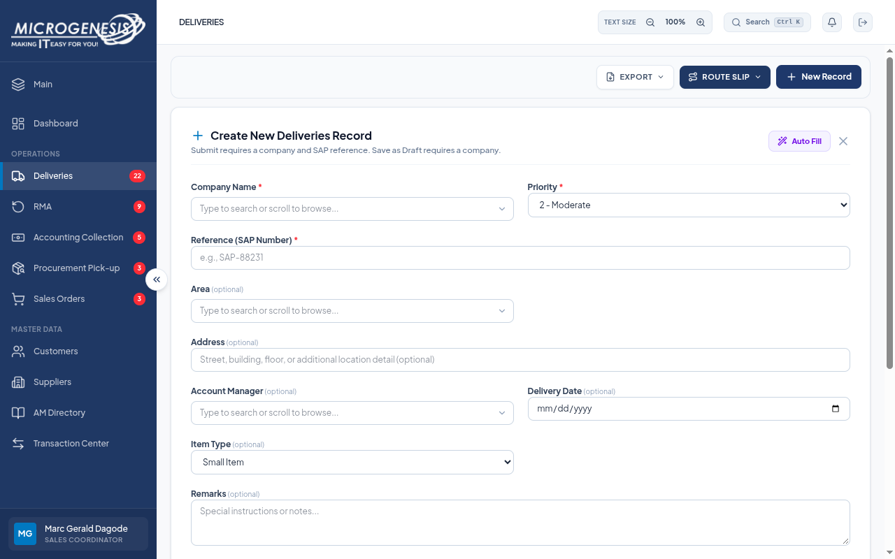
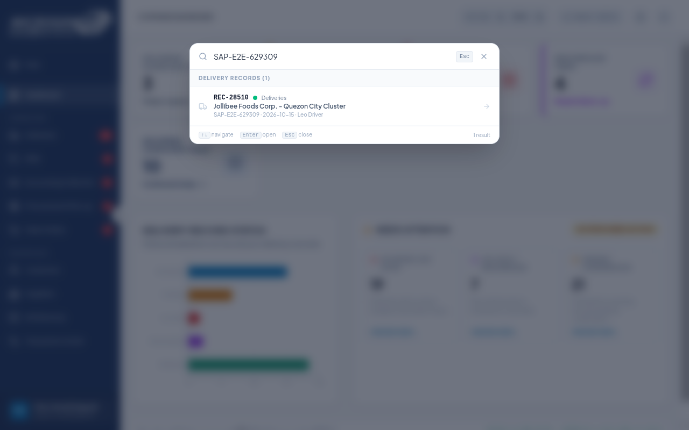

# Sales Coordinator QA: RUN-20261015-08

| Document control | Value |
|---|---|
| Title | Sales Coordinator read-only QA |
| Date | 2026-10-15 |
| Status | Read-only phase complete; write and other-role phases Blocked |
| Build | 665775f, branch dev, working tree |
| Account | dagodemarcgeraldarante@gmail.com — SALES_COORDINATOR |
| Time (Asia/Manila) | 2026-10-15T15:59:43.101000+08:00 to 2026-10-15T16:12:01.441000+08:00 |

## Result

**21 reviewed checks: 17 Pass, 4 Fail**, with three existing findings reproduced: DEF-003 (Major/P1), DEF-005 (Trivial/P4, label subset) and DEF-030 (Minor/P3, adapted Sales check). These are focused checks, not 21 complete approved UAT cases. Twenty checks used the Sales Coordinator session; one used a separate anonymous context.

The execution produced 25 raw attempts. Four preliminary attempts had timing, locator or endpoint-definition errors and are superseded explicitly below; they are not counted as application failures. Original evidence and raw outcomes remain preserved in [sales-results.json](../../artifacts/RUN-20261015-08/sales-results.json). The authoritative reviewed set is [reviewed-results.json](../../artifacts/RUN-20261015-08/reviewed-results.json).

Microsoft sign-in and user-completed MFA established the correct account/role. Only read operations were performed on business data. The current database configuration failed the repository's local `_sandbox`/`_test` guard, so submissions, edits, uploads and destructive/refusal probes were not performed. No application code, environment files, roles, permissions, seed data, commits or branches changed. Cookies and authentication tokens were not exported. The QA browser was closed after these checks.

## Passed behavior

- Pending Driver Assignment and On-Hold dashboard cards matched list totals: 23/23 and 3/3.
- Admin, SKU Master and Driver Manager direct routes redirected to Dashboard; the users API returned 403.
- Delivery resource reads, reference search, Draft filtering and invalid-filter rejection worked. Inverted dates, a 101-character search and unknown status returned the specified HTTP 400 errors.
- Existing record detail, audit (five events), document metadata and a Draft workspace were readable. Sales had no Dispatch & Logistics tab or delete control.
- Transaction Center offered exactly the three Sales categories and returned 79 transactions across those categories, without RMA or Accounting Collection.
- Customer and supplier reads, customer audit access, AM Directory, empty notifications and refresh persistence worked. The selected pre-existing customer's audit list was empty; this establishes access only, not creation-audit correctness.
- The settled Sales chart displayed five nonzero bars; Delivered tooltip matched 33 delivered records. This does not retest the Admin chart case.
- Anonymous access redirected to Login, with HTTP 401 for records and users APIs.

## Findings

### DEF-003 — approved Calendar and Reports access remains denied

The sidebar omitted both modules. Direct Calendar/Reports URLs redirected to Dashboard, and `GET /api/reports/summary` returned HTTP 403 with `{"error":"Module access denied"}`. Admin route redirects and the users API 403 were expected protections and passed their subchecks. The access case fails because the approved Sales modules are unavailable. The POST driver refusal step was blocked and is not claimed as executed.

### DEF-005 — Delivery Date still says optional

The create form displayed “Delivery Date (optional)”. Only the label was checked; submission rejection was not rerun because write tests were blocked. The existing label issue remains observed.

### DEF-030 — direct Enter leaves global-search overlay open

A one-character query showed the minimum-length prompt, and a full reference produced one result. Direct Enter left the overlay open at Dashboard. A separate keyboard control using ArrowDown then Enter opened the record and closed the overlay. This is a Sales-account adaptation; the original Logistics-role case was not rerun.

## Reviewed checks

| Check | Description | Status | Defect | Evidence |
|---|---|---|---|---|
| TC-ACC-001 | Sales Coordinator sidebar matches approved modules | Fail | DEF-003 | [TC-ACC-001-02-failure.png](../../artifacts/RUN-20261015-08/TC-ACC-001-02-failure.png) · [action trace](../../artifacts/RUN-20261015-08/TC-ACC-001-actions.zip) |
| SC-ACCESS-002 | Protected routes and approved Calendar/Reports access after session load | Fail | DEF-003 | [SC-ACCESS-002-08-failure.png](../../artifacts/RUN-20261015-08/SC-ACCESS-002-08-failure.png) · [action trace](../../artifacts/RUN-20261015-08/SC-ACCESS-002-actions.zip) |
| SC-API-002 | Sales allowed resource APIs return data | Pass | — | [SC-API-002-06-result.png](../../artifacts/RUN-20261015-08/SC-API-002-06-result.png) · [action trace](../../artifacts/RUN-20261015-08/SC-API-002-actions.zip) |
| TC-RPT-001 | Sales dashboard KPI drilldowns match list totals | Pass | — | [TC-RPT-001-03-result.png](../../artifacts/RUN-20261015-08/TC-RPT-001-03-result.png) · [action trace](../../artifacts/RUN-20261015-08/TC-RPT-001-actions.zip) |
| SC-DEL-002 | Draft status filter only shows draft deliveries | Pass | — | [SC-DEL-002-02-result.png](../../artifacts/RUN-20261015-08/SC-DEL-002-02-result.png) · [action trace](../../artifacts/RUN-20261015-08/SC-DEL-002-actions.zip) |
| SC-DEL-003 | Delivery filter APIs reject inverted dates, oversized searches and unknown status | Pass | — | [SC-DEL-003-04-result.png](../../artifacts/RUN-20261015-08/SC-DEL-003-04-result.png) · [action trace](../../artifacts/RUN-20261015-08/SC-DEL-003-actions.zip) |
| SC-DEL-004 | Delivery Date label communicates submission requirement | Fail | DEF-005 | [SC-DEL-004-02-failure.png](../../artifacts/RUN-20261015-08/SC-DEL-004-02-failure.png) · [action trace](../../artifacts/RUN-20261015-08/SC-DEL-004-actions.zip) |
| SC-DEL-005 | Existing delivery workspace permits Sales reading without dispatch controls | Pass | — | [SC-DEL-005-02-result.png](../../artifacts/RUN-20261015-08/SC-DEL-005-02-result.png) · [action trace](../../artifacts/RUN-20261015-08/SC-DEL-005-actions.zip) |
| SC-DEL-006 | Record audit and supporting document reads are available | Pass | — | [SC-DEL-006-04-result.png](../../artifacts/RUN-20261015-08/SC-DEL-006-04-result.png) · [action trace](../../artifacts/RUN-20261015-08/SC-DEL-006-actions.zip) |
| SC-DEL-007 | Draft workspace and list offer no delete action | Pass | — | [SC-DEL-007-02-result.png](../../artifacts/RUN-20261015-08/SC-DEL-007-02-result.png) · [action trace](../../artifacts/RUN-20261015-08/SC-DEL-007-actions.zip) |
| SC-DEL-008 | Reference search resolves to the correct record ID and a single row | Pass | — | [SC-DEL-008-01-result.png](../../artifacts/RUN-20261015-08/SC-DEL-008-01-result.png) · [action trace](../../artifacts/RUN-20261015-08/SC-DEL-008-actions.zip) |
| SC-TXN-001 | Transaction Center category choices and all delivery rows respect Sales scope | Pass | — | [SC-TXN-001-02-result.png](../../artifacts/RUN-20261015-08/SC-TXN-001-02-result.png) · [action trace](../../artifacts/RUN-20261015-08/SC-TXN-001-actions.zip) |
| SC-MD-002 | Supplier registry matches accessible supplier data | Pass | — | [SC-MD-002-02-result.png](../../artifacts/RUN-20261015-08/SC-MD-002-02-result.png) · [action trace](../../artifacts/RUN-20261015-08/SC-MD-002-actions.zip) |
| SC-AM-001 | Sales account can open the AM Directory | Pass | — | [SC-AM-001-01-result.png](../../artifacts/RUN-20261015-08/SC-AM-001-01-result.png) · [action trace](../../artifacts/RUN-20261015-08/SC-AM-001-actions.zip) |
| SC-NOT-001 | Notification bell and unread-count API agree for the current account | Pass | — | [SC-NOT-001-04-result.png](../../artifacts/RUN-20261015-08/SC-NOT-001-04-result.png) · [action trace](../../artifacts/RUN-20261015-08/SC-NOT-001-actions.zip) |
| SC-NAV-001 | Browser refresh preserves the authorized delivery screen and session | Pass | — | [SC-NAV-001-01-result.png](../../artifacts/RUN-20261015-08/SC-NAV-001-01-result.png) · [action trace](../../artifacts/RUN-20261015-08/SC-NAV-001-actions.zip) |
| SC-MD-003 | Customer registry and audit read using the rendered workspace controls | Pass | — | [SC-MD-003-03-result.png](../../artifacts/RUN-20261015-08/SC-MD-003-03-result.png) · [action trace](../../artifacts/RUN-20261015-08/SC-MD-003-actions.zip) |
| SC-SEARCH-001 | Global search finds a reference and Enter opens the result | Fail | DEF-030 | [SC-SEARCH-001-02-failure.png](../../artifacts/RUN-20261015-08/SC-SEARCH-001-02-failure.png) · [action trace](../../artifacts/RUN-20261015-08/SC-SEARCH-001-actions.zip) |
| SC-SEARCH-002 | Global search opens the highlighted result using ArrowDown then Enter | Pass | — | [SC-SEARCH-002-01-result.png](../../artifacts/RUN-20261015-08/SC-SEARCH-002-01-result.png) · [action trace](../../artifacts/RUN-20261015-08/SC-SEARCH-002-actions.zip) |
| SC-RPT-002 | Sales status chart displays nonzero bars and a Delivered tooltip after animation | Pass | — | [SC-RPT-002-02-result.png](../../artifacts/RUN-20261015-08/SC-RPT-002-02-result.png) · [action trace](../../artifacts/RUN-20261015-08/SC-RPT-002-actions.zip) |
| TC-AUTH-011 | Anonymous browser cannot open protected page or APIs | Pass | — | [TC-AUTH-011-01-result.png](../../artifacts/RUN-20261015-08/TC-AUTH-011-01-result.png) · [action trace](../../artifacts/RUN-20261015-08/TC-AUTH-011-actions.zip) |

## Observations and coverage per check

### TC-ACC-001: Sales Coordinator sidebar matches approved modules

Coverage: Complete sidebar case; current Microsoft account replaces seeded Sales account.

Observed: {"missing":["Delivery Calendar","Reports"],"unexpected":[],"visible":["Main","Dashboard","Deliveries","RMA","Accounting Collection","Procurement Pick-up","Sales Orders","Customers","Suppliers","AM Directory","Transaction Center"]}

Status: **Fail**. [TC-ACC-001-02-failure.png](../../artifacts/RUN-20261015-08/TC-ACC-001-02-failure.png) · [action trace](../../artifacts/RUN-20261015-08/TC-ACC-001-actions.zip).

### SC-ACCESS-002: Protected routes and approved Calendar/Reports access after session load

Coverage: TC-ACC-002 steps 1-4; write probe blocked. Corrects initial transient-page observation..

Observed: {"observations":[{"route":"admin","finalPath":"/dashboard","denied":true},{"route":"inventory","finalPath":"/dashboard","denied":true},{"route":"driver_manager","finalPath":"/dashboard","denied":true},{"route":"calendar","finalPath":"/dashboard","denied":true},{"route":"statistical_reports","finalPath":"/dashboard","denied":true}],"users":{"status":403,"body":{"error":"Module access denied"}},"reports":{"status":403,"body":{"error":"Module access denied"}}}

Status: **Fail**. [SC-ACCESS-002-08-failure.png](../../artifacts/RUN-20261015-08/SC-ACCESS-002-08-failure.png) · [action trace](../../artifacts/RUN-20261015-08/SC-ACCESS-002-actions.zip).

### SC-API-002: Sales allowed resource APIs return data

Coverage: Read-only endpoint smoke; replaces invalid unregistered endpoint in SC-API-001.

Observed: [{"endpoint": "/records?category=Deliveries", "status": 200, "count": 69}, {"endpoint": "/companies", "status": 200, "count": 45}, {"endpoint": "/customers", "status": 200, "count": 15}, {"endpoint": "/suppliers", "status": 200, "count": 5}, {"endpoint": "/notifications", "status": 200, "count": 0}]

Status: **Pass**. [SC-API-002-06-result.png](../../artifacts/RUN-20261015-08/SC-API-002-06-result.png) · [action trace](../../artifacts/RUN-20261015-08/SC-API-002-actions.zip).

### TC-RPT-001: Sales dashboard KPI drilldowns match list totals

Coverage: Complete read-only case with current Sales account.

Observed: [{"card": "kpi-pending-driver", "cardCount": 23, "listTotal": 23, "pagination": "Showing 1–10 of 23 records"}, {"card": "kpi-on-hold", "cardCount": 3, "listTotal": 3, "pagination": "Showing 1–3 of 3 records"}]

Status: **Pass**. [TC-RPT-001-03-result.png](../../artifacts/RUN-20261015-08/TC-RPT-001-03-result.png) · [action trace](../../artifacts/RUN-20261015-08/TC-RPT-001-actions.zip).

### SC-DEL-002: Draft status filter only shows draft deliveries

Coverage: TC-DEL-021 Draft subset; read-only existing data.

Observed: {"apiCount": 20, "visibleRows": ["REC-38858Alfamart Philippines Inc.UnassignedDraft", "REC-29286Alfamart Philippines Inc.UnassignedDraft", "REC-28487Alfamart Philippines Inc.UnassignedDraft", "REC-40426Alfamart Philippines Inc.UnassignedDraft", "REC-40597Alfamart Philippines Inc.UnassignedDraft", "REC-41996Alfamart Philippines Inc.UnassignedDraft", "REC-45623Alfamart Philippines Inc.UnassignedDraft", "REC-15830Alfamart Philippines Inc.UnassignedDraft", "REC-21274Alfamart Philippines Inc.UnassignedDraft", "REC-12744Alfamart Philippines Inc.UnassignedDraft"]}

Status: **Pass**. [SC-DEL-002-02-result.png](../../artifacts/RUN-20261015-08/SC-DEL-002-02-result.png) · [action trace](../../artifacts/RUN-20261015-08/SC-DEL-002-actions.zip).

### SC-DEL-003: Delivery filter APIs reject inverted dates, oversized searches and unknown status

Coverage: TC-DEL-021 API validation subset; GET requests only.

Observed: [{"endpoint": "/records?dateFrom=2026-10-16&dateTo=2026-10-15", "status": 400, "body": {"error": "dateFrom cannot be after dateTo"}}, {"endpoint": "/records?search=aaaaaaaaaaaaaaaaaaaaaaaaaaaaaaaaaaaaaaaaaaaaaaaaaaaaaaaaaaaaaaaaaaaaaaaaaaaaaaaaaaaaaaaaaaaaaaaaaaaaa", "status": 400, "body": {"error": "search query is too long"}}, {"endpoint": "/records?status=Lost", "status": 400, "body": {"error": "status is invalid"}}]

Status: **Pass**. [SC-DEL-003-04-result.png](../../artifacts/RUN-20261015-08/SC-DEL-003-04-result.png) · [action trace](../../artifacts/RUN-20261015-08/SC-DEL-003-actions.zip).

### SC-DEL-004: Delivery Date label communicates submission requirement

Coverage: TC-DEL-004 label subset only; submission blocked by database guard.

Observed: Delivery Date is labelled "Delivery Date (optional)" although scheduled Delivery submission requires a date. Submission was not attempted.

Status: **Fail**. [SC-DEL-004-02-failure.png](../../artifacts/RUN-20261015-08/SC-DEL-004-02-failure.png) · [action trace](../../artifacts/RUN-20261015-08/SC-DEL-004-actions.zip).

### SC-DEL-005: Existing delivery workspace permits Sales reading without dispatch controls

Coverage: TC-ACC-015 UI subset; record is existing data, no writes.

Observed: {"id": "REC-28510", "reference": "SAP-E2E-629309", "status": "Delivered", "tabs": ["Overview", "Comments", "Remarks History", "Audit Trail", "Documents"]}

Status: **Pass**. [SC-DEL-005-02-result.png](../../artifacts/RUN-20261015-08/SC-DEL-005-02-result.png) · [action trace](../../artifacts/RUN-20261015-08/SC-DEL-005-actions.zip).

### SC-DEL-006: Record audit and supporting document reads are available

Coverage: Read-only record audit and document API/UI smoke.

Observed: {"record": "REC-28510", "auditEvents": 5, "files": [{"name": "uat-photo.jpg", "size": 784, "is_photo": true}]}

Status: **Pass**. [SC-DEL-006-04-result.png](../../artifacts/RUN-20261015-08/SC-DEL-006-04-result.png) · [action trace](../../artifacts/RUN-20261015-08/SC-DEL-006-actions.zip).

### SC-DEL-007: Draft workspace and list offer no delete action

Coverage: TC-DEL-025 using an existing Draft instead of a newly created chain record.

Observed: {"draftId": "REC-38858", "workspaceDeletes": [], "listDeletes": []}

Status: **Pass**. [SC-DEL-007-02-result.png](../../artifacts/RUN-20261015-08/SC-DEL-007-02-result.png) · [action trace](../../artifacts/RUN-20261015-08/SC-DEL-007-actions.zip).

### SC-DEL-008: Reference search resolves to the correct record ID and a single row

Coverage: Corrected TC-DEL-021 search subset; table displays record IDs.

Observed: {"referenceSearch": "SAP-E2E-629309", "recordId": "REC-28510", "row": "\tREC-28510\t\nJollibee Foods Corp. - Quezon City Cluster\n\t\t2026-10-15\tLeo Driver\tDelivered", "pagination": "Showing 1–1 of 1 records"}

Status: **Pass**. [SC-DEL-008-01-result.png](../../artifacts/RUN-20261015-08/SC-DEL-008-01-result.png) · [action trace](../../artifacts/RUN-20261015-08/SC-DEL-008-actions.zip).

### SC-TXN-001: Transaction Center category choices and all delivery rows respect Sales scope

Coverage: TC-TXN-001 read-only assertions using existing deliveries; no new chain records.

Observed: {"categoryOptions": ["All Categories", "Deliveries", "Procurement Pick-up", "Sales Orders"], "allPagesChecked": 1, "records": 79, "categories": ["Deliveries", "Procurement Pick-up", "Sales Orders"]}

Status: **Pass**. [SC-TXN-001-02-result.png](../../artifacts/RUN-20261015-08/SC-TXN-001-02-result.png) · [action trace](../../artifacts/RUN-20261015-08/SC-TXN-001-actions.zip).

### SC-MD-002: Supplier registry matches accessible supplier data

Coverage: Read-only supplier module smoke.

Observed: {"suppliers": 5, "categories": ["Packaging", "Services", "Hardware", "Consumables", "Electronics"]}

Status: **Pass**. [SC-MD-002-02-result.png](../../artifacts/RUN-20261015-08/SC-MD-002-02-result.png) · [action trace](../../artifacts/RUN-20261015-08/SC-MD-002-actions.zip).

### SC-AM-001: Sales account can open the AM Directory

Coverage: Read-only authorized module access.

Observed: {"path": "/am_directory", "summary": "SORT BY:\nTOTAL\nDELIVERED\nNAME\nACCOUNT MANAGERS\n\n9\n\nDELIVERED\n\n33\n\nPENDING\n\n12\n\nON-HOLD\n\n5\n\nU\n\nUnknown\n\n3 companies · 33 records\n\n33\n\nTOTAL\n\n4\n\nDONE\n\n27\n\nACTIVE\n\n12% delivered\nDM\n\nD. Macaraeg\n\n7 companies · 14 records\n\n14\n\nTOTAL\n\n8\n\nDONE\n\n4\n\nACTIVE\n\n1\n\nON-HOLD\n\n57% delivered\nPS\n\nP. Soriano\n\n6 companies · 13 records\n\n13\n\nTOTAL\n\n6\n\nDONE\n\n5\n\nACTIVE\n\n46% delivered\nRP\n\nR. Pagkalinawan\n\n6 companies · 11 records\n\n11\n\nTOTAL\n\n3\n\nDONE\n\n6\n\nACTIVE\n\n1\n\nON-HOLD\n\n27% delivered\nFV\n\nF. Valenzuela\n\n5 companies · 9 records\n\n9\n\nTOTAL\n\n4\n\nDONE\n\n5\n\nACTIVE\n\n44% delivered\nAS\n\nA. Santos\n\n3 companies · 7 records\n\n7\n\nTOTAL\n\n1\n\nDONE\n\n4\n\nACTIVE\n\n2\n\nON-HOLD\n\n14% delivered\nCL\n\nC. Lim\n\n4 companies · 7 records\n\n7\n\nTOTAL\n\n0\n\nDONE\n\n5\n\nACTIVE\n\n1\n\nON-HOLD\n\n0% delivered\nMR\n\nMaria Reyes\n\n1 company · 6 records\n\n6\n\nTOTAL\n\n6\n\nDONE\n\n0\n\nACTIVE\n\n100% delivered\nDA\n\nDemo Account\n\n1 company · 4 records\n\n4\n\nTOTAL\n\n1\n\nDONE\n\n3\n\nACTIVE\n\n25% delivered"}

Status: **Pass**. [SC-AM-001-01-result.png](../../artifacts/RUN-20261015-08/SC-AM-001-01-result.png) · [action trace](../../artifacts/RUN-20261015-08/SC-AM-001-actions.zip).

### SC-NOT-001: Notification bell and unread-count API agree for the current account

Coverage: Read-only notification display; mark-read and cross-user privacy cases remain blocked.

Observed: {"listed": 0, "listedUnread": 0, "apiUnread": 0}

Status: **Pass**. [SC-NOT-001-04-result.png](../../artifacts/RUN-20261015-08/SC-NOT-001-04-result.png) · [action trace](../../artifacts/RUN-20261015-08/SC-NOT-001-actions.zip).

### SC-NAV-001: Browser refresh preserves the authorized delivery screen and session

Coverage: Authenticated routing persistence; read-only.

Observed: {"path": "/deliveries", "status": 200, "email": "dagodemarcgeraldarante@gmail.com", "role": "SALES_COORDINATOR"}

Status: **Pass**. [SC-NAV-001-01-result.png](../../artifacts/RUN-20261015-08/SC-NAV-001-01-result.png) · [action trace](../../artifacts/RUN-20261015-08/SC-NAV-001-actions.zip).

### SC-MD-003: Customer registry and audit read using the rendered workspace controls

Coverage: Corrects SC-MD-001 locator assumption: customer workspace uses buttons, not tab roles.

Observed: {"registryTotal": 15, "customerId": "cmuywehb6002en4sbx538enwo", "auditEvents": 0}

Status: **Pass**. [SC-MD-003-03-result.png](../../artifacts/RUN-20261015-08/SC-MD-003-03-result.png) · [action trace](../../artifacts/RUN-20261015-08/SC-MD-003-actions.zip).

### SC-SEARCH-001: Global search finds a reference and Enter opens the result

Coverage: TC-RPT-009 adapted to Sales and existing record; follows direct Enter sequence.

Observed: {"reference":"SAP-E2E-629309","path":"/dashboard","overlayStillVisible":true}

Status: **Fail**. [SC-SEARCH-001-02-failure.png](../../artifacts/RUN-20261015-08/SC-SEARCH-001-02-failure.png) · [action trace](../../artifacts/RUN-20261015-08/SC-SEARCH-001-actions.zip).

### SC-SEARCH-002: Global search opens the highlighted result using ArrowDown then Enter

Coverage: Supplemental keyboard navigation control.

Observed: {"reference": "SAP-E2E-629309", "path": "/deliveries", "overlayClosed": true}

Status: **Pass**. [SC-SEARCH-002-01-result.png](../../artifacts/RUN-20261015-08/SC-SEARCH-002-01-result.png) · [action trace](../../artifacts/RUN-20261015-08/SC-SEARCH-002-actions.zip).

### SC-RPT-002: Sales status chart displays nonzero bars and a Delivered tooltip after animation

Coverage: Sales dashboard rendering only; does not retest Admin TC-ADM-023.

Observed: {"deliveredRecords": 33, "barCount": 5, "tooltip": "Delivered\n\nTotal : 33 records"}

Status: **Pass**. [SC-RPT-002-02-result.png](../../artifacts/RUN-20261015-08/SC-RPT-002-02-result.png) · [action trace](../../artifacts/RUN-20261015-08/SC-RPT-002-actions.zip).

### TC-AUTH-011: Anonymous browser cannot open protected page or APIs

Coverage: Complete anonymous access case; separate context leaves Microsoft QA session signed in.

Observed: {"finalPath": "/login", "responses": [{"endpoint": "/api/records", "status": 401, "body": {"error": "Not authenticated"}}, {"endpoint": "/api/users", "status": 401, "body": {"error": "Not authenticated"}}], "anonymousScreenshot": "TC-AUTH-011-01-anonymous-login.png"}

Status: **Pass**. [TC-AUTH-011-01-result.png](../../artifacts/RUN-20261015-08/TC-AUTH-011-01-result.png) · [action trace](../../artifacts/RUN-20261015-08/TC-AUTH-011-actions.zip).

## Superseded execution diagnostics

- **TC-ACC-002**: Initial route observations were captured before the session loader finished. SC-ACCESS-002 is the authoritative route/API check.
- **SC-API-001**: Included /account-managers, which is not a registered API route. SC-API-002 covers the five actual resource APIs. This 404 is a probe-definition error, not an application defect.
- **SC-DEL-001**: Matched reference text against a table that renders Record ID. The screenshot already showed the correct single result. SC-DEL-008 verifies the expected ID and total.
- **SC-MD-001**: Expected role=tab in a customer workspace that renders ordinary buttons. SC-MD-003 verifies the actual controls and audit API.

These corrections changed only evidence-capture checks. Application source, configuration and data were not changed to make a check pass. The original screenshots distinguish transient loading, an invalid endpoint and mismatched selectors from application findings.

## Blocked and unexecuted scope

- **Blocked — current target not verified disposable:** Delivery create/submit/edit/comment writes, malformed create probes, attachment uploads/removals, master-data writes and driver-assignment refusal writes. TC-ACC-002's POST step and TC-DEL-004's submission step are explicitly unexecuted.
- **Blocked — other-role sessions unavailable:** Logistics dispatch, Driver Time In/completion, TASS/Admin behavior, permission overrides and multi-role privacy/concurrency workflows. No role was impersonated.
- **Not Run — cycle exclusions:** RMA, Accounting Collection, Procurement Pick-up and Sales Orders workflows, TASS-specific work and completion email remain deferred under the existing plan. Reading Sales transaction scope does not execute those workflows.
- Sign-out was not exercised in this read-only phase. Other historical defects retain their previous status; absence from this focused run does not resolve them.

## Recommendation

**No-Go for UAT sign-off.** A Major approved-access finding remains open, and write/multi-role coverage is blocked. The next phase requires a running API against a verified disposable local target plus the relevant role sessions. This report does not authorize seeding, resetting or changing the current environment.

[Artifact index](../../artifacts/RUN-20261015-08/index.md)
