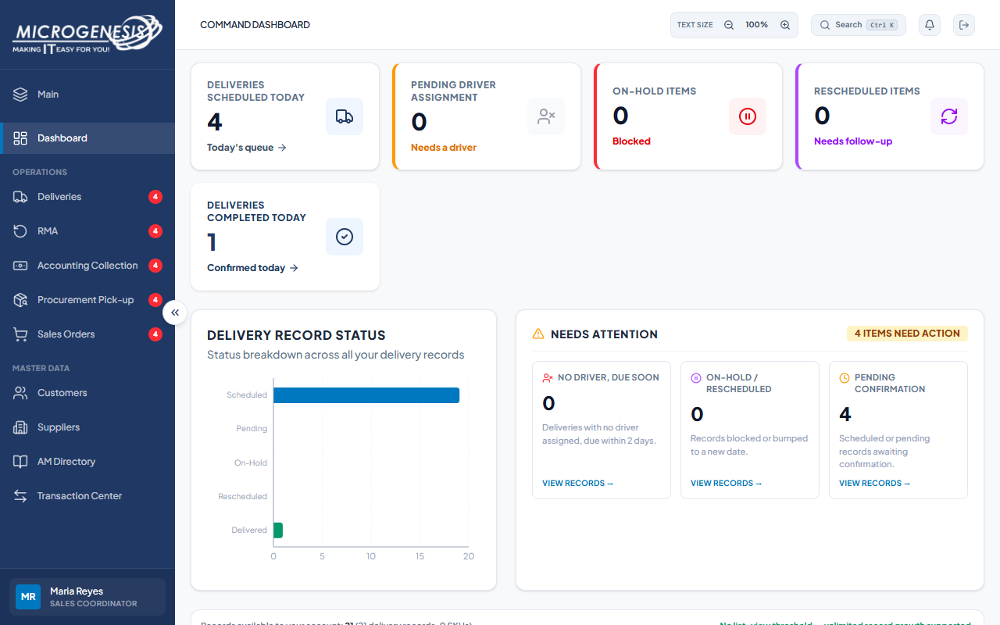
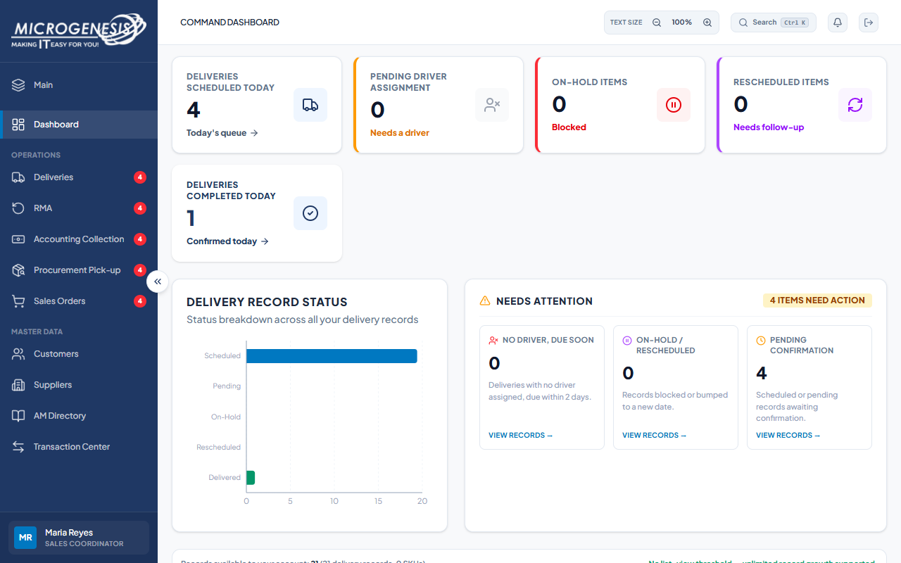
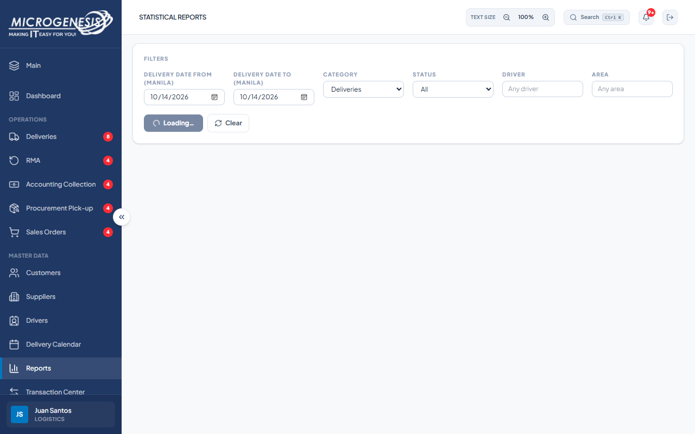

# DEF-003: Sales Coordinator is denied approved Calendar and Reports access

| Document control | |
|---|---|
| Title | DEF-003 Sales Coordinator is denied approved Calendar and Reports access |
| Version | 1.0 |
| Date | 2026-10-15 |
| Author agent | ChatGPT Codex |
| Status | Open |

## 1. Classification

| Field | Value |
|---|---|
| Defect ID | DEF-003 |
| Title | Sales Coordinator is denied approved Calendar and Reports access |
| Linked test case(s) | [TC-ACC-001](../02-test-design/test-cases/TC-ACC-access-control.md#tc-acc-001-sales-coordinator-sees-exactly-its-expected-modules), [TC-ACC-002](../02-test-design/test-cases/TC-ACC-access-control.md#tc-acc-002-sales-coordinator-opens-calendar-and-reports-but-not-admin-screens-or-apis), [TC-RPT-006](../02-test-design/test-cases/TC-RPT-dashboards-reports.md#tc-rpt-006-statistical-reports-summary-with-filters-and-range-validation) |
| Linked scenario | TS-010, TS-015 |
| Role and account used | Logistics, logistics@microgenesis.com; Sales Coordinator, sales@microgenesis.com; passwords are not recorded |
| Severity | Major |
| Priority | P1 |
| Status | Open |
| Found in run | RUN-20261014-02 |

## 2. Environment

| Field | Value |
|---|---|
| URL | http://localhost:3000 or the API path specified in the linked case steps |
| Browser and version | Microsoft Edge 155.0.4283.45 via Playwright 1.64.1 |
| Build / commit hash | 2172fc8 |
| Date and time observed (Asia/Manila) | ~2026-10-14 22:29 (earliest retained evidence timestamp) |
| Database / seed | mg_portal_sandbox; npm run seed:uat |

## 3. Preconditions and data used

- TC-ACC-001: Signed in as Sales Coordinator in its own browser context (session from TC-AUTH-001). Test data: None beyond preconditions
- TC-ACC-002: Signed in as Sales Coordinator in its own browser context (session from TC-AUTH-001). Test data: None beyond preconditions
- TC-RPT-006: Signed in as Logistics in its own browser context (session from TC-AUTH-002). Depends on TC-DEL-038. Test data: None beyond preconditions

## 4. Steps to reproduce

### TC-ACC-001 — Sales Coordinator sees exactly its expected modules

1. Expand the sidebar if collapsed ("Expand menu").
2. List every sidebar item label.

### TC-ACC-002 — Sales Coordinator opens Calendar and Reports but not admin screens or APIs

1. Navigate to `/admin`, then `/inventory`, then `/driver_manager`.
2. Navigate to `/calendar`, then `/statistical_reports`.
3. In the Sales Coordinator session, send with the API helper (AGENTS.md §8): `GET /api/users`
4. In the Sales Coordinator session, send with the API helper (AGENTS.md §8): `GET /api/reports/summary`
5. In the Sales Coordinator session, send with the API helper (AGENTS.md §8): `POST /api/drivers` body `{"name":"UAT Probe","type":"ASSISTANT"}`

### TC-RPT-006 — Statistical Reports summary with filters and range validation

1. Sidebar "Reports". "Delivery Date From (Manila)" and "To" = `<TODAY>`; Category "Deliveries"; "Generate Report".
2. Set From `<TODAY+1>`, To `<TODAY>`; "Generate Report".
3. Run as SC: `GET /api/reports/summary` (API helper).

## 5. Expected result

- TC-ACC-001: • Visible: Main, Dashboard, Deliveries, RMA, Accounting Collection, Procurement Pick-up, Sales Orders, Customers, Suppliers, Delivery Calendar, Reports, AM Directory, Transaction Center (Delivery Calendar and Reports per the user decision on OQ-09, 2026-10-14).; • Not visible: Drivers, SKU Master, Data Sampler, Admin Panel.; • Fail (SI-25) if "Delivery Calendar" or "Reports" is missing.
- TC-ACC-002: • Each URL in step 1 shows "This page is not available for your account." (or redirects to `/dashboard`); no admin data is displayed.; • Step 2: the Delivery Calendar and the Statistical Reports page open normally (OQ-09). Fail (SI-25) if either shows "This page is not available for your account."; • Step 3: 403 `{"error":"Module access denied"}`.; • Step 4: 200 with a report summary (Fail, SI-25, if 403).; • Step 5: 403 `{"error":"Module access denied"}`; no assistant created.
- TC-RPT-006: • Step 1: cards "Delivery Date Cohort", "Delivered in Cohort", "Completed by Time Out" etc. with values ≥ 1 delivered.; • Step 2: an error (server "dateFrom must be on or before dateTo") and no stale results.; • Step 3: 200 with a summary (Sales Coordinator should have Reports per OQ-09). Fail (SI-25) if 403 "Module access denied".

## 6. Actual result (in full)

- TC-ACC-001: Sales sidebar and module list did not include Delivery Calendar or Reports, contrary to the approved Sales access decision.
- TC-ACC-002: Calendar and Reports remained unavailable to Maria Reyes. GET /api/reports/summary returned 403 with {"error":"Module access denied"}.
- TC-RPT-006: The Logistics Reports page remained on Loading and the browser recorded 401/400 errors; the reversed-date step could not be submitted because its button was disabled. The separate Sales API check returned 403 {"error":"Module access denied"} (linked to DEF-003).

The report records observed behavior from the linked case and does not assert an unverified root cause or prescribe a code change.

## 7. Workflow impact

| Field | Value |
|---|---|
| Where in the workflow it occurred | TS-010, TS-015; see linked case steps |
| What it blocks downstream | Sales users cannot use the Calendar or Reports access approved by the user; the report summary API also returns 403. |
| Workaround observed | See linked case actual result; no unrecorded workaround is inferred. |

## 8. Frequency

| Field | Value |
|---|---|
| Reproducibility | Observed in this run; not re-tested after failure |
| Attempts | Case execution only; see steps for multi-attempt probes. No independent retry was made. |

## 9. Technical evidence

- Browser console errors: no finding-specific console transcript retained.
- Network request and response: No separate request/response artifact was retained for these cases.
- Server log lines: no finding-specific server log transcript retained.
- Playwright trace: not retained.

## 10. Screenshots

## 11. Retest history

| Run ID | Date | Result | Notes |
|---|---|---|---|
| | | | |
