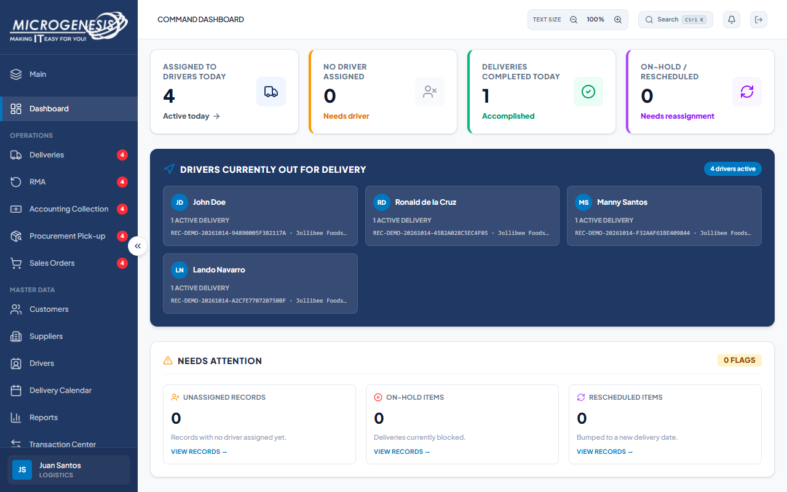

# DEF-004: Logistics RMA denial message differs from expected response

| Document control | |
|---|---|
| Title | DEF-004 Logistics RMA denial message differs from expected response |
| Version | 1.0 |
| Date | 2026-10-15 |
| Author agent | ChatGPT Codex |
| Status | Open |

## 1. Classification

| Field | Value |
|---|---|
| Defect ID | DEF-004 |
| Title | Logistics RMA denial message differs from expected response |
| Linked test case(s) | [TC-ACC-004](../02-test-design/test-cases/TC-ACC-access-control.md#tc-acc-004-logistics-is-refused-admin-company-creation-and-rma-writes) |
| Linked scenario | TS-010 |
| Role and account used | Logistics, logistics@microgenesis.com; passwords are not recorded |
| Severity | Minor |
| Priority | P3 |
| Status | Open |
| Found in run | RUN-20261014-02 |

## 2. Environment

| Field | Value |
|---|---|
| URL | http://localhost:3000 or the API path specified in the linked case steps |
| Browser and version | Microsoft Edge 155.0.4283.45 via Playwright 1.64.1 |
| Build / commit hash | 2172fc8 |
| Date and time observed (Asia/Manila) | ~2026-10-14 22:31 (earliest retained evidence timestamp) |
| Database / seed | mg_portal_sandbox; npm run seed:uat |

## 3. Preconditions and data used

- TC-ACC-004: Signed in as Logistics in its own browser context (session from TC-AUTH-002). Seeded RMA demo run exists (reference `SAP-DEMO-…-RMA`); note its Record ID from the RMA list. Test data: None beyond preconditions

## 4. Steps to reproduce

### TC-ACC-004 — Logistics is refused admin, company creation and RMA writes

1. Navigate to `/admin` and `/am_directory`.
2. In the Logistics session, send with the API helper (AGENTS.md §8): `POST /api/companies` body `{"name":"UAT Logistics Co"}`
3. In the Logistics session, send with the API helper (AGENTS.md §8): `POST /api/records` body `{"company_id":"<any company id from GET /api/companies>","category":"RMA","reference":"UAT-<RUN>-LOGRMA","delivery_date":"<TODAY>"}`
4. In the Logistics session, send with the API helper (AGENTS.md §8): `PUT /api/records/{seeded RMA id}` body `{"area":"Pasay","remarks":"UAT probe"}`

## 5. Expected result

- TC-ACC-004: • Step 1: "This page is not available for your account." for both.; • Step 2: 403 `{"error":"Forbidden for this role"}`.; • Step 3: 403 `{"error":"Logistics has view-only access to RMA records"}`.; • Step 4: 403 `{"error":"Logistics has view-only access to RMA records"}`.

## 6. Actual result (in full)

- TC-ACC-004: Logistics was denied the RMA/admin actions, but the denial text differed from the expected message in the case.

The report records observed behavior from the linked case and does not assert an unverified root cause or prescribe a code change.

## 7. Workflow impact

| Field | Value |
|---|---|
| Where in the workflow it occurred | TS-010; see linked case steps |
| What it blocks downstream | Access remained denied, but the response does not explain the view-only RMA rule as specified. |
| Workaround observed | See linked case actual result; no unrecorded workaround is inferred. |

## 8. Frequency

| Field | Value |
|---|---|
| Reproducibility | Observed in this run; not re-tested after failure |
| Attempts | Case execution only; see steps for multi-attempt probes. No independent retry was made. |

## 9. Technical evidence

- Browser console errors: no finding-specific console transcript retained.
- Network request and response: No separate request/response artifact was retained for these cases.
- Server log lines: no finding-specific server log transcript retained.
- Playwright trace: not retained.

## 10. Screenshots

## 11. Retest history

| Run ID | Date | Result | Notes |
|---|---|---|---|
| | | | |
