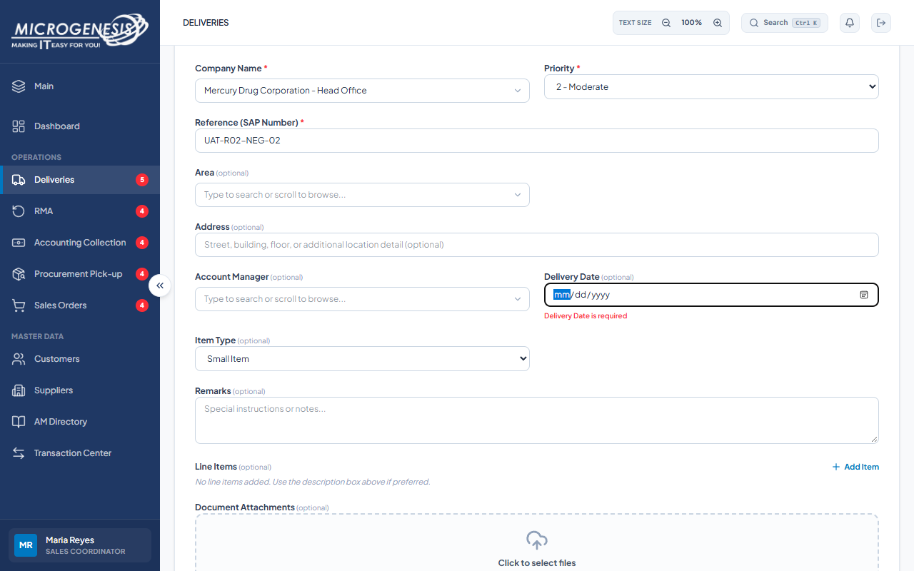

# DEF-005: Delivery Date is labeled optional while submission requires it

| Document control | |
|---|---|
| Title | DEF-005 Delivery Date is labeled optional while submission requires it |
| Version | 1.0 |
| Date | 2026-10-15 |
| Author agent | ChatGPT Codex |
| Status | Open |

## 1. Classification

| Field | Value |
|---|---|
| Defect ID | DEF-005 |
| Title | Delivery Date is labeled optional while submission requires it |
| Linked test case(s) | [TC-DEL-004](../02-test-design/test-cases/TC-DEL-deliveries.md#tc-del-004-delivery-date-is-presented-as-required-when-it-is-required-to-submit) |
| Linked scenario | TS-011 |
| Role and account used | Sales Coordinator, sales@microgenesis.com; passwords are not recorded |
| Severity | Trivial |
| Priority | P4 |
| Status | Open |
| Found in run | RUN-20261014-02 |

## 2. Environment

| Field | Value |
|---|---|
| URL | http://localhost:3000 or the API path specified in the linked case steps |
| Browser and version | Microsoft Edge 155.0.4283.45 via Playwright 1.64.1 |
| Build / commit hash | 2172fc8 |
| Date and time observed (Asia/Manila) | ~2026-10-14 22:37 (earliest retained evidence timestamp) |
| Database / seed | mg_portal_sandbox; npm run seed:uat |

## 3. Preconditions and data used

- TC-DEL-004: Signed in as Sales Coordinator in its own browser context (session from TC-AUTH-001). Test data: Company "Mercury Drug Corporation - Head Office", Reference `UAT-<RUN>-NEG-02`, no date

## 4. Steps to reproduce

### TC-DEL-004 — Delivery Date is presented as required when it is required to submit

1. Deliveries → "New Record". Read the label of the Delivery Date field.
2. Fill the test data (no Delivery Date) and click "Submit".
3. Click "Cancel".

## 5. Expected result

- TC-DEL-004: • Step 2 shows "Delivery Date is required" and creates nothing.; • Step 1: the label marks the field as required (e.g. "Delivery Date *"). Fail (SI-21) if the label reads "Delivery Date (optional)".

## 6. Actual result (in full)

- TC-DEL-004: The create form labeled Delivery Date optional, but Submit displayed Delivery Date is required.

The report records observed behavior from the linked case and does not assert an unverified root cause or prescribe a code change.

## 7. Workflow impact

| Field | Value |
|---|---|
| Where in the workflow it occurred | TS-011; see linked case steps |
| What it blocks downstream | The contradictory label can cause avoidable form errors; supplying a date allows the workflow to continue. |
| Workaround observed | See linked case actual result; no unrecorded workaround is inferred. |

## 8. Frequency

| Field | Value |
|---|---|
| Reproducibility | Observed in this run; not re-tested after failure |
| Attempts | Case execution only; see steps for multi-attempt probes. No independent retry was made. |

## 9. Technical evidence

- Browser console errors: no finding-specific console transcript retained.
- Network request and response: No separate request/response artifact was retained for these cases.
- Server log lines: no finding-specific server log transcript retained.
- Playwright trace: not retained.

## 10. Screenshots

## 11. Retest history

| Run ID | Date | Result | Notes |
|---|---|---|---|
| | | | |
