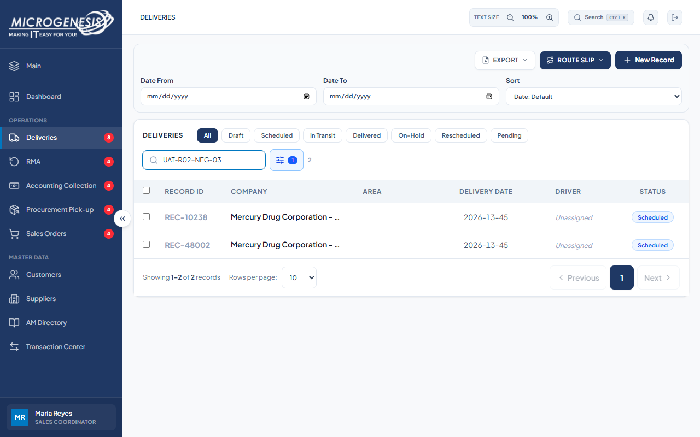

# DEF-006: Delivery creation accepts malformed dates

| Document control | |
|---|---|
| Title | DEF-006 Delivery creation accepts malformed dates |
| Version | 1.0 |
| Date | 2026-10-15 |
| Author agent | ChatGPT Codex |
| Status | Open |

## 1. Classification

| Field | Value |
|---|---|
| Defect ID | DEF-006 |
| Title | Delivery creation accepts malformed dates |
| Linked test case(s) | [TC-DEL-005](../02-test-design/test-cases/TC-DEL-deliveries.md#tc-del-005-api-refuses-a-malformed-delivery-date-on-create) |
| Linked scenario | TS-011 |
| Role and account used | Sales Coordinator, sales@microgenesis.com; passwords are not recorded |
| Severity | Major |
| Priority | P2 |
| Status | Open |
| Found in run | RUN-20261014-02 |

## 2. Environment

| Field | Value |
|---|---|
| URL | http://localhost:3000 or the API path specified in the linked case steps |
| Browser and version | Microsoft Edge 155.0.4283.45 via Playwright 1.64.1 |
| Build / commit hash | 2172fc8 |
| Date and time observed (Asia/Manila) | ~2026-10-14 22:38 (earliest retained evidence timestamp) |
| Database / seed | mg_portal_sandbox; npm run seed:uat |

## 3. Preconditions and data used

- TC-DEL-005: Signed in as Sales Coordinator in its own browser context (session from TC-AUTH-001). Company id of "Mercury Drug Corporation - Head Office" from `GET /api/companies`. Test data: None beyond preconditions

## 4. Steps to reproduce

### TC-DEL-005 — API refuses a malformed Delivery Date on create

1. In the Sales Coordinator session, send with the API helper (AGENTS.md §8): `POST /api/records` body `{"company_id":"<Mercury id>","category":"Deliveries","reference":"UAT-<RUN>-NEG-03","delivery_date":"2026-13-45"}`
2. Search the Deliveries list for `UAT-<RUN>-NEG-03`.

## 5. Expected result

- TC-DEL-005: • HTTP 400 with an error naming the Delivery Date (e.g. "Delivery Date must be a valid YYYY-MM-DD date.").; • No record `UAT-<RUN>-NEG-03` exists. Fail (SI-04) if 201 is returned.

## 6. Actual result (in full)

- TC-DEL-005: The create API accepted a malformed Delivery Date on two attempts instead of rejecting it; no validation refusal was returned.

The report records observed behavior from the linked case and does not assert an unverified root cause or prescribe a code change.

## 7. Workflow impact

| Field | Value |
|---|---|
| Where in the workflow it occurred | TS-011; see linked case steps |
| What it blocks downstream | Malformed dates can be stored on delivery records and undermine scheduling and reporting. |
| Workaround observed | See linked case actual result; no unrecorded workaround is inferred. |

## 8. Frequency

| Field | Value |
|---|---|
| Reproducibility | Observed in this run; not re-tested after failure |
| Attempts | Case execution only; see steps for multi-attempt probes. No independent retry was made. |

## 9. Technical evidence

- Browser console errors: no finding-specific console transcript retained.
- Network request and response: No separate request/response artifact was retained for these cases.
- Server log lines: no finding-specific server log transcript retained.
- Playwright trace: not retained.

## 10. Screenshots

## 11. Retest history

| Run ID | Date | Result | Notes |
|---|---|---|---|
| | | | |

### Confirmed-issue remediation: 2026-10-16

Delivery creation now validates provided dates before writing; malformed and impossible dates return 400. Drafts retain the permitted empty-date behavior.

Focused mocked-handler regressions passed. Full validation and browser acceptance status are tracked in the [remediation record](../06-reports/2026-10-16-major-issues-remediation.md). Historical test outcomes remain unchanged; this is an implementation follow-up, not live UAT closure.
