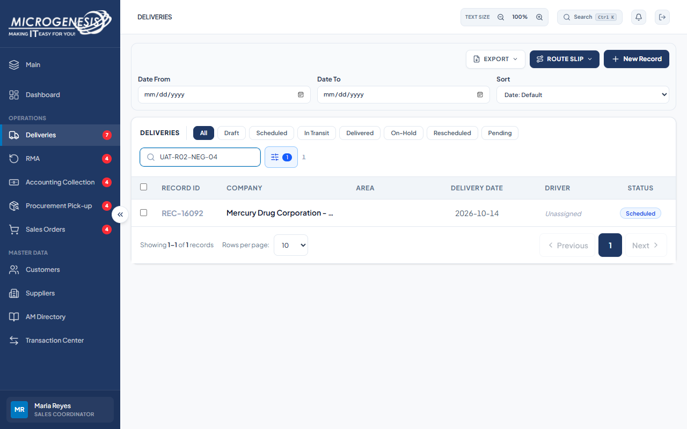

# DEF-007: Delivery creation accepts an unknown priority

| Document control | |
|---|---|
| Title | DEF-007 Delivery creation accepts an unknown priority |
| Version | 1.0 |
| Date | 2026-10-15 |
| Author agent | ChatGPT Codex |
| Status | Open |

## 1. Classification

| Field | Value |
|---|---|
| Defect ID | DEF-007 |
| Title | Delivery creation accepts an unknown priority |
| Linked test case(s) | [TC-DEL-006](../02-test-design/test-cases/TC-DEL-deliveries.md#tc-del-006-api-refuses-an-unknown-priority-on-create) |
| Linked scenario | TS-011 |
| Role and account used | Sales Coordinator, sales@microgenesis.com; passwords are not recorded |
| Severity | Major |
| Priority | P2 |
| Status | Open |
| Found in run | RUN-20261014-02 |

## 2. Environment

| Field | Value |
|---|---|
| URL | http://localhost:3000 or the API path specified in the linked case steps |
| Browser and version | Microsoft Edge 155.0.4283.45 via Playwright 1.64.1 |
| Build / commit hash | 2172fc8 |
| Date and time observed (Asia/Manila) | ~2026-10-14 22:38 (earliest retained evidence timestamp) |
| Database / seed | mg_portal_sandbox; npm run seed:uat |

## 3. Preconditions and data used

- TC-DEL-006: As TC-DEL-005. Test data: None beyond preconditions

## 4. Steps to reproduce

### TC-DEL-006 — API refuses an unknown Priority on create

1. In the Sales Coordinator session, send with the API helper (AGENTS.md §8): `POST /api/records` body `{"company_id":"<Mercury id>","category":"Deliveries","reference":"UAT-<RUN>-NEG-04","delivery_date":"<TODAY>","priority":"9 - Urgent"}`

## 5. Expected result

- TC-DEL-006: HTTP 400 "Invalid record priority." and no record created. Fail (SI-04) if 201 with priority "9 - Urgent".

## 6. Actual result (in full)

- TC-DEL-006: The create API accepted an unknown Priority value and created the record.

The report records observed behavior from the linked case and does not assert an unverified root cause or prescribe a code change.

## 7. Workflow impact

| Field | Value |
|---|---|
| Where in the workflow it occurred | TS-011; see linked case steps |
| What it blocks downstream | A record can be created with a priority value outside the approved business set. |
| Workaround observed | See linked case actual result; no unrecorded workaround is inferred. |

## 8. Frequency

| Field | Value |
|---|---|
| Reproducibility | Observed in this run; not re-tested after failure |
| Attempts | Case execution only; see steps for multi-attempt probes. No independent retry was made. |

## 9. Technical evidence

- Browser console errors: no finding-specific console transcript retained.
- Network request and response: No separate request/response artifact was retained for these cases.
- Server log lines: no finding-specific server log transcript retained.
- Playwright trace: not retained.

## 10. Screenshots

## 11. Retest history

| Run ID | Date | Result | Notes |
|---|---|---|---|
| | | | |
