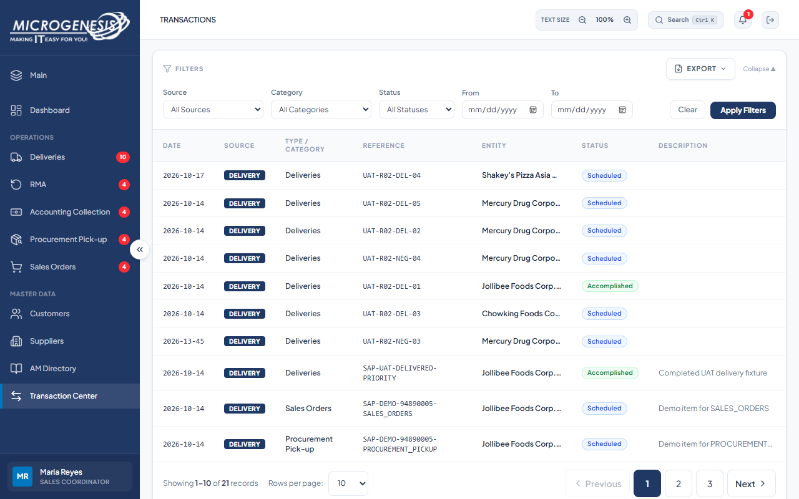
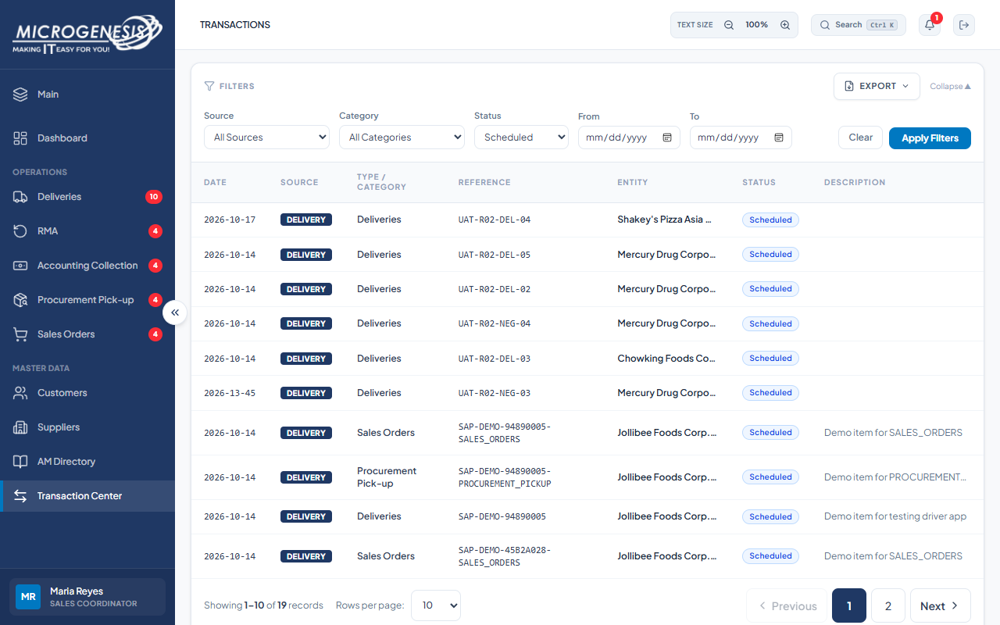

# DEF-009: Transaction Center status filter does not match displayed state

| Document control | |
|---|---|
| Title | DEF-009 Transaction Center status filter does not match displayed state |
| Version | 1.0 |
| Date | 2026-10-15 |
| Author agent | ChatGPT Codex |
| Status | Open |

## 1. Classification

| Field | Value |
|---|---|
| Defect ID | DEF-009 |
| Title | Transaction Center status filter does not match displayed state |
| Linked test case(s) | [TC-TXN-006](../02-test-design/test-cases/TC-TXN-transaction-center.md#tc-txn-006-status-filter-matches-the-displayed-state) |
| Linked scenario | TS-014 |
| Role and account used | Sales Coordinator, sales@microgenesis.com; passwords are not recorded |
| Severity | Minor |
| Priority | P3 |
| Status | Open |
| Found in run | RUN-20261014-02 |

## 2. Environment

| Field | Value |
|---|---|
| URL | http://localhost:3000 or the API path specified in the linked case steps |
| Browser and version | Microsoft Edge 155.0.4283.45 via Playwright 1.64.1 |
| Build / commit hash | 2172fc8 |
| Date and time observed (Asia/Manila) | ~2026-10-14 23:04 (earliest retained evidence timestamp) |
| Database / seed | mg_portal_sandbox; npm run seed:uat |

## 3. Preconditions and data used

- TC-TXN-006: Signed in as Sales Coordinator in its own browser context (session from TC-AUTH-001). Depends on TC-DEL-017 (D-DEL-03 is Draft). Test data: None beyond preconditions

## 4. Steps to reproduce

### TC-TXN-006 — Status filter matches the displayed state

1. Transaction Center: Status "Scheduled"; "Apply Filters"; look for `UAT-<RUN>-DEL-03`.

## 5. Expected result

- TC-TXN-006: The Draft record D-DEL-03 is NOT listed under "Scheduled". Fail (SI-16) if it is.

## 6. Actual result (in full)

- TC-TXN-006: Transaction Center status filtering did not consistently match displayed delivery status; the case exposed SI-16 status/date filter behavior.

The report records observed behavior from the linked case and does not assert an unverified root cause or prescribe a code change.

## 7. Workflow impact

| Field | Value |
|---|---|
| Where in the workflow it occurred | TS-014; see linked case steps |
| What it blocks downstream | Users can see records in a status filter that does not correspond to the displayed workflow state. |
| Workaround observed | See linked case actual result; no unrecorded workaround is inferred. |

## 8. Frequency

| Field | Value |
|---|---|
| Reproducibility | Observed in this run; not re-tested after failure |
| Attempts | Case execution only; see steps for multi-attempt probes. No independent retry was made. |

## 9. Technical evidence

- Browser console errors: no finding-specific console transcript retained.
- Network request and response: No separate request/response artifact was retained for these cases.
- Server log lines: no finding-specific server log transcript retained.
- Playwright trace: not retained.

## 10. Screenshots

## 11. Retest history

| Run ID | Date | Result | Notes |
|---|---|---|---|
| | | | |
