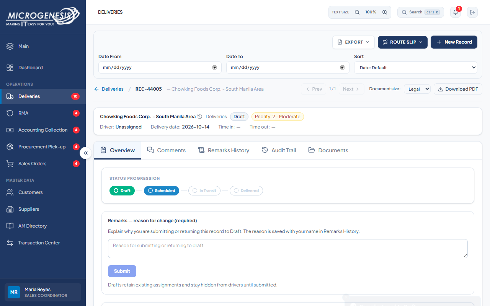

# DEF-010: Logistics can submit a Draft through the status API

| Document control | |
|---|---|
| Title | DEF-010 Logistics can submit a Draft through the status API |
| Version | 1.0 |
| Date | 2026-10-15 |
| Author agent | ChatGPT Codex |
| Status | Open |

## 1. Classification

| Field | Value |
|---|---|
| Defect ID | DEF-010 |
| Title | Logistics can submit a Draft through the status API |
| Linked test case(s) | [TC-DEL-022](../02-test-design/test-cases/TC-DEL-deliveries.md#tc-del-022-only-sales-coordinator-or-admin-can-submit-a-draft-status-route) |
| Linked scenario | TS-010 |
| Role and account used | Logistics, logistics@microgenesis.com; passwords are not recorded |
| Severity | Major |
| Priority | P1 |
| Status | Open |
| Found in run | RUN-20261014-02 |

## 2. Environment

| Field | Value |
|---|---|
| URL | http://localhost:3000 or the API path specified in the linked case steps |
| Browser and version | Microsoft Edge 155.0.4283.45 via Playwright 1.64.1 |
| Build / commit hash | 2172fc8 |
| Date and time observed (Asia/Manila) | ~2026-10-14 23:05 (earliest retained evidence timestamp) |
| Database / seed | mg_portal_sandbox; npm run seed:uat |

## 3. Preconditions and data used

- TC-DEL-022: Signed in as Logistics in its own browser context (session from TC-AUTH-002). Depends on TC-DEL-018 (D-DEL-03 still Draft). Test data: None beyond preconditions

## 4. Steps to reproduce

### TC-DEL-022 — Only Sales Coordinator or Admin can submit a Draft (status route)

1. In the Logistics session, send with the API helper (AGENTS.md §8): `PUT /api/records/{D-DEL-03.id}` body `{"is_draft":"No","remarks":"UAT probe"}`
2. In the Logistics session, send with the API helper (AGENTS.md §8): `PATCH /api/records/{D-DEL-03.id}/status` body `{"status":"Scheduled","remarks":"UAT probe"}`
3. In the Logistics session, send with the API helper (AGENTS.md §8): `GET /api/records/{D-DEL-03.id}` and read `status`.

## 5. Expected result

- TC-DEL-022: • Step 1: 403 "Only Sales Coordinator or Admin may submit or return drafts."; • Step 2: 403 with the same rule (Logistics may not submit drafts).; • Step 3: status is still "Draft". Fail (SI-03) if step 2 returns 200 and the record becomes "Scheduled"; user decision on OQ-06: Logistics must not submit drafts.

## 6. Actual result (in full)

- TC-DEL-022: Logistics changed a Draft to Scheduled through the status API; the request returned HTTP 200. Sales restored the record to Draft through the normal UI after the observation.

The report records observed behavior from the linked case and does not assert an unverified root cause or prescribe a code change.

## 7. Workflow impact

| Field | Value |
|---|---|
| Where in the workflow it occurred | TS-010; see linked case steps |
| What it blocks downstream | Logistics can advance a Draft despite the approved rule that only Sales Coordinator or Admin may submit it. |
| Workaround observed | See linked case actual result; no unrecorded workaround is inferred. |

## 8. Frequency

| Field | Value |
|---|---|
| Reproducibility | Observed in this run; not re-tested after failure |
| Attempts | Case execution only; see steps for multi-attempt probes. No independent retry was made. |

## 9. Technical evidence

- Browser console errors: no finding-specific console transcript retained.
- Network request and response: No separate request/response artifact was retained for these cases.
- Server log lines: no finding-specific server log transcript retained.
- Playwright trace: not retained.

## 10. Screenshots

## 11. Retest history

| Run ID | Date | Result | Notes |
|---|---|---|---|
| | | | |
