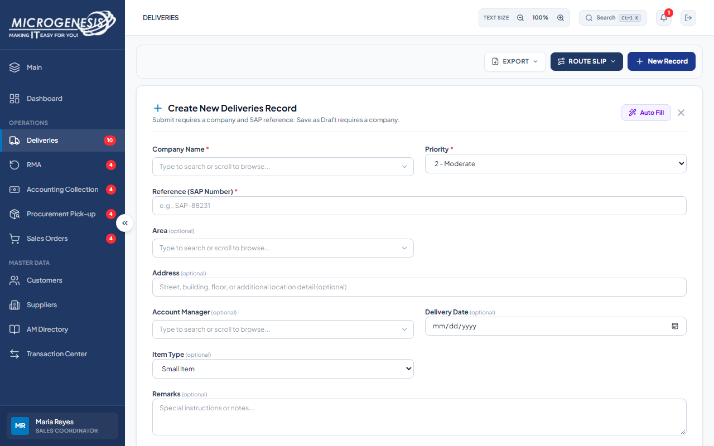
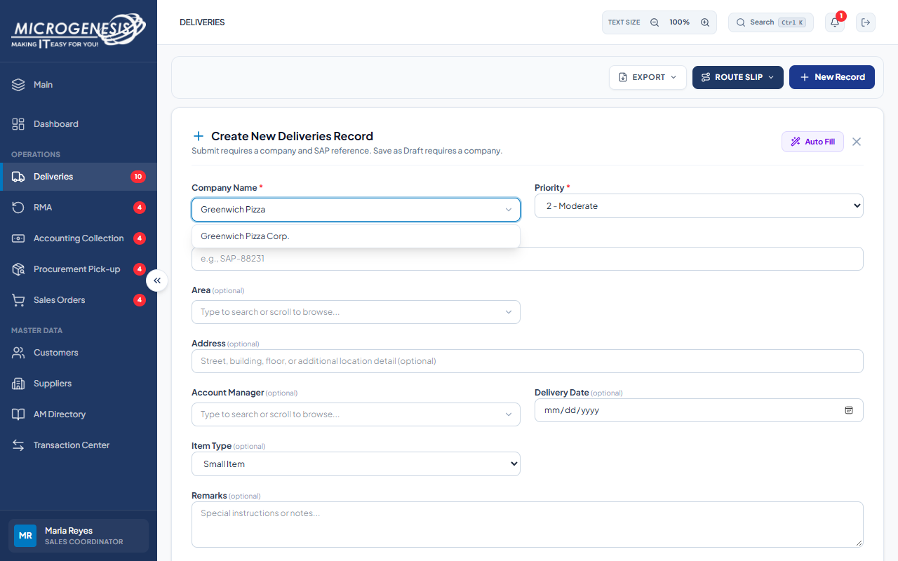
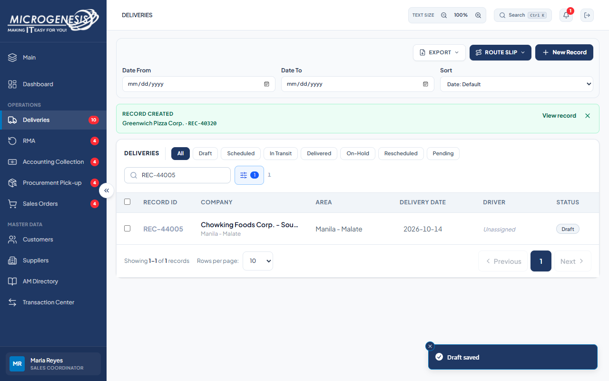
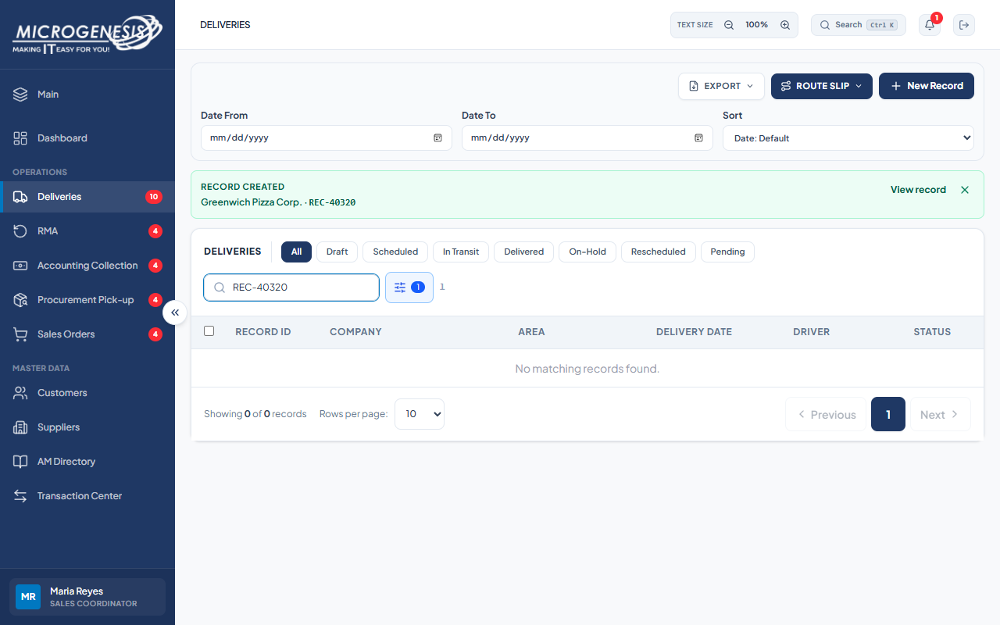

# DEF-011: Sales Coordinator can delete a delivery through the API

| Document control | |
|---|---|
| Title | DEF-011 Sales Coordinator can delete a delivery through the API |
| Version | 1.0 |
| Date | 2026-10-15 |
| Author agent | ChatGPT Codex |
| Status | Open |

## 1. Classification

| Field | Value |
|---|---|
| Defect ID | DEF-011 |
| Title | Sales Coordinator can delete a delivery through the API |
| Linked test case(s) | [TC-DEL-024](../02-test-design/test-cases/TC-DEL-deliveries.md#tc-del-024-records-cannot-be-deleted-even-by-sales-coordinator-api) |
| Linked scenario | TS-007 |
| Role and account used | Sales Coordinator, sales@microgenesis.com; passwords are not recorded |
| Severity | Major |
| Priority | P1 |
| Status | Open |
| Found in run | RUN-20261014-02 |

## 2. Environment

| Field | Value |
|---|---|
| URL | http://localhost:3000 or the API path specified in the linked case steps |
| Browser and version | Microsoft Edge 155.0.4283.45 via Playwright 1.64.1 |
| Build / commit hash | 2172fc8 |
| Date and time observed (Asia/Manila) | ~2026-10-14 23:06 (earliest retained evidence timestamp) |
| Database / seed | mg_portal_sandbox; npm run seed:uat |

## 3. Preconditions and data used

- TC-DEL-024: Signed in as Sales Coordinator in its own browser context (session from TC-AUTH-001). Create D-DEL-06 first: Deliveries → New Record → company "Greenwich Pizza Corp.", "Save as Draft"; record {D-DEL-06.id}. Test data: None beyond preconditions

## 4. Steps to reproduce

### TC-DEL-024 — Records cannot be deleted, even by Sales Coordinator (API)

1. In the Sales Coordinator session, send with the API helper (AGENTS.md §8): `DELETE /api/records/{D-DEL-06.id}`
2. In the Sales Coordinator session, send with the API helper (AGENTS.md §8): `GET /api/records/{D-DEL-06.id}`
3. Search the Deliveries list for {D-DEL-06.id}.

## 5. Expected result

- TC-DEL-024: • Step 1: refused with a 4xx (no record deletion is allowed: user decision on OQ-03, 2026-10-14).; • Step 2: 200; the record still exists.; • Step 3: the row is still listed.; • Fail (SI-26) if step 1 returns 200 `{"ok":true}` and the record disappears.

## 6. Actual result (in full)

- TC-DEL-024: The refusal check instead deleted the test Draft. The record disappeared from the list; the case was not retried. This was the single authorized deletion probe, and no seeded record was targeted.

The report records observed behavior from the linked case and does not assert an unverified root cause or prescribe a code change.

## 7. Workflow impact

| Field | Value |
|---|---|
| Where in the workflow it occurred | TS-007; see linked case steps |
| What it blocks downstream | The API permits deletion contrary to the user decision that records cannot be deleted; the test draft disappeared from the list. |
| Workaround observed | See linked case actual result; no unrecorded workaround is inferred. |

## 8. Frequency

| Field | Value |
|---|---|
| Reproducibility | Observed in this run; not re-tested after failure |
| Attempts | Case execution only; see steps for multi-attempt probes. No independent retry was made. |

## 9. Technical evidence

- Browser console errors: no finding-specific console transcript retained.
- Network request and response: No separate request/response artifact was retained for these cases.
- Server log lines: no finding-specific server log transcript retained.
- Playwright trace: not retained.

## 10. Screenshots

## 11. Retest history

| Run ID | Date | Result | Notes |
|---|---|---|---|
| | | | |

### Confirmed-issue remediation: 2026-10-16

The operational record deletion endpoint now refuses the operation with 403; no soft deletion or delete audit is written. The requirements document is aligned to the OQ-03 no-deletion decision.

Focused mocked-handler regressions passed. Full validation and browser acceptance status are tracked in the [remediation record](../06-reports/2026-10-16-major-issues-remediation.md). Historical test outcomes remain unchanged; this is an implementation follow-up, not live UAT closure.
