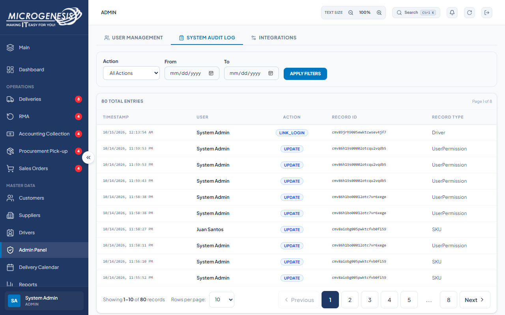

# DEF-012: Audit action filter ignores LINK_LOGIN

| Document control | |
|---|---|
| Title | DEF-012 Audit action filter ignores LINK_LOGIN |
| Version | 1.0 |
| Date | 2026-10-15 |
| Author agent | ChatGPT Codex |
| Status | Open |

## 1. Classification

| Field | Value |
|---|---|
| Defect ID | DEF-012 |
| Title | Audit action filter ignores LINK_LOGIN |
| Linked test case(s) | [TC-ADM-016](../02-test-design/test-cases/TC-ADM-administration.md#tc-adm-016-audit-log-can-be-filtered-by-action) |
| Linked scenario | TS-016 |
| Role and account used | Admin, admin@microgenesis.com; passwords are not recorded |
| Severity | Trivial |
| Priority | P4 |
| Status | Open |
| Found in run | RUN-20261014-02 |

## 2. Environment

| Field | Value |
|---|---|
| URL | http://localhost:3000 or the API path specified in the linked case steps |
| Browser and version | Microsoft Edge 155.0.4283.45 via Playwright 1.64.1 |
| Build / commit hash | 2172fc8 |
| Date and time observed (Asia/Manila) | ~2026-10-15 00:15 (earliest retained evidence timestamp) |
| Database / seed | mg_portal_sandbox; npm run seed:uat |

## 3. Preconditions and data used

- TC-ADM-016: Depends on TC-ADM-007 (a LINK_LOGIN entry exists). Test data: None beyond preconditions

## 4. Steps to reproduce

### TC-ADM-016 — Audit log can be filtered by action

1. "System Audit Log": open the "Action" filter options.
2. In the Admin session, send with the API helper (AGENTS.md §8): `GET /api/admin/audit-log?action=LINK_LOGIN` and inspect `entries[].action`.

## 5. Expected result

- TC-ADM-016: Filtering by LINK_LOGIN returns only LINK_LOGIN entries. Fail (SI-11) if the UI lacks the option and the API returns other actions.

## 6. Actual result (in full)

- TC-ADM-016: The UI action filter offered only CREATE, UPDATE, DELETE. GET /api/admin/audit-log?action=LINK_LOGIN returned HTTP 200 with 50 entries and included LINK_LOGIN, UPDATE, and CREATE, so the requested filter was ignored.

The report records observed behavior from the linked case and does not assert an unverified root cause or prescribe a code change.

## 7. Workflow impact

| Field | Value |
|---|---|
| Where in the workflow it occurred | TS-016; see linked case steps |
| What it blocks downstream | Admins cannot narrow the audit log to login-linking events, though these events remain visible unfiltered. |
| Workaround observed | See linked case actual result; no unrecorded workaround is inferred. |

## 8. Frequency

| Field | Value |
|---|---|
| Reproducibility | Observed in this run; not re-tested after failure |
| Attempts | Case execution only; see steps for multi-attempt probes. No independent retry was made. |

## 9. Technical evidence

- Browser console errors: no finding-specific console transcript retained.
- Network request and response: - [TC-ADM-016-02-audit-filter-api.json](../artifacts/RUN-20261014-02/TC-ADM-016-02-audit-filter-api.json)
- Server log lines: no finding-specific server log transcript retained.
- Playwright trace: not retained.

## 10. Screenshots

## 11. Retest history

| Run ID | Date | Result | Notes |
|---|---|---|---|
| | | | |
