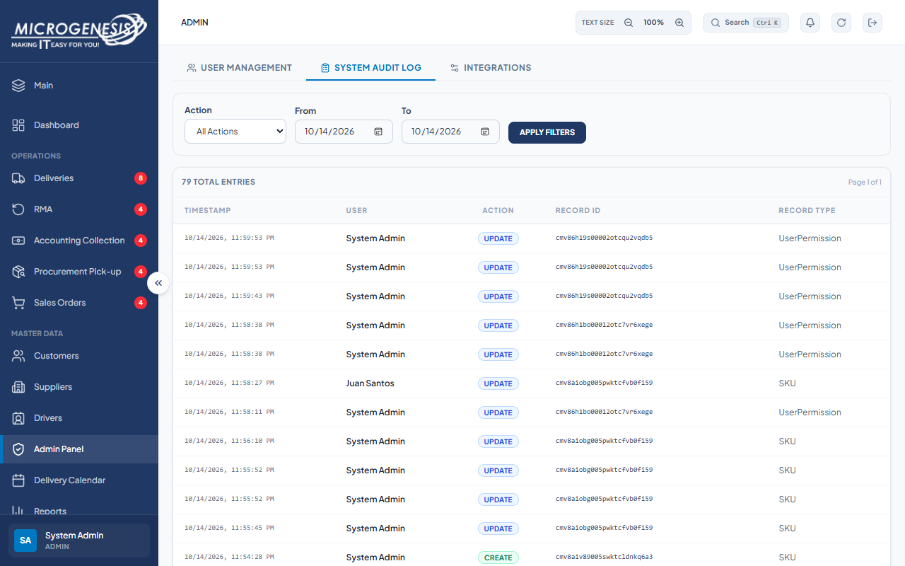

# DEF-013: User rename and activation changes are absent from audit log

| Document control | |
|---|---|
| Title | DEF-013 User rename and activation changes are absent from audit log |
| Version | 1.0 |
| Date | 2026-10-15 |
| Author agent | ChatGPT Codex |
| Status | Open |

## 1. Classification

| Field | Value |
|---|---|
| Defect ID | DEF-013 |
| Title | User rename and activation changes are absent from audit log |
| Linked test case(s) | [TC-ADM-010](../02-test-design/test-cases/TC-ADM-administration.md#tc-adm-010-user-administration-changes-are-audited) |
| Linked scenario | TS-016 |
| Role and account used | Admin, admin@microgenesis.com; passwords are not recorded |
| Severity | Minor |
| Priority | P2 |
| Status | Open |
| Found in run | RUN-20261014-02 |

## 2. Environment

| Field | Value |
|---|---|
| URL | http://localhost:3000 or the API path specified in the linked case steps |
| Browser and version | Microsoft Edge 155.0.4283.45 via Playwright 1.64.1 |
| Build / commit hash | 2172fc8 |
| Date and time observed (Asia/Manila) | ~2026-10-15 00:08 (earliest retained evidence timestamp) |
| Database / seed | mg_portal_sandbox; npm run seed:uat |

## 3. Preconditions and data used

- TC-ADM-010: Depends on TC-ADM-009 and TC-ADM-011. Test data: None beyond preconditions

## 4. Steps to reproduce

### TC-ADM-010 — User administration changes are audited

1. "System Audit Log": Action "All Actions"; From/To `<TODAY>`; "Apply Filters".
2. Look for Record Type "User" entries for UAT Sales Two (rename, deactivate, activate).

## 5. Expected result

- TC-ADM-010: An audit entry exists for each user change. Fail (SI-10) if none exist.

## 6. Actual result (in full)

- TC-ADM-010: The 2026-10-14 System Audit Log query returned 79 events and 9 UserPermission events, but zero User record-type events. Rename, deactivate, and activate actions on U-SC2 had no corresponding User audit rows.

The report records observed behavior from the linked case and does not assert an unverified root cause or prescribe a code change.

## 7. Workflow impact

| Field | Value |
|---|---|
| Where in the workflow it occurred | TS-016; see linked case steps |
| What it blocks downstream | Admin user changes cannot be reconstructed from User audit rows during review. |
| Workaround observed | See linked case actual result; no unrecorded workaround is inferred. |

## 8. Frequency

| Field | Value |
|---|---|
| Reproducibility | Observed in this run; not re-tested after failure |
| Attempts | Case execution only; see steps for multi-attempt probes. No independent retry was made. |

## 9. Technical evidence

- Browser console errors: no finding-specific console transcript retained.
- Network request and response: No separate request/response artifact was retained for these cases.
- Server log lines: no finding-specific server log transcript retained.
- Playwright trace: not retained.

## 10. Screenshots

## 11. Retest history

| Run ID | Date | Result | Notes |
|---|---|---|---|
| | | | |
