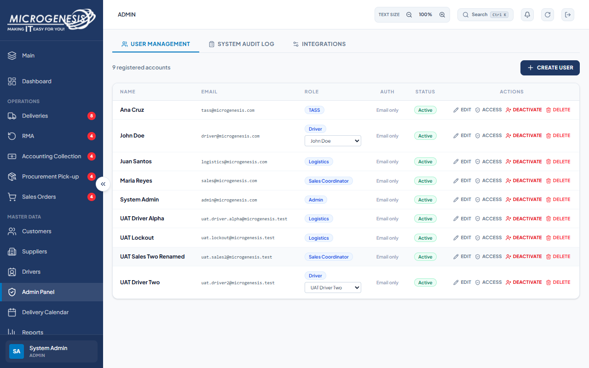
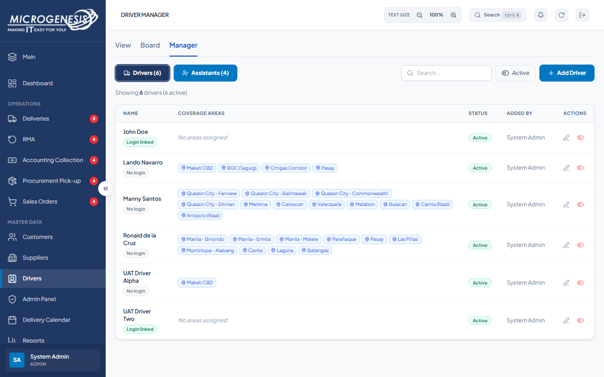
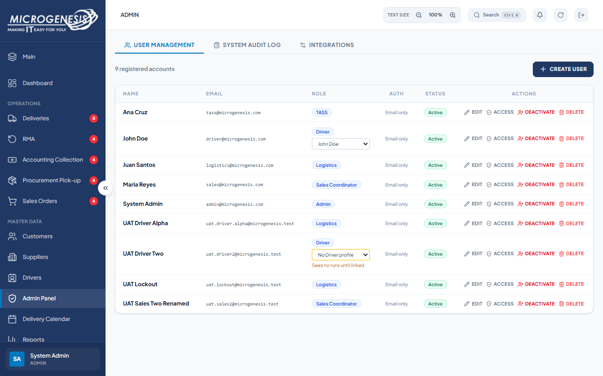

# DEF-014: Driver Manager count is stale after creating a linked login

| Document control | |
|---|---|
| Title | DEF-014 Driver Manager count is stale after creating a linked login |
| Version | 1.0 |
| Date | 2026-10-15 |
| Author agent | ChatGPT Codex |
| Status | Open |

## 1. Classification

| Field | Value |
|---|---|
| Defect ID | DEF-014 |
| Title | Driver Manager count is stale after creating a linked login |
| Linked test case(s) | [TC-ADM-022](../02-test-design/test-cases/TC-ADM-administration.md#tc-adm-022-new-driver-login-with-a-new-profile-then-unlinked) |
| Linked scenario | TS-016 |
| Role and account used | Admin, admin@microgenesis.com; passwords are not recorded |
| Severity | Minor |
| Priority | P3 |
| Status | Open |
| Found in run | RUN-20261014-02 |

## 2. Environment

| Field | Value |
|---|---|
| URL | http://localhost:3000 or the API path specified in the linked case steps |
| Browser and version | Microsoft Edge 155.0.4283.45 via Playwright 1.64.1 |
| Build / commit hash | 2172fc8 |
| Date and time observed (Asia/Manila) | ~2026-10-15 00:17 (earliest retained evidence timestamp) |
| Database / seed | mg_portal_sandbox; npm run seed:uat |

## 3. Preconditions and data used

- TC-ADM-022: Signed in as Admin in its own browser context (session from TC-AUTH-004). Test data: U-DRV2

## 4. Steps to reproduce

### TC-ADM-022 — New Driver login with a new profile, then unlinked

1. "Create User": `UAT Driver Two`, `uat.driver2@microgenesis.test`, user-supplied password, Role "Driver", "Driver profile" = "Create a new profile named after this login"; "Create".
2. In the Users table, row "UAT Driver Two", set the inline "Driver profile" select to "No Driver profile".

## 5. Expected result

- TC-ADM-022: • Step 1: Driver Manager shows "UAT Driver Two" with "Login linked".; • Step 2: warning "Sees no runs until linked." on the row.

## 6. Actual result (in full)

- TC-ADM-022: After creating UAT Driver Two, Driver Manager initially showed Drivers (5) and omitted the profile. A manual reload changed the list to Drivers (6) and showed Login linked.

The report records observed behavior from the linked case and does not assert an unverified root cause or prescribe a code change.

## 7. Workflow impact

| Field | Value |
|---|---|
| Where in the workflow it occurred | TS-016; see linked case steps |
| What it blocks downstream | The new profile is initially omitted until a reload, so the roster briefly shows an incorrect count. |
| Workaround observed | See linked case actual result; no unrecorded workaround is inferred. |

## 8. Frequency

| Field | Value |
|---|---|
| Reproducibility | Observed in this run; not re-tested after failure |
| Attempts | Case execution only; see steps for multi-attempt probes. No independent retry was made. |

## 9. Technical evidence

- Browser console errors: no finding-specific console transcript retained.
- Network request and response: No separate request/response artifact was retained for these cases.
- Server log lines: no finding-specific server log transcript retained.
- Playwright trace: not retained.

## 10. Screenshots

## 11. Retest history

| Run ID | Date | Result | Notes |
|---|---|---|---|
| | | | |
