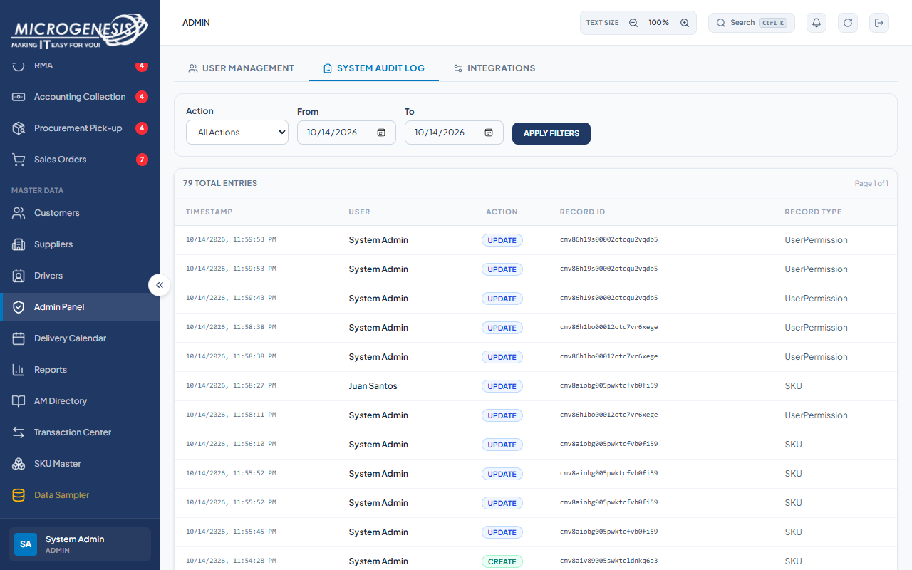
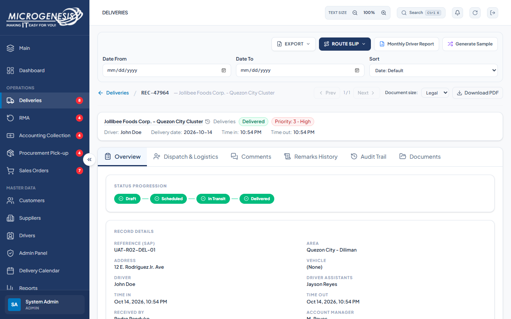
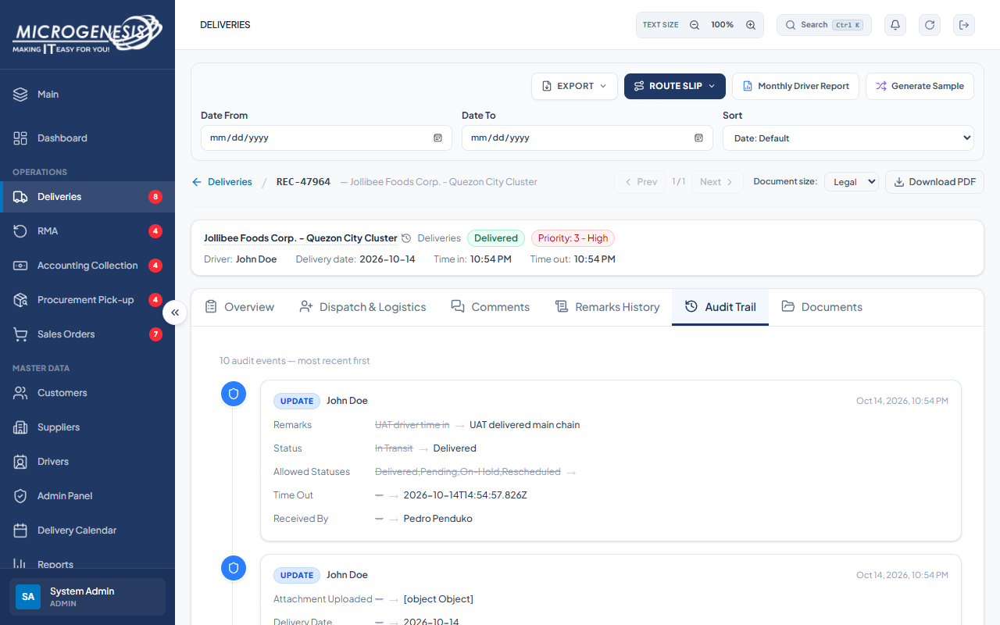
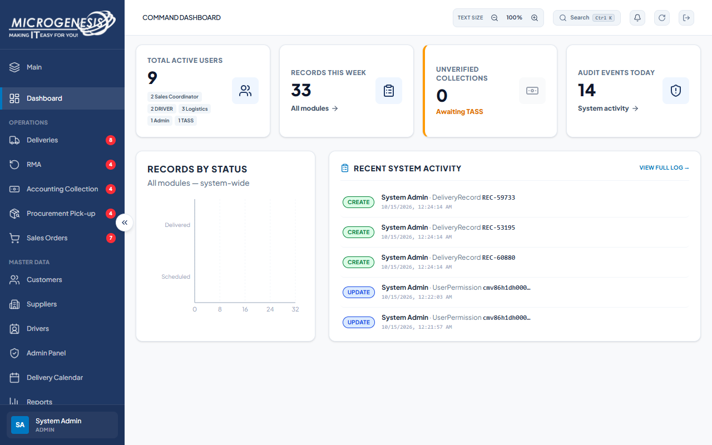

# DEF-015: Admin Records by Status chart omits delivered count

| Document control | |
|---|---|
| Title | DEF-015 Admin Records by Status chart omits delivered count |
| Version | 1.0 |
| Date | 2026-10-15 |
| Author agent | ChatGPT Codex |
| Status | Open |

## 1. Classification

| Field | Value |
|---|---|
| Defect ID | DEF-015 |
| Title | Admin Records by Status chart omits delivered count |
| Linked test case(s) | [TC-ADM-023](../02-test-design/test-cases/TC-ADM-administration.md#tc-adm-023-admin-reviews-the-completed-main-chain-end-of-ts-001) |
| Linked scenario | TS-001 |
| Role and account used | Admin, admin@microgenesis.com; passwords are not recorded |
| Severity | Minor |
| Priority | P2 |
| Status | Open |
| Found in run | RUN-20261014-02 |

## 2. Environment

| Field | Value |
|---|---|
| URL | http://localhost:3000 or the API path specified in the linked case steps |
| Browser and version | Microsoft Edge 155.0.4283.45 via Playwright 1.64.1 |
| Build / commit hash | 2172fc8 |
| Date and time observed (Asia/Manila) | ~2026-10-15 00:24 (earliest retained evidence timestamp) |
| Database / seed | mg_portal_sandbox; npm run seed:uat |

## 3. Preconditions and data used

- TC-ADM-023: Signed in as Admin in its own browser context (session from TC-AUTH-004). Depends on TC-DRV-005 and TC-TXN-003. Test data: None beyond preconditions

## 4. Steps to reproduce

### TC-ADM-023 — Admin reviews the completed main chain (end of TS-001)

1. "System Audit Log": From/To `<TODAY>`; "Apply Filters"; find the entries with Record ID {D-DEL-01.id} (use page navigation if needed).
2. Open D-DEL-01 (Deliveries) → tab "Audit Trail".
3. Dashboard: read "Records by Status".

## 5. Expected result

- TC-ADM-023: • D-DEL-01 has CREATE by Maria Reyes and UPDATEs by Maria Reyes, Juan Santos and John Doe (assignment, priority, Time In, completion), in time order.; • The record Audit Trail shows the same events.; • "Records by Status" includes the delivered status (ACCOMPLISHED) with a count of at least 1.

## 6. Actual result (in full)

- TC-ADM-023: The audit trail showed expected creator and update events, but the Records by Status chart showed axes and labels including Delivered without a visible bar or count for the completed record.

The report records observed behavior from the linked case and does not assert an unverified root cause or prescribe a code change.

## 7. Workflow impact

| Field | Value |
|---|---|
| Where in the workflow it occurred | TS-001; see linked case steps |
| What it blocks downstream | Admin cannot rely on the dashboard chart for delivery status totals. |
| Workaround observed | See linked case actual result; no unrecorded workaround is inferred. |

## 8. Frequency

| Field | Value |
|---|---|
| Reproducibility | Observed in this run; not re-tested after failure |
| Attempts | Case execution only; see steps for multi-attempt probes. No independent retry was made. |

## 9. Technical evidence

- Browser console errors: no finding-specific console transcript retained.
- Network request and response: No separate request/response artifact was retained for these cases.
- Server log lines: no finding-specific server log transcript retained.
- Playwright trace: not retained.

## 10. Screenshots

## 11. Retest history

| Run ID | Date | Result | Notes |
|---|---|---|---|
| | | | |
