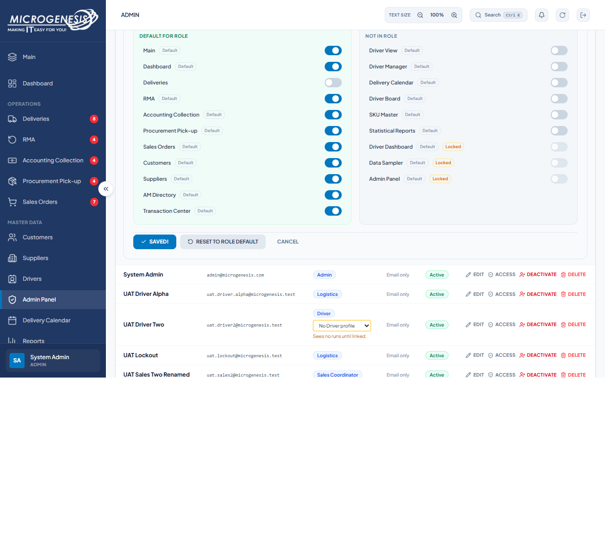
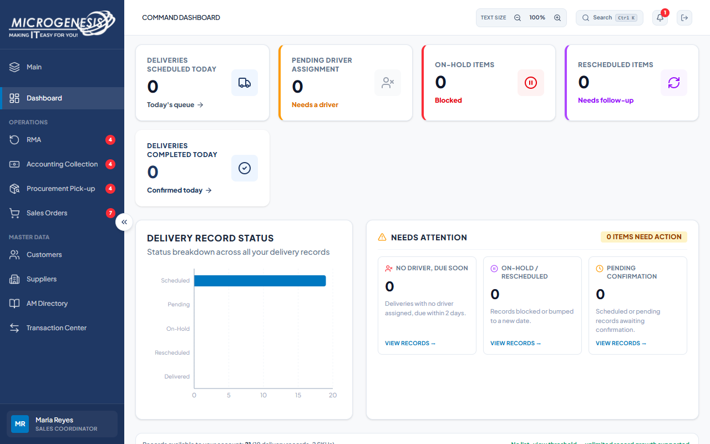
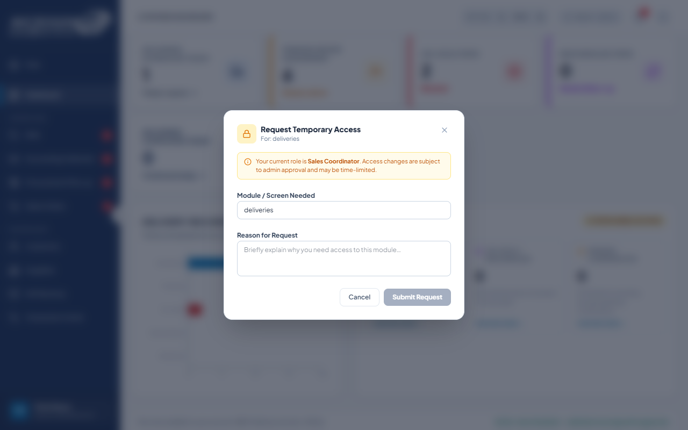
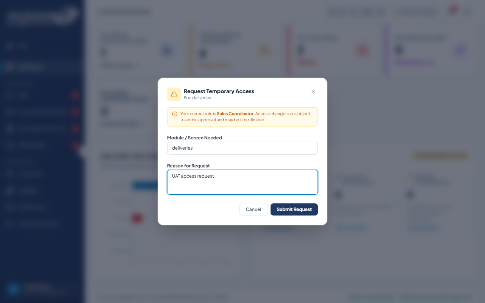
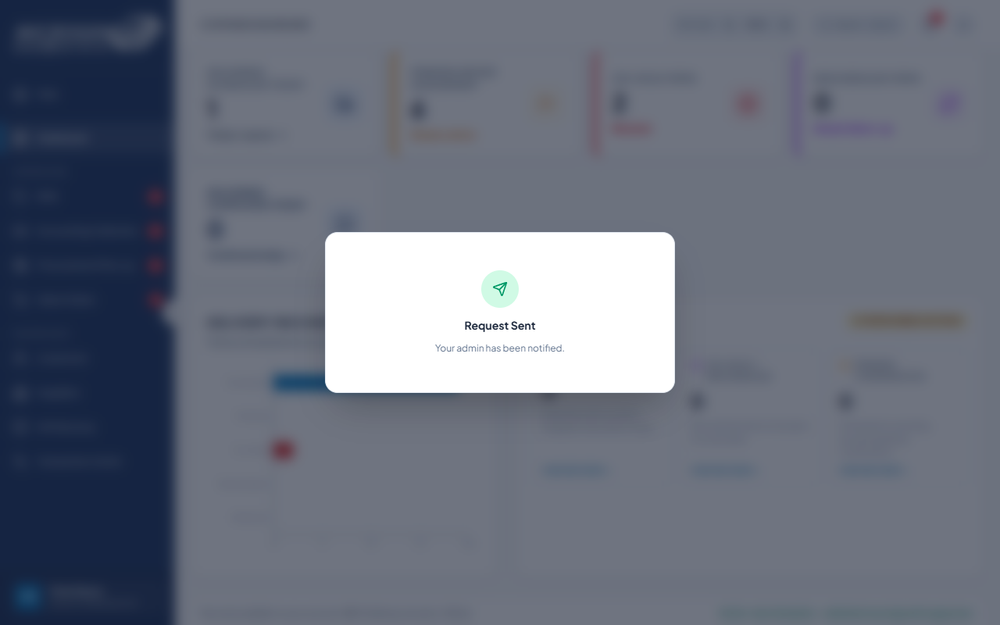
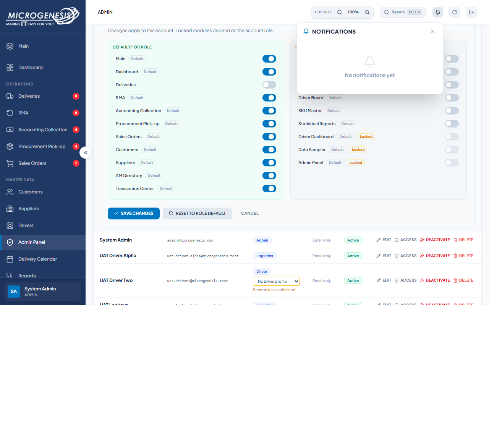
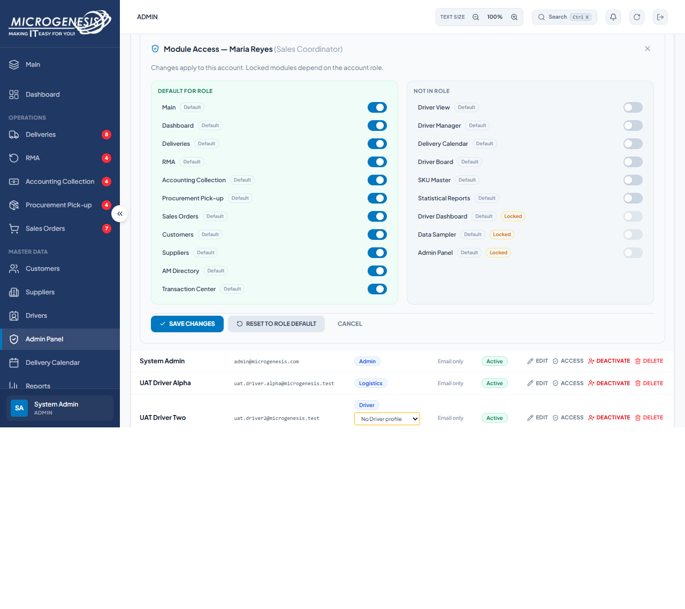
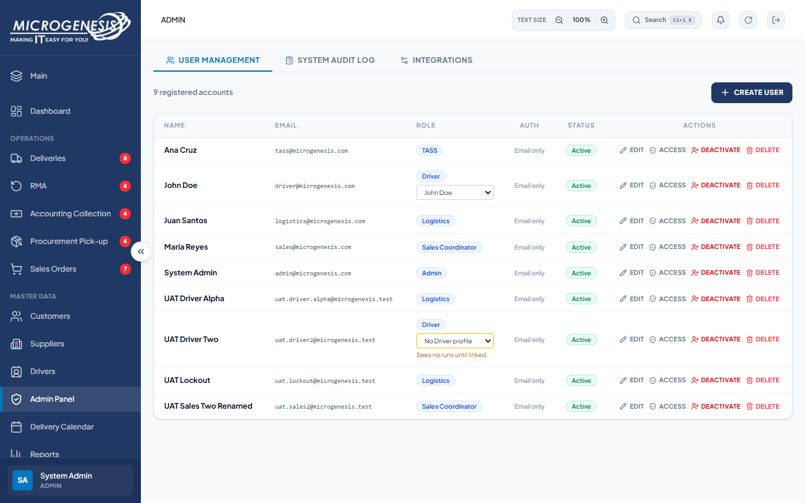
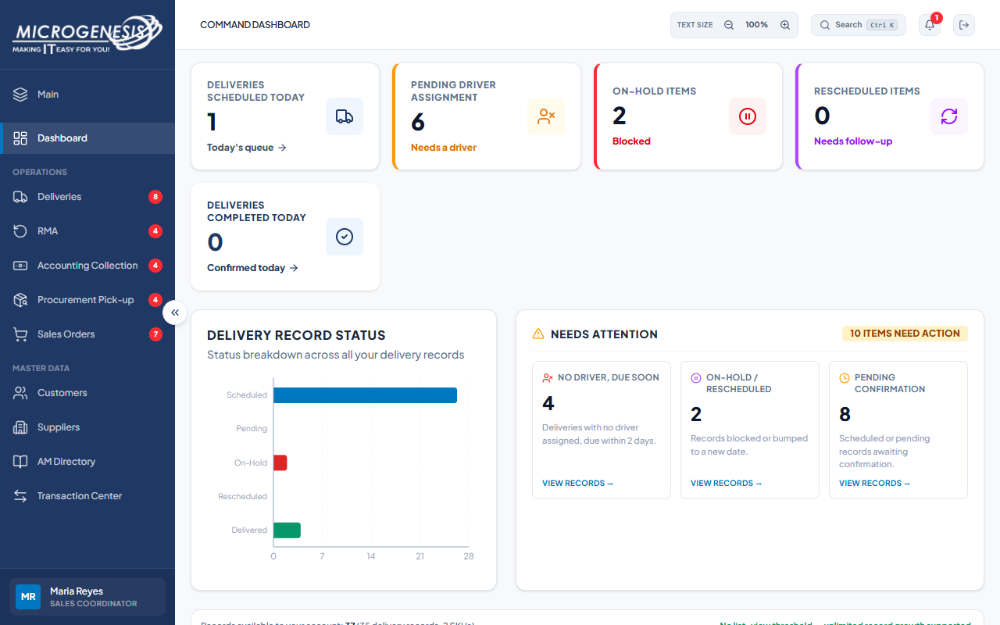

# DEF-016: Temporary access request claims an Admin was notified when none was shown

| Document control | |
|---|---|
| Title | DEF-016 Temporary access request claims an Admin was notified when none was shown |
| Version | 1.0 |
| Date | 2026-10-15 |
| Author agent | ChatGPT Codex |
| Status | Open |

## 1. Classification

| Field | Value |
|---|---|
| Defect ID | DEF-016 |
| Title | Temporary access request claims an Admin was notified when none was shown |
| Linked test case(s) | [TC-ACC-016](../02-test-design/test-cases/TC-ACC-access-control.md#tc-acc-016-temporary-access-request-actually-reaches-an-admin) |
| Linked scenario | TS-010 |
| Role and account used | Sales Coordinator, sales@microgenesis.com; passwords are not recorded |
| Severity | Minor |
| Priority | P2 |
| Status | Open |
| Found in run | RUN-20261014-02 |

## 2. Environment

| Field | Value |
|---|---|
| URL | http://localhost:3000 or the API path specified in the linked case steps |
| Browser and version | Microsoft Edge 155.0.4283.45 via Playwright 1.64.1 |
| Build / commit hash | 2172fc8 |
| Date and time observed (Asia/Manila) | ~2026-10-15 00:48 (earliest retained evidence timestamp) |
| Database / seed | mg_portal_sandbox; npm run seed:uat |

## 3. Preconditions and data used

- TC-ACC-016: Signed in as Sales Coordinator in its own browser context (session from TC-AUTH-001). Admin has denied Deliveries for Maria Reyes (Admin Panel → User Management → Maria Reyes → "Access" → toggle "Deliveries" off → "Save Changes"). Restore it at the end. Test data: Module "Deliveries", reason "UAT access request"

## 4. Steps to reproduce

### TC-ACC-016 — Temporary access request actually reaches an Admin

1. Reload the SC page. On Dashboard click the card "Deliveries Scheduled Today".
2. In the "Request Temporary Access" modal fill "Module / Screen Needed" and "Reason for Request", click "Submit Request".
3. As Admin, open the notification bell (title "Notifications").
4. As Admin restore SC access: Admin Panel → User Management → Maria Reyes → "Access" → "Reset to Role Default" → "Save Changes".

## 5. Expected result

- TC-ACC-016: • Step 2 shows "Request Sent" and "Your admin has been notified."; • Step 3: the Admin has a new notification about the request. (Fail if no notification or request record exists anywhere: SI-19.)

## 6. Actual result (in full)

- TC-ACC-016: Sales saw Request Sent and Your admin has been notified. Admin Notifications showed No notifications yet; no request notification appeared. Maria Reyes access was reset to role defaults and the Deliveries sidebar entry returned.

The report records observed behavior from the linked case and does not assert an unverified root cause or prescribe a code change.

## 7. Workflow impact

| Field | Value |
|---|---|
| Where in the workflow it occurred | TS-010; see linked case steps |
| What it blocks downstream | Sales receives false confirmation that access was escalated, delaying access restoration. |
| Workaround observed | See linked case actual result; no unrecorded workaround is inferred. |

## 8. Frequency

| Field | Value |
|---|---|
| Reproducibility | Observed in this run; not re-tested after failure |
| Attempts | Case execution only; see steps for multi-attempt probes. No independent retry was made. |

## 9. Technical evidence

- Browser console errors: no finding-specific console transcript retained.
- Network request and response: No separate request/response artifact was retained for these cases.
- Server log lines: no finding-specific server log transcript retained.
- Playwright trace: not retained.

## 10. Screenshots

## 11. Retest history

| Run ID | Date | Result | Notes |
|---|---|---|---|
| | | | |
