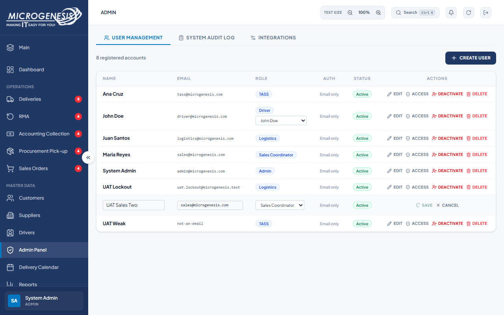

# DEF-017: Duplicate or invalid writes hang without a response across routes

| Document control | |
|---|---|
| Title | DEF-017 Duplicate or invalid writes hang without a response across routes |
| Version | 1.0 |
| Date | 2026-10-15 |
| Author agent | ChatGPT Codex |
| Status | Open |

## 1. Classification

| Field | Value |
|---|---|
| Defect ID | DEF-017 |
| Title | Duplicate or invalid writes hang without a response across routes |
| Linked test case(s) | [TC-ADM-008](../02-test-design/test-cases/TC-ADM-administration.md#tc-adm-008-editing-a-user-to-an-existing-email-gets-a-prompt-clear-error), [TC-MD-006](../02-test-design/test-cases/TC-MD-master-data.md#tc-md-006-malformed-customer-input-gets-a-prompt-error-response), [TC-SKU-004](../02-test-design/test-cases/TC-SKU-sku-master.md#tc-sku-004-duplicate-sku-code-gets-a-prompt-clear-error) |
| Linked scenario | TS-012, TS-014, TS-016 |
| Role and account used | Admin, admin@microgenesis.com; Sales Coordinator, sales@microgenesis.com; passwords are not recorded |
| Severity | Major |
| Priority | P2 |
| Status | Open |
| Found in run | RUN-20261014-02 |

## 2. Environment

| Field | Value |
|---|---|
| URL | http://localhost:3000 or the API path specified in the linked case steps |
| Browser and version | Microsoft Edge 155.0.4283.45 via Playwright 1.64.1 |
| Build / commit hash | 2172fc8 |
| Date and time observed (Asia/Manila) | ~2026-10-15 00:01 (earliest retained evidence timestamp) |
| Database / seed | mg_portal_sandbox; npm run seed:uat |

## 3. Preconditions and data used

- TC-ADM-008: Depends on TC-ADM-002. Test data: None beyond preconditions
- TC-MD-006: Signed in as Sales Coordinator in its own browser context (session from TC-AUTH-001). Test data: None beyond preconditions
- TC-SKU-004: Depends on TC-SKU-002. Test data: None beyond preconditions

## 4. Steps to reproduce

### TC-ADM-008 — Editing a user to an existing email gets a prompt, clear error

1. Row "UAT Sales Two" → "Edit"; Email `sales@microgenesis.com`; "Save". Wait up to 15 s.

### TC-MD-006 — Malformed customer input gets a prompt error response

1. In the Sales Coordinator session, send with the API helper (AGENTS.md §8): `POST /api/customers` body `{"name":12345}` with `AbortSignal.timeout(15000)`

### TC-SKU-004 — Duplicate SKU code gets a prompt, clear error

1. In the Admin session, send with the API helper (AGENTS.md §8): `POST /api/skus` body `{"sku_code":"UAT-SKU-<RUN>-01","name":"UAT Thermal Printer","category":"A","unit_cost":4500,"unit_price":6200,"reorder_point":5}` with `AbortSignal.timeout(15000)`

## 5. Expected result

- TC-ADM-008: Within 15 s an error says the email is already used; the row keeps its email. Fail (SI-05) if the save spins with no response or a generic failure dialog "Could not update user" with a 500.
- TC-MD-006: Within 15 s an HTTP 4xx response. Fail (SI-05) if no response within 15 s or HTTP 500.
- TC-SKU-004: Within 15 s a 4xx (409 or 400) saying the SKU code exists. Fail (SI-05) on timeout or 500.

## 6. Actual result (in full)

- TC-ADM-008: Updating UAT Sales Two to existing sales@microgenesis.com left the row in a pending save state with a spinner beyond 15 seconds and no prompt error.
- TC-MD-006: POST /api/customers with {"name":12345} produced no response within the 15-second timeout; the request remained unresolved.
- TC-SKU-004: The duplicate SKU code request received no response within 15 seconds instead of a 4xx duplicate-code error.

The report records observed behavior from the linked case and does not assert an unverified root cause or prescribe a code change.

## 7. Workflow impact

| Field | Value |
|---|---|
| Where in the workflow it occurred | TS-012, TS-014, TS-016; see linked case steps |
| What it blocks downstream | Users can be left waiting indefinitely when duplicate or malformed writes trigger an unhandled rejection. |
| Workaround observed | See linked case actual result; no unrecorded workaround is inferred. |

## 8. Frequency

| Field | Value |
|---|---|
| Reproducibility | Observed in this run; not re-tested after failure |
| Attempts | Case execution only; see steps for multi-attempt probes. No independent retry was made. |

## 9. Technical evidence

- Browser console errors: no finding-specific console transcript retained.
- Network request and response: No separate request/response artifact was retained for these cases.
- Server log lines: no finding-specific server log transcript retained.
- Playwright trace: not retained.

## 10. Screenshots

## 11. Retest history

| Run ID | Date | Result | Notes |
|---|---|---|---|
| | | | |
