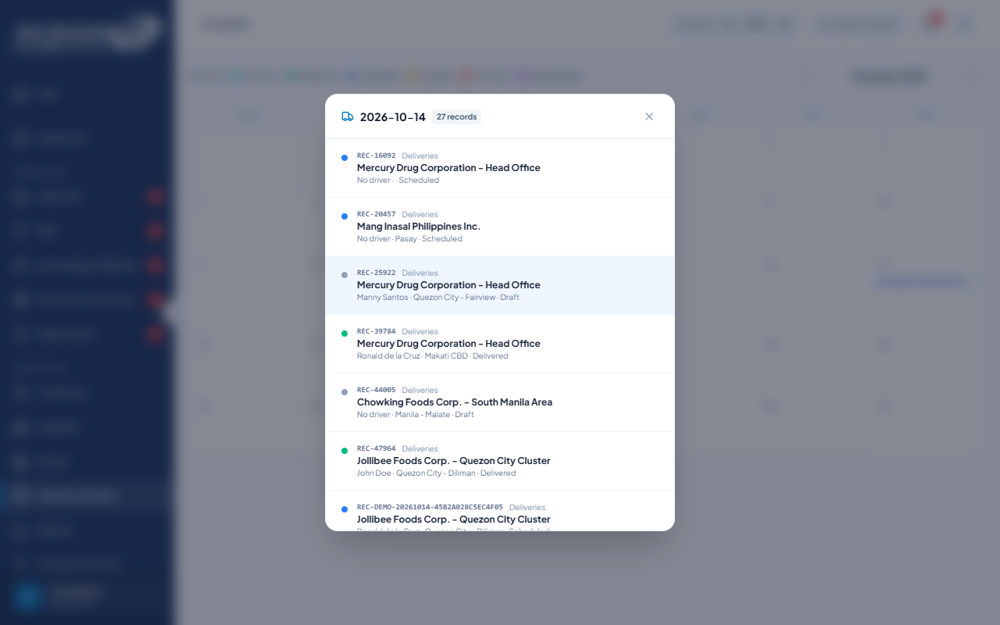
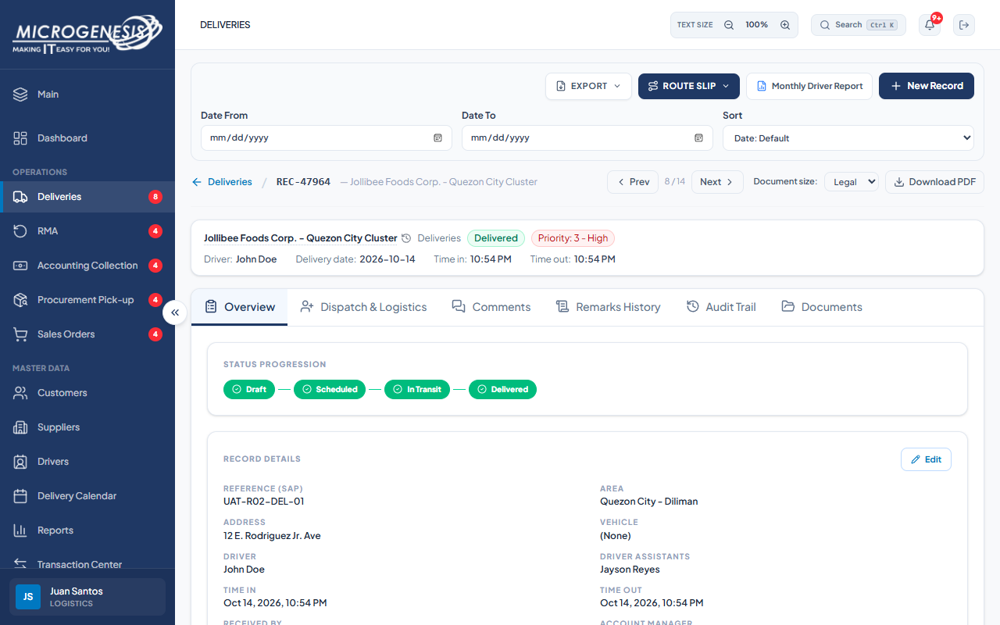
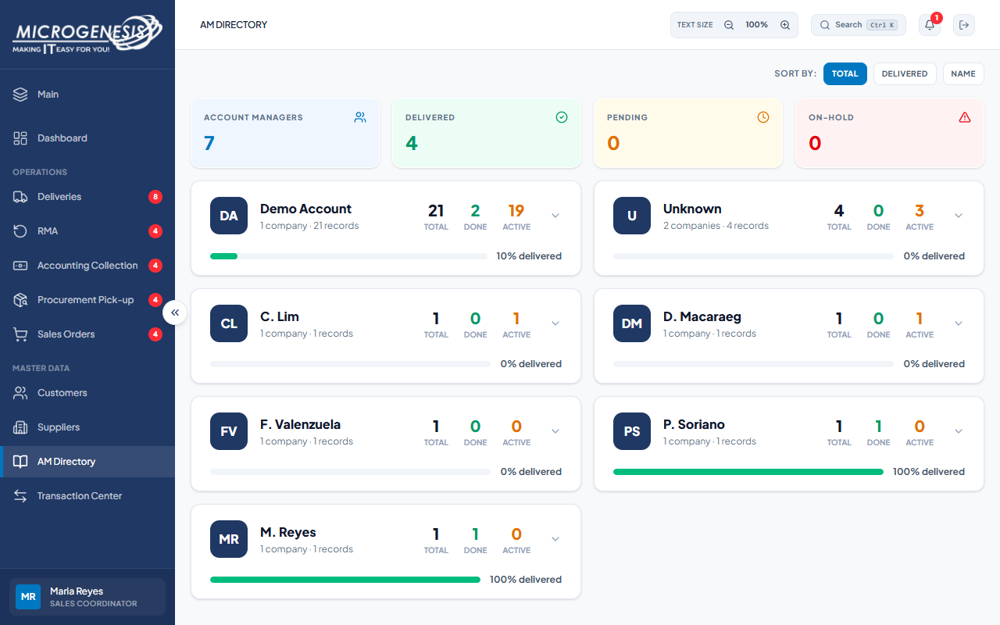

# DEF-018: Calendar and AM Directory display internal IDs instead of references

| Document control | |
|---|---|
| Title | DEF-018 Calendar and AM Directory display internal IDs instead of references |
| Version | 1.0 |
| Date | 2026-10-15 |
| Author agent | ChatGPT Codex |
| Status | Open |

## 1. Classification

| Field | Value |
|---|---|
| Defect ID | DEF-018 |
| Title | Calendar and AM Directory display internal IDs instead of references |
| Linked test case(s) | [TC-DIR-011](../02-test-design/test-cases/TC-DIR-driver-directory.md#tc-dir-011-delivery-calendar-shows-the-day-s-records), [TC-RPT-008](../02-test-design/test-cases/TC-RPT-dashboards-reports.md#tc-rpt-008-am-directory-groups-records-by-account-manager) |
| Linked scenario | TS-013, TS-015 |
| Role and account used | Logistics, logistics@microgenesis.com; Sales Coordinator, sales@microgenesis.com; passwords are not recorded |
| Severity | Minor |
| Priority | P3 |
| Status | Open |
| Found in run | RUN-20261014-02 |

## 2. Environment

| Field | Value |
|---|---|
| URL | http://localhost:3000 or the API path specified in the linked case steps |
| Browser and version | Microsoft Edge 155.0.4283.45 via Playwright 1.64.1 |
| Build / commit hash | 2172fc8 |
| Date and time observed (Asia/Manila) | ~2026-10-14 23:36 (earliest retained evidence timestamp) |
| Database / seed | mg_portal_sandbox; npm run seed:uat |

## 3. Preconditions and data used

- TC-DIR-011: Signed in as Logistics in its own browser context (session from TC-AUTH-002). Depends on TC-DEL-002. Test data: None beyond preconditions
- TC-RPT-008: Signed in as Sales Coordinator in its own browser context (session from TC-AUTH-001). Depends on TC-DEL-002. Test data: None beyond preconditions

## 4. Steps to reproduce

### TC-DIR-011 — Delivery Calendar shows the day's records

1. Sidebar "Delivery Calendar".
2. Click today's date cell.
3. Click `UAT-<RUN>-DEL-01` in the popup.

### TC-RPT-008 — AM Directory groups records by account manager

1. Sidebar "AM Directory"; expand "M. Reyes".

## 5. Expected result

- TC-DIR-011: • The popup lists "N records" for today including `UAT-<RUN>-DEL-01`.; • The record workspace opens.
- TC-RPT-008: Card shows Total/Done/Active; "All Records (N)" includes `UAT-<RUN>-DEL-01`.

## 6. Actual result (in full)

- TC-DIR-011: The October 14 calendar popup listed 27 records and included the correct record, but displayed internal ID REC-47964 where UAT-R02-DEL-01 was expected.
- TC-RPT-008: AM Directory showed the expected manager summary but expanded the record as REC-47964 instead of UAT-R02-DEL-01.

The report records observed behavior from the linked case and does not assert an unverified root cause or prescribe a code change.

## 7. Workflow impact

| Field | Value |
|---|---|
| Where in the workflow it occurred | TS-013, TS-015; see linked case steps |
| What it blocks downstream | Users must reconcile internal IDs with delivery references to identify the intended delivery. |
| Workaround observed | See linked case actual result; no unrecorded workaround is inferred. |

## 8. Frequency

| Field | Value |
|---|---|
| Reproducibility | Observed in this run; not re-tested after failure |
| Attempts | Case execution only; see steps for multi-attempt probes. No independent retry was made. |

## 9. Technical evidence

- Browser console errors: no finding-specific console transcript retained.
- Network request and response: No separate request/response artifact was retained for these cases.
- Server log lines: no finding-specific server log transcript retained.
- Playwright trace: not retained.

## 10. Screenshots

## 11. Retest history

| Run ID | Date | Result | Notes |
|---|---|---|---|
| | | | |
