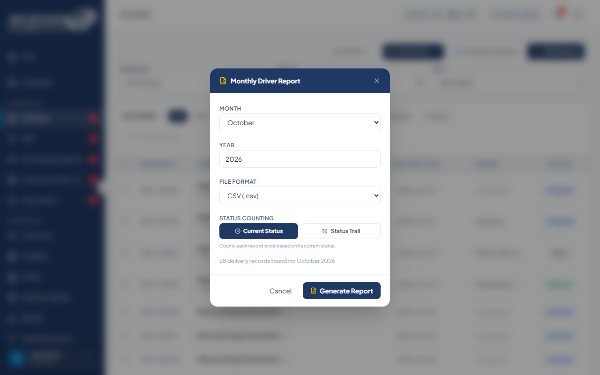
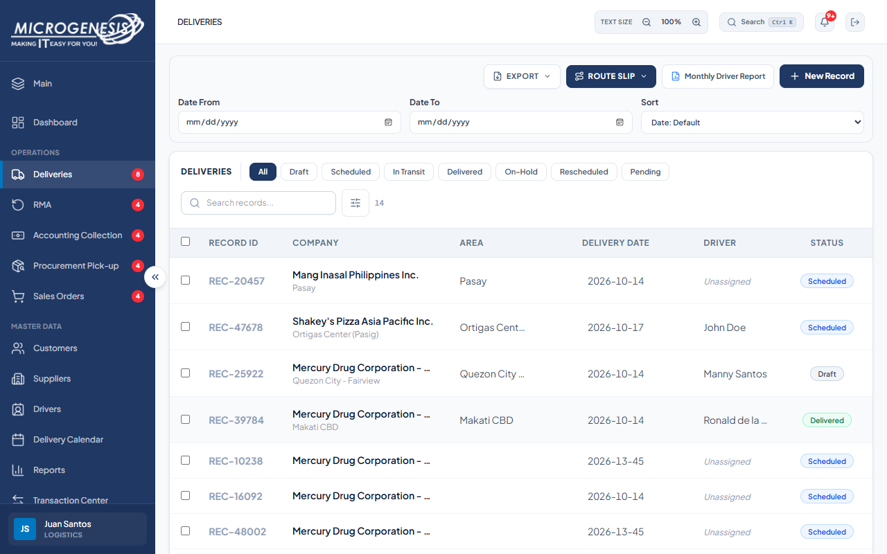

# DEF-019: Monthly Driver Report export omits per-delivery rows

| Document control | |
|---|---|
| Title | DEF-019 Monthly Driver Report export omits per-delivery rows |
| Version | 1.0 |
| Date | 2026-10-15 |
| Author agent | ChatGPT Codex |
| Status | Open |

## 1. Classification

| Field | Value |
|---|---|
| Defect ID | DEF-019 |
| Title | Monthly Driver Report export omits per-delivery rows |
| Linked test case(s) | [TC-DIR-014](../02-test-design/test-cases/TC-DIR-driver-directory.md#tc-dir-014-monthly-driver-report-generates-a-file) |
| Linked scenario | TS-015 |
| Role and account used | Logistics, logistics@microgenesis.com; passwords are not recorded |
| Severity | Major |
| Priority | P2 |
| Status | Open |
| Found in run | RUN-20261014-02 |

## 2. Environment

| Field | Value |
|---|---|
| URL | http://localhost:3000 or the API path specified in the linked case steps |
| Browser and version | Microsoft Edge 155.0.4283.45 via Playwright 1.64.1 |
| Build / commit hash | 2172fc8 |
| Date and time observed (Asia/Manila) | ~2026-10-14 23:39 (earliest retained evidence timestamp) |
| Database / seed | mg_portal_sandbox; npm run seed:uat |

## 3. Preconditions and data used

- TC-DIR-014: Signed in as Logistics in its own browser context (session from TC-AUTH-002). Test data: None beyond preconditions

## 4. Steps to reproduce

### TC-DIR-014 — Monthly Driver Report generates a file

1. Deliveries → "Monthly Driver Report".
2. Month = current month, Year = current year, File Format "CSV (.csv)", "Current Status"; "Generate Report".

## 5. Expected result

- TC-DIR-014: Text "N delivery records found for <Month> <Year>" and a CSV download that includes `UAT-<RUN>-DEL-01`.

## 6. Actual result (in full)

- TC-DIR-014: The UI reported 28 records found and generated Microgenesis_Driver_Report_OCTOBER_2026.csv, but the CSV contained aggregate output and did not include the expected D-DEL-01 reference.

The report records observed behavior from the linked case and does not assert an unverified root cause or prescribe a code change.

## 7. Workflow impact

| Field | Value |
|---|---|
| Where in the workflow it occurred | TS-015; see linked case steps |
| What it blocks downstream | The generated report omits the requested delivery reference needed to review the run. |
| Workaround observed | See linked case actual result; no unrecorded workaround is inferred. |

## 8. Frequency

| Field | Value |
|---|---|
| Reproducibility | Observed in this run; not re-tested after failure |
| Attempts | Case execution only; see steps for multi-attempt probes. No independent retry was made. |

## 9. Technical evidence

- Browser console errors: no finding-specific console transcript retained.
- Network request and response: - [TC-DIR-014-02-driver-report.csv](../artifacts/RUN-20261014-02/evidence/TC-DIR-014-02-driver-report.csv)
- Server log lines: no finding-specific server log transcript retained.
- Playwright trace: not retained.

## 10. Screenshots

## 11. Retest history

| Run ID | Date | Result | Notes |
|---|---|---|---|
| | | | |
