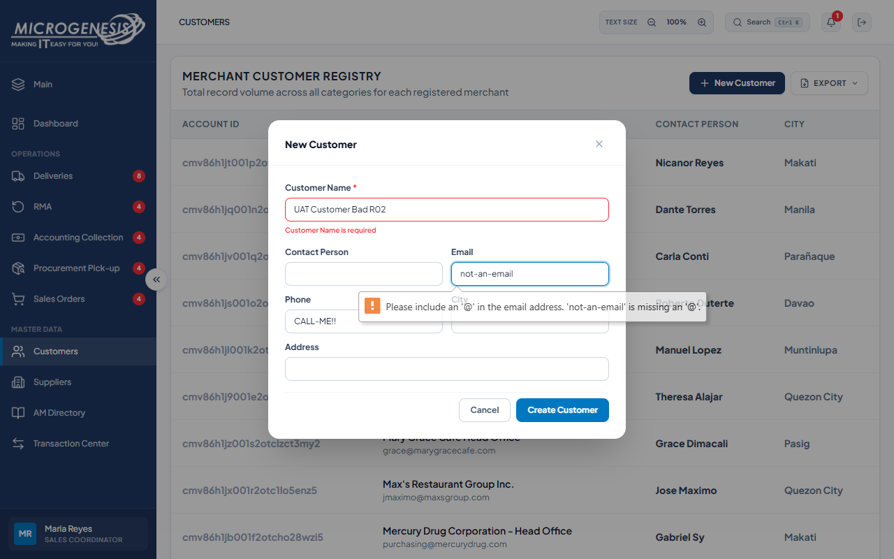

# DEF-020: Customer creation accepts invalid email and phone values

| Document control | |
|---|---|
| Title | DEF-020 Customer creation accepts invalid email and phone values |
| Version | 1.0 |
| Date | 2026-10-15 |
| Author agent | ChatGPT Codex |
| Status | Open |

## 1. Classification

| Field | Value |
|---|---|
| Defect ID | DEF-020 |
| Title | Customer creation accepts invalid email and phone values |
| Linked test case(s) | [TC-MD-005](../02-test-design/test-cases/TC-MD-master-data.md#tc-md-005-customer-create-validates-email-and-phone-like-edit-does) |
| Linked scenario | TS-012 |
| Role and account used | Sales Coordinator, sales@microgenesis.com; passwords are not recorded |
| Severity | Minor |
| Priority | P3 |
| Status | Open |
| Found in run | RUN-20261014-02 |

## 2. Environment

| Field | Value |
|---|---|
| URL | http://localhost:3000 or the API path specified in the linked case steps |
| Browser and version | Microsoft Edge 155.0.4283.45 via Playwright 1.64.1 |
| Build / commit hash | 2172fc8 |
| Date and time observed (Asia/Manila) | ~2026-10-14 23:43 (earliest retained evidence timestamp) |
| Database / seed | mg_portal_sandbox; npm run seed:uat |

## 3. Preconditions and data used

- TC-MD-005: Signed in as Sales Coordinator in its own browser context (session from TC-AUTH-001). Test data: Name `UAT Customer Bad <RUN>`, Email `not-an-email`, Phone `CALL-ME!!`

## 4. Steps to reproduce

### TC-MD-005 — Customer create validates email and phone like edit does

1. "New Customer" with the test data; "Create Customer".

## 5. Expected result

- TC-MD-005: Refused with "Enter a valid email address, like name@company.com." (and a phone error). Fail (SI-12) if the customer is created.

## 6. Actual result (in full)

- TC-MD-005: The create form accepted invalid email not-an-email and phone CALL-ME!! through browser-native validation, without the expected application email and phone errors.

The report records observed behavior from the linked case and does not assert an unverified root cause or prescribe a code change.

## 7. Workflow impact

| Field | Value |
|---|---|
| Where in the workflow it occurred | TS-012; see linked case steps |
| What it blocks downstream | Malformed contact information is stored and may prevent reliable customer communication. |
| Workaround observed | See linked case actual result; no unrecorded workaround is inferred. |

## 8. Frequency

| Field | Value |
|---|---|
| Reproducibility | Observed in this run; not re-tested after failure |
| Attempts | Case execution only; see steps for multi-attempt probes. No independent retry was made. |

## 9. Technical evidence

- Browser console errors: no finding-specific console transcript retained.
- Network request and response: No separate request/response artifact was retained for these cases.
- Server log lines: no finding-specific server log transcript retained.
- Playwright trace: not retained.

## 10. Screenshots

## 11. Retest history

| Run ID | Date | Result | Notes |
|---|---|---|---|
| | | | |
