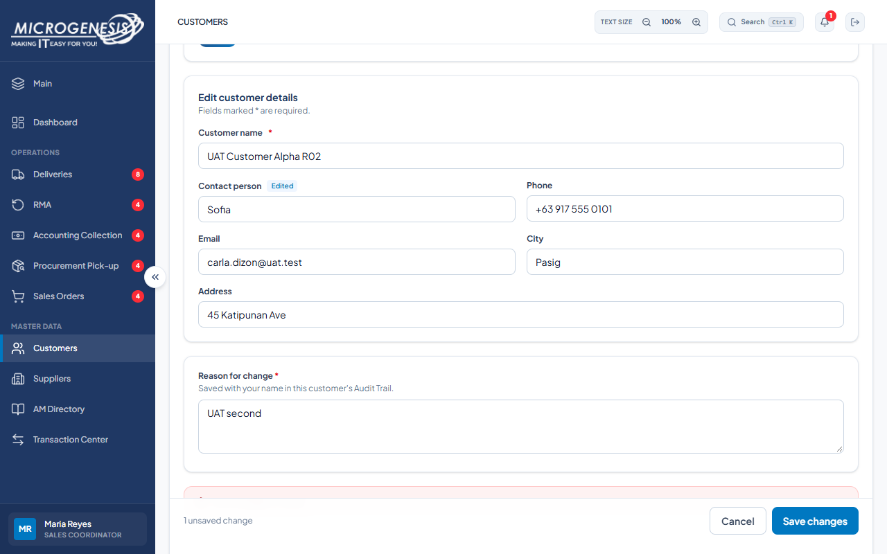

# DEF-021: Concurrent customer edit does not show the expected stale-edit conflict

| Document control | |
|---|---|
| Title | DEF-021 Concurrent customer edit does not show the expected stale-edit conflict |
| Version | 1.0 |
| Date | 2026-10-15 |
| Author agent | ChatGPT Codex |
| Status | Open |

## 1. Classification

| Field | Value |
|---|---|
| Defect ID | DEF-021 |
| Title | Concurrent customer edit does not show the expected stale-edit conflict |
| Linked test case(s) | [TC-MD-009](../02-test-design/test-cases/TC-MD-master-data.md#tc-md-009-concurrent-customer-edits-do-not-overwrite-each-other) |
| Linked scenario | TS-012 |
| Role and account used | Sales Coordinator, sales@microgenesis.com; passwords are not recorded |
| Severity | Major |
| Priority | P2 |
| Status | Open |
| Found in run | RUN-20261014-02 |

## 2. Environment

| Field | Value |
|---|---|
| URL | http://localhost:3000 or the API path specified in the linked case steps |
| Browser and version | Microsoft Edge 155.0.4283.45 via Playwright 1.64.1 |
| Build / commit hash | 2172fc8 |
| Date and time observed (Asia/Manila) | ~2026-10-14 23:46 (earliest retained evidence timestamp) |
| Database / seed | mg_portal_sandbox; npm run seed:uat |

## 3. Preconditions and data used

- TC-MD-009: Signed in as Sales Coordinator in its own browser context (session from TC-AUTH-001). and Signed in as Logistics in its own browser context (session from TC-AUTH-002). Depends on TC-MD-007. Test data: None beyond preconditions

## 4. Steps to reproduce

### TC-MD-009 — Concurrent customer edits do not overwrite each other

1. SC and Logistics both open "UAT Customer Alpha <RUN>" → "Edit customer".
2. Logistics: Contact person `Lucia`, reason `UAT first`, "Save changes".
3. SC: Contact person `Sofia`, reason `UAT second`, "Save changes".

## 5. Expected result

- TC-MD-009: • Logistics save succeeds.; • SC gets "Someone else saved changes to this customer after you opened it…" with "Discard my edits and load the latest values"; contact person stays "Lucia".

## 6. Actual result (in full)

- TC-MD-009: The concurrent edit did not show the expected stale-edit conflict with latest value Lucia. The Sales form remained on Sofia with an unsaved change, and the expected load-latest action was not observed.

The report records observed behavior from the linked case and does not assert an unverified root cause or prescribe a code change.

## 7. Workflow impact

| Field | Value |
|---|---|
| Where in the workflow it occurred | TS-012; see linked case steps |
| What it blocks downstream | A stale edit is not clearly reconciled with the latest customer value, creating a risk of lost updates. |
| Workaround observed | See linked case actual result; no unrecorded workaround is inferred. |

## 8. Frequency

| Field | Value |
|---|---|
| Reproducibility | Observed in this run; not re-tested after failure |
| Attempts | Case execution only; see steps for multi-attempt probes. No independent retry was made. |

## 9. Technical evidence

- Browser console errors: no finding-specific console transcript retained.
- Network request and response: No separate request/response artifact was retained for these cases.
- Server log lines: no finding-specific server log transcript retained.
- Playwright trace: not retained.

## 10. Screenshots

## 11. Retest history

| Run ID | Date | Result | Notes |
|---|---|---|---|
| | | | |
