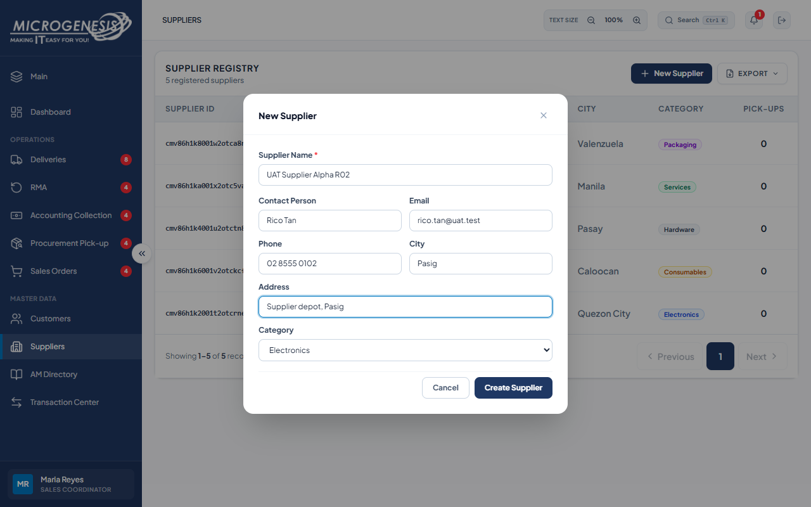
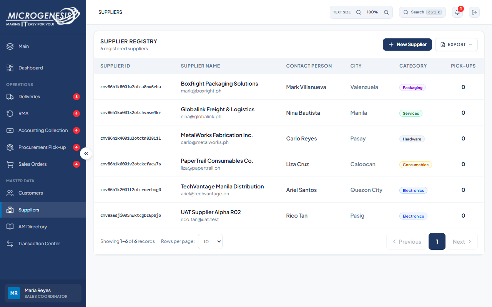
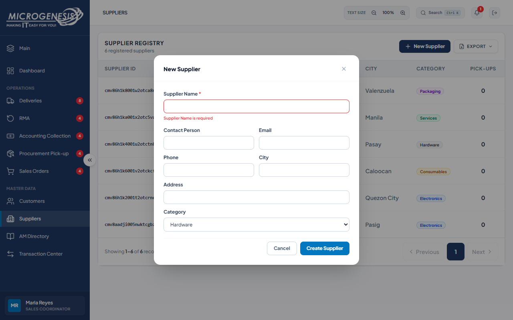

# DEF-022: Supplier creation accepts an undocumented category

| Document control | |
|---|---|
| Title | DEF-022 Supplier creation accepts an undocumented category |
| Version | 1.0 |
| Date | 2026-10-15 |
| Author agent | ChatGPT Codex |
| Status | Open |

## 1. Classification

| Field | Value |
|---|---|
| Defect ID | DEF-022 |
| Title | Supplier creation accepts an undocumented category |
| Linked test case(s) | [TC-MD-010](../02-test-design/test-cases/TC-MD-master-data.md#tc-md-010-supplier-creation-and-category-validation) |
| Linked scenario | TS-012 |
| Role and account used | Sales Coordinator, sales@microgenesis.com; passwords are not recorded |
| Severity | Trivial |
| Priority | P4 |
| Status | Open |
| Found in run | RUN-20261014-02 |

## 2. Environment

| Field | Value |
|---|---|
| URL | http://localhost:3000 or the API path specified in the linked case steps |
| Browser and version | Microsoft Edge 155.0.4283.45 via Playwright 1.64.1 |
| Build / commit hash | 2172fc8 |
| Date and time observed (Asia/Manila) | ~2026-10-14 23:47 (earliest retained evidence timestamp) |
| Database / seed | mg_portal_sandbox; npm run seed:uat |

## 3. Preconditions and data used

- TC-MD-010: Signed in as Sales Coordinator in its own browser context (session from TC-AUTH-001). Test data: D-SUP-01

## 4. Steps to reproduce

### TC-MD-010 — Supplier creation and category validation

1. Sidebar "Suppliers" → "New Supplier"; fill D-SUP-01 (Category "Electronics"); "Create Supplier".
2. "New Supplier" with empty name; "Create Supplier".
3. In the Sales Coordinator session, send with the API helper (AGENTS.md §8): `POST /api/suppliers` body `{"name":"UAT Supplier Odd <RUN>","category":"Gadgets"}`

## 5. Expected result

- TC-MD-010: • Step 1: row "UAT Supplier Alpha <RUN>" with Category Electronics.; • Step 2: "Supplier Name is required".; • Step 3: 400 (unknown category). Fail (SI-13) if 201.

## 6. Actual result (in full)

- TC-MD-010: POST /api/suppliers with category Gadgets returned HTTP 201 instead of expected HTTP 400.

The report records observed behavior from the linked case and does not assert an unverified root cause or prescribe a code change.

## 7. Workflow impact

| Field | Value |
|---|---|
| Where in the workflow it occurred | TS-012; see linked case steps |
| What it blocks downstream | The supplier directory can contain category labels outside the documented list. |
| Workaround observed | See linked case actual result; no unrecorded workaround is inferred. |

## 8. Frequency

| Field | Value |
|---|---|
| Reproducibility | Observed in this run; not re-tested after failure |
| Attempts | Case execution only; see steps for multi-attempt probes. No independent retry was made. |

## 9. Technical evidence

- Browser console errors: no finding-specific console transcript retained.
- Network request and response: No separate request/response artifact was retained for these cases.
- Server log lines: no finding-specific server log transcript retained.
- Playwright trace: not retained.

## 10. Screenshots

## 11. Retest history

| Run ID | Date | Result | Notes |
|---|---|---|---|
| | | | |
