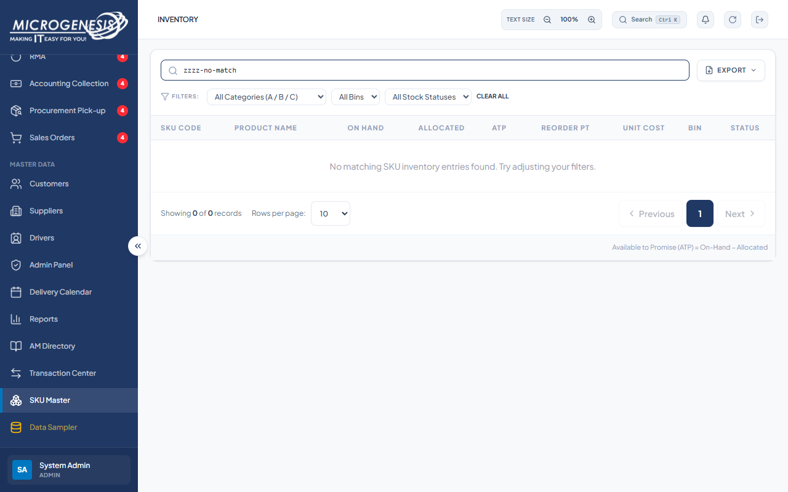
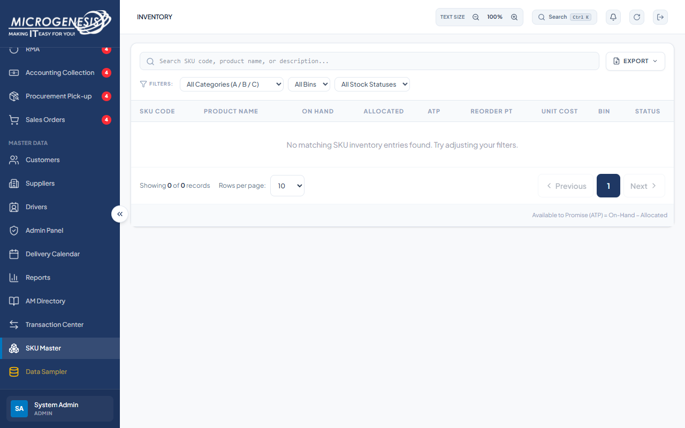

# DEF-023: SKU Clear All does not restore the inventory list

| Document control | |
|---|---|
| Title | DEF-023 SKU Clear All does not restore the inventory list |
| Version | 1.0 |
| Date | 2026-10-15 |
| Author agent | ChatGPT Codex |
| Status | Open |

## 1. Classification

| Field | Value |
|---|---|
| Defect ID | DEF-023 |
| Title | SKU Clear All does not restore the inventory list |
| Linked test case(s) | [TC-SKU-001](../02-test-design/test-cases/TC-SKU-sku-master.md#tc-sku-001-admin-browses-and-filters-the-sku-master) |
| Linked scenario | TS-014 |
| Role and account used | Admin, admin@microgenesis.com; passwords are not recorded |
| Severity | Minor |
| Priority | P3 |
| Status | Open |
| Found in run | RUN-20261014-02 |

## 2. Environment

| Field | Value |
|---|---|
| URL | http://localhost:3000 or the API path specified in the linked case steps |
| Browser and version | Microsoft Edge 155.0.4283.45 via Playwright 1.64.1 |
| Build / commit hash | 2172fc8 |
| Date and time observed (Asia/Manila) | ~2026-10-14 23:54 (earliest retained evidence timestamp) |
| Database / seed | mg_portal_sandbox; npm run seed:uat |

## 3. Preconditions and data used

- TC-SKU-001: Signed in as Admin in its own browser context (session from TC-AUTH-004). Test data: None beyond preconditions

## 4. Steps to reproduce

### TC-SKU-001 — Admin browses and filters the SKU Master

1. Sidebar "SKU Master".
2. Read the column headers.
3. Type `zzzz-no-match` in "Search SKU code, product name, or description..."; then "Clear All".

## 5. Expected result

- TC-SKU-001: • Columns: SKU Code, Product Name, On Hand, Allocated, ATP, Reorder Pt, Unit Cost, Bin, Status.; • Search shows "No matching SKU inventory entries found. Try adjusting your filters."; "Clear All" restores the list.

## 6. Actual result (in full)

- TC-SKU-001: The search returned No matching SKU inventory entries found. Try adjusting your filters. Clear All did not restore the SKU list.

The report records observed behavior from the linked case and does not assert an unverified root cause or prescribe a code change.

## 7. Workflow impact

| Field | Value |
|---|---|
| Where in the workflow it occurred | TS-014; see linked case steps |
| What it blocks downstream | Admin cannot return from a no-match search to the full SKU inventory in the current view. |
| Workaround observed | See linked case actual result; no unrecorded workaround is inferred. |

## 8. Frequency

| Field | Value |
|---|---|
| Reproducibility | Observed in this run; not re-tested after failure |
| Attempts | Case execution only; see steps for multi-attempt probes. No independent retry was made. |

## 9. Technical evidence

- Browser console errors: no finding-specific console transcript retained.
- Network request and response: No separate request/response artifact was retained for these cases.
- Server log lines: no finding-specific server log transcript retained.
- Playwright trace: not retained.

## 10. Screenshots

## 11. Retest history

| Run ID | Date | Result | Notes |
|---|---|---|---|
| | | | |
