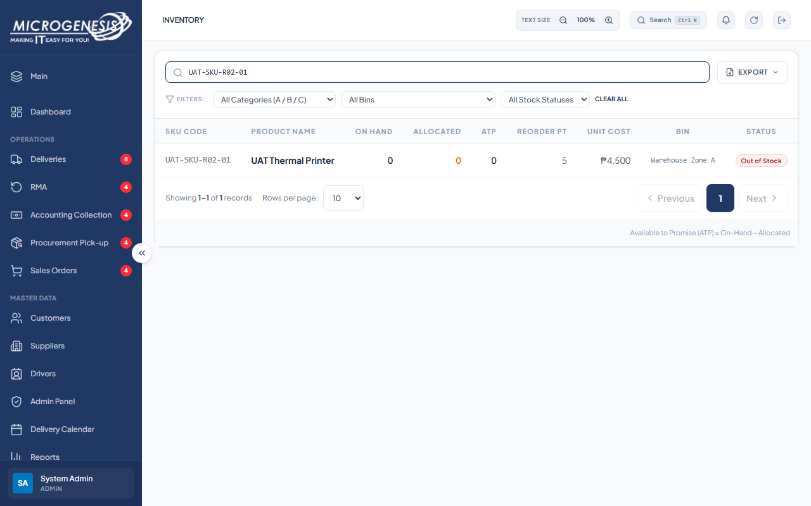

# DEF-024: Admin has no UI to create a SKU

| Document control | |
|---|---|
| Title | DEF-024 Admin has no UI to create a SKU |
| Version | 1.0 |
| Date | 2026-10-15 |
| Author agent | ChatGPT Codex |
| Status | Open |

## 1. Classification

| Field | Value |
|---|---|
| Defect ID | DEF-024 |
| Title | Admin has no UI to create a SKU |
| Linked test case(s) | [TC-SKU-002](../02-test-design/test-cases/TC-SKU-sku-master.md#tc-sku-002-admin-can-create-a-sku) |
| Linked scenario | TS-014 |
| Role and account used | Admin, admin@microgenesis.com; passwords are not recorded |
| Severity | Major |
| Priority | P2 |
| Status | Open |
| Found in run | RUN-20261014-02 |

## 2. Environment

| Field | Value |
|---|---|
| URL | http://localhost:3000 or the API path specified in the linked case steps |
| Browser and version | Microsoft Edge 155.0.4283.45 via Playwright 1.64.1 |
| Build / commit hash | 2172fc8 |
| Date and time observed (Asia/Manila) | ~2026-10-14 23:54 (earliest retained evidence timestamp) |
| Database / seed | mg_portal_sandbox; npm run seed:uat |

## 3. Preconditions and data used

- TC-SKU-002: Signed in as Admin in its own browser context (session from TC-AUTH-004). Test data: D-SKU-01

## 4. Steps to reproduce

### TC-SKU-002 — Admin can create a SKU

1. In SKU Master look for a control to create a SKU.
2. In the Admin session, send with the API helper (AGENTS.md §8): `POST /api/skus` body `{"sku_code":"UAT-SKU-<RUN>-01","name":"UAT Thermal Printer","category":"A","unit_cost":4500,"unit_price":6200,"reorder_point":5,"warehouse_location":"Warehouse Zone A"}`
3. Reload SKU Master; search `UAT-SKU-<RUN>-01`.

## 5. Expected result

- TC-SKU-002: • Step 1: a create control exists (BR-SKU-01). Fail (SI-18) if none.; • Step 2: 201; `inventory.on_hand_qty` 0, `warehouse_location` "Warehouse Zone A".; • Step 3: the SKU is listed with On Hand 0.

## 6. Actual result (in full)

- TC-SKU-002: No SKU create control was available in the Admin UI. POST /api/skus succeeded with HTTP 201; the created SKU had On Hand 0 and Warehouse Zone A.

The report records observed behavior from the linked case and does not assert an unverified root cause or prescribe a code change.

## 7. Workflow impact

| Field | Value |
|---|---|
| Where in the workflow it occurred | TS-014; see linked case steps |
| What it blocks downstream | The documented Admin SKU creation workflow cannot be completed in the application. |
| Workaround observed | See linked case actual result; no unrecorded workaround is inferred. |

## 8. Frequency

| Field | Value |
|---|---|
| Reproducibility | Observed in this run; not re-tested after failure |
| Attempts | Case execution only; see steps for multi-attempt probes. No independent retry was made. |

## 9. Technical evidence

- Browser console errors: no finding-specific console transcript retained.
- Network request and response: No separate request/response artifact was retained for these cases.
- Server log lines: no finding-specific server log transcript retained.
- Playwright trace: not retained.

## 10. Screenshots

## 11. Retest history

### Implementation follow-up: 2026-10-16

The user authorized Admin SKU creation. The working tree now adds an Admin-only Create SKU form with code, name, category, cost, price, reorder point, description and optional warehouse location. Creation uses the existing API, starts stock at zero and saves the product, inventory and audit together. Automated regression validation is recorded in the [scope follow-up](../06-reports/2026-10-16-scope-and-sales-access-clarification.md). Full live browser acceptance has not been rerun; historical results remain unchanged.

| Run ID | Date | Result | Notes |
|---|---|---|---|
| | | | |
