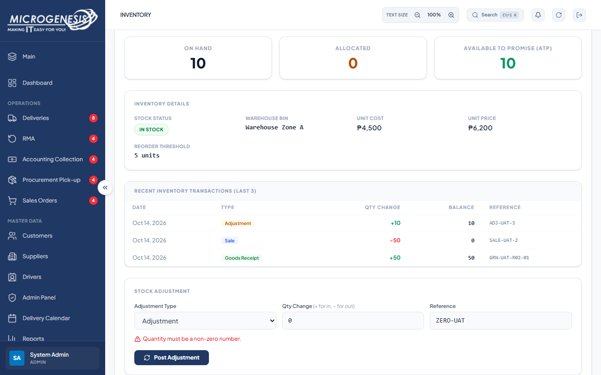
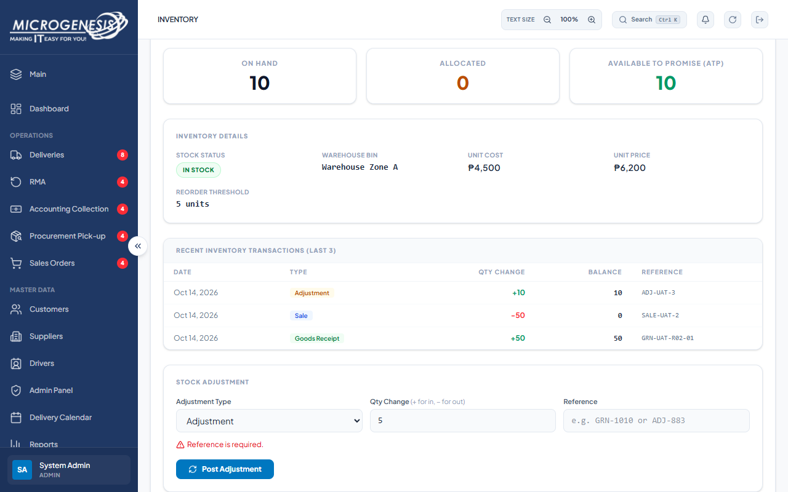

# DEF-026: Stock adjustment accepts an unrecognized type and posts quantity

| Document control | |
|---|---|
| Title | DEF-026 Stock adjustment accepts an unrecognized type and posts quantity |
| Version | 1.0 |
| Date | 2026-10-15 |
| Author agent | ChatGPT Codex |
| Status | Open |

## 1. Classification

| Field | Value |
|---|---|
| Defect ID | DEF-026 |
| Title | Stock adjustment accepts an unrecognized type and posts quantity |
| Linked test case(s) | [TC-SKU-008](../02-test-design/test-cases/TC-SKU-sku-master.md#tc-sku-008-adjustment-input-validation) |
| Linked scenario | TS-014 |
| Role and account used | Admin, admin@microgenesis.com; passwords are not recorded |
| Severity | Major |
| Priority | P2 |
| Status | Open |
| Found in run | RUN-20261014-02 |

## 2. Environment

| Field | Value |
|---|---|
| URL | http://localhost:3000 or the API path specified in the linked case steps |
| Browser and version | Microsoft Edge 155.0.4283.45 via Playwright 1.64.1 |
| Build / commit hash | 2172fc8 |
| Date and time observed (Asia/Manila) | ~2026-10-14 23:56 (earliest retained evidence timestamp) |
| Database / seed | mg_portal_sandbox; npm run seed:uat |

## 3. Preconditions and data used

- TC-SKU-008: Depends on TC-SKU-006. Test data: None beyond preconditions

## 4. Steps to reproduce

### TC-SKU-008 — Adjustment input validation

1. Post Adjustment with qty `0`.
2. Post Adjustment with qty `5` and empty reference.
3. In the Admin session, send with the API helper (AGENTS.md §8): `POST /api/skus/{D-SKU-01.id}/adjust` body `{"type":"Gift","qty_change":1,"reference":"UAT-ODD"}`

## 5. Expected result

- TC-SKU-008: • Step 1: "Quantity must be a non-zero number."; • Step 2: "Reference is required."; • Step 3: 400 (type must be Goods Receipt, Sale, Adjustment or Transfer). Fail (SI-07) if 200.

## 6. Actual result (in full)

- TC-SKU-008: POST /api/skus/{id}/adjust with type Gift returned HTTP 200 and posted +1 stock; zero quantity and missing reference guards returned expected errors.

The report records observed behavior from the linked case and does not assert an unverified root cause or prescribe a code change.

## 7. Workflow impact

| Field | Value |
|---|---|
| Where in the workflow it occurred | TS-014; see linked case steps |
| What it blocks downstream | An unrecognized free-text movement type changes stock outside the documented movement types. |
| Workaround observed | See linked case actual result; no unrecorded workaround is inferred. |

## 8. Frequency

| Field | Value |
|---|---|
| Reproducibility | Observed in this run; not re-tested after failure |
| Attempts | Case execution only; see steps for multi-attempt probes. No independent retry was made. |

## 9. Technical evidence

- Browser console errors: no finding-specific console transcript retained.
- Network request and response: No separate request/response artifact was retained for these cases.
- Server log lines: no finding-specific server log transcript retained.
- Playwright trace: not retained.

## 10. Screenshots

## 11. Retest history

| Run ID | Date | Result | Notes |
|---|---|---|---|
| | | | |
