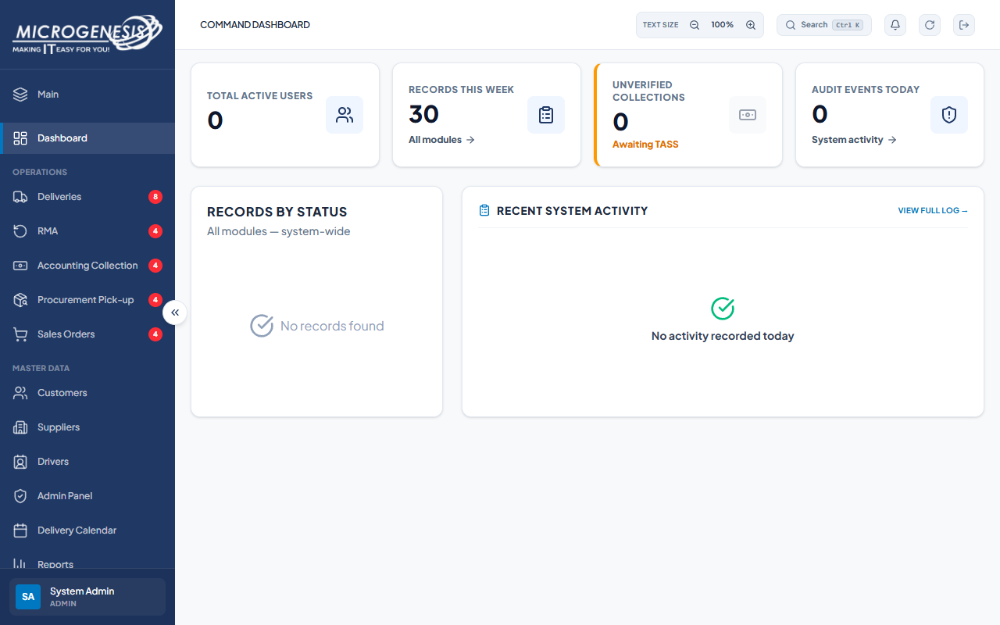

# DEF-027: Admin dashboard reports zero active users while eight are active

| Document control | |
|---|---|
| Title | DEF-027 Admin dashboard reports zero active users while eight are active |
| Version | 1.0 |
| Date | 2026-10-15 |
| Author agent | ChatGPT Codex |
| Status | Open |

## 1. Classification

| Field | Value |
|---|---|
| Defect ID | DEF-027 |
| Title | Admin dashboard reports zero active users while eight are active |
| Linked test case(s) | [TC-RPT-005](../02-test-design/test-cases/TC-RPT-dashboards-reports.md#tc-rpt-005-admin-dashboard-matches-administration-data) |
| Linked scenario | TS-015 |
| Role and account used | Admin, admin@microgenesis.com; passwords are not recorded |
| Severity | Minor |
| Priority | P3 |
| Status | Open |
| Found in run | RUN-20261014-02 |

## 2. Environment

| Field | Value |
|---|---|
| URL | http://localhost:3000 or the API path specified in the linked case steps |
| Browser and version | Microsoft Edge 155.0.4283.45 via Playwright 1.64.1 |
| Build / commit hash | 2172fc8 |
| Date and time observed (Asia/Manila) | ~2026-10-14 23:59 (earliest retained evidence timestamp) |
| Database / seed | mg_portal_sandbox; npm run seed:uat |

## 3. Preconditions and data used

- TC-RPT-005: Signed in as Admin in its own browser context (session from TC-AUTH-004). Test data: None beyond preconditions

## 4. Steps to reproduce

### TC-RPT-005 — Admin dashboard matches administration data

1. Dashboard: note "Total Active Users".
2. Admin Panel → "User Management": count Status "Active".
3. Back on Dashboard click "View Full Log →".

## 5. Expected result

- TC-RPT-005: • "Total Active Users" equals the Active count.; • "View Full Log →" opens "System Audit Log".

## 6. Actual result (in full)

- TC-RPT-005: The Admin dashboard showed Total Active Users as 0 while User Management showed 8 active seeded/test accounts at that point in the run.

The report records observed behavior from the linked case and does not assert an unverified root cause or prescribe a code change.

## 7. Workflow impact

| Field | Value |
|---|---|
| Where in the workflow it occurred | TS-015; see linked case steps |
| What it blocks downstream | The dashboard gives an incorrect active-user count. |
| Workaround observed | See linked case actual result; no unrecorded workaround is inferred. |

## 8. Frequency

| Field | Value |
|---|---|
| Reproducibility | Observed in this run; not re-tested after failure |
| Attempts | Case execution only; see steps for multi-attempt probes. No independent retry was made. |

## 9. Technical evidence

- Browser console errors: no finding-specific console transcript retained.
- Network request and response: No separate request/response artifact was retained for these cases.
- Server log lines: no finding-specific server log transcript retained.
- Playwright trace: not retained.

## 10. Screenshots

## 11. Retest history

| Run ID | Date | Result | Notes |
|---|---|---|---|
| | | | |
