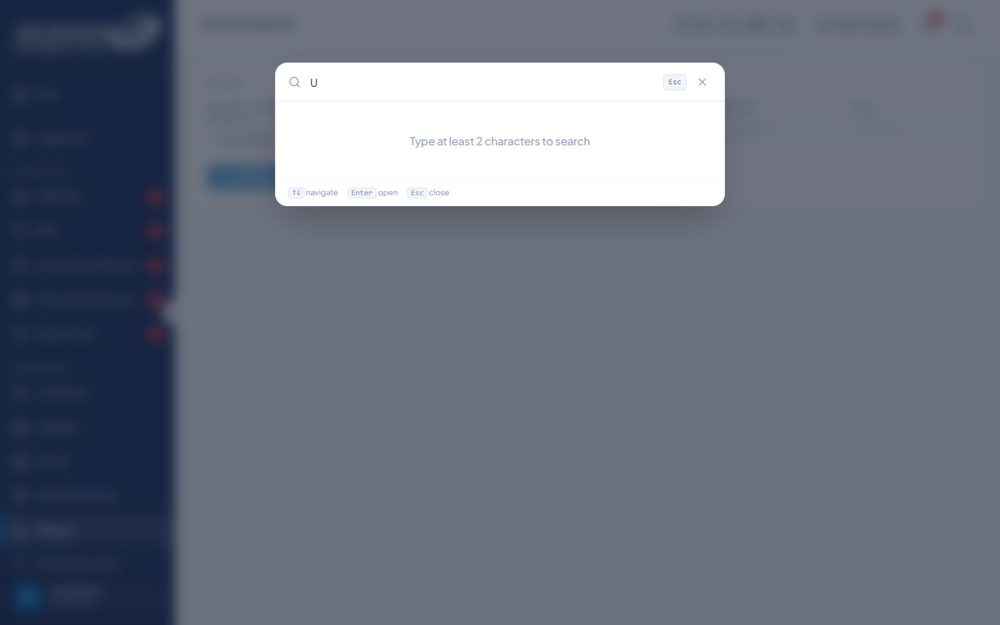
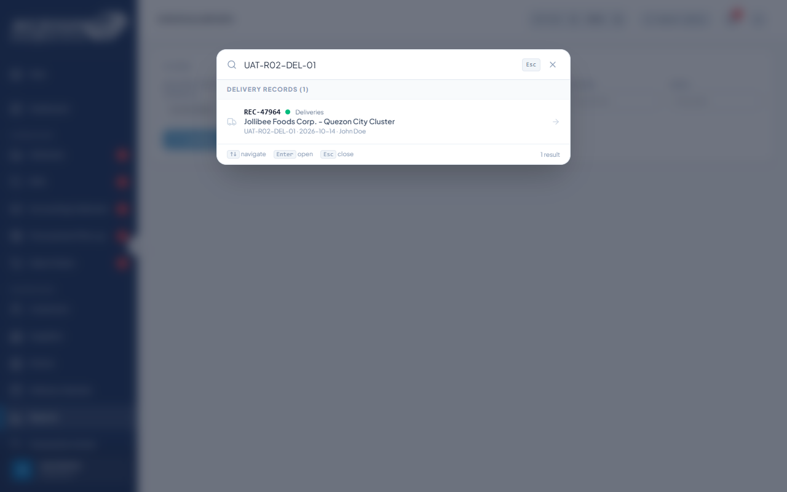
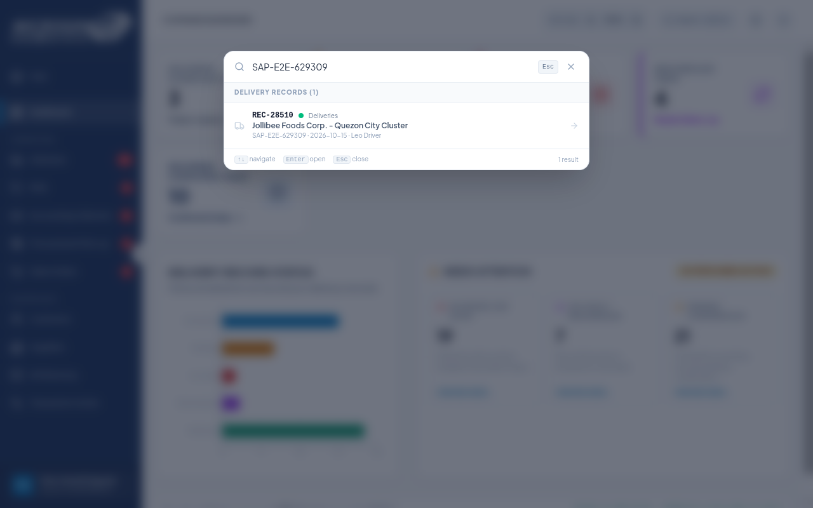

# DEF-030: Global search Enter leaves the result overlay open

| Document control | |
|---|---|
| Title | DEF-030 Global search Enter leaves the result overlay open |
| Version | 1.0 |
| Date | 2026-10-15 |
| Author agent | ChatGPT Codex |
| Status | Open |

## 1. Classification

| Field | Value |
|---|---|
| Defect ID | DEF-030 |
| Title | Global search Enter leaves the result overlay open |
| Linked test case(s) | [TC-RPT-009](../02-test-design/test-cases/TC-RPT-dashboards-reports.md#tc-rpt-009-global-search-finds-a-record) |
| Linked scenario | TS-015 |
| Role and account used | Logistics, logistics@microgenesis.com; passwords are not recorded |
| Severity | Minor |
| Priority | P3 |
| Status | Open |
| Found in run | RUN-20261014-02 |

## 2. Environment

| Field | Value |
|---|---|
| URL | http://localhost:3000 or the API path specified in the linked case steps |
| Browser and version | Microsoft Edge 155.0.4283.45 via Playwright 1.64.1 |
| Build / commit hash | 2172fc8 |
| Date and time observed (Asia/Manila) | ~2026-10-14 23:51 (earliest retained evidence timestamp) |
| Database / seed | mg_portal_sandbox; npm run seed:uat |

## 3. Preconditions and data used

- TC-RPT-009: Signed in as Logistics in its own browser context (session from TC-AUTH-002). Depends on TC-DEL-002. Test data: None beyond preconditions

## 4. Steps to reproduce

### TC-RPT-009 — Global search finds a record

1. Press Ctrl+K; type `U`; then type `UAT-<RUN>-DEL-01`; press Enter on the result.

## 5. Expected result

- TC-RPT-009: • With one character: "Type at least 2 characters to search".; • Group "Delivery Records (1)"; Enter opens the record.

## 6. Actual result (in full)

- TC-RPT-009: One-character search showed the minimum-length prompt and the full reference produced one delivery result, but pressing Enter left the overlay open and did not open the record.

The report records observed behavior from the linked case and does not assert an unverified root cause or prescribe a code change.

## 7. Workflow impact

| Field | Value |
|---|---|
| Where in the workflow it occurred | TS-015; see linked case steps |
| What it blocks downstream | A matching record is found but keyboard navigation does not open it. |
| Workaround observed | See linked case actual result; no unrecorded workaround is inferred. |

## 8. Frequency

| Field | Value |
|---|---|
| Reproducibility | Observed in this run; not re-tested after failure |
| Attempts | Case execution only; see steps for multi-attempt probes. No independent retry was made. |

## 9. Technical evidence

- Browser console errors: no finding-specific console transcript retained.
- Network request and response: No separate request/response artifact was retained for these cases.
- Server log lines: no finding-specific server log transcript retained.
- Playwright trace: not retained.

## 10. Screenshots

## 11. Retest history

| Run ID | Date | Result | Notes |
|---|---|---|---|
| | | | |

### Retest observation: RUN-20261015-08

Fail, Sales-account adaptation: direct Enter on a unique global-search result leaves the overlay open; ArrowDown then Enter works. Original Logistics-role case not rerun.

[Focused run report](../06-reports/UAT-summary-RUN-20261015-08.md)
