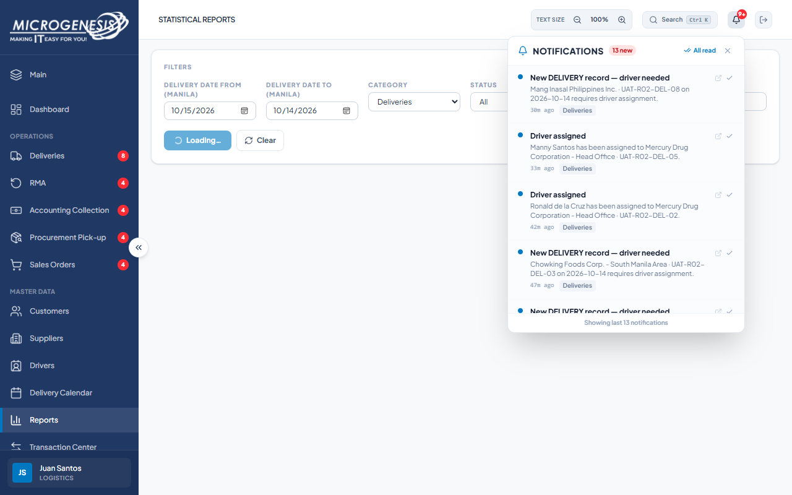
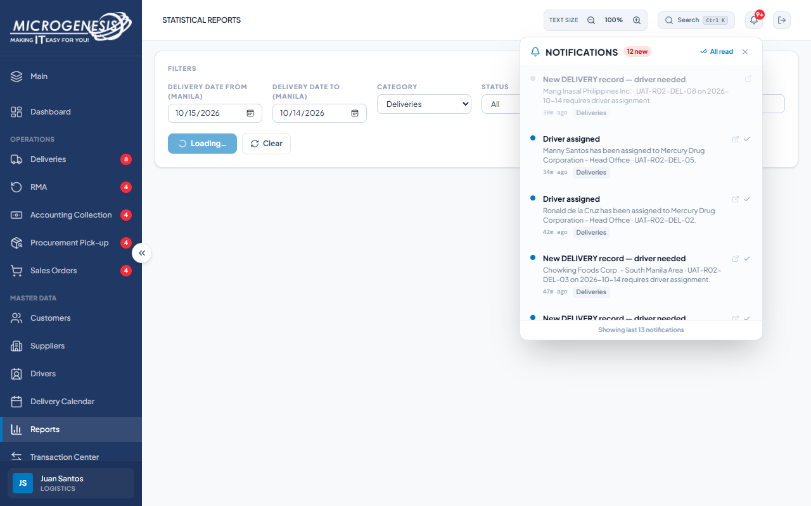

# DEF-031: Notification badge stays 9+ after marking one item read

| Document control | |
|---|---|
| Title | DEF-031 Notification badge stays 9+ after marking one item read |
| Version | 1.0 |
| Date | 2026-10-15 |
| Author agent | ChatGPT Codex |
| Status | Open |

## 1. Classification

| Field | Value |
|---|---|
| Defect ID | DEF-031 |
| Title | Notification badge stays 9+ after marking one item read |
| Linked test case(s) | [TC-NOT-003](../02-test-design/test-cases/TC-NOT-notifications.md#tc-not-003-mark-one-notification-read) |
| Linked scenario | TS-015 |
| Role and account used | Logistics, logistics@microgenesis.com; passwords are not recorded |
| Severity | Minor |
| Priority | P3 |
| Status | Open |
| Found in run | RUN-20261014-02 |

## 2. Environment

| Field | Value |
|---|---|
| URL | http://localhost:3000 or the API path specified in the linked case steps |
| Browser and version | Microsoft Edge 155.0.4283.45 via Playwright 1.64.1 |
| Build / commit hash | 2172fc8 |
| Date and time observed (Asia/Manila) | ~2026-10-14 23:52 (earliest retained evidence timestamp) |
| Database / seed | mg_portal_sandbox; npm run seed:uat |

## 3. Preconditions and data used

- TC-NOT-003: Depends on TC-NOT-001. Test data: None beyond preconditions

## 4. Steps to reproduce

### TC-NOT-003 — Mark one notification read

1. Note the unread badge number.
2. Click the ✓ button (title "Mark as read") on one unread item.

## 5. Expected result

- TC-NOT-003: Badge decreases by 1; the item shows as read.

## 6. Actual result (in full)

- TC-NOT-003: After one notification was marked read, read controls fell from 13 to 12 while the navbar badge remained 9+.

The report records observed behavior from the linked case and does not assert an unverified root cause or prescribe a code change.

## 7. Workflow impact

| Field | Value |
|---|---|
| Where in the workflow it occurred | TS-015; see linked case steps |
| What it blocks downstream | The unread badge does not reflect the changed read state above its display threshold. |
| Workaround observed | See linked case actual result; no unrecorded workaround is inferred. |

## 8. Frequency

| Field | Value |
|---|---|
| Reproducibility | Observed in this run; not re-tested after failure |
| Attempts | Case execution only; see steps for multi-attempt probes. No independent retry was made. |

## 9. Technical evidence

- Browser console errors: no finding-specific console transcript retained.
- Network request and response: No separate request/response artifact was retained for these cases.
- Server log lines: no finding-specific server log transcript retained.
- Playwright trace: not retained.

## 10. Screenshots

## 11. Retest history

| Run ID | Date | Result | Notes |
|---|---|---|---|
| | | | |
