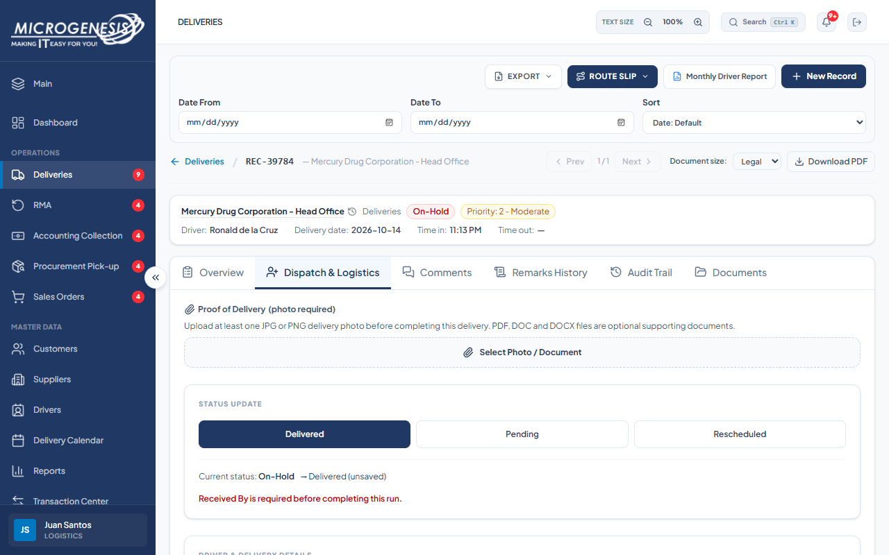
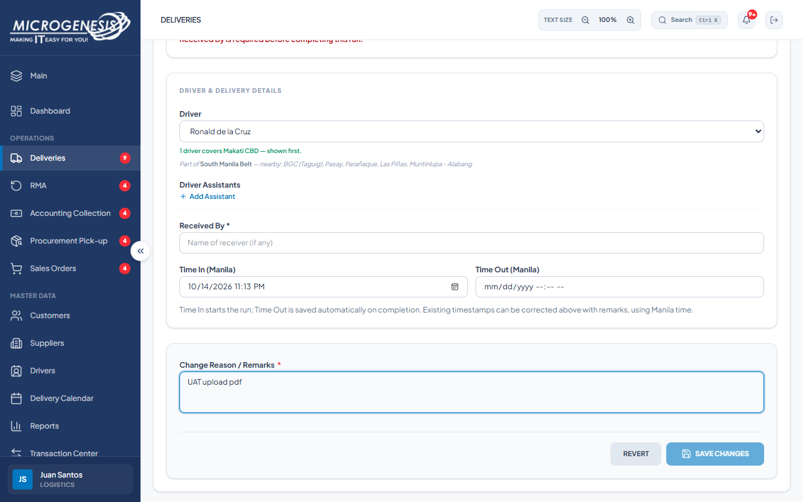
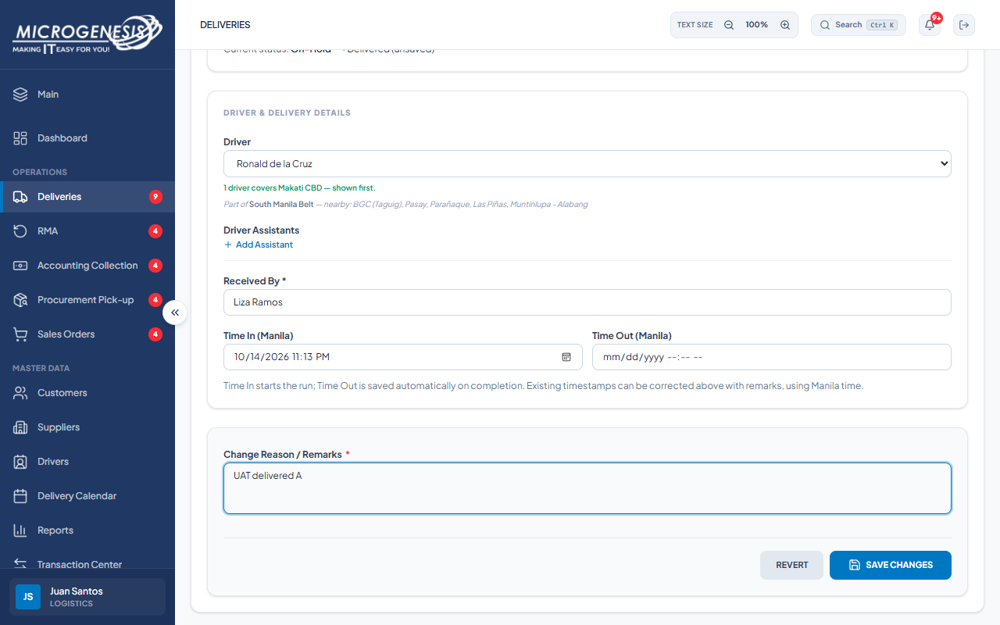
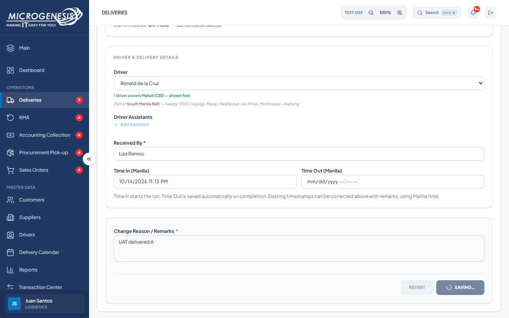

# DEF-032: PDF attachment cannot be saved before delivery completion

| Document control | |
|---|---|
| Title | DEF-032 PDF attachment cannot be saved before delivery completion |
| Version | 1.0 |
| Date | 2026-10-15 |
| Author agent | ChatGPT Codex |
| Status | Open |

## 1. Classification

| Field | Value |
|---|---|
| Defect ID | DEF-032 |
| Title | PDF attachment cannot be saved before delivery completion |
| Linked test case(s) | [TC-DEL-038](../02-test-design/test-cases/TC-DEL-deliveries.md#tc-del-038-chain-a-completion-is-blocked-without-photo-and-received-by-then-succeeds-on-hold-delivered) |
| Linked scenario | TS-002 |
| Role and account used | Logistics, logistics@microgenesis.com; passwords are not recorded |
| Severity | Minor |
| Priority | P3 |
| Status | Open |
| Found in run | RUN-20261014-02 |

## 2. Environment

| Field | Value |
|---|---|
| URL | http://localhost:3000 or the API path specified in the linked case steps |
| Browser and version | Microsoft Edge 155.0.4283.45 via Playwright 1.64.1 |
| Build / commit hash | 2172fc8 |
| Date and time observed (Asia/Manila) | ~2026-10-14 23:14 (earliest retained evidence timestamp) |
| Database / seed | mg_portal_sandbox; npm run seed:uat |

## 3. Preconditions and data used

- TC-DEL-038: Depends on TC-DEL-037. Fixture files F-PDF and F-JPG (test-data.md §6). Test data: Received By `Liza Ramos`

## 4. Steps to reproduce

### TC-DEL-038 — Chain A: completion is blocked without photo and Received By, then succeeds (On-Hold → Delivered)

1. In the Logistics session, send with the API helper (AGENTS.md §8): `PATCH /api/records/{D-DEL-02.id}/status` body `{"status":"Delivered","remarks":"UAT probe","received_by":"Liza Ramos"}`
2. Tab "Dispatch & Logistics": click "Delivered". Read the red messages; note whether "Save Changes" is enabled.
3. Click "Select Photo / Document", choose F-PDF; type remarks `UAT upload pdf`; "Save Changes". Click "Delivered" again and read the messages.
4. In the Logistics session, send with the API helper (AGENTS.md §8): `PATCH /api/records/{D-DEL-02.id}/status` body `{"status":"Delivered","remarks":"UAT probe"}` (no received_by)
5. Click "Select Photo / Document", choose F-JPG; type "Received By *" `Liza Ramos`; click "Delivered"; remarks `UAT delivered A`; "Save Changes".

## 5. Expected result

- TC-DEL-038: • Step 1: 400 "Upload at least one JPG or PNG delivery photo before marking this delivery Accomplished."; • Step 2: "Upload at least one JPG or PNG delivery photo before completing this delivery. Documents alone do not count." (and "Received By is required before completing this run.") with Save disabled.; • Step 3: the PDF is listed under "Saved Attachments" but the photo message remains.; • Step 4: 400 "Received By is required before completing this run."; • Step 5: status "Delivered"; "Time Out (Manila)" filled with the current time; Received By "Liza Ramos".

## 6. Actual result (in full)

- TC-DEL-038: With only the PDF staged and no delivery photo or Received By value, the expected intermediate save could not be completed because Save Changes was disabled. The PDF and photo were persisted only with the later successful completion.

The report records observed behavior from the linked case and does not assert an unverified root cause or prescribe a code change.

## 7. Workflow impact

| Field | Value |
|---|---|
| Where in the workflow it occurred | TS-002; see linked case steps |
| What it blocks downstream | The case expected an intermediate document save, but Save Changes remained disabled until completion requirements were met. |
| Workaround observed | See linked case actual result; no unrecorded workaround is inferred. |

## 8. Frequency

| Field | Value |
|---|---|
| Reproducibility | Observed in this run; not re-tested after failure |
| Attempts | Case execution only; see steps for multi-attempt probes. No independent retry was made. |

## 9. Technical evidence

- Browser console errors: no finding-specific console transcript retained.
- Network request and response: No separate request/response artifact was retained for these cases.
- Server log lines: no finding-specific server log transcript retained.
- Playwright trace: not retained.

## 10. Screenshots

## 11. Retest history

| Run ID | Date | Result | Notes |
|---|---|---|---|
| | | | |
