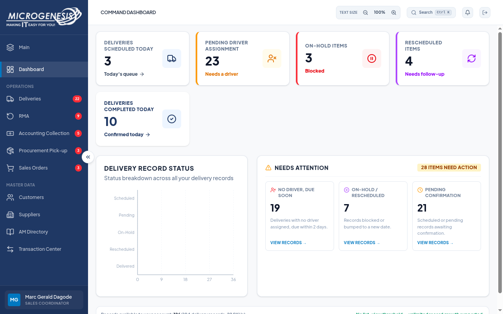

# Microsoft sign-in result: RUN-20261015-07

| Document control | Value |
|---|---|
| Title | Microsoft sign-in Sales Coordinator smoke |
| Date | 2026-10-15 |
| Status | Pass |
| Build | 665775f, working tree |

Microsoft sign-in and user-completed MFA succeeded for `dagodemarcgeraldarante@gmail.com`. After the OAuth callback completed, `GET /api/auth/me` returned HTTP 200 with role `SALES_COORDINATOR`. The portal dashboard rendered, and its profile area displayed Sales Coordinator. Node's test runner reported 1 test passed, zero failed, in 90.04 seconds.

The test checks the exact email and expected role. Credentials, session cookies and authentication tokens were not saved. The browser was closed after verification. Post-authentication action/screenshot tracing used network/DOM snapshots disabled.

QA dependencies were installed from the existing lockfile. The QA TypeScript check passes against pinned Playwright 1.64.1; this run used the already installed Chromium revision 1243 through the explicit executable override. No application source, permissions, environment files or seeds were changed.

Earlier attempts are preserved: RUN-20261015-04 timed out while MFA was pending; RUN-20261015-05 exposed a test timing error that checked identity during the callback. The test was corrected to exclude API callback URLs and wait for an authenticated session. Neither earlier attempt establishes an application authorization defect.

This pass covers sign-in and the Sales Coordinator landing screen. It does not establish complete Sales Coordinator workflows, other roles or UAT release sign-off.

[Identity evidence](../artifacts/RUN-20261015-07/SSO-account-identity.json) · [Evidence index](../artifacts/RUN-20261015-07/index.md)

