# UAT Summary Report: RUN-20261014-02

| Document control | |
|---|---|
| Title | UAT Summary Report RUN-20261014-02 |
| Version | 1.0 |
| Date | 2026-10-15 |
| Author agent | ChatGPT Codex |
| Status | Execution complete; draft for user sign-off |

## 1. Execution summary

Cycle 1 exercised authentication, access control, delivery workflows, driver operations, attachments, directory, master data, inventory, transaction, reporting, notification and administration cases on the local development environment at commit 2172fc8. The approved UAT seed ran once against mg_portal_sandbox. Of 213 cases, 135 passed, 35 failed, none are Blocked, and 43 were Not Run under the recorded scope deferrals. TC-POD-006 passed after the user restored the services and approved removing one attachment from D-DEL-07; the UI confirmed the removal, nine remaining files and Maria Reyes audit event. The execution is complete and this report is ready for user sign-off review.

| Field | Value |
|---|---|
| Run ID(s) covered | RUN-20261014-02 |
| Execution window (Asia/Manila) | 2026-10-14 22:01 to 2026-10-15 13:07; includes one blocked resume attempt followed by successful TC-POD-006 completion |
| Build / commit hash | 2172fc8 |
| Environment | Local dev; Microsoft Edge 155.0.4283.45 via Playwright 1.64.1 |
| Test package version | 1.2 |
| Execution log | [execution-log.md](../04-execution/RUN-20261014-02/execution-log.md) |

## 2. Results overall

| Total | Pass | Fail | Blocked | Not Run | Pass rate (Pass / completed: Pass + Fail) |
|---|---|---|---|---|---|
| 213 | 135 | 35 | 0 | 43 | 79.4% (135 / 170) |

### 2.1 By module

| Module (file) | Total | Pass | Fail | Blocked | Not Run |
|---|---|---|---|---|---|
| TC-ACC | 17 | 9 | 4 | 0 | 4 |
| TC-ADM | 23 | 15 | 7 | 0 | 1 |
| TC-AUTH | 13 | 13 | 0 | 0 | 0 |
| TC-COL | 13 | 0 | 0 | 0 | 13 |
| TC-DEL | 49 | 42 | 7 | 0 | 0 |
| TC-DIR | 15 | 13 | 2 | 0 | 0 |
| TC-DRV | 12 | 10 | 0 | 0 | 2 |
| TC-MD | 11 | 6 | 4 | 0 | 1 |
| TC-NOT | 7 | 4 | 1 | 0 | 2 |
| TC-POD | 10 | 9 | 0 | 0 | 1 |
| TC-PRC | 4 | 0 | 0 | 0 | 4 |
| TC-RMA | 9 | 0 | 0 | 0 | 9 |
| TC-RPT | 9 | 4 | 4 | 0 | 1 |
| TC-SKU | 11 | 6 | 5 | 0 | 0 |
| TC-SO | 4 | 0 | 0 | 0 | 4 |
| TC-TXN | 6 | 4 | 1 | 0 | 1 |

### 2.2 By role

| Role | Total | Pass | Fail | Blocked | Not Run |
|---|---|---|---|---|---|
| Sales Coordinator | 61 | 38 | 14 | 0 | 9 |
| Logistics | 64 | 48 | 8 | 0 | 8 |
| TASS | 19 | 2 | 0 | 0 | 17 |
| Admin | 41 | 25 | 13 | 0 | 3 |
| Driver | 23 | 17 | 0 | 0 | 6 |
| Unauthenticated | 5 | 5 | 0 | 0 | 0 |

### 2.3 Critical end-to-end gate (TS-001 to TS-003)

| Scenario | Total | Pass | Fail | Blocked | Not Run |
|---|---:|---:|---:|---:|---:|
| TS-001 | 19 | 11 | 1 | 0 | 7 |
| TS-002 | 12 | 11 | 1 | 0 | 0 |
| TS-003 | 9 | 9 | 0 | 0 | 0 |
| **Gate total** | **40** | **31** | **2** | **0** | **7** |

## 3. Coverage

- Scenarios with at least one Pass or Fail case: 15 of 17. Scenarios without an executed case: TS-004, TS-005; their cases were deferred. The TS-001 to TS-003 gate has 31 Pass, 2 Fail, 0 Blocked and 7 Not Run.
- Requirements / rules with at least one executed case: 99 of 120 traceability items, matching the RTM execution coverage. 21 remain deferred or excluded.
- All 213 cases have Cycle 1 statuses. The 43 Not Run case IDs are: TC-ACC-005, TC-ACC-006, TC-ACC-010, TC-ACC-017, TC-ADM-017, TC-COL-001, TC-COL-002, TC-COL-003, TC-COL-004, TC-COL-005, TC-COL-006, TC-COL-007, TC-COL-008, TC-COL-009, TC-COL-010, TC-COL-011, TC-COL-012, TC-COL-013, TC-DRV-008, TC-DRV-010, TC-MD-011, TC-NOT-005, TC-NOT-007, TC-POD-009, TC-PRC-001, TC-PRC-002, TC-PRC-003, TC-PRC-006, TC-RMA-001, TC-RMA-002, TC-RMA-003, TC-RMA-004, TC-RMA-005, TC-RMA-006, TC-RMA-007, TC-RMA-008, TC-RMA-009, TC-RPT-003, TC-SO-001, TC-SO-002, TC-SO-003, TC-SO-004, TC-TXN-004.
- Deferrals follow department scope or user focus (RMA, Accounting Collection, Procurement Pick-up, Sales Orders, selected TASS cases and email-related cases) in the test cases and HO-004. TC-POD-006 was completed as Pass after an initial blocked resume attempt; the restored endpoint checks, removal confirmation, nine-file count and audit event are documented in the execution log and linked evidence notes.

## 4. Results of every test case

| Test Case ID | Title | Role | Status | Defect ID | Evidence |
|---|---|---|---|---|---|
| [TC-ACC-001](../02-test-design/test-cases/TC-ACC-access-control.md#tc-acc-001-sales-coordinator-sees-exactly-its-expected-modules) | Sales Coordinator sees exactly its expected modules | Sales Coordinator | Fail | DEF-003 | [TC-ACC-001-02-sales-sidebar.png](../artifacts/RUN-20261014-02/TC-ACC-001-02-sales-sidebar.png) |
| [TC-ACC-002](../02-test-design/test-cases/TC-ACC-access-control.md#tc-acc-002-sales-coordinator-opens-calendar-and-reports-but-not-admin-screens-or-apis) | Sales Coordinator opens Calendar and Reports but not admin screens or APIs | Sales Coordinator | Fail | DEF-003 | [TC-ACC-002-01-admin-denied.png](../artifacts/RUN-20261014-02/TC-ACC-002-01-admin-denied.png) [TC-ACC-002-01-driver-manager-denied.png](../artifacts/RUN-20261014-02/TC-ACC-002-01-driver-manager-denied.png) [TC-ACC-002-01-inventory-denied.png](../artifacts/RUN-20261014-02/TC-ACC-002-01-inventory-denied.png) [TC-ACC-002-02-calendar.png](../artifacts/RUN-20261014-02/TC-ACC-002-02-calendar.png) [TC-ACC-002-02-reports.png](../artifacts/RUN-20261014-02/TC-ACC-002-02-reports.png) |
| [TC-ACC-003](../02-test-design/test-cases/TC-ACC-access-control.md#tc-acc-003-logistics-sees-exactly-its-default-modules) | Logistics sees exactly its default modules | Logistics | Pass | — | [TC-ACC-003-02-logistics-sidebar-drivers.png](../artifacts/RUN-20261014-02/TC-ACC-003-02-logistics-sidebar-drivers.png) |
| [TC-ACC-004](../02-test-design/test-cases/TC-ACC-access-control.md#tc-acc-004-logistics-is-refused-admin-company-creation-and-rma-writes) | Logistics is refused admin, company creation and RMA writes | Logistics | Fail | DEF-004 | [TC-ACC-004-01-admin-denied.png](../artifacts/RUN-20261014-02/TC-ACC-004-01-admin-denied.png) [TC-ACC-004-01-am-directory-denied.png](../artifacts/RUN-20261014-02/TC-ACC-004-01-am-directory-denied.png) |
| [TC-ACC-005](../02-test-design/test-cases/TC-ACC-access-control.md#tc-acc-005-tass-sees-exactly-its-default-modules) | TASS sees exactly its default modules | TASS | Not Run | — | No retained file artifact |
| [TC-ACC-006](../02-test-design/test-cases/TC-ACC-access-control.md#tc-acc-006-tass-sees-records-in-the-procurement-pick-up-module-it-is-granted) | TASS sees records in the Procurement Pick-up module it is granted | TASS | Not Run | — | No retained file artifact |
| [TC-ACC-007](../02-test-design/test-cases/TC-ACC-access-control.md#tc-acc-007-tass-cannot-read-or-write-deliveries) | TASS cannot read or write Deliveries | TASS | Pass | — | [TC-ACC-007-01-tass-deliveries-denied.png](../artifacts/RUN-20261014-02/TC-ACC-007-01-tass-deliveries-denied.png) |
| [TC-ACC-008](../02-test-design/test-cases/TC-ACC-access-control.md#tc-acc-008-admin-sees-every-staff-module) | Admin sees every staff module | Admin | Pass | — | [TC-ACC-008-01-admin-modules.png](../artifacts/RUN-20261014-02/TC-ACC-008-01-admin-modules.png) |
| [TC-ACC-009](../02-test-design/test-cases/TC-ACC-access-control.md#tc-acc-009-driver-cannot-reach-staff-screens-or-staff-apis) | Driver cannot reach staff screens or staff APIs | Driver | Pass | — | [TC-ACC-009-01-driver-admin.png](../artifacts/RUN-20261014-02/TC-ACC-009-01-driver-admin.png) [TC-ACC-009-01-driver-deliveries.png](../artifacts/RUN-20261014-02/TC-ACC-009-01-driver-deliveries.png) |
| [TC-ACC-010](../02-test-design/test-cases/TC-ACC-access-control.md#tc-acc-010-tass-is-not-offered-record-creation-it-cannot-perform-main-new-delivery) | TASS is not offered record creation it cannot perform (Main → New Delivery) | TASS | Not Run | — | No retained file artifact |
| [TC-ACC-011](../02-test-design/test-cases/TC-ACC-access-control.md#tc-acc-011-driver-cannot-read-a-run-assigned-to-another-driver) | Driver cannot read a run assigned to another driver | Driver | Pass | — | No retained file artifact |
| [TC-ACC-012](../02-test-design/test-cases/TC-ACC-access-control.md#tc-acc-012-a-per-user-module-denial-takes-effect-in-the-ui-and-the-api) | A per-user module denial takes effect in the UI and the API | Admin | Pass | — | [TC-ACC-012-02-rma-access-denied.png](../artifacts/RUN-20261014-02/TC-ACC-012-02-rma-access-denied.png) [TC-ACC-012-06-rma-access-restored.png](../artifacts/RUN-20261014-02/TC-ACC-012-06-rma-access-restored.png) |
| [TC-ACC-013](../02-test-design/test-cases/TC-ACC-access-control.md#tc-acc-013-a-driver-login-without-a-linked-profile-sees-no-runs) | A Driver login without a linked profile sees no runs | Driver | Pass | — | [TC-ACC-013-01-unlinked-driver-dashboard.png](../artifacts/RUN-20261014-02/TC-ACC-013-01-unlinked-driver-dashboard.png) [TC-ACC-013-02-unlinked-driver-records.json](../artifacts/RUN-20261014-02/TC-ACC-013-02-unlinked-driver-records.json) |
| [TC-ACC-014](../02-test-design/test-cases/TC-ACC-access-control.md#tc-acc-014-driver-cannot-create-customers-or-suppliers) | Driver cannot create customers or suppliers | Driver | Pass | — | [TC-ACC-014-01-driver-session.png](../artifacts/RUN-20261014-02/TC-ACC-014-01-driver-session.png) [TC-ACC-014-02-driver-write-denials.json](../artifacts/RUN-20261014-02/TC-ACC-014-02-driver-write-denials.json) |
| [TC-ACC-015](../02-test-design/test-cases/TC-ACC-access-control.md#tc-acc-015-sales-coordinator-cannot-assign-drivers) | Sales Coordinator cannot assign drivers | Sales Coordinator | Pass | — | [TC-ACC-015-01-sales-workspace.png](../artifacts/RUN-20261014-02/TC-ACC-015-01-sales-workspace.png) |
| [TC-ACC-016](../02-test-design/test-cases/TC-ACC-access-control.md#tc-acc-016-temporary-access-request-actually-reaches-an-admin) | Temporary access request actually reaches an Admin | Sales Coordinator | Fail | DEF-016 | [TC-ACC-016-01-maria-deliveries-denied.png](../artifacts/RUN-20261014-02/TC-ACC-016-01-maria-deliveries-denied.png) [TC-ACC-016-02-sales-dashboard-denied.png](../artifacts/RUN-20261014-02/TC-ACC-016-02-sales-dashboard-denied.png) [TC-ACC-016-03-request-modal.png](../artifacts/RUN-20261014-02/TC-ACC-016-03-request-modal.png) [TC-ACC-016-04-request-filled.png](../artifacts/RUN-20261014-02/TC-ACC-016-04-request-filled.png) [TC-ACC-016-05-request-sent-message.png](../artifacts/RUN-20261014-02/TC-ACC-016-05-request-sent-message.png) [TC-ACC-016-06-admin-notifications.png](../artifacts/RUN-20261014-02/TC-ACC-016-06-admin-notifications.png) [TC-ACC-016-07-maria-access-restored.png](../artifacts/RUN-20261014-02/TC-ACC-016-07-maria-access-restored.png) [TC-ACC-016-08-access-modal-closed.png](../artifacts/RUN-20261014-02/TC-ACC-016-08-access-modal-closed.png) [TC-ACC-016-09-sales-access-restored.png](../artifacts/RUN-20261014-02/TC-ACC-016-09-sales-access-restored.png) |
| [TC-ACC-017](../02-test-design/test-cases/TC-ACC-access-control.md#tc-acc-017-logistics-has-view-only-rma-in-the-ui) | Logistics has view-only RMA in the UI | Logistics | Not Run | — | No retained file artifact |
| [TC-ADM-001](../02-test-design/test-cases/TC-ADM-administration.md#tc-adm-001-user-management-lists-the-seeded-accounts) | User Management lists the seeded accounts | Admin | Pass | — | [TC-ADM-001-02-seeded-users.png](../artifacts/RUN-20261014-02/TC-ADM-001-02-seeded-users.png) |
| [TC-ADM-002](../02-test-design/test-cases/TC-ADM-administration.md#tc-adm-002-admin-creates-a-sales-coordinator-who-can-sign-in) | Admin creates a Sales Coordinator who can sign in | Admin | Pass | — | [TC-ADM-002-02-user-created.png](../artifacts/RUN-20261014-02/TC-ADM-002-02-user-created.png) [TC-ADM-002-03-user-sign-in.png](../artifacts/RUN-20261014-02/TC-ADM-002-03-user-sign-in.png) |
| [TC-ADM-003](../02-test-design/test-cases/TC-ADM-administration.md#tc-adm-003-admin-creates-the-lockout-test-account) | Admin creates the lockout test account | Admin | Pass | — | [TC-ADM-003-01-lockout-user-created.png](../artifacts/RUN-20261014-02/TC-ADM-003-01-lockout-user-created.png) |
| [TC-ADM-004](../02-test-design/test-cases/TC-ADM-administration.md#tc-adm-004-weak-passwords-and-malformed-emails-are-refused) | Weak passwords and malformed emails are refused | Admin | Fail | DEF-001 | No retained file artifact |
| [TC-ADM-005](../02-test-design/test-cases/TC-ADM-administration.md#tc-adm-005-duplicate-email-is-refused) | Duplicate email is refused | Admin | Pass | — | [TC-ADM-005-02-duplicate-email.png](../artifacts/RUN-20261014-02/TC-ADM-005-02-duplicate-email.png) |
| [TC-ADM-006](../02-test-design/test-cases/TC-ADM-administration.md#tc-adm-006-required-fields-for-user-creation) | Required fields for user creation | Admin | Fail | DEF-002 | [TC-ADM-006-01-empty-required-fields.png](../artifacts/RUN-20261014-02/TC-ADM-006-01-empty-required-fields.png) [TC-ADM-006-01-required-fields.png](../artifacts/RUN-20261014-02/TC-ADM-006-01-required-fields.png) [TC-ADM-006-02-name-required-message.png](../artifacts/RUN-20261014-02/TC-ADM-006-02-name-required-message.png) |
| [TC-ADM-007](../02-test-design/test-cases/TC-ADM-administration.md#tc-adm-007-create-a-driver-login-linked-to-an-existing-profile) | Create a Driver login linked to an existing profile | Admin | Pass | — | [TC-ADM-007-01-driver-login-created.png](../artifacts/RUN-20261014-02/TC-ADM-007-01-driver-login-created.png) [TC-ADM-007-02-profile-linked.png](../artifacts/RUN-20261014-02/TC-ADM-007-02-profile-linked.png) |
| [TC-ADM-008](../02-test-design/test-cases/TC-ADM-administration.md#tc-adm-008-editing-a-user-to-an-existing-email-gets-a-prompt-clear-error) | Editing a user to an existing email gets a prompt, clear error | Admin | Fail | DEF-017 | [TC-ADM-008-01-duplicate-email.png](../artifacts/RUN-20261014-02/TC-ADM-008-01-duplicate-email.png) |
| [TC-ADM-009](../02-test-design/test-cases/TC-ADM-administration.md#tc-adm-009-admin-renames-a-user) | Admin renames a user | Admin | Pass | — | [TC-ADM-009-01-user-renamed.png](../artifacts/RUN-20261014-02/TC-ADM-009-01-user-renamed.png) |
| [TC-ADM-010](../02-test-design/test-cases/TC-ADM-administration.md#tc-adm-010-user-administration-changes-are-audited) | User administration changes are audited | Admin | Fail | DEF-013 | [TC-ADM-010-01-user-audit-missing.png](../artifacts/RUN-20261014-02/TC-ADM-010-01-user-audit-missing.png) |
| [TC-ADM-011](../02-test-design/test-cases/TC-ADM-administration.md#tc-adm-011-deactivation-ends-sessions-and-blocks-sign-in-activation-restores-it) | Deactivation ends sessions and blocks sign-in; activation restores it | Admin | Pass | — | [TC-ADM-011-01-sales-two-session.png](../artifacts/RUN-20261014-02/TC-ADM-011-01-sales-two-session.png) [TC-ADM-011-02-user-deactivated.png](../artifacts/RUN-20261014-02/TC-ADM-011-02-user-deactivated.png) [TC-ADM-011-03-deactivated-signin.png](../artifacts/RUN-20261014-02/TC-ADM-011-03-deactivated-signin.png) [TC-ADM-011-04-user-activated.png](../artifacts/RUN-20261014-02/TC-ADM-011-04-user-activated.png) [TC-ADM-011-05-reactivated-signin.png](../artifacts/RUN-20261014-02/TC-ADM-011-05-reactivated-signin.png) |
| [TC-ADM-012](../02-test-design/test-cases/TC-ADM-administration.md#tc-adm-012-admin-cannot-lock-themselves-out) | Admin cannot lock themselves out | Admin | Pass | — | No retained file artifact |
| [TC-ADM-013](../02-test-design/test-cases/TC-ADM-administration.md#tc-adm-013-delete-is-refused-for-users-with-records-allowed-for-unused-users) | Delete is refused for users with records; allowed for unused users | Admin | Pass | — | [TC-ADM-013-01-protected-user.png](../artifacts/RUN-20261014-02/TC-ADM-013-01-protected-user.png) [TC-ADM-013-02-temp-created.png](../artifacts/RUN-20261014-02/TC-ADM-013-02-temp-created.png) [TC-ADM-013-03-temp-deleted.png](../artifacts/RUN-20261014-02/TC-ADM-013-03-temp-deleted.png) [TC-ADM-013-04-weak-user-cleaned.png](../artifacts/RUN-20261014-02/TC-ADM-013-04-weak-user-cleaned.png) |
| [TC-ADM-014](../02-test-design/test-cases/TC-ADM-administration.md#tc-adm-014-grant-and-reset-module-access-for-a-user) | Grant and reset module access for a user | Admin | Pass | — | [TC-ADM-014-01-access-granted.png](../artifacts/RUN-20261014-02/TC-ADM-014-01-access-granted.png) [TC-ADM-014-02-sales-sku-access.png](../artifacts/RUN-20261014-02/TC-ADM-014-02-sales-sku-access.png) [TC-ADM-014-03-access-reset.png](../artifacts/RUN-20261014-02/TC-ADM-014-03-access-reset.png) [TC-ADM-014-04-sales-default-restored.png](../artifacts/RUN-20261014-02/TC-ADM-014-04-sales-default-restored.png) |
| [TC-ADM-015](../02-test-design/test-cases/TC-ADM-administration.md#tc-adm-015-module-access-save-is-protected-against-stale-edits) | Module access save is protected against stale edits | Admin | Pass | — | [TC-ADM-015-01-tab1-saved.png](../artifacts/RUN-20261014-02/TC-ADM-015-01-tab1-saved.png) [TC-ADM-015-02-stale-tab-conflict.png](../artifacts/RUN-20261014-02/TC-ADM-015-02-stale-tab-conflict.png) [TC-ADM-015-03-role-default-restored.png](../artifacts/RUN-20261014-02/TC-ADM-015-03-role-default-restored.png) |
| [TC-ADM-016](../02-test-design/test-cases/TC-ADM-administration.md#tc-adm-016-audit-log-can-be-filtered-by-action) | Audit log can be filtered by action | Admin | Fail | DEF-012 | [TC-ADM-016-01-audit-filter-ui.png](../artifacts/RUN-20261014-02/TC-ADM-016-01-audit-filter-ui.png) [TC-ADM-016-02-audit-filter-api.json](../artifacts/RUN-20261014-02/TC-ADM-016-02-audit-filter-api.json) |
| [TC-ADM-017](../02-test-design/test-cases/TC-ADM-administration.md#tc-adm-017-integrations-tab-and-test-email-mock-mailer) | Integrations tab and test email (mock mailer) | Admin | Not Run | — | No retained file artifact |
| [TC-ADM-018](../02-test-design/test-cases/TC-ADM-administration.md#tc-adm-018-non-admins-cannot-use-administration-apis) | Non-admins cannot use administration APIs | Logistics | Pass | — | No retained file artifact |
| [TC-ADM-019](../02-test-design/test-cases/TC-ADM-administration.md#tc-adm-019-changing-a-driver-login-to-another-role-unlinks-its-profile) | Changing a Driver login to another role unlinks its profile | Admin | Pass | — | [TC-ADM-019-01-role-updated.png](../artifacts/RUN-20261014-02/TC-ADM-019-01-role-updated.png) [TC-ADM-019-02-profile-unlinked.png](../artifacts/RUN-20261014-02/TC-ADM-019-02-profile-unlinked.png) |
| [TC-ADM-020](../02-test-design/test-cases/TC-ADM-administration.md#tc-adm-020-data-sampler-generates-sample-records) | Data Sampler generates sample records | Admin | Pass | — | [TC-ADM-020-01-sales-orders-generated.png](../artifacts/RUN-20261014-02/TC-ADM-020-01-sales-orders-generated.png) |
| [TC-ADM-021](../02-test-design/test-cases/TC-ADM-administration.md#tc-adm-021-linking-a-profile-already-linked-to-another-login-is-refused) | Linking a profile already linked to another login is refused | Admin | Pass | — | [TC-ADM-021-01-link-existing-profile.json](../artifacts/RUN-20261014-02/TC-ADM-021-01-link-existing-profile.json) |
| [TC-ADM-022](../02-test-design/test-cases/TC-ADM-administration.md#tc-adm-022-new-driver-login-with-a-new-profile-then-unlinked) | New Driver login with a new profile, then unlinked | Admin | Fail | DEF-014 | [TC-ADM-022-01-driver-created.png](../artifacts/RUN-20261014-02/TC-ADM-022-01-driver-created.png) [TC-ADM-022-02-login-linked.png](../artifacts/RUN-20261014-02/TC-ADM-022-02-login-linked.png) [TC-ADM-022-03-driver-unlinked.png](../artifacts/RUN-20261014-02/TC-ADM-022-03-driver-unlinked.png) |
| [TC-ADM-023](../02-test-design/test-cases/TC-ADM-administration.md#tc-adm-023-admin-reviews-the-completed-main-chain-end-of-ts-001) | Admin reviews the completed main chain (end of TS-001) | Admin | Fail | DEF-015 | [TC-ADM-023-01-main-chain-audit.png](../artifacts/RUN-20261014-02/TC-ADM-023-01-main-chain-audit.png) [TC-ADM-023-02-record-audit.png](../artifacts/RUN-20261014-02/TC-ADM-023-02-record-audit.png) [TC-ADM-023-03-record-audit-trail.png](../artifacts/RUN-20261014-02/TC-ADM-023-03-record-audit-trail.png) [TC-ADM-023-04-records-by-status.png](../artifacts/RUN-20261014-02/TC-ADM-023-04-records-by-status.png) |
| [TC-AUTH-001](../02-test-design/test-cases/TC-AUTH-authentication.md#tc-auth-001-sales-coordinator-signs-in-with-email-and-password) | Sales Coordinator signs in with email and password | Sales Coordinator | Pass | — | [TC-AUTH-001-05-sales-signed-in.png](../artifacts/RUN-20261014-02/TC-AUTH-001-05-sales-signed-in.png) |
| [TC-AUTH-002](../02-test-design/test-cases/TC-AUTH-authentication.md#tc-auth-002-logistics-signs-in-with-email-and-password) | Logistics signs in with email and password | Logistics | Pass | — | [TC-AUTH-002-05-logistics-signed-in.png](../artifacts/RUN-20261014-02/TC-AUTH-002-05-logistics-signed-in.png) [TC-AUTH-002-console.txt](../artifacts/RUN-20261014-02/TC-AUTH-002-console.txt) |
| [TC-AUTH-003](../02-test-design/test-cases/TC-AUTH-authentication.md#tc-auth-003-tass-signs-in-with-email-and-password) | TASS signs in with email and password | TASS | Pass | — | [TC-AUTH-003-05-tass-signed-in.png](../artifacts/RUN-20261014-02/TC-AUTH-003-05-tass-signed-in.png) [TC-AUTH-003-console.txt](../artifacts/RUN-20261014-02/TC-AUTH-003-console.txt) |
| [TC-AUTH-004](../02-test-design/test-cases/TC-AUTH-authentication.md#tc-auth-004-admin-signs-in-with-email-and-password) | Admin signs in with email and password | Admin | Pass | — | [TC-AUTH-004-05-admin-signed-in.png](../artifacts/RUN-20261014-02/TC-AUTH-004-05-admin-signed-in.png) [TC-AUTH-004-06-admin-credential-followup.png](../artifacts/RUN-20261014-02/TC-AUTH-004-06-admin-credential-followup.png) [TC-AUTH-004-console.txt](../artifacts/RUN-20261014-02/TC-AUTH-004-console.txt) |
| [TC-AUTH-005](../02-test-design/test-cases/TC-AUTH-authentication.md#tc-auth-005-driver-signs-in-and-lands-on-the-field-mobile-dashboard) | Driver signs in and lands on the field mobile dashboard | Driver | Pass | — | [TC-AUTH-005-05-driver-signed-in.png](../artifacts/RUN-20261014-02/TC-AUTH-005-05-driver-signed-in.png) [TC-AUTH-005-console.txt](../artifacts/RUN-20261014-02/TC-AUTH-005-console.txt) |
| [TC-AUTH-006](../02-test-design/test-cases/TC-AUTH-authentication.md#tc-auth-006-wrong-password-is-rejected) | Wrong password is rejected | Unauthenticated | Pass | — | [TC-AUTH-006-02-wrong-password-rejected.png](../artifacts/RUN-20261014-02/TC-AUTH-006-02-wrong-password-rejected.png) [TC-AUTH-006-03-cookie-check.png](../artifacts/RUN-20261014-02/TC-AUTH-006-03-cookie-check.png) |
| [TC-AUTH-007](../02-test-design/test-cases/TC-AUTH-authentication.md#tc-auth-007-unknown-email-is-rejected-with-the-same-message) | Unknown email is rejected with the same message | Unauthenticated | Pass | — | [TC-AUTH-007-02-unknown-email-rejected.png](../artifacts/RUN-20261014-02/TC-AUTH-007-02-unknown-email-rejected.png) |
| [TC-AUTH-008](../02-test-design/test-cases/TC-AUTH-authentication.md#tc-auth-008-login-without-email-or-password-is-refused) | Login without email or password is refused | Unauthenticated | Pass | — | [TC-AUTH-008-01-required-fields.png](../artifacts/RUN-20261014-02/TC-AUTH-008-01-required-fields.png) |
| [TC-AUTH-009](../02-test-design/test-cases/TC-AUTH-authentication.md#tc-auth-009-email-is-case-insensitive-at-sign-in) | Email is case-insensitive at sign-in | Sales Coordinator | Pass | — | [TC-AUTH-009-02-case-insensitive-sign-in.png](../artifacts/RUN-20261014-02/TC-AUTH-009-02-case-insensitive-sign-in.png) [TC-AUTH-009-03-logout.png](../artifacts/RUN-20261014-02/TC-AUTH-009-03-logout.png) |
| [TC-AUTH-010](../02-test-design/test-cases/TC-AUTH-authentication.md#tc-auth-010-sign-out-ends-the-session) | Sign out ends the session | Sales Coordinator | Pass | — | [TC-AUTH-010-01-fresh-sales-signed-in.png](../artifacts/RUN-20261014-02/TC-AUTH-010-01-fresh-sales-signed-in.png) [TC-AUTH-010-02-protected-route-after-logout.png](../artifacts/RUN-20261014-02/TC-AUTH-010-02-protected-route-after-logout.png) |
| [TC-AUTH-011](../02-test-design/test-cases/TC-AUTH-authentication.md#tc-auth-011-protected-pages-and-api-refuse-anonymous-access) | Protected pages and API refuse anonymous access | Unauthenticated | Pass | — | [TC-AUTH-011-01-anonymous-blocked.png](../artifacts/RUN-20261014-02/TC-AUTH-011-01-anonymous-blocked.png) |
| [TC-AUTH-012](../02-test-design/test-cases/TC-AUTH-authentication.md#tc-auth-012-a-write-without-the-csrf-token-is-refused) | A write without the CSRF token is refused | Sales Coordinator | Pass | — | [TC-AUTH-012-02-company-search-form.png](../artifacts/RUN-20261014-02/TC-AUTH-012-02-company-search-form.png) [TC-AUTH-012-03-probe-absent.png](../artifacts/RUN-20261014-02/TC-AUTH-012-03-probe-absent.png) |
| [TC-AUTH-013](../02-test-design/test-cases/TC-AUTH-authentication.md#tc-auth-013-repeated-failed-logins-are-rate-limited-per-account) | Repeated failed logins are rate-limited per account | Unauthenticated | Pass | — | [TC-AUTH-013-02-rate-limited.png](../artifacts/RUN-20261014-02/TC-AUTH-013-02-rate-limited.png) |
| [TC-COL-001](../02-test-design/test-cases/TC-COL-accounting-collection.md#tc-col-001-sales-coordinator-creates-an-accounting-collection) | Sales Coordinator creates an Accounting Collection | Sales Coordinator | Not Run | — | No retained file artifact |
| [TC-COL-002](../02-test-design/test-cases/TC-COL-accounting-collection.md#tc-col-002-collection-create-form-enforces-its-required-fields) | Collection create form enforces its required fields | Sales Coordinator | Not Run | — | No retained file artifact |
| [TC-COL-003](../02-test-design/test-cases/TC-COL-accounting-collection.md#tc-col-003-logistics-assigns-the-collection-to-john-doe-from-the-driver-board) | Logistics assigns the collection to John Doe from the Driver Board | Logistics | Not Run | — | No retained file artifact |
| [TC-COL-004](../02-test-design/test-cases/TC-COL-accounting-collection.md#tc-col-004-driver-collects-delivered-and-tass-is-notified) | Driver collects (Delivered) and TASS is notified | Driver | Not Run | — | No retained file artifact |
| [TC-COL-005](../02-test-design/test-cases/TC-COL-accounting-collection.md#tc-col-005-tass-verifies-the-collection-once) | TASS verifies the collection once | TASS | Not Run | — | No retained file artifact |
| [TC-COL-006](../02-test-design/test-cases/TC-COL-accounting-collection.md#tc-col-006-second-verification-is-refused-and-the-verification-is-audited) | Second verification is refused and the verification is audited | TASS | Not Run | — | No retained file artifact |
| [TC-COL-007](../02-test-design/test-cases/TC-COL-accounting-collection.md#tc-col-007-verification-tab-and-api-agree-on-who-may-verify) | Verification tab and API agree on who may verify | Admin | Not Run | — | No retained file artifact |
| [TC-COL-008](../02-test-design/test-cases/TC-COL-accounting-collection.md#tc-col-008-collection-documents-can-be-managed-in-the-documents-tab) | Collection documents can be managed in the Documents tab | Sales Coordinator | Not Run | — | No retained file artifact |
| [TC-COL-009](../02-test-design/test-cases/TC-COL-accounting-collection.md#tc-col-009-verification-before-collection-is-refused) | Verification before collection is refused | TASS | Not Run | — | No retained file artifact |
| [TC-COL-010](../02-test-design/test-cases/TC-COL-accounting-collection.md#tc-col-010-verification-applies-only-to-collection-records) | Verification applies only to collection records | TASS | Not Run | — | No retained file artifact |
| [TC-COL-011](../02-test-design/test-cases/TC-COL-accounting-collection.md#tc-col-011-logistics-links-a-delivery-to-the-collection) | Logistics links a Delivery to the collection | Logistics | Not Run | — | No retained file artifact |
| [TC-COL-012](../02-test-design/test-cases/TC-COL-accounting-collection.md#tc-col-012-only-collection-records-can-be-linked) | Only collection records can be linked | Logistics | Not Run | — | No retained file artifact |
| [TC-COL-013](../02-test-design/test-cases/TC-COL-accounting-collection.md#tc-col-013-sales-coordinator-and-logistics-cannot-verify-collections) | Sales Coordinator and Logistics cannot verify collections | Sales Coordinator | Not Run | — | No retained file artifact |
| [TC-DEL-001](../02-test-design/test-cases/TC-DEL-deliveries.md#tc-del-001-sales-coordinator-saves-a-delivery-as-draft) | Sales Coordinator saves a Delivery as Draft | Sales Coordinator | Pass | — | [TC-DEL-001-04-draft-created.png](../artifacts/RUN-20261014-02/TC-DEL-001-04-draft-created.png) |
| [TC-DEL-002](../02-test-design/test-cases/TC-DEL-deliveries.md#tc-del-002-sales-coordinator-submits-a-complete-delivery-start-of-the-main-chain) | Sales Coordinator submits a complete Delivery (start of the main chain) | Sales Coordinator | Pass | — | [TC-DEL-002-04-record-submitted.png](../artifacts/RUN-20261014-02/TC-DEL-002-04-record-submitted.png) [TC-DEL-002-05-record-workspace.png](../artifacts/RUN-20261014-02/TC-DEL-002-05-record-workspace.png) [TC-DEL-002-06-audit-trail.png](../artifacts/RUN-20261014-02/TC-DEL-002-06-audit-trail.png) [TC-DEL-002-06-remarks-history.png](../artifacts/RUN-20261014-02/TC-DEL-002-06-remarks-history.png) |
| [TC-DEL-003](../02-test-design/test-cases/TC-DEL-deliveries.md#tc-del-003-create-form-rejects-missing-company-and-reference) | Create form rejects missing company and reference | Sales Coordinator | Pass | — | [TC-DEL-003-01-empty-submit.png](../artifacts/RUN-20261014-02/TC-DEL-003-01-empty-submit.png) [TC-DEL-003-02-empty-draft.png](../artifacts/RUN-20261014-02/TC-DEL-003-02-empty-draft.png) [TC-DEL-003-03-missing-reference.png](../artifacts/RUN-20261014-02/TC-DEL-003-03-missing-reference.png) |
| [TC-DEL-004](../02-test-design/test-cases/TC-DEL-deliveries.md#tc-del-004-delivery-date-is-presented-as-required-when-it-is-required-to-submit) | Delivery Date is presented as required when it is required to submit | Sales Coordinator | Fail | DEF-005 | [TC-DEL-004-02-date-required-label-and-error.png](../artifacts/RUN-20261014-02/TC-DEL-004-02-date-required-label-and-error.png) |
| [TC-DEL-005](../02-test-design/test-cases/TC-DEL-deliveries.md#tc-del-005-api-refuses-a-malformed-delivery-date-on-create) | API refuses a malformed Delivery Date on create | Sales Coordinator | Fail | DEF-006 | [TC-DEL-005-02-invalid-date-no-record.png](../artifacts/RUN-20261014-02/TC-DEL-005-02-invalid-date-no-record.png) |
| [TC-DEL-006](../02-test-design/test-cases/TC-DEL-deliveries.md#tc-del-006-api-refuses-an-unknown-priority-on-create) | API refuses an unknown Priority on create | Sales Coordinator | Fail | DEF-007 | [TC-DEL-006-01-invalid-priority-created.png](../artifacts/RUN-20261014-02/TC-DEL-006-01-invalid-priority-created.png) |
| [TC-DEL-007](../02-test-design/test-cases/TC-DEL-deliveries.md#tc-del-007-api-refuses-an-unknown-company-cleanly) | API refuses an unknown company cleanly | Sales Coordinator | Fail | DEF-008 | No retained file artifact |
| [TC-DEL-008](../02-test-design/test-cases/TC-DEL-deliveries.md#tc-del-008-api-refuses-creating-a-record-directly-in-a-non-initial-status) | API refuses creating a record directly in a non-initial status | Sales Coordinator | Pass | — | No retained file artifact |
| [TC-DEL-009](../02-test-design/test-cases/TC-DEL-deliveries.md#tc-del-009-drivers-cannot-be-assigned-while-creating-a-record) | Drivers cannot be assigned while creating a record | Logistics | Pass | — | No retained file artifact |
| [TC-DEL-010](../02-test-design/test-cases/TC-DEL-deliveries.md#tc-del-010-logistics-creates-two-deliveries-for-the-alternate-chains) | Logistics creates two Deliveries for the alternate chains | Logistics | Pass | — | [TC-DEL-010-01-scheduled.png](../artifacts/RUN-20261014-02/TC-DEL-010-01-scheduled.png) [TC-DEL-010-02-scheduled.png](../artifacts/RUN-20261014-02/TC-DEL-010-02-scheduled.png) |
| [TC-DEL-011](../02-test-design/test-cases/TC-DEL-deliveries.md#tc-del-011-logistics-assigns-driver-and-assistant-to-the-main-chain-delivery) | Logistics assigns driver and assistant to the main-chain Delivery | Logistics | Pass | — | [TC-DEL-011-04-dispatch-saved.png](../artifacts/RUN-20261014-02/TC-DEL-011-04-dispatch-saved.png) |
| [TC-DEL-012](../02-test-design/test-cases/TC-DEL-deliveries.md#tc-del-012-dispatch-changes-without-a-reason-are-refused) | Dispatch changes without a reason are refused | Logistics | Pass | — | [TC-DEL-012-02-reason-required.png](../artifacts/RUN-20261014-02/TC-DEL-012-02-reason-required.png) [TC-DEL-012-03-reverted.png](../artifacts/RUN-20261014-02/TC-DEL-012-03-reverted.png) |
| [TC-DEL-013](../02-test-design/test-cases/TC-DEL-deliveries.md#tc-del-013-only-active-directory-entries-can-be-assigned) | Only active directory entries can be assigned | Logistics | Pass | — | No retained file artifact |
| [TC-DEL-014](../02-test-design/test-cases/TC-DEL-deliveries.md#tc-del-014-sales-coordinator-edits-a-record-remarks-are-mandatory-and-logged) | Sales Coordinator edits a record; remarks are mandatory and logged | Sales Coordinator | Pass | — | [TC-DEL-014-02-reason-required.png](../artifacts/RUN-20261014-02/TC-DEL-014-02-reason-required.png) [TC-DEL-014-03-priority-updated.png](../artifacts/RUN-20261014-02/TC-DEL-014-03-priority-updated.png) [TC-DEL-014-04-remarks-history.png](../artifacts/RUN-20261014-02/TC-DEL-014-04-remarks-history.png) |
| [TC-DEL-015](../02-test-design/test-cases/TC-DEL-deliveries.md#tc-del-015-a-draft-without-a-reference-cannot-be-submitted) | A Draft without a reference cannot be submitted | Sales Coordinator | Pass | — | [TC-DEL-015-01-draft-workspace.png](../artifacts/RUN-20261014-02/TC-DEL-015-01-draft-workspace.png) [TC-DEL-015-02-reference-required.png](../artifacts/RUN-20261014-02/TC-DEL-015-02-reference-required.png) |
| [TC-DEL-016](../02-test-design/test-cases/TC-DEL-deliveries.md#tc-del-016-sales-coordinator-completes-and-submits-the-draft) | Sales Coordinator completes and submits the Draft | Sales Coordinator | Pass | — | [TC-DEL-016-01-edit-draft.png](../artifacts/RUN-20261014-02/TC-DEL-016-01-edit-draft.png) [TC-DEL-016-02-reference-date-saved.png](../artifacts/RUN-20261014-02/TC-DEL-016-02-reference-date-saved.png) [TC-DEL-016-03-record-submitted.png](../artifacts/RUN-20261014-02/TC-DEL-016-03-record-submitted.png) |
| [TC-DEL-017](../02-test-design/test-cases/TC-DEL-deliveries.md#tc-del-017-sales-coordinator-returns-a-scheduled-record-to-draft) | Sales Coordinator returns a Scheduled record to Draft | Sales Coordinator | Pass | — | [TC-DEL-017-01-return-dialog.png](../artifacts/RUN-20261014-02/TC-DEL-017-01-return-dialog.png) [TC-DEL-017-02-return-reason.png](../artifacts/RUN-20261014-02/TC-DEL-017-02-return-reason.png) [TC-DEL-017-03-returned-to-draft.png](../artifacts/RUN-20261014-02/TC-DEL-017-03-returned-to-draft.png) |
| [TC-DEL-018](../02-test-design/test-cases/TC-DEL-deliveries.md#tc-del-018-record-time-in-is-refused-when-its-preconditions-are-missing) | Record Time In is refused when its preconditions are missing | Logistics | Pass | — | No retained file artifact |
| [TC-DEL-019](../02-test-design/test-cases/TC-DEL-deliveries.md#tc-del-019-delivery-date-edits-are-validated) | Delivery Date edits are validated | Logistics | Pass | — | No retained file artifact |
| [TC-DEL-020](../02-test-design/test-cases/TC-DEL-deliveries.md#tc-del-020-comments-are-added-to-the-record-timeline-empty-comments-are-refused) | Comments are added to the record timeline; empty comments are refused | Sales Coordinator | Pass | — | [TC-DEL-020-02-comment-added.png](../artifacts/RUN-20261014-02/TC-DEL-020-02-comment-added.png) |
| [TC-DEL-021](../02-test-design/test-cases/TC-DEL-deliveries.md#tc-del-021-record-list-search-filters-and-filter-validation) | Record list search, filters and filter validation | Sales Coordinator | Pass | — | [TC-DEL-021-01-reference-search.png](../artifacts/RUN-20261014-02/TC-DEL-021-01-reference-search.png) [TC-DEL-021-02-draft-filter.png](../artifacts/RUN-20261014-02/TC-DEL-021-02-draft-filter.png) |
| [TC-DEL-022](../02-test-design/test-cases/TC-DEL-deliveries.md#tc-del-022-only-sales-coordinator-or-admin-can-submit-a-draft-status-route) | Only Sales Coordinator or Admin can submit a Draft (status route) | Logistics | Fail | DEF-010 | [TC-DEL-022-04-restored-to-draft.png](../artifacts/RUN-20261014-02/TC-DEL-022-04-restored-to-draft.png) |
| [TC-DEL-023](../02-test-design/test-cases/TC-DEL-deliveries.md#tc-del-023-logistics-cannot-return-a-record-to-draft) | Logistics cannot return a record to Draft | Logistics | Pass | — | [TC-DEL-023-01-logistics-status-controls.png](../artifacts/RUN-20261014-02/TC-DEL-023-01-logistics-status-controls.png) |
| [TC-DEL-024](../02-test-design/test-cases/TC-DEL-deliveries.md#tc-del-024-records-cannot-be-deleted-even-by-sales-coordinator-api) | Records cannot be deleted, even by Sales Coordinator (API) | Sales Coordinator | Fail | DEF-011 | [TC-DEL-024-01-new-draft-form.png](../artifacts/RUN-20261014-02/TC-DEL-024-01-new-draft-form.png) [TC-DEL-024-02-company-selected.png](../artifacts/RUN-20261014-02/TC-DEL-024-02-company-selected.png) [TC-DEL-024-03-delete-test-draft-created.png](../artifacts/RUN-20261014-02/TC-DEL-024-03-delete-test-draft-created.png) [TC-DEL-024-04-deleted-record-not-listed.png](../artifacts/RUN-20261014-02/TC-DEL-024-04-deleted-record-not-listed.png) |
| [TC-DEL-025](../02-test-design/test-cases/TC-DEL-deliveries.md#tc-del-025-no-delete-control-is-offered-for-records-in-the-ui) | No delete control is offered for records in the UI | Sales Coordinator | Pass | — | [TC-DEL-025-01-no-delete-control.png](../artifacts/RUN-20261014-02/TC-DEL-025-01-no-delete-control.png) |
| [TC-DEL-026](../02-test-design/test-cases/TC-DEL-deliveries.md#tc-del-026-logistics-cannot-delete-records) | Logistics cannot delete records | Logistics | Pass | — | No retained file artifact |
| [TC-DEL-027](../02-test-design/test-cases/TC-DEL-deliveries.md#tc-del-027-admin-cannot-delete-records) | Admin cannot delete records | Admin | Pass | — | No retained file artifact |
| [TC-DEL-028](../02-test-design/test-cases/TC-DEL-deliveries.md#tc-del-028-timestamp-corrections-and-received-by-rules-on-completed-runs) | Timestamp corrections and Received By rules on completed runs | Logistics | Pass | — | [TC-DEL-028-01-time-corrections.png](../artifacts/RUN-20261014-02/TC-DEL-028-01-time-corrections.png) [TC-DEL-028-02-time-out-remark-history.png](../artifacts/RUN-20261014-02/TC-DEL-028-02-time-out-remark-history.png) |
| [TC-DEL-029](../02-test-design/test-cases/TC-DEL-deliveries.md#tc-del-029-logistics-bulk-sets-status-on-two-deliveries) | Logistics bulk-sets status on two Deliveries | Logistics | Pass | — | [TC-DEL-029-01-d09-form.png](../artifacts/RUN-20261014-02/TC-DEL-029-01-d09-form.png) [TC-DEL-029-01-record-08-created.png](../artifacts/RUN-20261014-02/TC-DEL-029-01-record-08-created.png) [TC-DEL-029-02-d09-submitted.png](../artifacts/RUN-20261014-02/TC-DEL-029-02-d09-submitted.png) [TC-DEL-029-03-bulk-options.png](../artifacts/RUN-20261014-02/TC-DEL-029-03-bulk-options.png) [TC-DEL-029-04-status-hold.png](../artifacts/RUN-20261014-02/TC-DEL-029-04-status-hold.png) [TC-DEL-029-05-d08-remarks-history.png](../artifacts/RUN-20261014-02/TC-DEL-029-05-d08-remarks-history.png) |
| [TC-DEL-030](../02-test-design/test-cases/TC-DEL-deliveries.md#tc-del-030-chain-a-assign-driver-then-scheduled-on-hold) | Chain A: assign driver, then Scheduled → On-Hold | Logistics | Pass | — | [TC-DEL-030-02-driver-assigned.png](../artifacts/RUN-20261014-02/TC-DEL-030-02-driver-assigned.png) [TC-DEL-030-04-hold-reason.png](../artifacts/RUN-20261014-02/TC-DEL-030-04-hold-reason.png) [TC-DEL-030-05-on-hold.png](../artifacts/RUN-20261014-02/TC-DEL-030-05-on-hold.png) |
| [TC-DEL-031](../02-test-design/test-cases/TC-DEL-deliveries.md#tc-del-031-chain-a-on-hold-scheduled-same-status-is-refused) | Chain A: On-Hold → Scheduled; same status is refused | Logistics | Pass | — | [TC-DEL-031-01-scheduled-selected.png](../artifacts/RUN-20261014-02/TC-DEL-031-01-scheduled-selected.png) [TC-DEL-031-02-scheduled-restored.png](../artifacts/RUN-20261014-02/TC-DEL-031-02-scheduled-restored.png) |
| [TC-DEL-032](../02-test-design/test-cases/TC-DEL-deliveries.md#tc-del-032-chain-a-scheduled-rescheduled-requires-a-new-future-different-date) | Chain A: Scheduled → Rescheduled requires a new, future, different date | Logistics | Pass | — | [TC-DEL-032-01-reschedule-date-form.png](../artifacts/RUN-20261014-02/TC-DEL-032-01-reschedule-date-form.png) [TC-DEL-032-03-same-date-rejected.png](../artifacts/RUN-20261014-02/TC-DEL-032-03-same-date-rejected.png) [TC-DEL-032-04-rescheduled-tomorrow.png](../artifacts/RUN-20261014-02/TC-DEL-032-04-rescheduled-tomorrow.png) |
| [TC-DEL-033](../02-test-design/test-cases/TC-DEL-deliveries.md#tc-del-033-chain-a-rescheduled-on-hold) | Chain A: Rescheduled → On-Hold | Logistics | Pass | — | [TC-DEL-033-01-hold-selected.png](../artifacts/RUN-20261014-02/TC-DEL-033-01-hold-selected.png) [TC-DEL-033-02-on-hold.png](../artifacts/RUN-20261014-02/TC-DEL-033-02-on-hold.png) |
| [TC-DEL-034](../02-test-design/test-cases/TC-DEL-deliveries.md#tc-del-034-chain-a-on-hold-rescheduled-back-to-today) | Chain A: On-Hold → Rescheduled back to today | Logistics | Pass | — | [TC-DEL-034-01-reschedule-today.png](../artifacts/RUN-20261014-02/TC-DEL-034-01-reschedule-today.png) [TC-DEL-034-02-rescheduled-today.png](../artifacts/RUN-20261014-02/TC-DEL-034-02-rescheduled-today.png) |
| [TC-DEL-035](../02-test-design/test-cases/TC-DEL-deliveries.md#tc-del-035-chain-a-logistics-records-time-in-on-a-rescheduled-run) | Chain A: Logistics records Time In on a Rescheduled run | Logistics | Pass | — | [TC-DEL-035-01-time-in-disabled-empty.png](../artifacts/RUN-20261014-02/TC-DEL-035-01-time-in-disabled-empty.png) [TC-DEL-035-02-time-in-recorded.png](../artifacts/RUN-20261014-02/TC-DEL-035-02-time-in-recorded.png) [TC-DEL-035-03-remarks-history.png](../artifacts/RUN-20261014-02/TC-DEL-035-03-remarks-history.png) |
| [TC-DEL-036](../02-test-design/test-cases/TC-DEL-deliveries.md#tc-del-036-a-started-run-cannot-be-returned-to-draft) | A started run cannot be returned to Draft | Admin | Pass | — | No retained file artifact |
| [TC-DEL-037](../02-test-design/test-cases/TC-DEL-deliveries.md#tc-del-037-chain-a-in-transit-on-hold) | Chain A: In Transit → On-Hold | Logistics | Pass | — | [TC-DEL-037-01-on-hold-selected.png](../artifacts/RUN-20261014-02/TC-DEL-037-01-on-hold-selected.png) [TC-DEL-037-02-on-hold.png](../artifacts/RUN-20261014-02/TC-DEL-037-02-on-hold.png) |
| [TC-DEL-038](../02-test-design/test-cases/TC-DEL-deliveries.md#tc-del-038-chain-a-completion-is-blocked-without-photo-and-received-by-then-succeeds-on-hold-delivered) | Chain A: completion is blocked without photo and Received By, then succeeds (On-Hold → Delivered) | Logistics | Fail | DEF-032 | [TC-DEL-038-02-delivery-blocked-no-photo.png](../artifacts/RUN-20261014-02/TC-DEL-038-02-delivery-blocked-no-photo.png) [TC-DEL-038-03-pdf-staged.png](../artifacts/RUN-20261014-02/TC-DEL-038-03-pdf-staged.png) [TC-DEL-038-05-photo-receiver-ready.png](../artifacts/RUN-20261014-02/TC-DEL-038-05-photo-receiver-ready.png) [TC-DEL-038-06-delivered.png](../artifacts/RUN-20261014-02/TC-DEL-038-06-delivered.png) |
| [TC-DEL-039](../02-test-design/test-cases/TC-DEL-deliveries.md#tc-del-039-delivered-is-terminal-and-priority-is-locked) | Delivered is terminal and priority is locked | Logistics | Pass | — | [TC-DEL-039-01-priority-locked.png](../artifacts/RUN-20261014-02/TC-DEL-039-01-priority-locked.png) |
| [TC-DEL-040](../02-test-design/test-cases/TC-DEL-deliveries.md#tc-del-040-chain-b-assign-manny-santos-and-record-time-in-from-scheduled) | Chain B: assign Manny Santos and record Time In from Scheduled | Logistics | Pass | — | [TC-DEL-040-02-manny-assigned.png](../artifacts/RUN-20261014-02/TC-DEL-040-02-manny-assigned.png) [TC-DEL-040-03-time-in.png](../artifacts/RUN-20261014-02/TC-DEL-040-03-time-in.png) |
| [TC-DEL-041](../02-test-design/test-cases/TC-DEL-deliveries.md#tc-del-041-chain-b-duplicate-time-in-refused-in-transit-pending) | Chain B: duplicate Time In refused; In Transit → Pending | Logistics | Pass | — | [TC-DEL-041-01-pending-selected.png](../artifacts/RUN-20261014-02/TC-DEL-041-01-pending-selected.png) [TC-DEL-041-02-pending.png](../artifacts/RUN-20261014-02/TC-DEL-041-02-pending.png) |
| [TC-DEL-042](../02-test-design/test-cases/TC-DEL-deliveries.md#tc-del-042-chain-b-pending-on-hold) | Chain B: Pending → On-Hold | Logistics | Pass | — | [TC-DEL-042-01-on-hold.png](../artifacts/RUN-20261014-02/TC-DEL-042-01-on-hold.png) |
| [TC-DEL-043](../02-test-design/test-cases/TC-DEL-deliveries.md#tc-del-043-chain-b-on-hold-pending-allowed-because-time-in-exists) | Chain B: On-Hold → Pending (allowed because Time In exists) | Logistics | Pass | — | [TC-DEL-043-02-pending.png](../artifacts/RUN-20261014-02/TC-DEL-043-02-pending.png) |
| [TC-DEL-044](../02-test-design/test-cases/TC-DEL-deliveries.md#tc-del-044-chain-b-pending-rescheduled-clears-time-in-time-out-and-received-by) | Chain B: Pending → Rescheduled clears Time In, Time Out and Received By | Logistics | Pass | — | [TC-DEL-044-01-reschedule-next-day.png](../artifacts/RUN-20261014-02/TC-DEL-044-01-reschedule-next-day.png) [TC-DEL-044-02-rescheduled-reset.png](../artifacts/RUN-20261014-02/TC-DEL-044-02-rescheduled-reset.png) |
| [TC-DEL-045](../02-test-design/test-cases/TC-DEL-deliveries.md#tc-del-045-chain-b-rescheduled-scheduled) | Chain B: Rescheduled → Scheduled | Logistics | Pass | — | [TC-DEL-045-01-scheduled.png](../artifacts/RUN-20261014-02/TC-DEL-045-01-scheduled.png) |
| [TC-DEL-046](../02-test-design/test-cases/TC-DEL-deliveries.md#tc-del-046-chain-b-a-second-attempt-is-started-then-in-transit-rescheduled) | Chain B: a second attempt is started, then In Transit → Rescheduled | Logistics | Pass | — | [TC-DEL-046-01-time-in-b2.png](../artifacts/RUN-20261014-02/TC-DEL-046-01-time-in-b2.png) [TC-DEL-046-02-rescheduled-today.png](../artifacts/RUN-20261014-02/TC-DEL-046-02-rescheduled-today.png) |
| [TC-DEL-047](../02-test-design/test-cases/TC-DEL-deliveries.md#tc-del-047-chain-b-sales-coordinator-returns-a-rescheduled-record-to-draft) | Chain B: Sales Coordinator returns a Rescheduled record to Draft | Sales Coordinator | Pass | — | [TC-DEL-047-01-returned-draft-manny-retained.png](../artifacts/RUN-20261014-02/TC-DEL-047-01-returned-draft-manny-retained.png) |
| [TC-DEL-048](../02-test-design/test-cases/TC-DEL-deliveries.md#tc-del-048-chain-b-on-hold-draft-by-sales-coordinator) | Chain B: On-Hold → Draft by Sales Coordinator | Sales Coordinator | Pass | — | [TC-DEL-048-01-resubmitted.png](../artifacts/RUN-20261014-02/TC-DEL-048-01-resubmitted.png) [TC-DEL-048-02-on-hold.png](../artifacts/RUN-20261014-02/TC-DEL-048-02-on-hold.png) [TC-DEL-048-03-returned-draft.png](../artifacts/RUN-20261014-02/TC-DEL-048-03-returned-draft.png) |
| [TC-DEL-049](../02-test-design/test-cases/TC-DEL-deliveries.md#tc-del-049-sales-coordinator-bulk-sets-priority-delivered-records-are-skipped) | Sales Coordinator bulk-sets priority; Delivered records are skipped | Sales Coordinator | Pass | — | [TC-DEL-049-01-sales-bulk-controls.png](../artifacts/RUN-20261014-02/TC-DEL-049-01-sales-bulk-controls.png) [TC-DEL-049-02-priority-high.png](../artifacts/RUN-20261014-02/TC-DEL-049-02-priority-high.png) [TC-DEL-049-03-d08-priority.png](../artifacts/RUN-20261014-02/TC-DEL-049-03-d08-priority.png) [TC-DEL-049-04-delivered-selected.png](../artifacts/RUN-20261014-02/TC-DEL-049-04-delivered-selected.png) [TC-DEL-049-05-delivered-skip-result.png](../artifacts/RUN-20261014-02/TC-DEL-049-05-delivered-skip-result.png) [TC-DEL-049-06-d08-low.png](../artifacts/RUN-20261014-02/TC-DEL-049-06-d08-low.png) [TC-DEL-049-07-d02-unchanged.png](../artifacts/RUN-20261014-02/TC-DEL-049-07-d02-unchanged.png) |
| [TC-DIR-001](../02-test-design/test-cases/TC-DIR-driver-directory.md#tc-dir-001-admin-adds-a-driver-with-coverage-areas) | Admin adds a Driver with coverage areas | Admin | Pass | — | [TC-DIR-001-01-driver-manager.png](../artifacts/RUN-20261014-02/TC-DIR-001-01-driver-manager.png) [TC-DIR-001-02-driver-details.png](../artifacts/RUN-20261014-02/TC-DIR-001-02-driver-details.png) [TC-DIR-001-03-driver-added.png](../artifacts/RUN-20261014-02/TC-DIR-001-03-driver-added.png) |
| [TC-DIR-002](../02-test-design/test-cases/TC-DIR-driver-directory.md#tc-dir-002-logistics-adds-an-assistant-only) | Logistics adds an Assistant (only) | Logistics | Pass | — | [TC-DIR-002-01-assistant-form.png](../artifacts/RUN-20261014-02/TC-DIR-002-01-assistant-form.png) [TC-DIR-002-02-assistant-added.png](../artifacts/RUN-20261014-02/TC-DIR-002-02-assistant-added.png) |
| [TC-DIR-003](../02-test-design/test-cases/TC-DIR-driver-directory.md#tc-dir-003-logistics-cannot-add-a-driver-api) | Logistics cannot add a Driver (API) | Logistics | Pass | — | No retained file artifact |
| [TC-DIR-004](../02-test-design/test-cases/TC-DIR-driver-directory.md#tc-dir-004-duplicate-roster-names-are-refused) | Duplicate roster names are refused | Logistics | Pass | — | [TC-DIR-004-01-duplicate-assistant-ui.png](../artifacts/RUN-20261014-02/TC-DIR-004-01-duplicate-assistant-ui.png) |
| [TC-DIR-005](../02-test-design/test-cases/TC-DIR-driver-directory.md#tc-dir-005-logistics-edits-a-driver-s-coverage) | Logistics edits a Driver's coverage | Logistics | Pass | — | [TC-DIR-005-01-edit-driver.png](../artifacts/RUN-20261014-02/TC-DIR-005-01-edit-driver.png) [TC-DIR-005-01-pasay-staged.png](../artifacts/RUN-20261014-02/evidence/TC-DIR-005-01-pasay-staged.png) [TC-DIR-005-02-pasay-saved.png](../artifacts/RUN-20261014-02/evidence/TC-DIR-005-02-pasay-saved.png) |
| [TC-DIR-006](../02-test-design/test-cases/TC-DIR-driver-directory.md#tc-dir-006-logistics-cannot-rename-a-driver-or-change-type) | Logistics cannot rename a Driver or change type | Logistics | Pass | — | No retained file artifact |
| [TC-DIR-007](../02-test-design/test-cases/TC-DIR-driver-directory.md#tc-dir-007-coverage-must-come-from-the-area-list) | Coverage must come from the area list | Logistics | Pass | — | No retained file artifact |
| [TC-DIR-008](../02-test-design/test-cases/TC-DIR-driver-directory.md#tc-dir-008-linking-a-login-through-the-roster-api-is-refused) | Linking a login through the roster API is refused | Logistics | Pass | — | No retained file artifact |
| [TC-DIR-009](../02-test-design/test-cases/TC-DIR-driver-directory.md#tc-dir-009-deactivated-drivers-cannot-be-assigned) | Deactivated Drivers cannot be assigned | Logistics | Pass | — | [TC-DIR-009-01-driver-manager-alpha.png](../artifacts/RUN-20261014-02/TC-DIR-009-01-driver-manager-alpha.png) [TC-DIR-009-02-alpha-inactive.png](../artifacts/RUN-20261014-02/TC-DIR-009-02-alpha-inactive.png) [TC-DIR-009-03-driver-options.png](../artifacts/RUN-20261014-02/TC-DIR-009-03-driver-options.png) [TC-DIR-009-04-driver-options-after-deactivation.png](../artifacts/RUN-20261014-02/TC-DIR-009-04-driver-options-after-deactivation.png) [TC-DIR-009-05-inactive-assignment-api.json](../artifacts/RUN-20261014-02/TC-DIR-009-05-inactive-assignment-api.json) |
| [TC-DIR-010](../02-test-design/test-cases/TC-DIR-driver-directory.md#tc-dir-010-reactivate-a-driver) | Reactivate a Driver | Logistics | Pass | — | [TC-DIR-010-01-alpha-reactivated.png](../artifacts/RUN-20261014-02/TC-DIR-010-01-alpha-reactivated.png) |
| [TC-DIR-011](../02-test-design/test-cases/TC-DIR-driver-directory.md#tc-dir-011-delivery-calendar-shows-the-day-s-records) | Delivery Calendar shows the day's records | Logistics | Fail | DEF-018 | [TC-DIR-011-01-today-calendar.png](../artifacts/RUN-20261014-02/evidence/TC-DIR-011-01-today-calendar.png) [TC-DIR-011-02-delivery-opened.png](../artifacts/RUN-20261014-02/evidence/TC-DIR-011-02-delivery-opened.png) |
| [TC-DIR-012](../02-test-design/test-cases/TC-DIR-driver-directory.md#tc-dir-012-driver-board-groups-records-by-driver-and-shows-unassigned-ones) | Driver Board groups records by driver and shows unassigned ones | Logistics | Pass | — | [TC-DIR-012-01-driver-board.png](../artifacts/RUN-20261014-02/evidence/TC-DIR-012-01-driver-board.png) [TC-DIR-012-02-diliman-filter.png](../artifacts/RUN-20261014-02/evidence/TC-DIR-012-02-diliman-filter.png) |
| [TC-DIR-013](../02-test-design/test-cases/TC-DIR-driver-directory.md#tc-dir-013-driver-view-lists-a-driver-s-runs-and-supports-actions) | Driver View lists a driver's runs and supports actions | Logistics | Pass | — | [TC-DIR-013-01-manny-runs.png](../artifacts/RUN-20261014-02/evidence/TC-DIR-013-01-manny-runs.png) [TC-DIR-013-03-needs-driver.png](../artifacts/RUN-20261014-02/evidence/TC-DIR-013-03-needs-driver.png) |
| [TC-DIR-014](../02-test-design/test-cases/TC-DIR-driver-directory.md#tc-dir-014-monthly-driver-report-generates-a-file) | Monthly Driver Report generates a file | Logistics | Fail | DEF-019 | [TC-DIR-014-01-report-settings.png](../artifacts/RUN-20261014-02/evidence/TC-DIR-014-01-report-settings.png) [TC-DIR-014-02-driver-report.csv](../artifacts/RUN-20261014-02/evidence/TC-DIR-014-02-driver-report.csv) [TC-DIR-014-03-report-generated.png](../artifacts/RUN-20261014-02/evidence/TC-DIR-014-03-report-generated.png) |
| [TC-DIR-015](../02-test-design/test-cases/TC-DIR-driver-directory.md#tc-dir-015-logistics-prepares-a-future-dated-delivery-for-the-driver) | Logistics prepares a future-dated delivery for the Driver | Logistics | Pass | — | [TC-DIR-015-01-future-delivery-created.png](../artifacts/RUN-20261014-02/TC-DIR-015-01-future-delivery-created.png) [TC-DIR-015-02-driver-assigned.png](../artifacts/RUN-20261014-02/TC-DIR-015-02-driver-assigned.png) |
| [TC-DRV-001](../02-test-design/test-cases/TC-DRV-driver-app.md#tc-drv-001-assigned-run-appears-on-the-driver-dashboard) | Assigned run appears on the Driver dashboard | Driver | Pass | — | [TC-DRV-001-01-assigned-run.png](../artifacts/RUN-20261014-02/TC-DRV-001-01-assigned-run.png) |
| [TC-DRV-002](../02-test-design/test-cases/TC-DRV-driver-app.md#tc-drv-002-time-in-needs-remarks-and-starts-the-run) | Time In needs remarks and starts the run | Driver | Pass | — | [TC-DRV-002-02-empty-confirm.png](../artifacts/RUN-20261014-02/TC-DRV-002-02-empty-confirm.png) [TC-DRV-002-03-confirm-with-remarks.png](../artifacts/RUN-20261014-02/TC-DRV-002-03-confirm-with-remarks.png) [TC-DRV-002-04-time-in-recorded.png](../artifacts/RUN-20261014-02/TC-DRV-002-04-time-in-recorded.png) |
| [TC-DRV-003](../02-test-design/test-cases/TC-DRV-driver-app.md#tc-drv-003-a-document-alone-does-not-unlock-completion) | A document alone does not unlock completion | Driver | Pass | — | [TC-DRV-003-02-document-staged.png](../artifacts/RUN-20261014-02/TC-DRV-003-02-document-staged.png) |
| [TC-DRV-004](../02-test-design/test-cases/TC-DRV-driver-app.md#tc-drv-004-driver-completes-the-main-chain-run-with-photo-and-received-by) | Driver completes the main-chain run with photo and Received By | Driver | Pass | — | [TC-DRV-004-02-photo-staged.png](../artifacts/RUN-20261014-02/TC-DRV-004-02-photo-staged.png) [TC-DRV-004-03-confirm-delivery.png](../artifacts/RUN-20261014-02/TC-DRV-004-03-confirm-delivery.png) [TC-DRV-004-04-accomplished.png](../artifacts/RUN-20261014-02/TC-DRV-004-04-accomplished.png) [TC-DRV-004-05-accomplished-section.png](../artifacts/RUN-20261014-02/TC-DRV-004-05-accomplished-section.png) [TC-DRV-004-06-logistics-deliveries.png](../artifacts/RUN-20261014-02/TC-DRV-004-06-logistics-deliveries.png) [TC-DRV-004-07-logistics-search.png](../artifacts/RUN-20261014-02/TC-DRV-004-07-logistics-search.png) [TC-DRV-004-08-logistics-record.png](../artifacts/RUN-20261014-02/TC-DRV-004-08-logistics-record.png) [TC-DRV-004-09-logistics-documents.png](../artifacts/RUN-20261014-02/TC-DRV-004-09-logistics-documents.png) |
| [TC-DRV-005](../02-test-design/test-cases/TC-DRV-driver-app.md#tc-drv-005-accomplished-run-details-show-proof-and-timestamps) | Accomplished run details show proof and timestamps | Driver | Pass | — | [TC-DRV-005-01-details-modal.png](../artifacts/RUN-20261014-02/TC-DRV-005-01-details-modal.png) |
| [TC-DRV-006](../02-test-design/test-cases/TC-DRV-driver-app.md#tc-drv-006-driver-marks-a-seeded-delivery-run-pending) | Driver marks a seeded Delivery run Pending | Driver | Pass | — | [TC-DRV-006-01-time-in-confirm.png](../artifacts/RUN-20261014-02/TC-DRV-006-01-time-in-confirm.png) [TC-DRV-006-02-time-in.png](../artifacts/RUN-20261014-02/TC-DRV-006-02-time-in.png) [TC-DRV-006-03-pending-confirm.png](../artifacts/RUN-20261014-02/TC-DRV-006-03-pending-confirm.png) [TC-DRV-006-04-pending.png](../artifacts/RUN-20261014-02/TC-DRV-006-04-pending.png) |
| [TC-DRV-007](../02-test-design/test-cases/TC-DRV-driver-app.md#tc-drv-007-driver-completes-the-pending-run-pending-delivered) | Driver completes the Pending run (Pending → Delivered) | Driver | Pass | — | [TC-DRV-007-01-pending-run-ready.png](../artifacts/RUN-20261014-02/TC-DRV-007-01-pending-run-ready.png) [TC-DRV-007-02-completion-confirm.png](../artifacts/RUN-20261014-02/TC-DRV-007-02-completion-confirm.png) [TC-DRV-007-03-accomplished.png](../artifacts/RUN-20261014-02/TC-DRV-007-03-accomplished.png) |
| [TC-DRV-008](../02-test-design/test-cases/TC-DRV-driver-app.md#tc-drv-008-driver-reschedules-a-started-rma-run) | Driver reschedules a started RMA run | Driver | Not Run | — | No retained file artifact |
| [TC-DRV-009](../02-test-design/test-cases/TC-DRV-driver-app.md#tc-drv-009-future-dated-delivery-is-read-only-for-the-driver) | Future-dated Delivery is read-only for the Driver | Driver | Pass | — | [TC-DRV-009-01-upcoming-read-only.png](../artifacts/RUN-20261014-02/TC-DRV-009-01-upcoming-read-only.png) |
| [TC-DRV-010](../02-test-design/test-cases/TC-DRV-driver-app.md#tc-drv-010-future-dated-non-delivery-run-is-also-read-only-for-the-driver) | Future-dated non-Delivery run is also read-only for the Driver | Driver | Not Run | — | No retained file artifact |
| [TC-DRV-011](../02-test-design/test-cases/TC-DRV-driver-app.md#tc-drv-011-driver-cannot-change-priority-or-other-metadata) | Driver cannot change priority or other metadata | Driver | Pass | — | No retained file artifact |
| [TC-DRV-012](../02-test-design/test-cases/TC-DRV-driver-app.md#tc-drv-012-driver-signs-out) | Driver signs out | Driver | Pass | — | [TC-DRV-012-01-before-signout.png](../artifacts/RUN-20261014-02/TC-DRV-012-01-before-signout.png) [TC-DRV-012-02-signed-out.png](../artifacts/RUN-20261014-02/TC-DRV-012-02-signed-out.png) |
| [TC-MD-001](../02-test-design/test-cases/TC-MD-master-data.md#tc-md-001-sales-coordinator-creates-a-company-api-and-it-is-selectable-on-records) | Sales Coordinator creates a company (API) and it is selectable on records | Sales Coordinator | Pass | — | [TC-MD-001-02-company-option.png](../artifacts/RUN-20261014-02/TC-MD-001-02-company-option.png) [TC-MD-001-03-company-selected.png](../artifacts/RUN-20261014-02/TC-MD-001-03-company-selected.png) |
| [TC-MD-002](../02-test-design/test-cases/TC-MD-master-data.md#tc-md-002-company-creation-rules) | Company creation rules | Logistics | Pass | — | No retained file artifact |
| [TC-MD-003](../02-test-design/test-cases/TC-MD-master-data.md#tc-md-003-sales-coordinator-creates-a-customer) | Sales Coordinator creates a customer | Sales Coordinator | Pass | — | [TC-MD-003-01-customer-form.png](../artifacts/RUN-20261014-02/TC-MD-003-01-customer-form.png) [TC-MD-003-02-customer-created.png](../artifacts/RUN-20261014-02/TC-MD-003-02-customer-created.png) [TC-MD-003-03-customer-page2.png](../artifacts/RUN-20261014-02/TC-MD-003-03-customer-page2.png) [TC-MD-003-04-audit.png](../artifacts/RUN-20261014-02/TC-MD-003-04-audit.png) |
| [TC-MD-004](../02-test-design/test-cases/TC-MD-master-data.md#tc-md-004-customer-name-is-required-on-create) | Customer name is required on create | Sales Coordinator | Pass | — | [TC-MD-004-01-name-required.png](../artifacts/RUN-20261014-02/TC-MD-004-01-name-required.png) |
| [TC-MD-005](../02-test-design/test-cases/TC-MD-master-data.md#tc-md-005-customer-create-validates-email-and-phone-like-edit-does) | Customer create validates email and phone like edit does | Sales Coordinator | Fail | DEF-020 | [TC-MD-005-01-invalid-customer.png](../artifacts/RUN-20261014-02/TC-MD-005-01-invalid-customer.png) |
| [TC-MD-006](../02-test-design/test-cases/TC-MD-master-data.md#tc-md-006-malformed-customer-input-gets-a-prompt-error-response) | Malformed customer input gets a prompt error response | Sales Coordinator | Fail | DEF-017 | No retained file artifact |
| [TC-MD-007](../02-test-design/test-cases/TC-MD-master-data.md#tc-md-007-logistics-edits-a-customer-with-a-reason-change-is-audited) | Logistics edits a customer with a reason; change is audited | Logistics | Pass | — | [TC-MD-007-01-city-saved.png](../artifacts/RUN-20261014-02/TC-MD-007-01-city-saved.png) |
| [TC-MD-008](../02-test-design/test-cases/TC-MD-master-data.md#tc-md-008-customer-edit-validations) | Customer edit validations | Sales Coordinator | Pass | — | [TC-MD-008-01-no-change.png](../artifacts/RUN-20261014-02/TC-MD-008-01-no-change.png) [TC-MD-008-02-bad-email.png](../artifacts/RUN-20261014-02/TC-MD-008-02-bad-email.png) [TC-MD-008-03-reason-required.png](../artifacts/RUN-20261014-02/TC-MD-008-03-reason-required.png) [TC-MD-008-04-name-required.png](../artifacts/RUN-20261014-02/TC-MD-008-04-name-required.png) |
| [TC-MD-009](../02-test-design/test-cases/TC-MD-master-data.md#tc-md-009-concurrent-customer-edits-do-not-overwrite-each-other) | Concurrent customer edits do not overwrite each other | Sales Coordinator | Fail | DEF-021 | [TC-MD-009-01-stale-edit-conflict.png](../artifacts/RUN-20261014-02/TC-MD-009-01-stale-edit-conflict.png) |
| [TC-MD-010](../02-test-design/test-cases/TC-MD-master-data.md#tc-md-010-supplier-creation-and-category-validation) | Supplier creation and category validation | Sales Coordinator | Fail | DEF-022 | [TC-MD-010-01-supplier-form.png](../artifacts/RUN-20261014-02/TC-MD-010-01-supplier-form.png) [TC-MD-010-02-supplier-created.png](../artifacts/RUN-20261014-02/TC-MD-010-02-supplier-created.png) [TC-MD-010-03-empty-name.png](../artifacts/RUN-20261014-02/TC-MD-010-03-empty-name.png) |
| [TC-MD-011](../02-test-design/test-cases/TC-MD-master-data.md#tc-md-011-tass-cannot-create-suppliers-or-customers) | TASS cannot create suppliers or customers | TASS | Not Run | — | No retained file artifact |
| [TC-NOT-001](../02-test-design/test-cases/TC-NOT-notifications.md#tc-not-001-logistics-is-notified-when-a-record-needs-a-driver) | Logistics is notified when a record needs a driver | Logistics | Pass | — | [TC-NOT-001-01-driver-needed.png](../artifacts/RUN-20261014-02/TC-NOT-001-01-driver-needed.png) |
| [TC-NOT-002](../02-test-design/test-cases/TC-NOT-notifications.md#tc-not-002-record-creator-is-notified-when-a-driver-is-assigned) | Record creator is notified when a driver is assigned | Sales Coordinator | Pass | — | No retained file artifact |
| [TC-NOT-003](../02-test-design/test-cases/TC-NOT-notifications.md#tc-not-003-mark-one-notification-read) | Mark one notification read | Logistics | Fail | DEF-031 | [TC-NOT-003-01-notifications-open.png](../artifacts/RUN-20261014-02/TC-NOT-003-01-notifications-open.png) [TC-NOT-003-02-one-read.png](../artifacts/RUN-20261014-02/TC-NOT-003-02-one-read.png) |
| [TC-NOT-004](../02-test-design/test-cases/TC-NOT-notifications.md#tc-not-004-mark-all-notifications-read) | Mark all notifications read | Logistics | Pass | — | [TC-NOT-004-01-all-read.png](../artifacts/RUN-20261014-02/TC-NOT-004-01-all-read.png) |
| [TC-NOT-005](../02-test-design/test-cases/TC-NOT-notifications.md#tc-not-005-completion-email-is-produced-for-the-account-manager) | Completion email is produced for the Account Manager | Driver | Not Run | — | No retained file artifact |
| [TC-NOT-006](../02-test-design/test-cases/TC-NOT-notifications.md#tc-not-006-notifications-are-private-to-their-owner) | Notifications are private to their owner | Sales Coordinator | Pass | — | No retained file artifact |
| [TC-NOT-007](../02-test-design/test-cases/TC-NOT-notifications.md#tc-not-007-only-authorized-roles-can-trigger-outbound-emails) | Only authorized roles can trigger outbound emails | Driver | Not Run | — | No retained file artifact |
| [TC-POD-001](../02-test-design/test-cases/TC-POD-attachments.md#tc-pod-001-upload-pdf-and-docx-supporting-documents-in-the-documents-tab) | Upload PDF and DOCX supporting documents in the Documents tab | Sales Coordinator | Pass | — | [TC-POD-001-02-files-staged.png](../artifacts/RUN-20261014-02/TC-POD-001-02-files-staged.png) [TC-POD-001-03-files-uploaded.png](../artifacts/RUN-20261014-02/TC-POD-001-03-files-uploaded.png) |
| [TC-POD-002](../02-test-design/test-cases/TC-POD-attachments.md#tc-pod-002-disallowed-file-type-is-rejected-client-and-server) | Disallowed file type is rejected (client and server) | Sales Coordinator | Pass | — | [TC-POD-002-01-text-rejected.png](../artifacts/RUN-20261014-02/TC-POD-002-01-text-rejected.png) |
| [TC-POD-003](../02-test-design/test-cases/TC-POD-attachments.md#tc-pod-003-a-non-image-renamed-to-jpg-is-rejected) | A non-image renamed to .jpg is rejected | Sales Coordinator | Pass | — | [TC-POD-003-02-fake-image-rejected.png](../artifacts/RUN-20261014-02/TC-POD-003-02-fake-image-rejected.png) |
| [TC-POD-004](../02-test-design/test-cases/TC-POD-attachments.md#tc-pod-004-files-over-10-mb-are-rejected) | Files over 10 MB are rejected | Sales Coordinator | Pass | — | [TC-POD-004-01-client-size-limit.png](../artifacts/RUN-20261014-02/TC-POD-004-01-client-size-limit.png) [TC-POD-004-02-api-size-rejected.png](../artifacts/RUN-20261014-02/TC-POD-004-02-api-size-rejected.png) |
| [TC-POD-005](../02-test-design/test-cases/TC-POD-attachments.md#tc-pod-005-per-record-quota-of-10-attachments) | Per-record quota of 10 attachments | Sales Coordinator | Pass | — | [TC-POD-005-01-d07-form.png](../artifacts/RUN-20261014-02/TC-POD-005-01-d07-form.png) [TC-POD-005-02-d07-created.png](../artifacts/RUN-20261014-02/TC-POD-005-02-d07-created.png) [TC-POD-005-03-d07-before-uploads.png](../artifacts/RUN-20261014-02/TC-POD-005-03-d07-before-uploads.png) [TC-POD-005-04-upload-01.png](../artifacts/RUN-20261014-02/TC-POD-005-04-upload-01.png) [TC-POD-005-04-upload-02.png](../artifacts/RUN-20261014-02/TC-POD-005-04-upload-02.png) [TC-POD-005-04-upload-03.png](../artifacts/RUN-20261014-02/TC-POD-005-04-upload-03.png) [TC-POD-005-04-upload-04.png](../artifacts/RUN-20261014-02/TC-POD-005-04-upload-04.png) [TC-POD-005-04-upload-05.png](../artifacts/RUN-20261014-02/TC-POD-005-04-upload-05.png) [TC-POD-005-04-upload-06.png](../artifacts/RUN-20261014-02/TC-POD-005-04-upload-06.png) [TC-POD-005-04-upload-07.png](../artifacts/RUN-20261014-02/TC-POD-005-04-upload-07.png) [TC-POD-005-04-upload-08.png](../artifacts/RUN-20261014-02/TC-POD-005-04-upload-08.png) [TC-POD-005-04-upload-09.png](../artifacts/RUN-20261014-02/TC-POD-005-04-upload-09.png) [TC-POD-005-04-upload-10.png](../artifacts/RUN-20261014-02/TC-POD-005-04-upload-10.png) [TC-POD-005-04-upload-11.png](../artifacts/RUN-20261014-02/TC-POD-005-04-upload-11.png) [TC-POD-005-05-quota-api.json](../artifacts/RUN-20261014-02/TC-POD-005-05-quota-api.json) |
| [TC-POD-006](../02-test-design/test-cases/TC-POD-attachments.md#tc-pod-006-remove-an-attachment-with-confirmation-removal-is-audited) | Remove an attachment with confirmation; removal is audited | Sales Coordinator | Pass | — | [TC-POD-006-01-remove-confirmation.png](../artifacts/RUN-20261014-02/TC-POD-006-01-remove-confirmation.png) [TC-POD-006-02-cancel-kept-10.png](../artifacts/RUN-20261014-02/TC-POD-006-02-cancel-kept-10.png) [TC-POD-006-03-resume-preflight-blocked.md](../artifacts/RUN-20261014-02/TC-POD-006-03-resume-preflight-blocked.md) [TC-POD-006-04-resume-preflight-restored.md](../artifacts/RUN-20261014-02/TC-POD-006-04-resume-preflight-restored.md) [TC-POD-006-05-removal-and-audit-verification.md](../artifacts/RUN-20261014-02/TC-POD-006-05-removal-and-audit-verification.md) |
| [TC-POD-007](../02-test-design/test-cases/TC-POD-attachments.md#tc-pod-007-the-last-delivery-photo-of-a-delivered-record-cannot-be-removed) | The last delivery photo of a Delivered record cannot be removed | Logistics | Pass | — | [TC-POD-007-01-seeded-record.png](../artifacts/RUN-20261014-02/evidence/TC-POD-007-01-seeded-record.png) [TC-POD-007-02-documents.png](../artifacts/RUN-20261014-02/evidence/TC-POD-007-02-documents.png) [TC-POD-007-03-last-photo-probe.png](../artifacts/RUN-20261014-02/evidence/TC-POD-007-03-last-photo-probe.png) |
| [TC-POD-008](../02-test-design/test-cases/TC-POD-attachments.md#tc-pod-008-download-returns-the-original-file) | Download returns the original file | Sales Coordinator | Pass | — | [TC-POD-008-01-uat-doc-download.pdf](../artifacts/RUN-20261014-02/TC-POD-008-01-uat-doc-download.pdf) |
| [TC-POD-009](../02-test-design/test-cases/TC-POD-attachments.md#tc-pod-009-tass-cannot-upload-attachments) | TASS cannot upload attachments | TASS | Not Run | — | No retained file artifact |
| [TC-POD-010](../02-test-design/test-cases/TC-POD-attachments.md#tc-pod-010-driver-cannot-upload-to-a-run-that-is-not-theirs) | Driver cannot upload to a run that is not theirs | Driver | Pass | — | No retained file artifact |
| [TC-PRC-001](../02-test-design/test-cases/TC-PRC-procurement-pickup.md#tc-prc-001-sales-coordinator-creates-a-procurement-pick-up) | Sales Coordinator creates a Procurement Pick-up | Sales Coordinator | Not Run | — | No retained file artifact |
| [TC-PRC-002](../02-test-design/test-cases/TC-PRC-procurement-pickup.md#tc-prc-002-logistics-assigns-starts-and-completes-the-pick-up) | Logistics assigns, starts and completes the pick-up | Logistics | Not Run | — | No retained file artifact |
| [TC-PRC-003](../02-test-design/test-cases/TC-PRC-procurement-pickup.md#tc-prc-003-pick-ups-list-in-the-suppliers-module) | Pick-ups list in the Suppliers module | Sales Coordinator | Not Run | — | No retained file artifact |
| [TC-PRC-006](../02-test-design/test-cases/TC-PRC-procurement-pickup.md#tc-prc-006-tass-sees-procurement-pick-up-records-it-is-granted) | TASS sees Procurement Pick-up records it is granted | TASS | Not Run | — | No retained file artifact |
| [TC-RMA-001](../02-test-design/test-cases/TC-RMA-rma.md#tc-rma-001-sales-coordinator-creates-an-rma-record) | Sales Coordinator creates an RMA record | Sales Coordinator | Not Run | — | No retained file artifact |
| [TC-RMA-002](../02-test-design/test-cases/TC-RMA-rma.md#tc-rma-002-logistics-cannot-create-rma-records) | Logistics cannot create RMA records | Logistics | Not Run | — | No retained file artifact |
| [TC-RMA-003](../02-test-design/test-cases/TC-RMA-rma.md#tc-rma-003-tass-can-work-an-rma-record-in-the-ui) | TASS can work an RMA record in the UI | TASS | Not Run | — | No retained file artifact |
| [TC-RMA-004](../02-test-design/test-cases/TC-RMA-rma.md#tc-rma-004-tass-changes-rma-status-through-the-server-rules) | TASS changes RMA status through the server rules | TASS | Not Run | — | No retained file artifact |
| [TC-RMA-005](../02-test-design/test-cases/TC-RMA-rma.md#tc-rma-005-tass-cannot-change-status-of-non-rma-records-it-can-read) | TASS cannot change status of non-RMA records it can read | TASS | Not Run | — | No retained file artifact |
| [TC-RMA-006](../02-test-design/test-cases/TC-RMA-rma.md#tc-rma-006-tass-cannot-assign-drivers-or-vehicles) | TASS cannot assign drivers or vehicles | TASS | Not Run | — | No retained file artifact |
| [TC-RMA-007](../02-test-design/test-cases/TC-RMA-rma.md#tc-rma-007-admin-assigns-a-driver-and-starts-an-rma-run) | Admin assigns a driver and starts an RMA run | Admin | Not Run | — | No retained file artifact |
| [TC-RMA-008](../02-test-design/test-cases/TC-RMA-rma.md#tc-rma-008-tass-cannot-submit-an-rma-draft) | TASS cannot submit an RMA draft | TASS | Not Run | — | No retained file artifact |
| [TC-RMA-009](../02-test-design/test-cases/TC-RMA-rma.md#tc-rma-009-driver-completes-the-rma-run) | Driver completes the RMA run | Driver | Not Run | — | No retained file artifact |
| [TC-RPT-001](../02-test-design/test-cases/TC-RPT-dashboards-reports.md#tc-rpt-001-sales-coordinator-dashboard-cards-drill-into-matching-lists) | Sales Coordinator dashboard cards drill into matching lists | Sales Coordinator | Pass | — | [TC-RPT-001-01-dashboard.png](../artifacts/RUN-20261014-02/TC-RPT-001-01-dashboard.png) [TC-RPT-001-02-pending-click.png](../artifacts/RUN-20261014-02/TC-RPT-001-02-pending-click.png) [TC-RPT-001-03-pending-list.png](../artifacts/RUN-20261014-02/TC-RPT-001-03-pending-list.png) [TC-RPT-001-04-onhold-list.png](../artifacts/RUN-20261014-02/TC-RPT-001-04-onhold-list.png) |
| [TC-RPT-002](../02-test-design/test-cases/TC-RPT-dashboards-reports.md#tc-rpt-002-logistics-dashboard-shows-driver-workload) | Logistics dashboard shows driver workload | Logistics | Pass | — | [TC-RPT-002-01-dashboard.png](../artifacts/RUN-20261014-02/TC-RPT-002-01-dashboard.png) [TC-RPT-002-02-unassigned-list.png](../artifacts/RUN-20261014-02/TC-RPT-002-02-unassigned-list.png) |
| [TC-RPT-003](../02-test-design/test-cases/TC-RPT-dashboards-reports.md#tc-rpt-003-tass-dashboard-counts-only-records-tass-can-open) | TASS dashboard counts only records TASS can open | TASS | Not Run | — | No retained file artifact |
| [TC-RPT-004](../02-test-design/test-cases/TC-RPT-dashboards-reports.md#tc-rpt-004-dashboard-counts-respect-per-user-category-denials) | Dashboard counts respect per-user category denials | Sales Coordinator | Pass | — | [TC-RPT-004-01-deliveries-denied-dashboard.png](../artifacts/RUN-20261014-02/TC-RPT-004-01-deliveries-denied-dashboard.png) |
| [TC-RPT-005](../02-test-design/test-cases/TC-RPT-dashboards-reports.md#tc-rpt-005-admin-dashboard-matches-administration-data) | Admin dashboard matches administration data | Admin | Fail | DEF-027, DEF-028 | [TC-RPT-005-01-admin-dashboard.png](../artifacts/RUN-20261014-02/TC-RPT-005-01-admin-dashboard.png) |
| [TC-RPT-006](../02-test-design/test-cases/TC-RPT-dashboards-reports.md#tc-rpt-006-statistical-reports-summary-with-filters-and-range-validation) | Statistical Reports summary with filters and range validation | Logistics | Fail | DEF-003, DEF-029 | [TC-RPT-006-01-deliveries-today.png](../artifacts/RUN-20261014-02/TC-RPT-006-01-deliveries-today.png) |
| [TC-RPT-007](../02-test-design/test-cases/TC-RPT-dashboards-reports.md#tc-rpt-007-export-the-deliveries-list-to-csv) | Export the Deliveries list to CSV | Sales Coordinator | Pass | — | [TC-RPT-007-01-export-menu.png](../artifacts/RUN-20261014-02/TC-RPT-007-01-export-menu.png) [TC-RPT-007-02-deliveries-export.csv](../artifacts/RUN-20261014-02/TC-RPT-007-02-deliveries-export.csv) |
| [TC-RPT-008](../02-test-design/test-cases/TC-RPT-dashboards-reports.md#tc-rpt-008-am-directory-groups-records-by-account-manager) | AM Directory groups records by account manager | Sales Coordinator | Fail | DEF-018 | [TC-RPT-008-01-am-directory.png](../artifacts/RUN-20261014-02/TC-RPT-008-01-am-directory.png) |
| [TC-RPT-009](../02-test-design/test-cases/TC-RPT-dashboards-reports.md#tc-rpt-009-global-search-finds-a-record) | Global search finds a record | Logistics | Fail | DEF-030 | [TC-RPT-009-01-one-char.png](../artifacts/RUN-20261014-02/TC-RPT-009-01-one-char.png) [TC-RPT-009-02-search-result-opened.png](../artifacts/RUN-20261014-02/TC-RPT-009-02-search-result-opened.png) |
| [TC-SKU-001](../02-test-design/test-cases/TC-SKU-sku-master.md#tc-sku-001-admin-browses-and-filters-the-sku-master) | Admin browses and filters the SKU Master | Admin | Fail | DEF-023 | [TC-SKU-001-01-no-match.png](../artifacts/RUN-20261014-02/TC-SKU-001-01-no-match.png) [TC-SKU-001-02-list-restored.png](../artifacts/RUN-20261014-02/TC-SKU-001-02-list-restored.png) |
| [TC-SKU-002](../02-test-design/test-cases/TC-SKU-sku-master.md#tc-sku-002-admin-can-create-a-sku) | Admin can create a SKU | Admin | Fail | DEF-024 | [TC-SKU-002-01-api-created-sku.png](../artifacts/RUN-20261014-02/TC-SKU-002-01-api-created-sku.png) |
| [TC-SKU-003](../02-test-design/test-cases/TC-SKU-sku-master.md#tc-sku-003-sku-numeric-fields-are-validated) | SKU numeric fields are validated | Admin | Fail | DEF-025 | No retained file artifact |
| [TC-SKU-004](../02-test-design/test-cases/TC-SKU-sku-master.md#tc-sku-004-duplicate-sku-code-gets-a-prompt-clear-error) | Duplicate SKU code gets a prompt, clear error | Admin | Fail | DEF-017 | No retained file artifact |
| [TC-SKU-005](../02-test-design/test-cases/TC-SKU-sku-master.md#tc-sku-005-required-sku-fields-are-enforced) | Required SKU fields are enforced | Admin | Pass | — | No retained file artifact |
| [TC-SKU-006](../02-test-design/test-cases/TC-SKU-sku-master.md#tc-sku-006-goods-receipt-stock-adjustment-updates-on-hand) | Goods Receipt stock adjustment updates On Hand | Admin | Pass | — | [TC-SKU-006-01-inventory-tab.png](../artifacts/RUN-20261014-02/TC-SKU-006-01-inventory-tab.png) [TC-SKU-006-02-grn-form.png](../artifacts/RUN-20261014-02/TC-SKU-006-02-grn-form.png) [TC-SKU-006-03-grn-posted.png](../artifacts/RUN-20261014-02/TC-SKU-006-03-grn-posted.png) |
| [TC-SKU-007](../02-test-design/test-cases/TC-SKU-sku-master.md#tc-sku-007-stock-cannot-go-below-zero-boundary) | Stock cannot go below zero (boundary) | Admin | Pass | — | [TC-SKU-007-01-insufficient-stock.png](../artifacts/RUN-20261014-02/TC-SKU-007-01-insufficient-stock.png) [TC-SKU-007-02-stock-zero.png](../artifacts/RUN-20261014-02/TC-SKU-007-02-stock-zero.png) [TC-SKU-007-03-adjusted-ten.png](../artifacts/RUN-20261014-02/TC-SKU-007-03-adjusted-ten.png) |
| [TC-SKU-008](../02-test-design/test-cases/TC-SKU-sku-master.md#tc-sku-008-adjustment-input-validation) | Adjustment input validation | Admin | Fail | DEF-026 | [TC-SKU-008-01-zero-qty.png](../artifacts/RUN-20261014-02/TC-SKU-008-01-zero-qty.png) [TC-SKU-008-02-empty-reference.png](../artifacts/RUN-20261014-02/TC-SKU-008-02-empty-reference.png) |
| [TC-SKU-009](../02-test-design/test-cases/TC-SKU-sku-master.md#tc-sku-009-logistics-needs-sku-master-access-to-adjust-stock) | Logistics needs SKU Master access to adjust stock | Logistics | Pass | — | [TC-SKU-009-01-sku-access-enabled.png](../artifacts/RUN-20261014-02/TC-SKU-009-01-sku-access-enabled.png) [TC-SKU-009-02-logistics-adjustment.png](../artifacts/RUN-20261014-02/TC-SKU-009-02-logistics-adjustment.png) |
| [TC-SKU-010](../02-test-design/test-cases/TC-SKU-sku-master.md#tc-sku-010-sku-audit-trail-is-admin-only-and-records-changes) | SKU audit trail is Admin-only and records changes | Admin | Pass | — | [TC-SKU-010-01-admin-audit.png](../artifacts/RUN-20261014-02/TC-SKU-010-01-admin-audit.png) |
| [TC-SKU-011](../02-test-design/test-cases/TC-SKU-sku-master.md#tc-sku-011-sku-writes-are-admin-only) | SKU writes are Admin-only | Sales Coordinator | Pass | — | No retained file artifact |
| [TC-SO-001](../02-test-design/test-cases/TC-SO-sales-orders.md#tc-so-001-sales-coordinator-creates-sales-orders) | Sales Coordinator creates Sales Orders | Sales Coordinator | Not Run | — | No retained file artifact |
| [TC-SO-002](../02-test-design/test-cases/TC-SO-sales-orders.md#tc-so-002-logistics-bulk-sets-status-on-two-sales-orders) | Logistics bulk-sets status on two Sales Orders | Logistics | Not Run | — | No retained file artifact |
| [TC-SO-003](../02-test-design/test-cases/TC-SO-sales-orders.md#tc-so-003-sales-coordinator-bulk-sets-priority) | Sales Coordinator bulk-sets priority | Sales Coordinator | Not Run | — | No retained file artifact |
| [TC-SO-004](../02-test-design/test-cases/TC-SO-sales-orders.md#tc-so-004-bulk-status-reports-records-that-cannot-transition) | Bulk status reports records that cannot transition | Logistics | Not Run | — | No retained file artifact |
| [TC-TXN-001](../02-test-design/test-cases/TC-TXN-transaction-center.md#tc-txn-001-sales-coordinator-sees-only-its-delivery-categories) | Sales Coordinator sees only its delivery categories | Sales Coordinator | Pass | — | [TC-TXN-001-01-delivery-category-filter.png](../artifacts/RUN-20261014-02/TC-TXN-001-01-delivery-category-filter.png) |
| [TC-TXN-002](../02-test-design/test-cases/TC-TXN-transaction-center.md#tc-txn-002-inventory-movements-appear-for-admin) | Inventory movements appear for Admin | Admin | Pass | — | [TC-TXN-002-01-inventory-movements.png](../artifacts/RUN-20261014-02/TC-TXN-002-01-inventory-movements.png) [TC-TXN-002-02-inventory-detail.png](../artifacts/RUN-20261014-02/TC-TXN-002-02-inventory-detail.png) |
| [TC-TXN-003](../02-test-design/test-cases/TC-TXN-transaction-center.md#tc-txn-003-record-detail-shows-the-audit-timeline) | Record detail shows the audit timeline | Sales Coordinator | Pass | — | [TC-TXN-003-01-transaction-center.png](../artifacts/RUN-20261014-02/TC-TXN-003-01-transaction-center.png) [TC-TXN-003-02-audit-timeline.png](../artifacts/RUN-20261014-02/TC-TXN-003-02-audit-timeline.png) |
| [TC-TXN-004](../02-test-design/test-cases/TC-TXN-transaction-center.md#tc-txn-004-tass-sees-the-categories-it-works) | TASS sees the categories it works | TASS | Not Run | — | No retained file artifact |
| [TC-TXN-005](../02-test-design/test-cases/TC-TXN-transaction-center.md#tc-txn-005-driver-transaction-api-is-limited-to-own-runs-and-no-inventory) | Driver Transaction API is limited to own runs and no inventory | Driver | Pass | — | No retained file artifact |
| [TC-TXN-006](../02-test-design/test-cases/TC-TXN-transaction-center.md#tc-txn-006-status-filter-matches-the-displayed-state) | Status filter matches the displayed state | Sales Coordinator | Fail | DEF-009 | [TC-TXN-006-01-filter-form.png](../artifacts/RUN-20261014-02/TC-TXN-006-01-filter-form.png) [TC-TXN-006-02-scheduled-filter.png](../artifacts/RUN-20261014-02/TC-TXN-006-02-scheduled-filter.png) |

## 5. Findings (one subsection per defect, in severity order)

### DEF-003: Sales Coordinator is denied approved Calendar and Reports access

- **Severity / Priority:** Major / P1
- **Role and workflow step:** Sales Coordinator (TS-010); Logistics (TS-015)
- **What failed:** Sales sidebar and module list did not include Delivery Calendar or Reports, contrary to the approved Sales access decision. / Calendar and Reports remained unavailable to Maria Reyes. GET /api/reports/summary returned 403 with {"error":"Module access denied"}. / The Logistics Reports page remained on Loading and the browser recorded 401/400 errors; the reversed-date step could not be submitted because its button was disabled. The separate Sales API check returned 403 {"error":"Module access denied"} (linked to DEF-003).
- **Expected:** • Visible: Main, Dashboard, Deliveries, RMA, Accounting Collection, Procurement Pick-up, Sales Orders, Customers, Suppliers, Delivery Calendar, Reports, AM Directory, Transaction Center (Delivery Calendar and Reports per the user decision on OQ-09, 2026-10-14).; • Not visible: Drivers, SKU Master, Data Sampler, Admin Panel.; • Fail (SI-25) if "Delivery Calendar" or "Reports" is missing. / • Each URL in step 1 shows "This page is not available for your account." (or redirects to `/dashboard`); no admin data is displayed.; • Step 2: the Delivery Calendar and the Statistical Reports page open normally (OQ-09). Fail (SI-25) if either shows "This page is not available for your account."; • Step 3: 403 `{"error":"Module access denied"}`.; • Step 4: 200 with a report summary (Fail, SI-25, if 403).; • Step 5: 403 `{"error":"Module access denied"}`; no assistant created. / • Step 1: cards "Delivery Date Cohort", "Delivered in Cohort", "Completed by Time Out" etc. with values ≥ 1 delivered.; • Step 2: an error (server "dateFrom must be on or before dateTo") and no stale results.; • Step 3: 200 with a summary (Sales Coordinator should have Reports per OQ-09). Fail (SI-25) if 403 "Module access denied".
- **Impact:** Sales users cannot use the Calendar or Reports access approved by the user; the report summary API also returns 403.
- **Linked cases:** TC-ACC-001, TC-ACC-002, TC-RPT-006
- **Full report:** [DEF-003 report](../05-defects/DEF-003-sales-coordinator-is-denied-approved-calendar-and-reports-access.md)

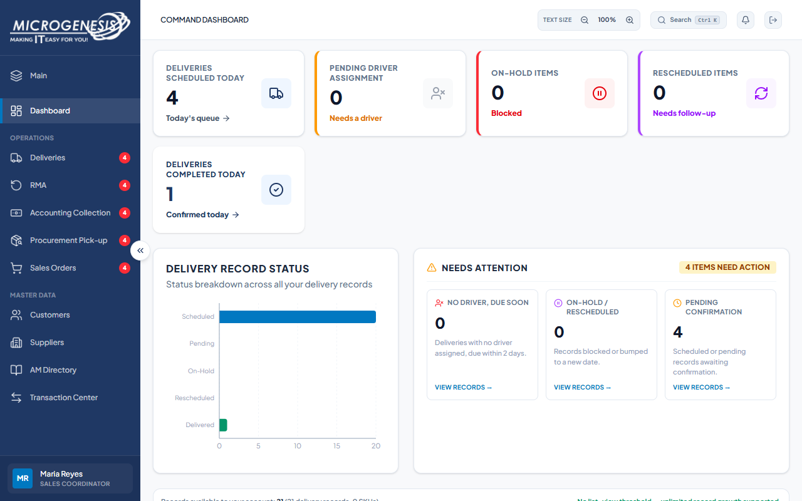

### DEF-006: Delivery creation accepts malformed dates

- **Severity / Priority:** Major / P2
- **Role and workflow step:** Sales Coordinator (TS-011)
- **What failed:** The create API accepted a malformed Delivery Date on two attempts instead of rejecting it; no validation refusal was returned.
- **Expected:** • HTTP 400 with an error naming the Delivery Date (e.g. "Delivery Date must be a valid YYYY-MM-DD date.").; • No record `UAT-<RUN>-NEG-03` exists. Fail (SI-04) if 201 is returned.
- **Impact:** Malformed dates can be stored on delivery records and undermine scheduling and reporting.
- **Linked cases:** TC-DEL-005
- **Full report:** [DEF-006 report](../05-defects/DEF-006-delivery-creation-accepts-malformed-dates.md)

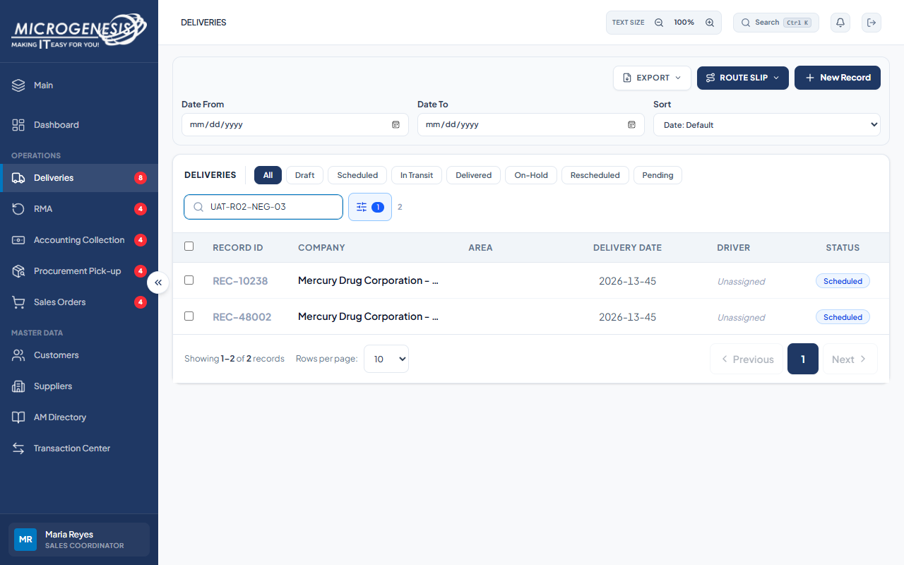

### DEF-007: Delivery creation accepts an unknown priority

- **Severity / Priority:** Major / P2
- **Role and workflow step:** Sales Coordinator (TS-011)
- **What failed:** The create API accepted an unknown Priority value and created the record.
- **Expected:** HTTP 400 "Invalid record priority." and no record created. Fail (SI-04) if 201 with priority "9 - Urgent".
- **Impact:** A record can be created with a priority value outside the approved business set.
- **Linked cases:** TC-DEL-006
- **Full report:** [DEF-007 report](../05-defects/DEF-007-delivery-creation-accepts-an-unknown-priority.md)

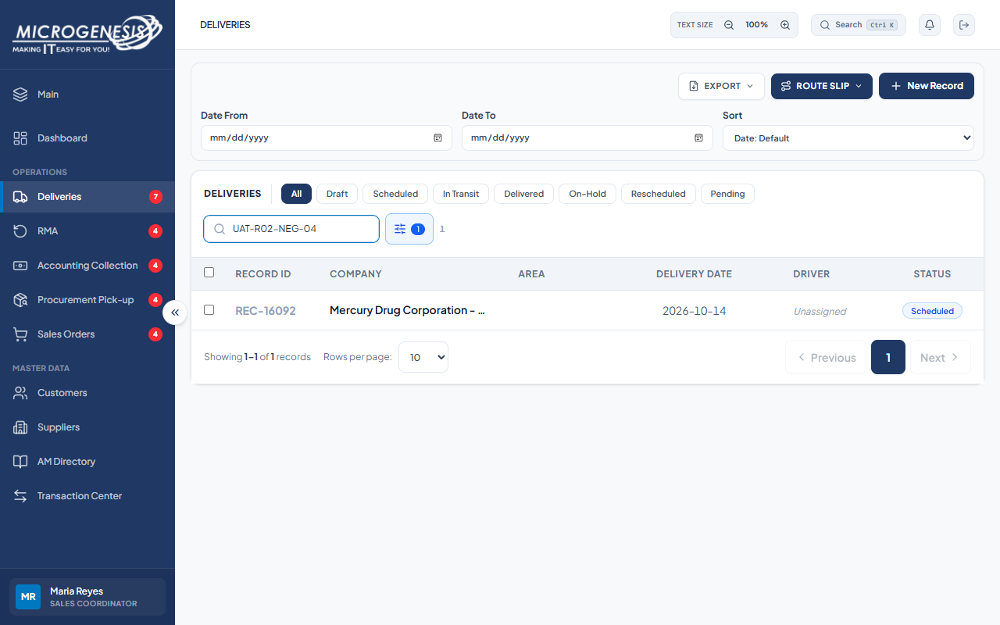

### DEF-008: Unknown company on delivery creation produces an internal server error

- **Severity / Priority:** Major / P2
- **Role and workflow step:** Sales Coordinator (TS-011)
- **What failed:** Creating with an unknown company produced HTTP 500 instead of a clean 400 validation response.
- **Expected:** Within 15 s an HTTP 4xx (400 or 404) naming the company. Fail if HTTP 500 "Internal server error" or no response within 15 s (record which).
- **Impact:** Invalid company references fail as a server error instead of a clear validation response.
- **Linked cases:** TC-DEL-007
- **Full report:** [DEF-008 report](../05-defects/DEF-008-unknown-company-on-delivery-creation-produces-an-internal-server-error.md)

No screenshot was retained.

### DEF-010: Logistics can submit a Draft through the status API

- **Severity / Priority:** Major / P1
- **Role and workflow step:** Logistics (TS-010)
- **What failed:** Logistics changed a Draft to Scheduled through the status API; the request returned HTTP 200. Sales restored the record to Draft through the normal UI after the observation.
- **Expected:** • Step 1: 403 "Only Sales Coordinator or Admin may submit or return drafts."; • Step 2: 403 with the same rule (Logistics may not submit drafts).; • Step 3: status is still "Draft". Fail (SI-03) if step 2 returns 200 and the record becomes "Scheduled"; user decision on OQ-06: Logistics must not submit drafts.
- **Impact:** Logistics can advance a Draft despite the approved rule that only Sales Coordinator or Admin may submit it.
- **Linked cases:** TC-DEL-022
- **Full report:** [DEF-010 report](../05-defects/DEF-010-logistics-can-submit-a-draft-through-the-status-api.md)

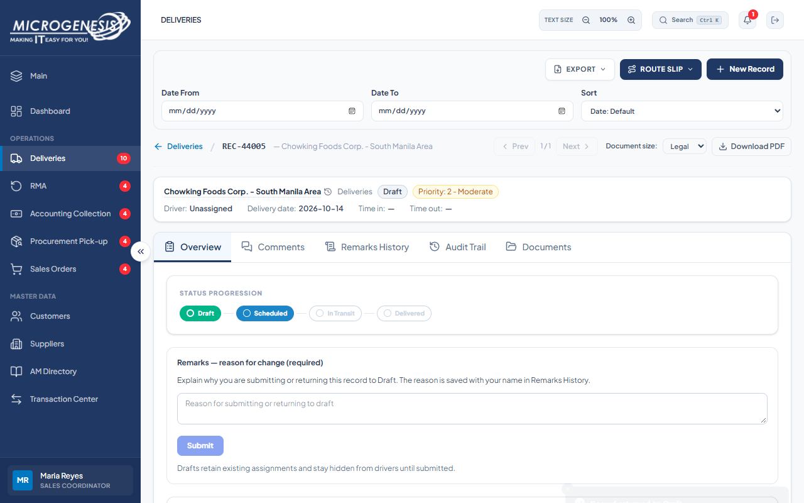

### DEF-011: Sales Coordinator can delete a delivery through the API

- **Severity / Priority:** Major / P1
- **Role and workflow step:** Sales Coordinator (TS-007)
- **What failed:** The refusal check instead deleted the test Draft. The record disappeared from the list; the case was not retried. This was the single authorized deletion probe, and no seeded record was targeted.
- **Expected:** • Step 1: refused with a 4xx (no record deletion is allowed: user decision on OQ-03, 2026-10-14).; • Step 2: 200; the record still exists.; • Step 3: the row is still listed.; • Fail (SI-26) if step 1 returns 200 `{"ok":true}` and the record disappears.
- **Impact:** The API permits deletion contrary to the user decision that records cannot be deleted; the test draft disappeared from the list.
- **Linked cases:** TC-DEL-024
- **Full report:** [DEF-011 report](../05-defects/DEF-011-sales-coordinator-can-delete-a-delivery-through-the-api.md)

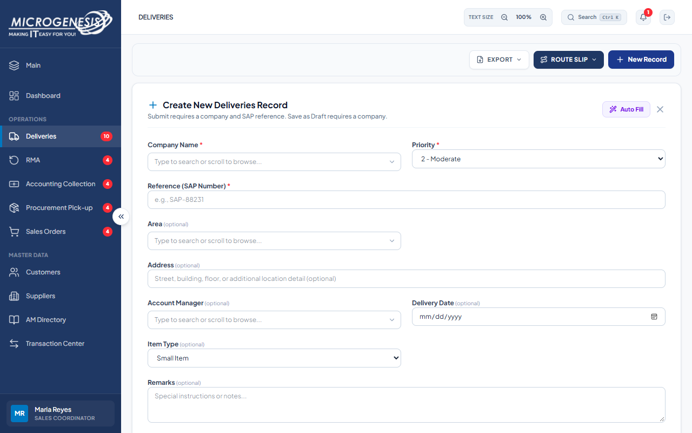

### DEF-017: Duplicate or invalid writes hang without a response across routes

- **Severity / Priority:** Major / P2
- **Role and workflow step:** Admin (TS-016); Sales Coordinator (TS-012); Admin (TS-014)
- **What failed:** Updating UAT Sales Two to existing sales@microgenesis.com left the row in a pending save state with a spinner beyond 15 seconds and no prompt error. / POST /api/customers with {"name":12345} produced no response within the 15-second timeout; the request remained unresolved. / The duplicate SKU code request received no response within 15 seconds instead of a 4xx duplicate-code error.
- **Expected:** Within 15 s an error says the email is already used; the row keeps its email. Fail (SI-05) if the save spins with no response or a generic failure dialog "Could not update user" with a 500. / Within 15 s an HTTP 4xx response. Fail (SI-05) if no response within 15 s or HTTP 500. / Within 15 s a 4xx (409 or 400) saying the SKU code exists. Fail (SI-05) on timeout or 500.
- **Impact:** Users can be left waiting indefinitely when duplicate or malformed writes trigger an unhandled rejection.
- **Linked cases:** TC-ADM-008, TC-MD-006, TC-SKU-004
- **Full report:** [DEF-017 report](../05-defects/DEF-017-duplicate-or-invalid-writes-hang-without-a-response-across-routes.md)

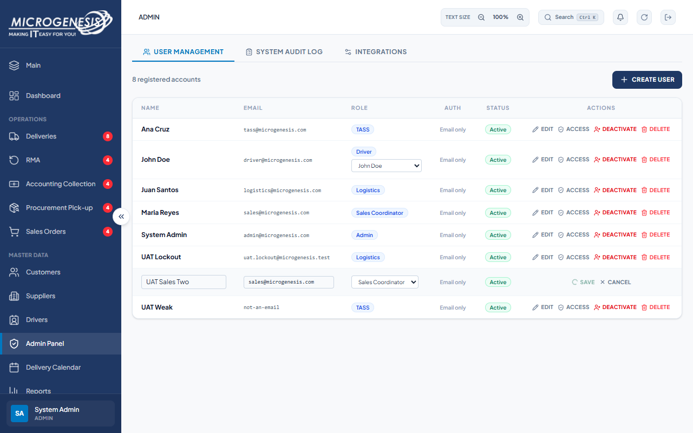

### DEF-019: Monthly Driver Report export omits per-delivery rows

- **Severity / Priority:** Major / P2
- **Role and workflow step:** Logistics (TS-015)
- **What failed:** The UI reported 28 records found and generated Microgenesis_Driver_Report_OCTOBER_2026.csv, but the CSV contained aggregate output and did not include the expected D-DEL-01 reference.
- **Expected:** Text "N delivery records found for <Month> <Year>" and a CSV download that includes `UAT-<RUN>-DEL-01`.
- **Impact:** The generated report omits the requested delivery reference needed to review the run.
- **Linked cases:** TC-DIR-014
- **Full report:** [DEF-019 report](../05-defects/DEF-019-monthly-driver-report-export-omits-per-delivery-rows.md)

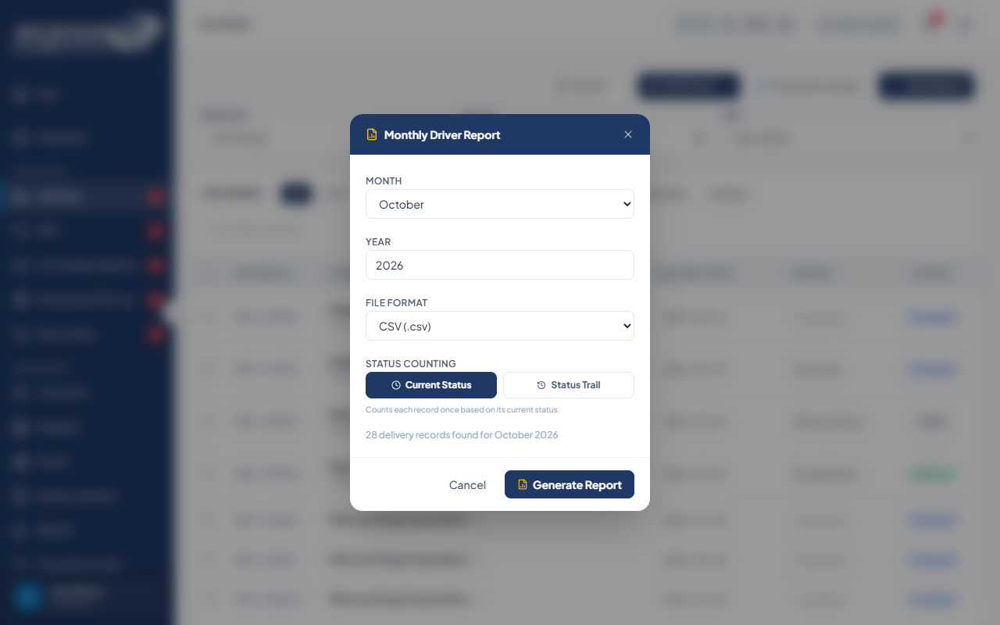

### DEF-021: Concurrent customer edit does not show the expected stale-edit conflict

- **Severity / Priority:** Major / P2
- **Role and workflow step:** Sales Coordinator (TS-012)
- **What failed:** The concurrent edit did not show the expected stale-edit conflict with latest value Lucia. The Sales form remained on Sofia with an unsaved change, and the expected load-latest action was not observed.
- **Expected:** • Logistics save succeeds.; • SC gets "Someone else saved changes to this customer after you opened it…" with "Discard my edits and load the latest values"; contact person stays "Lucia".
- **Impact:** A stale edit is not clearly reconciled with the latest customer value, creating a risk of lost updates.
- **Linked cases:** TC-MD-009
- **Full report:** [DEF-021 report](../05-defects/DEF-021-concurrent-customer-edit-does-not-show-the-expected-stale-edit-conflict.md)

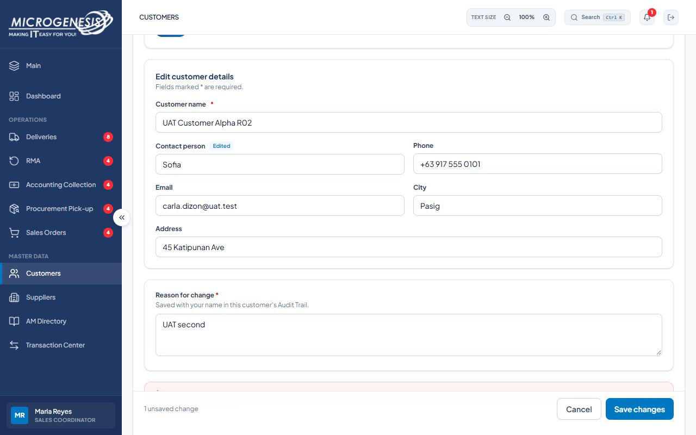

### DEF-024: Admin has no UI to create a SKU

- **Severity / Priority:** Major / P2
- **Role and workflow step:** Admin (TS-014)
- **What failed:** No SKU create control was available in the Admin UI. POST /api/skus succeeded with HTTP 201; the created SKU had On Hand 0 and Warehouse Zone A.
- **Expected:** • Step 1: a create control exists (BR-SKU-01). Fail (SI-18) if none.; • Step 2: 201; `inventory.on_hand_qty` 0, `warehouse_location` "Warehouse Zone A".; • Step 3: the SKU is listed with On Hand 0.
- **Impact:** The documented Admin SKU creation workflow cannot be completed in the application.
- **Linked cases:** TC-SKU-002
- **Full report:** [DEF-024 report](../05-defects/DEF-024-admin-has-no-ui-to-create-a-sku.md)

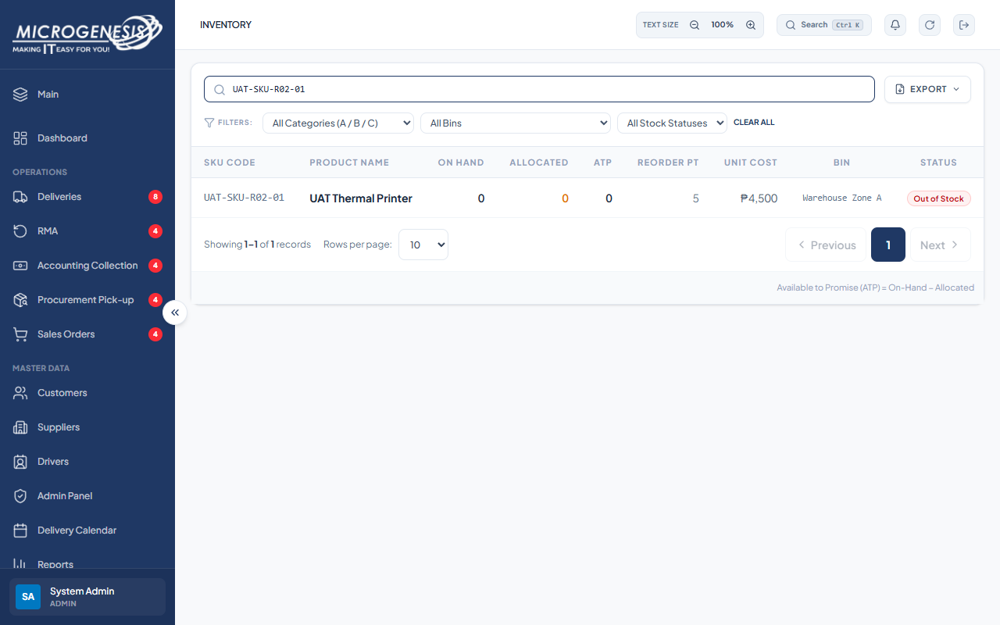

### DEF-025: SKU creation accepts negative and non-numeric price data

- **Severity / Priority:** Major / P2
- **Role and workflow step:** Admin (TS-014)
- **What failed:** POST /api/skus accepted unit_cost -5 and unit_price abc with HTTP 201; inventory had on_hand_qty 0, cost -5, and price null.
- **Expected:** • A 400 naming the invalid fields within 15 s.; • No SKU `UAT-SKU-<RUN>-NEG` exists. Fail (SI-06) if created, 500, or no response.
- **Impact:** Invalid cost and price values can enter inventory and affect purchasing or valuation workflows.
- **Linked cases:** TC-SKU-003
- **Full report:** [DEF-025 report](../05-defects/DEF-025-sku-creation-accepts-negative-and-non-numeric-price-data.md)

No screenshot was retained.

### DEF-026: Stock adjustment accepts an unrecognized type and posts quantity

- **Severity / Priority:** Major / P2
- **Role and workflow step:** Admin (TS-014)
- **What failed:** POST /api/skus/{id}/adjust with type Gift returned HTTP 200 and posted +1 stock; zero quantity and missing reference guards returned expected errors.
- **Expected:** • Step 1: "Quantity must be a non-zero number."; • Step 2: "Reference is required."; • Step 3: 400 (type must be Goods Receipt, Sale, Adjustment or Transfer). Fail (SI-07) if 200.
- **Impact:** An unrecognized free-text movement type changes stock outside the documented movement types.
- **Linked cases:** TC-SKU-008
- **Full report:** [DEF-026 report](../05-defects/DEF-026-stock-adjustment-accepts-an-unrecognized-type-and-posts-quantity.md)

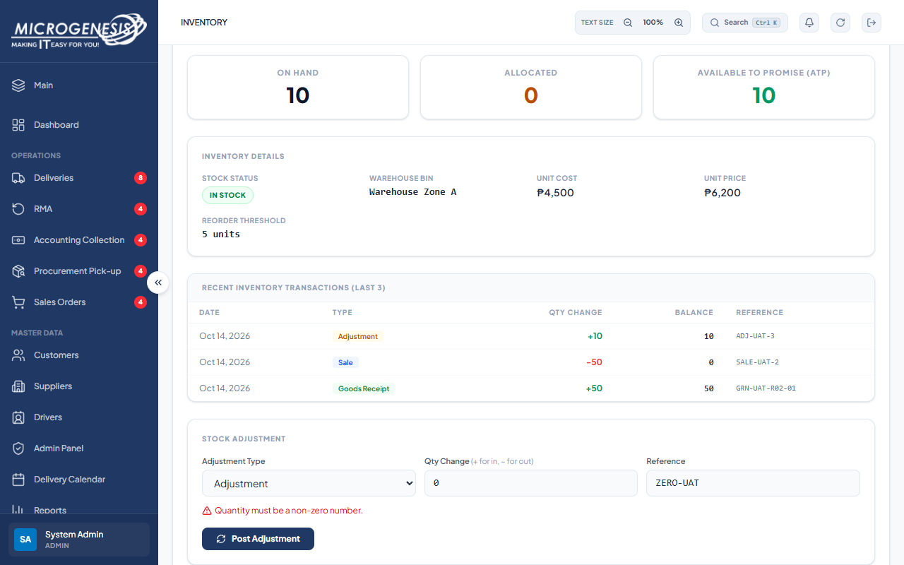

### DEF-029: Logistics Statistical Reports stays loading with request errors

- **Severity / Priority:** Major / P2
- **Role and workflow step:** Logistics (TS-015)
- **What failed:** The Logistics Reports page remained on Loading and the browser recorded 401/400 errors; the reversed-date step could not be submitted because its button was disabled. The separate Sales API check returned 403 {"error":"Module access denied"} (linked to DEF-003).
- **Expected:** • Step 1: cards "Delivery Date Cohort", "Delivered in Cohort", "Completed by Time Out" etc. with values ≥ 1 delivered.; • Step 2: an error (server "dateFrom must be on or before dateTo") and no stale results.; • Step 3: 200 with a summary (Sales Coordinator should have Reports per OQ-09). Fail (SI-25) if 403 "Module access denied".
- **Impact:** Logistics cannot obtain the expected delivery cohort report through the Reports page.
- **Linked cases:** TC-RPT-006
- **Full report:** [DEF-029 report](../05-defects/DEF-029-logistics-statistical-reports-stays-loading-with-request-errors.md)

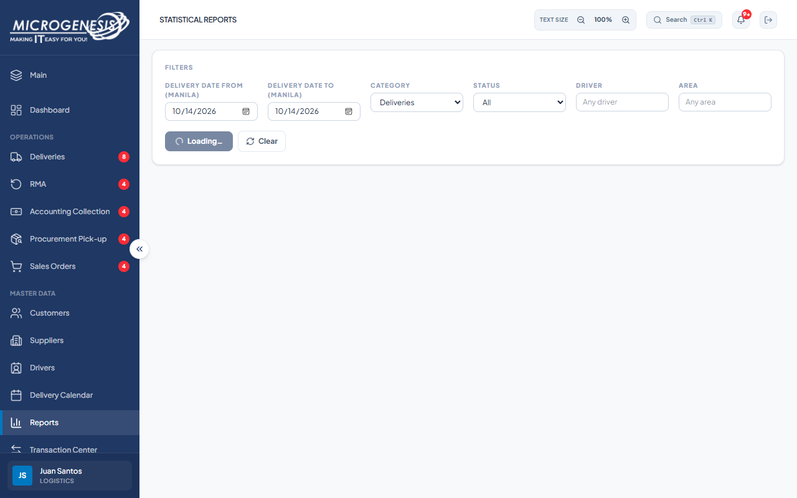

### DEF-001: Admin accepts malformed email and weak passwords

- **Severity / Priority:** Minor / P3
- **Role and workflow step:** Admin (TS-016)
- **What failed:** The Admin creation flow accepted malformed email not-an-email and a weak password for UAT Weak; the created user appeared Active. The account was later removed under TC-ADM-013.
- **Expected:** 400 naming the email format and/or password policy. Fail (SI-15) if 201.
- **Impact:** Invalid account data can enter the user directory; the test account was removed after the probe.
- **Linked cases:** TC-ADM-004
- **Full report:** [DEF-001 report](../05-defects/DEF-001-admin-accepts-malformed-email-and-weak-passwords.md)

No screenshot was retained.

### DEF-002: Admin required-field message differs from expectation

- **Severity / Priority:** Minor / P3
- **Role and workflow step:** Admin (TS-016)
- **What failed:** Submitting the empty user form showed a required-field message that did not match the expected Full Name wording.
- **Expected:** • "Name, email, and password are required".; • 400 "role must be one of: SALES_COORDINATOR, LOGISTICS, TASS, ADMIN, DRIVER".
- **Impact:** The form rejects an empty submission, but its message does not match the expected account setup wording.
- **Linked cases:** TC-ADM-006
- **Full report:** [DEF-002 report](../05-defects/DEF-002-admin-required-field-message-differs-from-expectation.md)

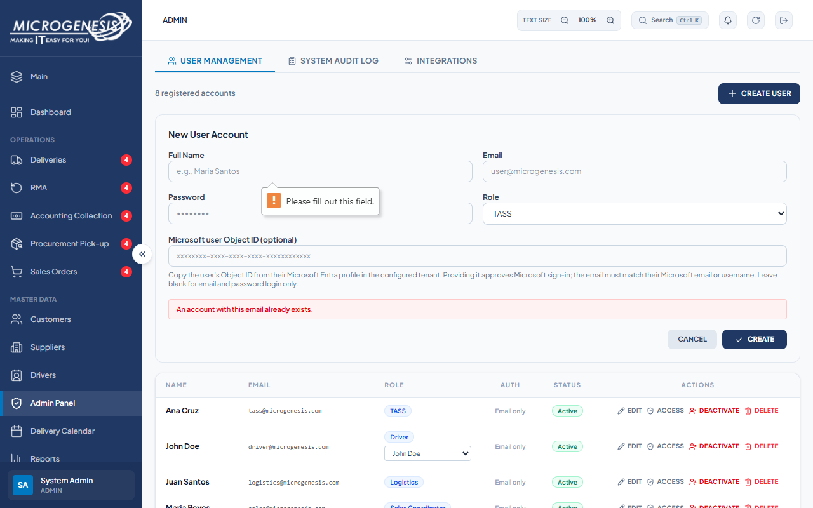

### DEF-004: Logistics RMA denial message differs from expected response

- **Severity / Priority:** Minor / P3
- **Role and workflow step:** Logistics (TS-010)
- **What failed:** Logistics was denied the RMA/admin actions, but the denial text differed from the expected message in the case.
- **Expected:** • Step 1: "This page is not available for your account." for both.; • Step 2: 403 `{"error":"Forbidden for this role"}`.; • Step 3: 403 `{"error":"Logistics has view-only access to RMA records"}`.; • Step 4: 403 `{"error":"Logistics has view-only access to RMA records"}`.
- **Impact:** Access remained denied, but the response does not explain the view-only RMA rule as specified.
- **Linked cases:** TC-ACC-004
- **Full report:** [DEF-004 report](../05-defects/DEF-004-logistics-rma-denial-message-differs-from-expected-response.md)

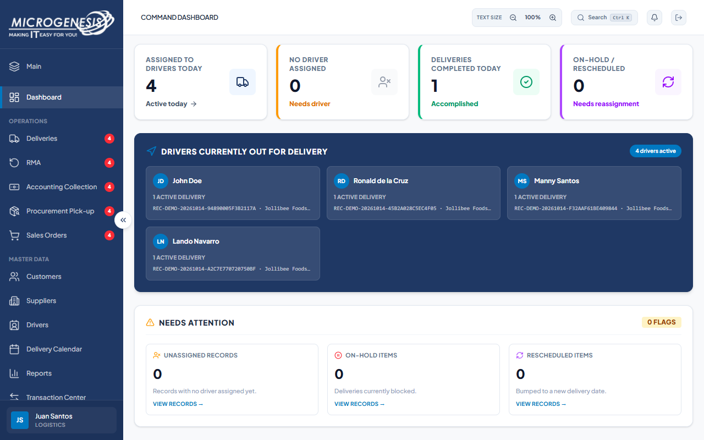

### DEF-009: Transaction Center status filter does not match displayed state

- **Severity / Priority:** Minor / P3
- **Role and workflow step:** Sales Coordinator (TS-014)
- **What failed:** Transaction Center status filtering did not consistently match displayed delivery status; the case exposed SI-16 status/date filter behavior.
- **Expected:** The Draft record D-DEL-03 is NOT listed under "Scheduled". Fail (SI-16) if it is.
- **Impact:** Users can see records in a status filter that does not correspond to the displayed workflow state.
- **Linked cases:** TC-TXN-006
- **Full report:** [DEF-009 report](../05-defects/DEF-009-transaction-center-status-filter-does-not-match-displayed-state.md)

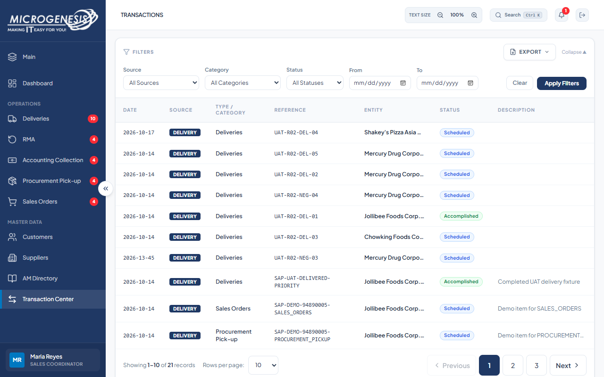

### DEF-013: User rename and activation changes are absent from audit log

- **Severity / Priority:** Minor / P2
- **Role and workflow step:** Admin (TS-016)
- **What failed:** The 2026-10-14 System Audit Log query returned 79 events and 9 UserPermission events, but zero User record-type events. Rename, deactivate, and activate actions on U-SC2 had no corresponding User audit rows.
- **Expected:** An audit entry exists for each user change. Fail (SI-10) if none exist.
- **Impact:** Admin user changes cannot be reconstructed from User audit rows during review.
- **Linked cases:** TC-ADM-010
- **Full report:** [DEF-013 report](../05-defects/DEF-013-user-rename-and-activation-changes-are-absent-from-audit-log.md)

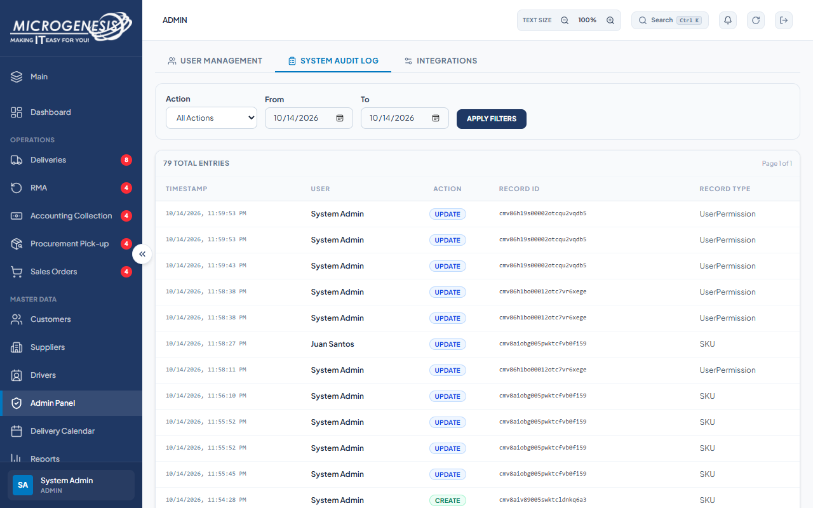

### DEF-014: Driver Manager count is stale after creating a linked login

- **Severity / Priority:** Minor / P3
- **Role and workflow step:** Admin (TS-016)
- **What failed:** After creating UAT Driver Two, Driver Manager initially showed Drivers (5) and omitted the profile. A manual reload changed the list to Drivers (6) and showed Login linked.
- **Expected:** • Step 1: Driver Manager shows "UAT Driver Two" with "Login linked".; • Step 2: warning "Sees no runs until linked." on the row.
- **Impact:** The new profile is initially omitted until a reload, so the roster briefly shows an incorrect count.
- **Linked cases:** TC-ADM-022
- **Full report:** [DEF-014 report](../05-defects/DEF-014-driver-manager-count-is-stale-after-creating-a-linked-login.md)

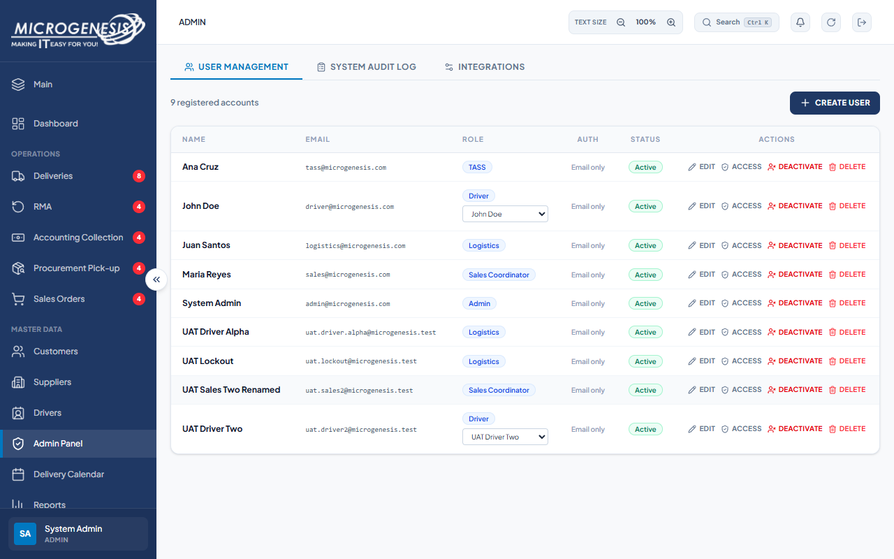

### DEF-015: Admin Records by Status chart omits delivered count

- **Severity / Priority:** Minor / P2
- **Role and workflow step:** Admin (TS-001)
- **What failed:** The audit trail showed expected creator and update events, but the Records by Status chart showed axes and labels including Delivered without a visible bar or count for the completed record.
- **Expected:** • D-DEL-01 has CREATE by Maria Reyes and UPDATEs by Maria Reyes, Juan Santos and John Doe (assignment, priority, Time In, completion), in time order.; • The record Audit Trail shows the same events.; • "Records by Status" includes the delivered status (ACCOMPLISHED) with a count of at least 1.
- **Impact:** Admin cannot rely on the dashboard chart for delivery status totals.
- **Linked cases:** TC-ADM-023
- **Full report:** [DEF-015 report](../05-defects/DEF-015-admin-records-by-status-chart-omits-delivered-count.md)

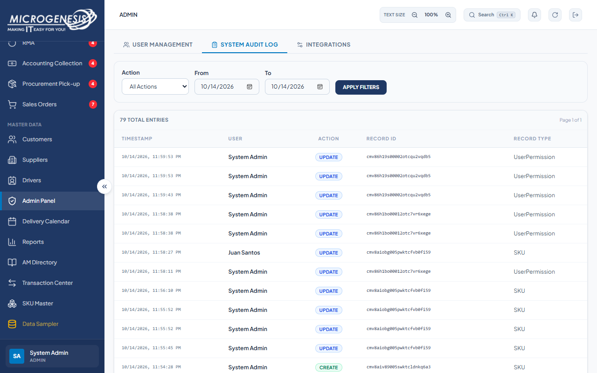

### DEF-016: Temporary access request claims an Admin was notified when none was shown

- **Severity / Priority:** Minor / P2
- **Role and workflow step:** Sales Coordinator (TS-010)
- **What failed:** Sales saw Request Sent and Your admin has been notified. Admin Notifications showed No notifications yet; no request notification appeared. Maria Reyes access was reset to role defaults and the Deliveries sidebar entry returned.
- **Expected:** • Step 2 shows "Request Sent" and "Your admin has been notified."; • Step 3: the Admin has a new notification about the request. (Fail if no notification or request record exists anywhere: SI-19.)
- **Impact:** Sales receives false confirmation that access was escalated, delaying access restoration.
- **Linked cases:** TC-ACC-016
- **Full report:** [DEF-016 report](../05-defects/DEF-016-temporary-access-request-claims-an-admin-was-notified-when-none-was-shown.md)

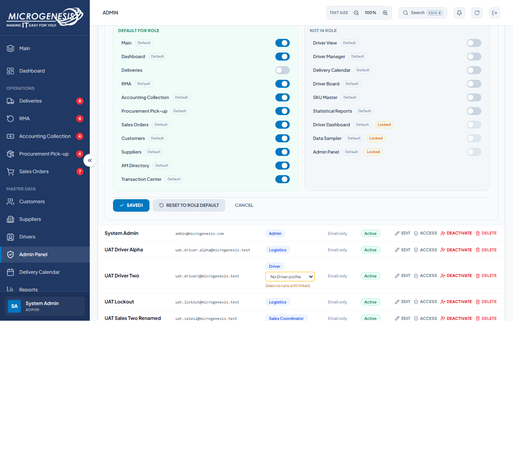

### DEF-018: Calendar and AM Directory display internal IDs instead of references

- **Severity / Priority:** Minor / P3
- **Role and workflow step:** Logistics (TS-013); Sales Coordinator (TS-015)
- **What failed:** The October 14 calendar popup listed 27 records and included the correct record, but displayed internal ID REC-47964 where UAT-R02-DEL-01 was expected. / AM Directory showed the expected manager summary but expanded the record as REC-47964 instead of UAT-R02-DEL-01.
- **Expected:** • The popup lists "N records" for today including `UAT-<RUN>-DEL-01`.; • The record workspace opens. / Card shows Total/Done/Active; "All Records (N)" includes `UAT-<RUN>-DEL-01`.
- **Impact:** Users must reconcile internal IDs with delivery references to identify the intended delivery.
- **Linked cases:** TC-DIR-011, TC-RPT-008
- **Full report:** [DEF-018 report](../05-defects/DEF-018-calendar-and-am-directory-display-internal-ids-instead-of-references.md)

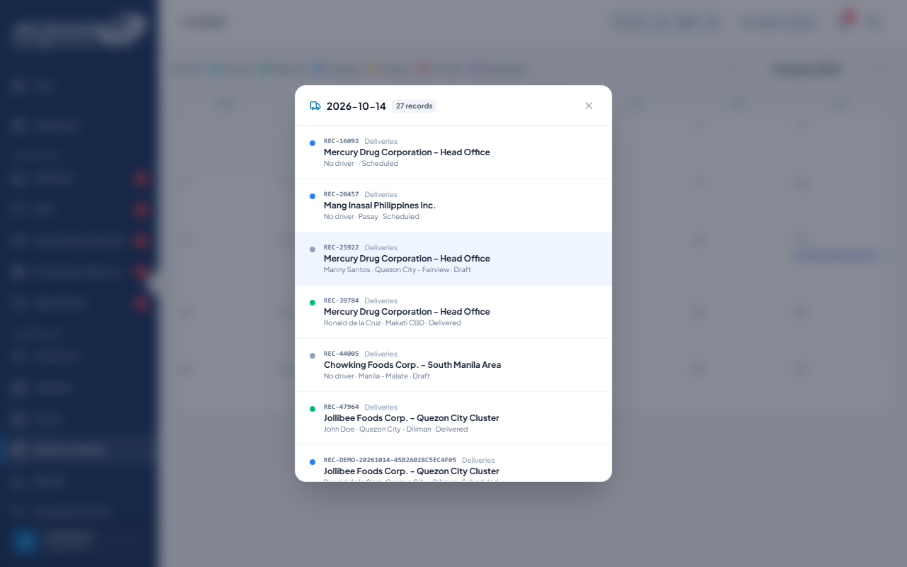

### DEF-020: Customer creation accepts invalid email and phone values

- **Severity / Priority:** Minor / P3
- **Role and workflow step:** Sales Coordinator (TS-012)
- **What failed:** The create form accepted invalid email not-an-email and phone CALL-ME!! through browser-native validation, without the expected application email and phone errors.
- **Expected:** Refused with "Enter a valid email address, like name@company.com." (and a phone error). Fail (SI-12) if the customer is created.
- **Impact:** Malformed contact information is stored and may prevent reliable customer communication.
- **Linked cases:** TC-MD-005
- **Full report:** [DEF-020 report](../05-defects/DEF-020-customer-creation-accepts-invalid-email-and-phone-values.md)

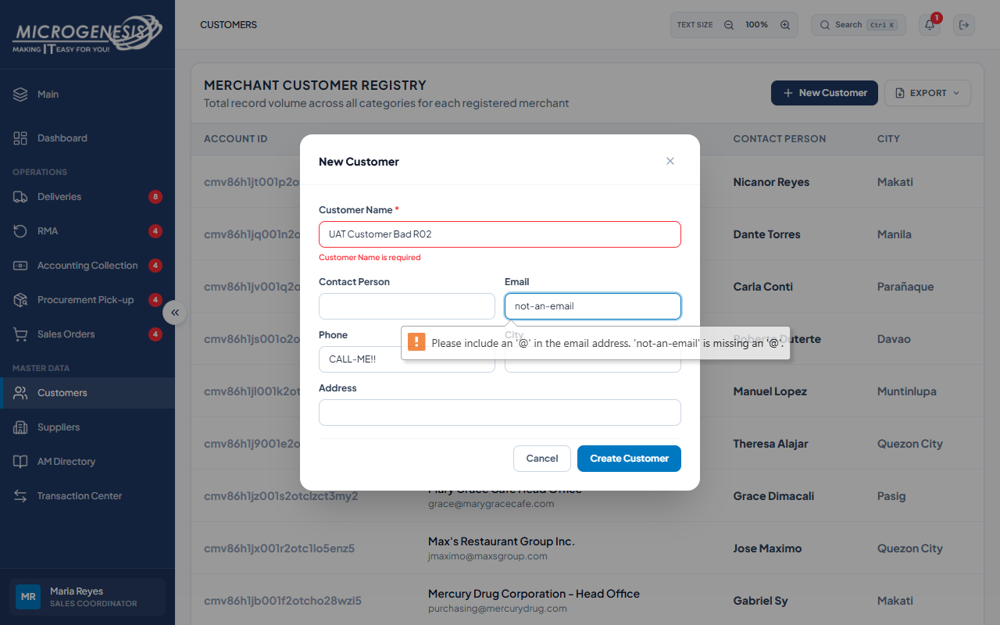

### DEF-023: SKU Clear All does not restore the inventory list

- **Severity / Priority:** Minor / P3
- **Role and workflow step:** Admin (TS-014)
- **What failed:** The search returned No matching SKU inventory entries found. Try adjusting your filters. Clear All did not restore the SKU list.
- **Expected:** • Columns: SKU Code, Product Name, On Hand, Allocated, ATP, Reorder Pt, Unit Cost, Bin, Status.; • Search shows "No matching SKU inventory entries found. Try adjusting your filters."; "Clear All" restores the list.
- **Impact:** Admin cannot return from a no-match search to the full SKU inventory in the current view.
- **Linked cases:** TC-SKU-001
- **Full report:** [DEF-023 report](../05-defects/DEF-023-sku-clear-all-does-not-restore-the-inventory-list.md)

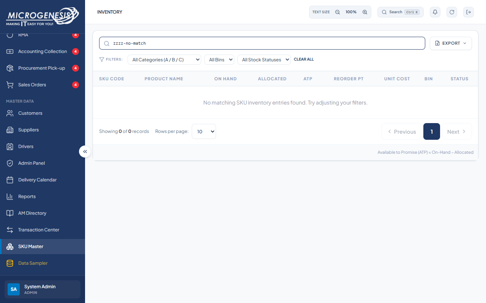

### DEF-027: Admin dashboard reports zero active users while eight are active

- **Severity / Priority:** Minor / P3
- **Role and workflow step:** Admin (TS-015)
- **What failed:** The Admin dashboard showed Total Active Users as 0 while User Management showed 8 active seeded/test accounts at that point in the run.
- **Expected:** • "Total Active Users" equals the Active count.; • "View Full Log →" opens "System Audit Log".
- **Impact:** The dashboard gives an incorrect active-user count.
- **Linked cases:** TC-RPT-005
- **Full report:** [DEF-027 report](../05-defects/DEF-027-admin-dashboard-reports-zero-active-users-while-eight-are-active.md)

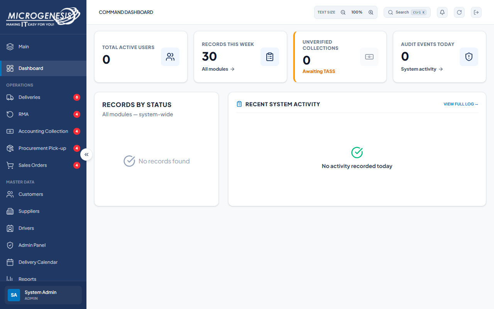

### DEF-028: Admin dashboard View Full Log does not open System Audit Log

- **Severity / Priority:** Minor / P3
- **Role and workflow step:** Admin (TS-015)
- **What failed:** The Admin dashboard showed Total Active Users as 0 while User Management showed 8 active seeded/test accounts at that point in the run.
- **Expected:** • "Total Active Users" equals the Active count.; • "View Full Log →" opens "System Audit Log".
- **Impact:** Admins cannot follow the dashboard shortcut to the audit review screen.
- **Linked cases:** TC-RPT-005
- **Full report:** [DEF-028 report](../05-defects/DEF-028-admin-dashboard-view-full-log-does-not-open-system-audit-log.md)

### DEF-030: Global search Enter leaves the result overlay open

- **Severity / Priority:** Minor / P3
- **Role and workflow step:** Logistics (TS-015)
- **What failed:** One-character search showed the minimum-length prompt and the full reference produced one delivery result, but pressing Enter left the overlay open and did not open the record.
- **Expected:** • With one character: "Type at least 2 characters to search".; • Group "Delivery Records (1)"; Enter opens the record.
- **Impact:** A matching record is found but keyboard navigation does not open it.
- **Linked cases:** TC-RPT-009
- **Full report:** [DEF-030 report](../05-defects/DEF-030-global-search-enter-leaves-the-result-overlay-open.md)

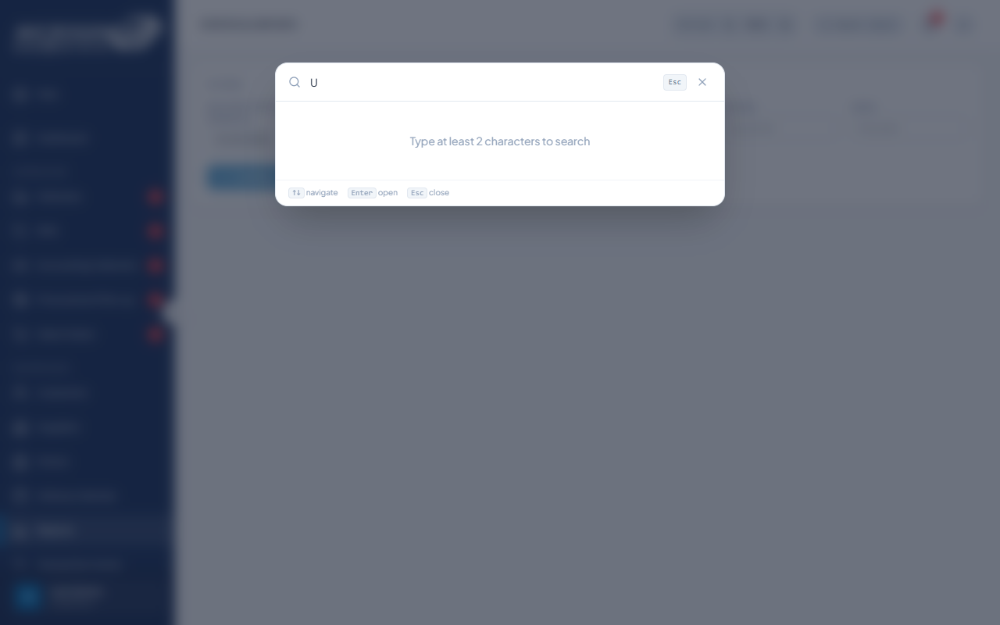

### DEF-031: Notification badge stays 9+ after marking one item read

- **Severity / Priority:** Minor / P3
- **Role and workflow step:** Logistics (TS-015)
- **What failed:** After one notification was marked read, read controls fell from 13 to 12 while the navbar badge remained 9+.
- **Expected:** Badge decreases by 1; the item shows as read.
- **Impact:** The unread badge does not reflect the changed read state above its display threshold.
- **Linked cases:** TC-NOT-003
- **Full report:** [DEF-031 report](../05-defects/DEF-031-notification-badge-stays-9-after-marking-one-item-read.md)

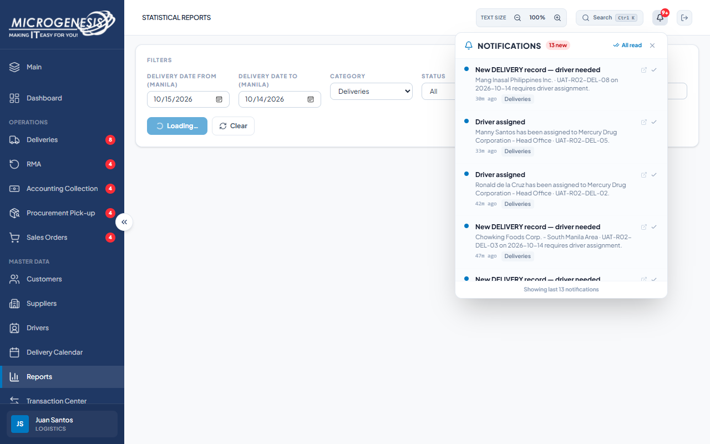

### DEF-032: PDF attachment cannot be saved before delivery completion

- **Severity / Priority:** Minor / P3
- **Role and workflow step:** Logistics (TS-002)
- **What failed:** With only the PDF staged and no delivery photo or Received By value, the expected intermediate save could not be completed because Save Changes was disabled. The PDF and photo were persisted only with the later successful completion.
- **Expected:** • Step 1: 400 "Upload at least one JPG or PNG delivery photo before marking this delivery Accomplished."; • Step 2: "Upload at least one JPG or PNG delivery photo before completing this delivery. Documents alone do not count." (and "Received By is required before completing this run.") with Save disabled.; • Step 3: the PDF is listed under "Saved Attachments" but the photo message remains.; • Step 4: 400 "Received By is required before completing this run."; • Step 5: status "Delivered"; "Time Out (Manila)" filled with the current time; Received By "Liza Ramos".
- **Impact:** The case expected an intermediate document save, but Save Changes remained disabled until completion requirements were met.
- **Linked cases:** TC-DEL-038
- **Full report:** [DEF-032 report](../05-defects/DEF-032-pdf-attachment-cannot-be-saved-before-delivery-completion.md)

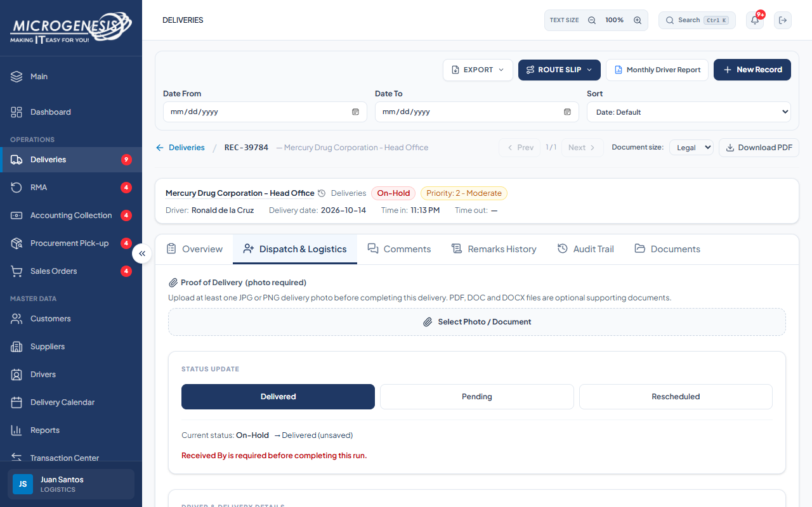

### DEF-005: Delivery Date is labeled optional while submission requires it

- **Severity / Priority:** Trivial / P4
- **Role and workflow step:** Sales Coordinator (TS-011)
- **What failed:** The create form labeled Delivery Date optional, but Submit displayed Delivery Date is required.
- **Expected:** • Step 2 shows "Delivery Date is required" and creates nothing.; • Step 1: the label marks the field as required (e.g. "Delivery Date *"). Fail (SI-21) if the label reads "Delivery Date (optional)".
- **Impact:** The contradictory label can cause avoidable form errors; supplying a date allows the workflow to continue.
- **Linked cases:** TC-DEL-004
- **Full report:** [DEF-005 report](../05-defects/DEF-005-delivery-date-is-labeled-optional-while-submission-requires-it.md)

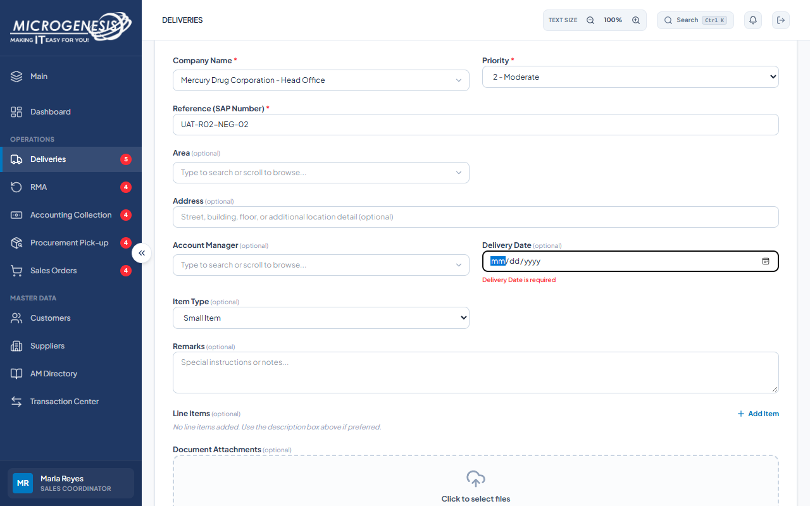

### DEF-012: Audit action filter ignores LINK_LOGIN

- **Severity / Priority:** Trivial / P4
- **Role and workflow step:** Admin (TS-016)
- **What failed:** The UI action filter offered only CREATE, UPDATE, DELETE. GET /api/admin/audit-log?action=LINK_LOGIN returned HTTP 200 with 50 entries and included LINK_LOGIN, UPDATE, and CREATE, so the requested filter was ignored.
- **Expected:** Filtering by LINK_LOGIN returns only LINK_LOGIN entries. Fail (SI-11) if the UI lacks the option and the API returns other actions.
- **Impact:** Admins cannot narrow the audit log to login-linking events, though these events remain visible unfiltered.
- **Linked cases:** TC-ADM-016
- **Full report:** [DEF-012 report](../05-defects/DEF-012-audit-action-filter-ignores-link-login.md)

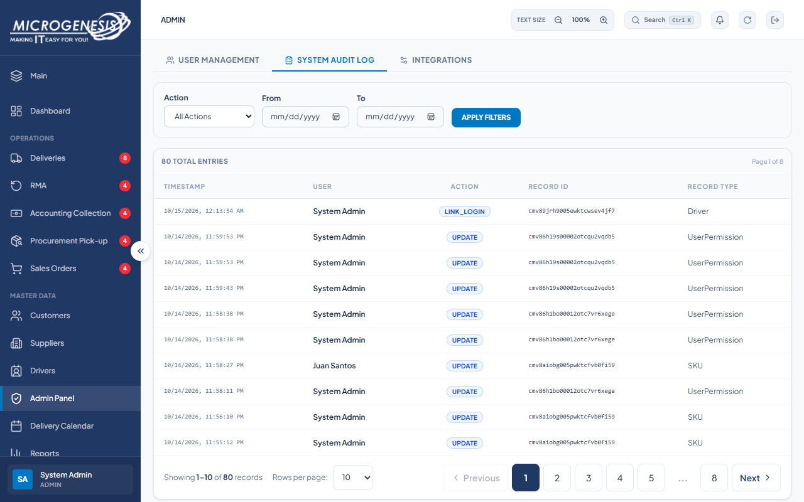

### DEF-022: Supplier creation accepts an undocumented category

- **Severity / Priority:** Trivial / P4
- **Role and workflow step:** Sales Coordinator (TS-012)
- **What failed:** POST /api/suppliers with category Gadgets returned HTTP 201 instead of expected HTTP 400.
- **Expected:** • Step 1: row "UAT Supplier Alpha <RUN>" with Category Electronics.; • Step 2: "Supplier Name is required".; • Step 3: 400 (unknown category). Fail (SI-13) if 201.
- **Impact:** The supplier directory can contain category labels outside the documented list.
- **Linked cases:** TC-MD-010
- **Full report:** [DEF-022 report](../05-defects/DEF-022-supplier-creation-accepts-an-undocumented-category.md)

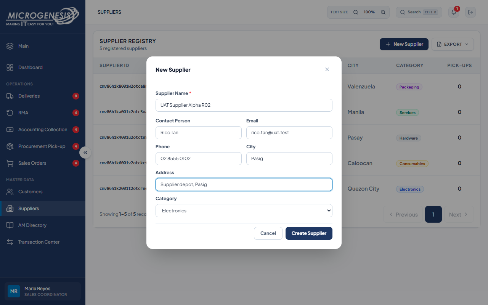

## 6. Open defects by severity

| Severity | Count | Defect IDs |
|---|---|---|
| Critical | 0 | — |
| Major | 13 | DEF-003, DEF-006, DEF-007, DEF-008, DEF-010, DEF-011, DEF-017, DEF-019, DEF-021, DEF-024, DEF-025, DEF-026, DEF-029 |
| Minor | 16 | DEF-001, DEF-002, DEF-004, DEF-009, DEF-013, DEF-014, DEF-015, DEF-016, DEF-018, DEF-020, DEF-023, DEF-027, DEF-028, DEF-030, DEF-031, DEF-032 |
| Trivial | 3 | DEF-005, DEF-012, DEF-022 |

## 7. Suspected issues from discovery: confirmation status

| SI ID | Covering case(s) | Outcome | Defect ID |
|---|---|---|---|
| SI-01 | TC-ACC-006, TC-PRC-006 | Not Run — TASS/Pick-up scope cases deferred. | — |
| SI-02 | TC-RPT-003, TC-RPT-004 | Pass for Sales per-user denial; TASS dashboard case deferred. | — |
| SI-03 | TC-DEL-022, TC-RMA-008 | Fail — DEF-010. | DEF-010 |
| SI-04 | TC-DEL-005, TC-DEL-006, TC-DEL-007 | Fail — DEF-006, DEF-007 and DEF-008. | DEF-006, DEF-007, DEF-008 |
| SI-05 | TC-SKU-004, TC-ADM-008, TC-MD-006 | Fail — DEF-017. | DEF-017 |
| SI-06 | TC-SKU-003, TC-SKU-005 | Fail for invalid numeric fields — DEF-025; transaction atomicity not directly verified. | DEF-025 |
| SI-07 | TC-SKU-008 | Fail — DEF-026. | DEF-026 |
| SI-08 | TC-COL-006, TC-DEL-024 | Not Run — collection case deferred; deletion probe stopped after the test record disappeared. | — |
| SI-09 | TC-NOT-007 | Not Run — email cases deferred. | — |
| SI-10 | TC-ADM-010 | Fail — DEF-013. | DEF-013 |
| SI-11 | TC-ADM-016 | Fail — DEF-012. | DEF-012 |
| SI-12 | TC-MD-005 | Fail — DEF-020. | DEF-020 |
| SI-13 | TC-MD-010 | Fail — DEF-022. | DEF-022 |
| SI-14 | TC-RMA-006 | Not Run — RMA case deferred. | — |
| SI-15 | TC-ADM-004 | Fail — DEF-001. | DEF-001 |
| SI-16 | TC-TXN-006 | Fail — DEF-009. | DEF-009 |
| SI-17 | TC-RMA-003 | Not Run — RMA case deferred. | — |
| SI-18 | TC-SKU-002 | Fail — DEF-024. | DEF-024 |
| SI-19 | TC-ACC-016 | Fail — DEF-016. | DEF-016 |
| SI-20 | TC-COL-008 | Not Run — Accounting Collection case deferred. | — |
| SI-21 | TC-DEL-004 | Fail — DEF-005. | DEF-005 |
| SI-22 | TC-ACC-010 | Not Run — TASS New Delivery case deferred. | — |
| SI-23 | TC-COL-007 | Not Run — Admin collection verification deferred. | — |
| SI-24 | TC-DEL-025 | Pass — user decision resolved it; TC-DEL-025 found no UI delete control. | — |
| SI-25 | TC-ACC-001, TC-ACC-002, TC-RPT-006 | Fail — DEF-003. | DEF-003 |
| SI-26 | TC-DEL-024 | Fail — DEF-011. | DEF-011 |

## 8. Risks and observations

- The UI showed “Email sent to: C. Lim”; the user confirmed that notice was mocked. Bulk-delivery cases proceeded on that basis. Email-specific cases remained deferred, and no email test endpoint was invoked.
- TC-POD-006: Cancel preserved all 10 attachments. The user approved one removal. After both endpoints returned HTTP 200, the UI removed `uat-photo.png` (attachment `cmv8c1ze70081wktc7vor2aku`), displayed “Attachment removed” and “9 FILES”, and Audit Trail showed the 1:07 PM Maria Reyes entry. See [restored preflight](../artifacts/RUN-20261014-02/TC-POD-006-04-resume-preflight-restored.md) and [removal verification](../artifacts/RUN-20261014-02/TC-POD-006-05-removal-and-audit-verification.md). Screenshots were captured in the UI session and displayed in the QA conversation; the browser security policy blocked local PNG export, so only the earlier confirmation and Cancel screenshots are retained in the artifact folder.
- Exact per-case execution times were not recorded. The log uses approximate artifact file timestamps when available. No Playwright traces or HAR files were retained. Only some role sign-in console transcripts exist; finding-specific console and server logs were not retained. API-only observations without JSON artifacts are described in case records.
- TC-DEL-038's failed intermediate PDF-save expectation is recorded as observed; confirm that saving a supporting PDF before completion is a business rule before treating it as a release blocker.
- Existing local services and the single approved seed were reused. No source, configuration, environment or data cleanup was performed; the sandbox retains the run state.

## 9. Recommendation

**No-Go for sign-off.** The critical TS-001 end-to-end scenario failed at TC-ADM-023, which is a No-Go condition under Test Plan §11. The run also has 35 failed cases and 13 open Major defects, including missing approved Sales access, invalid data accepted by APIs, Logistics submitting Drafts, unrecognized stock adjustments changing inventory, and delivery deletion contrary to the user's decision. TC-POD-006 passed and is no longer a blocker.

## 10. Sign-off

| Role | Name | Decision | Date | Signature |
|---|---|---|---|---|
| UAT executor | ChatGPT Codex | Draft submitted | 2026-10-15 | n/a |
| UAT sign-off authority | (user) | Go / Conditional Go / No-Go | | |
