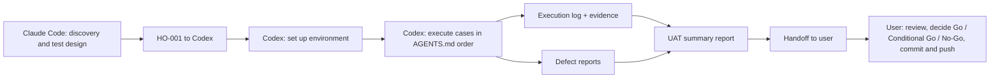

# Quality Assurance Workspace

| Document control | |
|---|---|
| Title | Quality Assurance Workspace: README |
| Document ID | QA-README-001 |
| Version | 1.1 |
| Date | 2026-10-14 |
| Author agent | Claude Code |
| Status | In force |

## Current acceptance addenda

- [V1 dashboard screen, resource and category permissions — accepted 2026-11-04](06-reports/2026-11-04-v1-dashboard-access-acceptance.md). Includes manual cases and verification limits; live execution remains pending.

## Purpose

This folder is the single, organized workspace for **User Acceptance Testing (UAT) of the Microgenesis Supply Chain Portal as it exists today**. It is a findings-only exercise: the goal is to establish what passes and what fails. Nobody here fixes the system; failures are recorded and reported to the user.

It is written for AI agents (and readable by humans):

| Party | Does |
|---|---|
| Claude Code | Test designer: discovery, plan, scenarios, cases, data, traceability, templates, initial handoff |
| ChatGPT Codex | Test executor and reporter: runs the cases, captures evidence, writes logs, defect reports, summary reports, handoffs. **Start with [`AGENTS.md`](AGENTS.md).** |
| The user | UAT sign-off authority; supplies environment and passwords; reviews; commits and pushes everything manually |

Documentation follows ISO/IEC/IEEE 29119-3 (test plan, test design, test case, test data, traceability, execution log, incident report, completion report) with ISTQB terminology.

## Structure

```
quality-assurance/
├── README.md                  # This file: purpose, structure, workflow, conventions
├── AGENTS.md                  # Operating manual for Codex (and any executing agent)
├── 00-discovery/
│   ├── system-overview.md     # System model with code references, role matrix, state diagrams
│   └── open-questions.md      # Suspected issues (SI-xx) and open questions (OQ-xx)
├── 01-plan/
│   └── uat-test-plan.md       # Scope, approach, criteria, severity, risks, sign-off
├── 02-test-design/
│   ├── test-scenarios.md      # TS-001..TS-017
│   ├── test-cases/            # TC-<MODULE>-*.md, one file per module/workflow
│   ├── test-data.md           # Accounts, data keys, fixtures, negative values
│   └── traceability-matrix.md # Requirement/rule → scenario → case
├── 03-handoffs/               # HO-<NNN>-<from>-to-<to>-<topic>.md
├── 04-execution/              # Codex: one subfolder per run with its execution log
├── 05-defects/                # Codex: one file per defect
├── 06-reports/                # Codex: UAT summary reports
├── e2e/                       # Codex: self-contained Playwright evidence-capture scripts
├── artifacts/                 # Codex: screenshots, traces, logs (one subfolder per run)
└── templates/                 # Execution log, defect report, summary report, handoff
```

## Workflow



1. Read `03-handoffs/` for the latest handoff addressed to you.
2. Codex executes per `AGENTS.md`, writing only inside this folder.
3. Codex writes the summary report and a handoff to the user.
4. The user reviews and decides; any retest is a new run (`RUN-<YYYYMMDD>-<NN+1>`).

## Conventions

| Topic | Convention |
|---|---|
| File naming | kebab-case with ID prefixes: `TC-`, `TS-`, `DEF-`, `HO-`, `RUN-` |
| Test case IDs | `TC-<MODULE>-<NNN>`; modules AUTH, ACC, DEL, DRV, POD, RMA, COL, PRC, SO, DIR, MD, SKU, TXN, RPT, NOT, ADM |
| Scenario IDs | `TS-<NNN>` |
| Run folders | `04-execution/RUN-<YYYYMMDD>-<NN>/` |
| Evidence naming | `artifacts/RUN-<YYYYMMDD>-<NN>/<TC-ID>-<step>-<short-desc>.<ext>` |
| Defects | `05-defects/DEF-<NNN>-<short-desc>.md` |
| Handoffs | `03-handoffs/HO-<NNN>-<from>-to-<to>-<topic>.md`, each with: from, to, date, status, summary, what was done, what is needed next, open issues, links |
| Status vocabulary | **Pass, Fail, Blocked, Not Run** (no other values) |
| Severity vocabulary | **Critical, Major, Minor, Trivial** (definitions in the Test Plan §14) |
| Priority vocabulary | P1, P2, P3, P4 |
| Document header | Every document starts with a document-control table (title, version, date, author agent, status) |
| Dates and times | `YYYY-MM-DD`, Asia/Manila |
| Code references | `path:line` relative to the repository root |
| Secrets | Never recorded anywhere in this folder (passwords, cookies, tokens, `.env` values) |
| Git | No branches, no commits, no pushes by agents; the user commits manually |

## Status of this package

| Item | Count |
|---|---|
| Scenarios | 17 |
| Test cases | 213 in 16 files: 170 run in cycle 1, 43 deferred (user decision 2026-10-14: Deliveries focus) |
| Suspected issues | 26 (SI-01..SI-26); SI-24 resolved; 7 wait for deferred cases |
| Open questions | 9, all answered 2026-10-14 (see `00-discovery/open-questions.md` §0) |
| Out of scope | Microsoft SSO login (by decision), scheduled reminders, destructive resets, Teams packaging; deferred in cycle 1: RMA, Accounting Collection, Procurement Pick-up, Sales Orders, TASS-specific behaviour, completion email |

## Current automation

Confirmed major issues were remediated under the user's 2026-10-16 authorization and automated validation passed (239 server tests; 27 reported client test files; both TypeScript checks). See the [remediation record and browser acceptance checklist](06-reports/2026-10-16-major-issues-remediation.md) for the working-tree implementation and live acceptance still needed. Earlier open findings and run counts are historical and do not describe whether a later fix has passed live acceptance.

Latest policy clarification (2026-10-16): Calendar and Reports are intentionally disabled by default for Sales Coordinator and work after Admin grants them per account. DEF-003 is closed by this user clarification; historical run counts are unchanged. See [current scope and clarification](06-reports/2026-10-16-scope-and-sales-access-clarification.md) before interpreting the earlier Sales-access failures.

Use the [QA automation README](e2e/README.md) for the canonical suites, runtime credentials, evidence and run commands. The user authorized a Microsoft account smoke on 2026-10-15; this updates the earlier SSO exclusion for that account only. See [implementation remediation](06-reports/automation-remediation.md) for corrected reporting and remaining live validation.
